# Phase 1 — WordPress on EC2 (Complete Hands-on Guide & Notes)

---

<details>
<summary><h3>🧠 Conceptual Foundations, Architecture & Trade-offs (Click to Expand)</h3></summary>

## What it does

EC2 is a rented virtual server — a bare machine with an IP address and nothing pre-installed. In this phase, we launch an Ubuntu LTS instance on `t3.micro` in `ap-south-1` (Mumbai) and build the entire LAMP/LEMP stack by hand: **Nginx, MySQL, PHP 8.5, and WordPress**.

---

## Why EC2 over managed hosting (Trade-offs)

- **Why choose it:** Full control of the entire stack — custom PHP versions, tailored Nginx configs, custom extensions, and direct Linux system access. It is also significantly cheaper at baseline.
- **The Trade-off:** Uptime, security patching, OS updates, backups, firewall configurations, and performance tuning become completely our responsibility. For a simple brochure site, managed hosting saves time; EC2 earns its keep when you need custom control, cost efficiency, or intend to scale horizontally.

</details>

---

<details>
<summary><h3>⚙️ Part 1: The AWS Onboarding Activity ($20 Credit Lifecycle Test) (Click to Expand)</h3></summary>

## Part 1: The AWS Onboarding Activity ($20 Credit Lifecycle Test)

Before setting up the production WordPress server, we completed the AWS official **"Launch an instance using EC2"** guided activity. This gave us hands-on practice with the complete lifecycle of a cloud instance (Provisioning → Connecting → Terminating/Cleanup) and earned **$20 in AWS credits**.

### 1. Tutorial Launch Wizard (Task 1: Launch)

AWS guided us to launch a temporary test instance using **Amazon Linux 2023** (`t3.micro`).

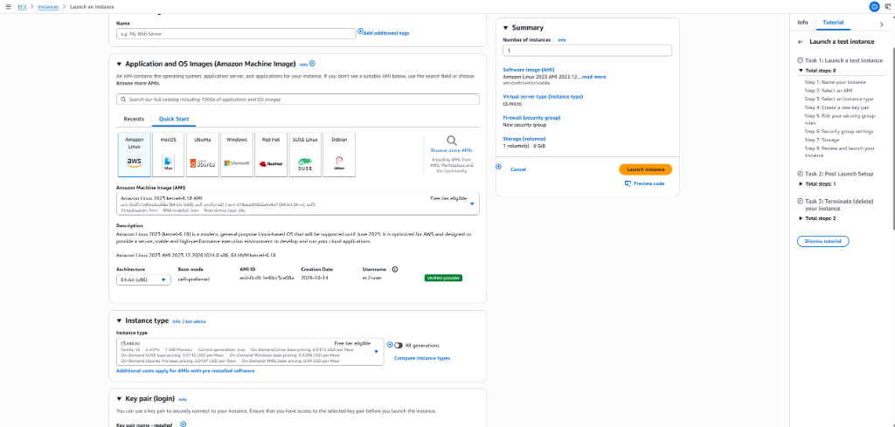
_AWS Guided Tutorial: Task 1 - Step 1/8 showing the interactive wizard prompt asking to name the instance 'Test instance'._

### 2. Key Pair Selection

We created a new RSA `.pem` key pair (`test-key`) to understand how password-less asymmetric cryptography secures EC2 login.

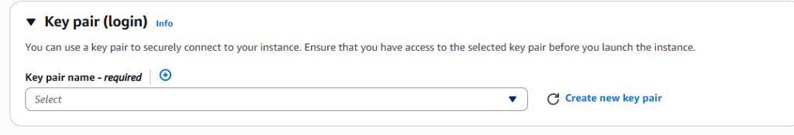
_Key Pair Configuration: Selecting or creating an RSA `.pem` private key for SSH authentication._

### 3. Network Settings & Security Group (Firewall)

We configured the firewall rules. Selecting `0.0.0.0/0` triggered an AWS security warning, teaching us why SSH should be restricted to `My IP`.

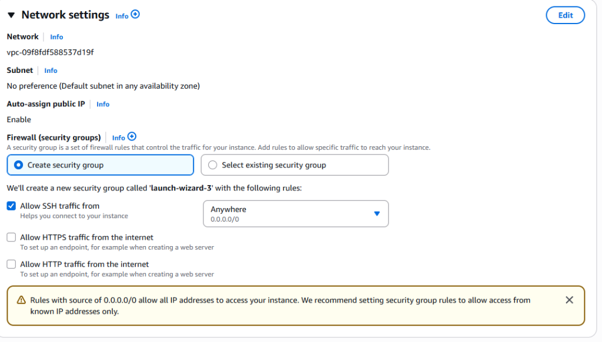
_Network Settings: Creating a security group, configuring rules for SSH (restricted to 'My IP' to prevent brute force attacks), HTTP, and HTTPS._

### 4. Launch Confirmation & Post-Launch Cards

Once initiated, AWS showed the green success banner with cards for connecting, setting up budgets, and alarms.

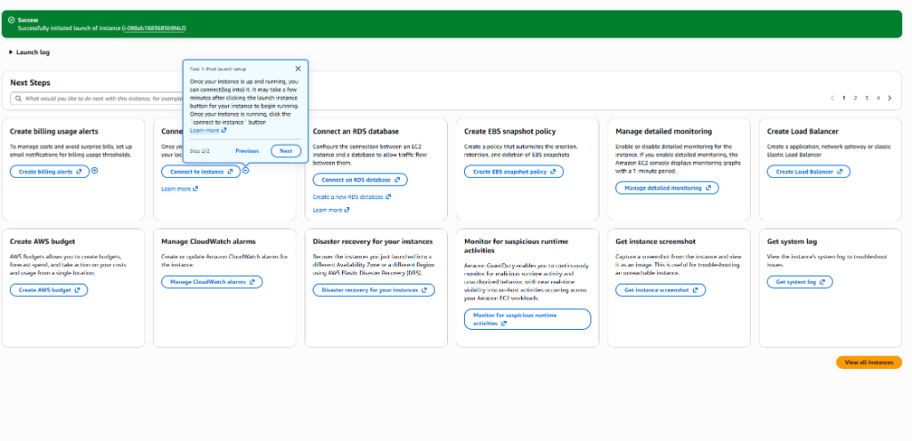
_Launch Confirmation: Instance successfully initiated with green banner, next steps cards (Connect to instance, create billing alerts, budgets, monitoring)._

### 5. Connecting via EC2 Instance Connect (Task 2)

We tested browser-based SSH through **EC2 Instance Connect**, which uses temporary AWS-managed keys without requiring local machine configuration.

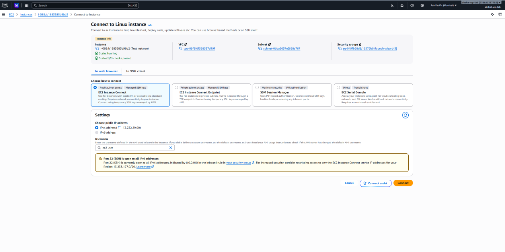
_EC2 Instance Connect: Connecting directly in the browser using AWS-managed temporary SSH keys without requiring local client setup._

### 6. Active Browser Terminal Session

The terminal session loaded successfully with the Amazon Linux prompt (`[ec2-user@ip-... ~]$`), confirming network connectivity.

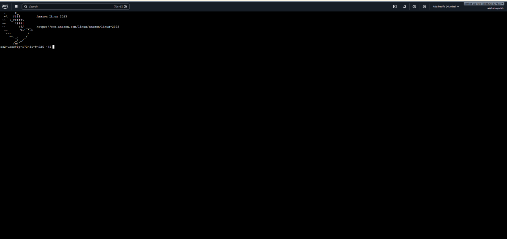
_EC2 Instance Connect Web Terminal: Direct interactive Linux shell prompt (`[ec2-user@ip-... ~]$`) running in the browser tab._

### 7. Terminate Instance for Cleanup (Task 3)

To complete the activity and secure the $20 credit, AWS required us to terminate the test server, demonstrating cloud cleanup best practices.

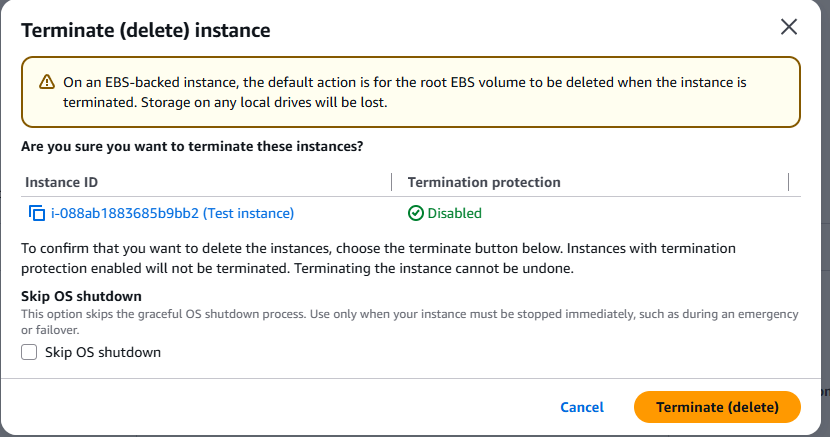
_Terminate (delete) Instance: Confirming permanent deletion of instance and its attached root EBS volume storage to avoid idle charges._

</details>

---

<details>
<summary><h3>⚙️ Part 2: Real WordPress Infrastructure Setup (`wp-lab` - Ubuntu 26.04) (Click to Expand)</h3></summary>

## Part 2: Real WordPress Infrastructure Setup (`wp-lab` - Ubuntu 26.04)

Now that the test server is cleaned up and credits are secured, we configure our **real, permanent WordPress server** on **Ubuntu Server 26.04 LTS**.

### Step 1: Launch the Real EC2 Instance

In AWS Console (`ap-south-1` Mumbai) → **EC2** → **Launch instance**:

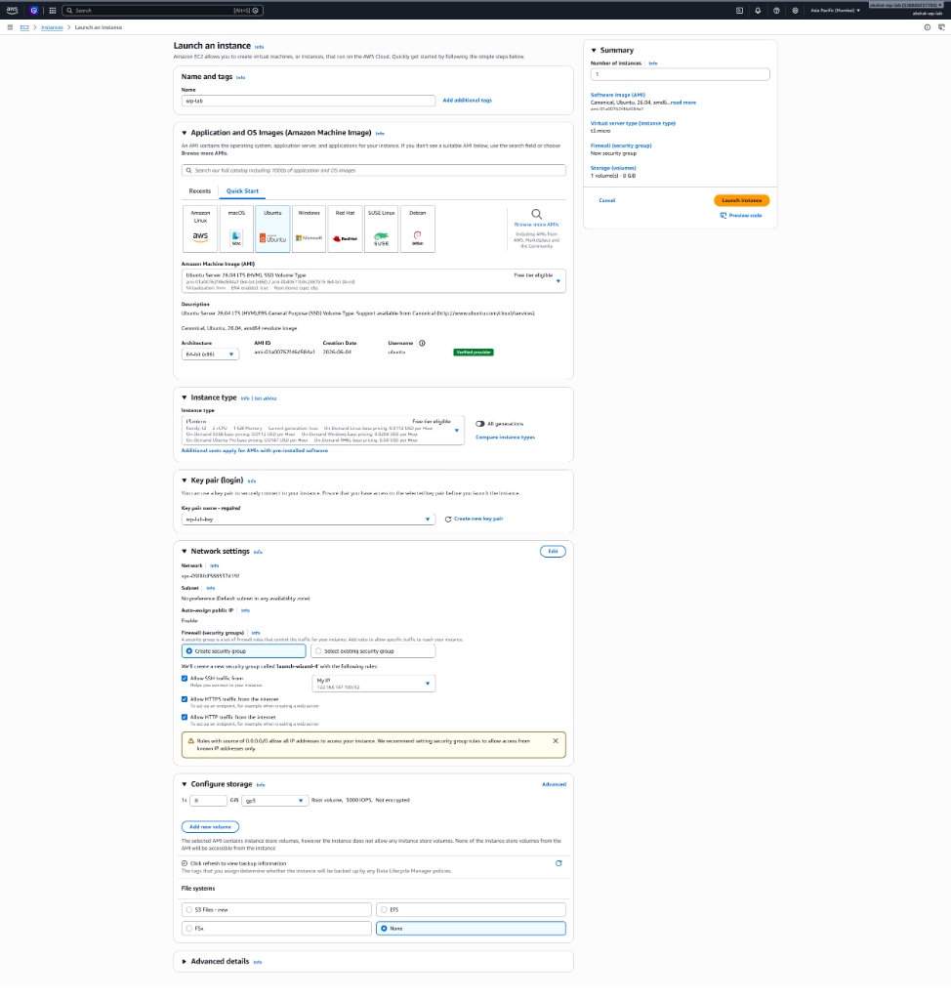
_Real WordPress Instance Launch Wizard: `wp-lab` with Ubuntu Server 26.04 LTS, t3.micro, `wp-lab-key`, and Security Group rules (SSH My IP, HTTP Anywhere, HTTPS Anywhere)._

| Setting                | Value Chosen                     | Why this value?                                                                   |
| ---------------------- | -------------------------------- | --------------------------------------------------------------------------------- |
| **Name**               | `wp-lab`                         | Clean identifier in console and cost reports                                      |
| **OS (AMI)**           | Ubuntu Server 26.04 LTS (64-bit) | Modern LTS with native PHP 8.5 package support                                    |
| **Instance Type**      | `t3.micro` (1 vCPU, 1 GB RAM)    | AWS Free Tier eligible compute                                                    |
| **Key Pair**           | `wp-lab-key` (RSA, `.pem`)       | Required for secure SSH access from laptop                                        |
| **Network (Firewall)** | Custom Security Group            | Port 22 (SSH - My IP), Port 80 (HTTP - Anywhere), Port 443 (HTTPS - Anywhere)     |
| **Storage (EBS)**      | 20 GB gp3                        | gp3 baseline (3000 IOPS / 125 MB/s); 20 GB covers swap + DB + uploads comfortably |

#### Storage Configuration (EBS gp3)

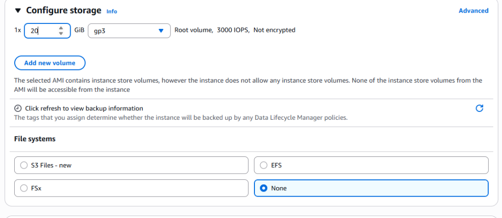
_Configure Storage: 20 GiB gp3 root volume. File systems kept as 'None' (S3 and EFS are handled in later phases)._

#### Real Instance Launch Confirmation Screen

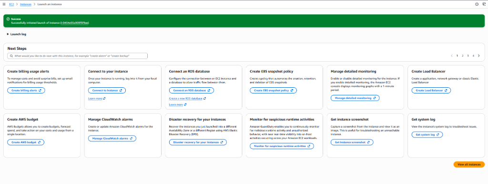
_Launch Confirmation: `wp-lab` instance initiated successfully (`i-0454e55a303f5f9ae`) without tutorial overlays._

#### Active Instances Overview (Running State & Public IP)

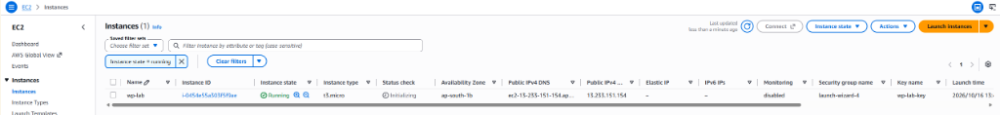
_EC2 Instances Inventory: `wp-lab` showing 'Running' state, status checks 'Initializing', and assigned Public IPv4 (`13.233.151.154`)._

---

### Step 2: Connect via SSH (Local Terminal)

Open PowerShell (Windows) or Terminal (Mac/Linux) in the folder where `wp-lab-key.pem` is saved:

```bash
# Windows key permissions (if needed):
# icacls .\wp-lab-key.pem /inheritance:r
# icacls .\wp-lab-key.pem /grant:r "$($env:USERNAME):(R)"

# Connect to Ubuntu:
ssh -i "wp-lab-key.pem" ubuntu@<PUBLIC-IP>
```

> **Rule:** Ubuntu AMIs always use `ubuntu` as the username, never `root` or `ec2-user`.

#### Local Terminal Connected via SSH (Ubuntu 26.04) Reference

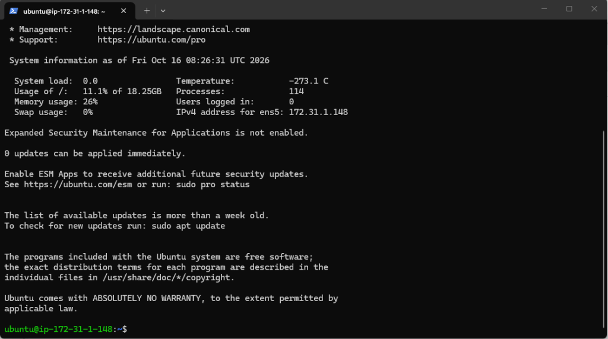
_Successful SSH Connection: Logged into Ubuntu 26.04 LTS (`ubuntu@ip-172-31-1-148:~$`) showing 18.25 GB root storage available and 0% swap configured._

---

### Step 3: Add Swap Memory (Prevent MySQL OOM Crash)

#### Why Swap is mandatory on `t3.micro`:

`t3.micro` comes with only **1 GB of physical RAM**. In a LAMP/LEMP stack, Nginx, PHP-FPM worker pools, and the MySQL daemon collectively require ~1.2 GB to 1.5 GB under normal operations. Without swap, memory spikes trigger the Linux kernel's **Out-Of-Memory (OOM) killer**, which terminates `mysqld` first (causing _"Error establishing a database connection"_ in WordPress). Adding a **2 GB Swap file** uses cheap disk space as emergency virtual RAM.

#### Step-by-Step Commands & Explanation:

1. **Pre-allocate a 2 GB file on disk:**

   ```bash
   sudo fallocate -l 2G /swapfile
   ```

   _Creates a 2 GB block instantly without waiting for disk writes._

2. **Lock down file permissions (Security Best Practice):**

   ```bash
   sudo chmod 600 /swapfile
   ```

   _Restricts read/write access exclusively to root. Essential because swap holds raw application memory dumps, which may contain unencrypted passwords and session keys._

3. **Format the file as Linux swap area:**

   ```bash
   sudo mkswap /swapfile
   ```

   _Sets up swap space header and metadata. Outputs confirmation: `Setting up swapspace version 1, size = 2 GiB`._

4. **Activate the swap space:**

   ```bash
   sudo swapon /swapfile
   ```

   _Instructs the Linux kernel to start using `/swapfile` for paging memory._

5. **Make swap persistent across reboots:**

   ```bash
   echo '/swapfile none swap sw 0 0' | sudo tee -a /etc/fstab
   ```

   _Appends the mount entry to `/etc/fstab`. Without this line, swap will disappear on every instance stop/restart!_

6. **Verify memory and swap status:**
   ```bash
   free -h
   ```
   _Expected Output:_ The `Swap:` row must show approximately `2.0Gi` total and available.

#### Swap Verification & Troubleshooting Gotcha

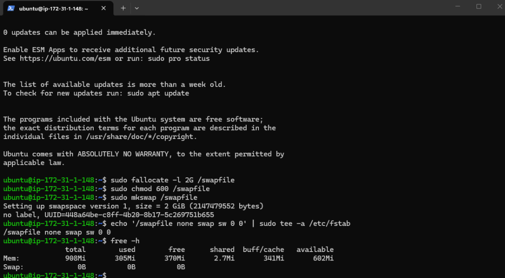
_Troubleshooting Gotcha: Notice `Swap: 0B` in `free -h` if `sudo swapon /swapfile` is omitted. Formatting with `mkswap` prepares the filesystem, but the Linux kernel only allocates it once `swapon` is triggered._

---

### Step 4: Install the LEMP Stack

Update package repositories and install Nginx, MySQL, and PHP:

```bash
sudo apt update && sudo apt upgrade -y
sudo apt install -y nginx mysql-server php-fpm php-mysql php-curl php-gd \
  php-mbstring php-xml php-zip php-intl unzip

# Verify the real PHP-FPM socket path:
ls /run/php/
# Output shows: php8.5-fpm.sock
```

#### PHP-FPM Socket Verification Reference

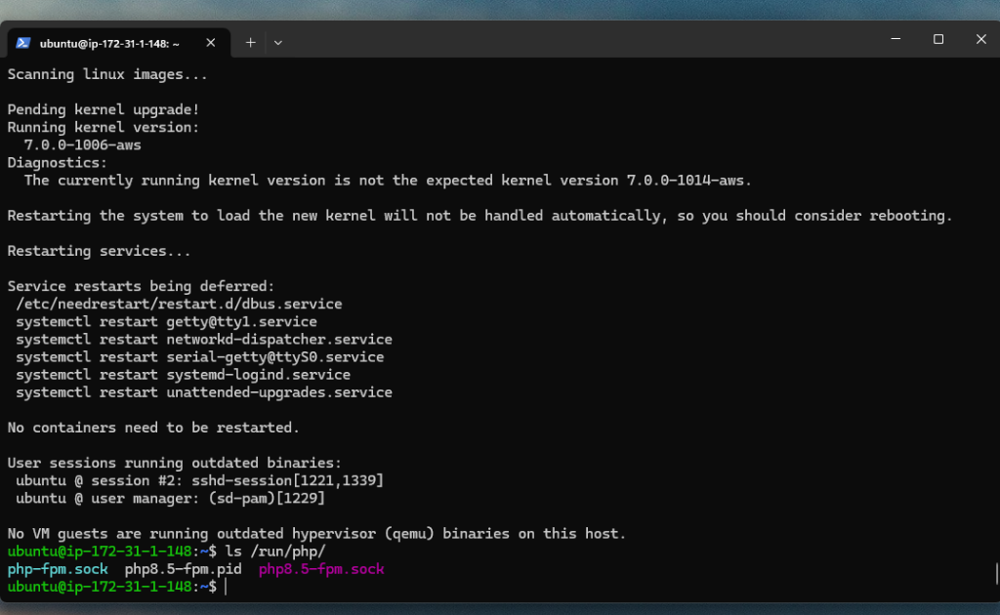
_PHP-FPM Socket Verification: `ls /run/php/` confirms `php8.5-fpm.sock` on Ubuntu 26.04 LTS. This exact Unix socket path is required for Nginx `fastcgi_pass` to prevent 502 Bad Gateway errors._

---

### Step 5: Configure MySQL Database

Log into MySQL as root and create the WordPress database and dedicated user:

```bash
sudo mysql
```

```sql
CREATE DATABASE wordpress DEFAULT CHARACTER SET utf8mb4;
CREATE USER 'wpuser'@'localhost' IDENTIFIED BY 'StrongPasswordHere123!';
GRANT ALL ON wordpress.* TO 'wpuser'@'localhost';
FLUSH PRIVILEGES;
EXIT;
```

#### MySQL Database & Dedicated User Creation Reference

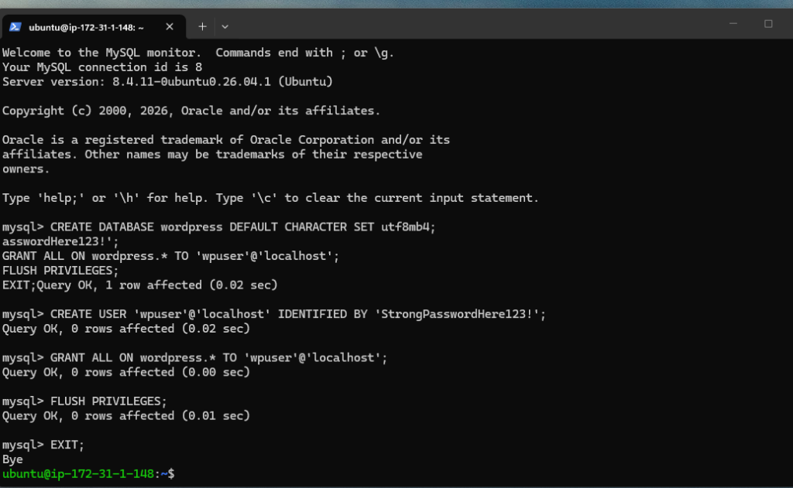
_MySQL Setup: Database `wordpress` (utf8mb4) and dedicated user `wpuser` created with granted privileges. Uses `auth_socket` for root, requiring explicit credentials for the web application user._

---

### Step 6: Download & Extract WordPress (Broken Down into 4 Parts)

#### Part 6.1: Download & Unpack WordPress in `/tmp`

Always download archives in `/tmp` so unnecessary zip/tar files don't clutter your production web root, and `/tmp` gets automatically cleaned up by Linux.

```bash
cd /tmp
curl -O https://wordpress.org/latest.tar.gz
tar xzf latest.tar.gz
```

- **`cd /tmp`**: Navigates to Ubuntu's temporary directory.
- **`curl -O <url>`**: Downloads the official latest WordPress tarball and preserves the original file name (`latest.tar.gz`).
- **`tar xzf latest.tar.gz`**: Extracts the archive into a folder named `wordpress`.
  - `x` = e**X**tract
  - `z` = gun**Z**ip (decompress `.gz`)
  - `f` = **F**ile name specified next

---

#### Part 6.2: Clean Web Root & Copy WordPress Core

Remove the default Nginx welcome page and copy the extracted files into the document root.

```bash
sudo rm -rf /var/www/html/*
sudo cp -r wordpress/* /var/www/html/
```

- **`sudo rm -rf /var/www/html/*`**: Cleans out the default `index.nginx-debian.html` page so it doesn't conflict with WordPress.
- **`sudo cp -r wordpress/* /var/www/html/`**: Recursively copies all WordPress files (`index.php`, `wp-login.php`, `wp-content/`, etc.) directly into the root folder.
- **Verification:** Run `ls -la /var/www/html` to confirm WordPress core files are in place.

---

#### Part 6.3: Assign Web Server Ownership (`www-data`)

Grant the Nginx & PHP-FPM web process ownership of the website files.

```bash
sudo chown -R www-data:www-data /var/www/html
```

- **Why `www-data`:** `www-data` is the service user and group that runs Nginx and PHP-FPM on Ubuntu.
- **Why this matters:** When WordPress uploads media, auto-updates plugins, or creates cached pages, the PHP process writes to disk. With `www-data` ownership, WordPress runs natively without ever asking for annoying FTP credentials.

---

#### Part 6.4: Enforce Hardened Security Permissions (Dirs: 755, Files: 644)

Apply the industry-standard permission model to protect against Remote Code Execution (RCE).

```bash
sudo find /var/www/html -type d -exec chmod 755 {} \;
sudo find /var/www/html -type f -exec chmod 644 {} \;
```

- **Why `find -type` instead of `chmod -R`:**
  - If you ran `chmod -R 644`, folders would lose their execute (`x`) permission and become completely un-traversable (`cd` would fail, breaking the entire site).
  - If you ran `chmod -R 755`, every `.php` and image file would become executable, opening huge security holes.
- **Directories (`755` = `rwxr-xr-x`):** Owner can read, write, and open (`cd`) folders. Everyone else can only read and open.
- **Files (`644` = `rw-r--r--`):** Owner can read and write; others can only read. **Crucially, execute (`x`) is removed**, preventing hackers from executing scripts uploaded into `/wp-content/uploads/`.
- **Never use `chmod 777`!** It grants everyone write & execute permissions, allowing arbitrary system takeover.

#### WordPress Download & Permissions Terminal Verification Reference

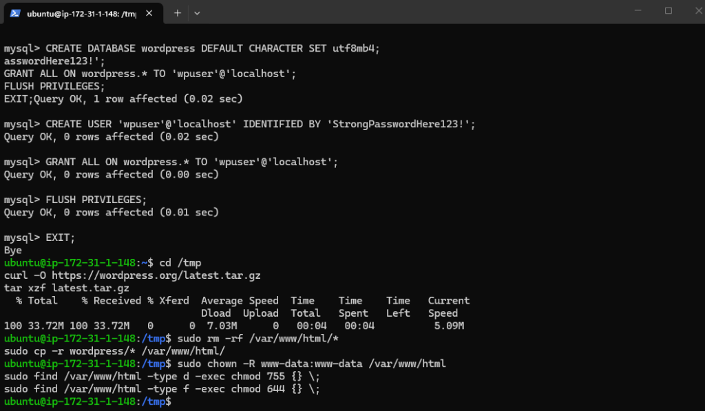
_Terminal Execution: Downloading latest.tar.gz via curl, extracting via tar xzf, copying into /var/www/html, assigning www-data:www-data ownership, and recursively locking down directories (755) and files (644)._

---

### Step 7: Configure Nginx Virtual Host (Broken Down into 4 Parts)

#### Part 7.1: Create the WordPress Server Block File

Create the dedicated Nginx virtual host configuration in `sites-available`:

```bash
sudo tee /etc/nginx/sites-available/wordpress << 'EOF'
server {
    listen 80;
    server_name _;
    root /var/www/html;
    index index.php index.html;

    location / {
        try_files $uri $uri/ /index.php?$args;
    }

    location ~ \.php$ {
        include snippets/fastcgi-php.conf;
        fastcgi_pass unix:/run/php/php8.5-fpm.sock;
    }

    location ~ /\.ht {
        deny all;
    }
}
EOF
```

#### Nginx Server Block Configuration Verification Reference

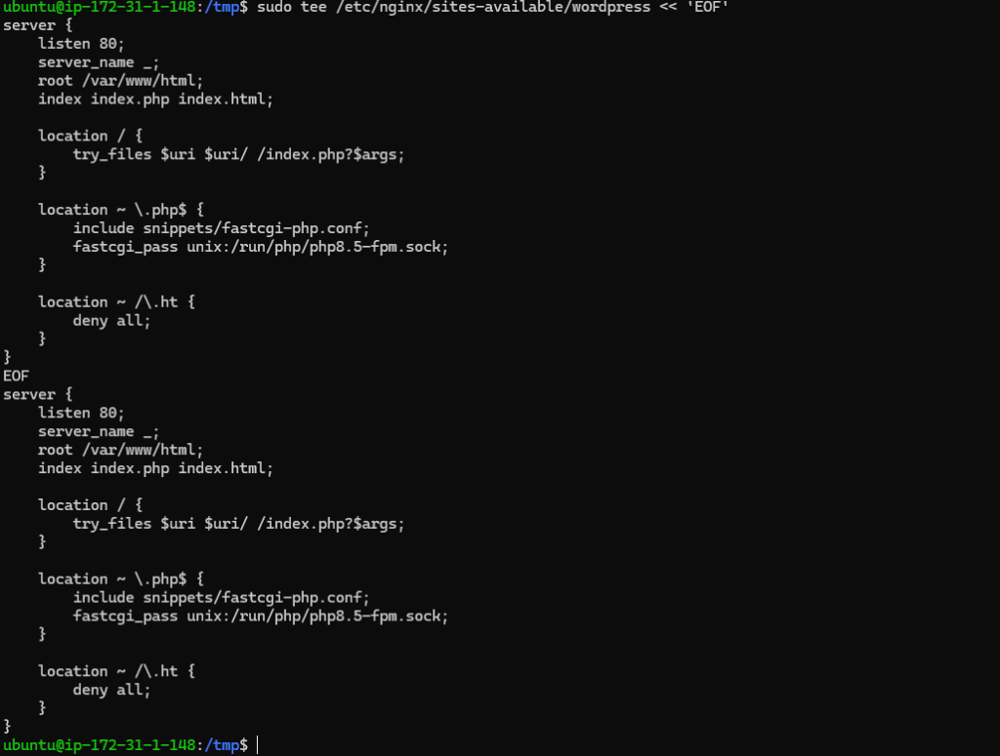
_Terminal Execution: Writing the dedicated WordPress Nginx server block to /etc/nginx/sites-available/wordpress with PHP 8.5 fastcgi socket forwarding and permalink rewrite rules._

---

#### Part 7.2: Line-by-Line Architecture Breakdown (Interview Deep Dive)

- **`listen 80;`**: Listens for incoming unencrypted HTTP requests on standard port 80. (In Phase 2, Let's Encrypt / Certbot will add SSL/TLS on port 443).
- **`server_name _;`**: Wildcard catch-all host. Matches any domain or raw EC2 public IP hitting this server.
- **`root /var/www/html;`**: Root filesystem directory where Nginx looks for website files.
- **`index index.php index.html;`**: Defines lookup order. Tells Nginx to serve `index.php` before trying static `.html`.
- **`try_files $uri $uri/ /index.php?$args;` (Crucial for WordPress!)**:
  - 1. Checks if a physical file exists (`$uri`) — serves static images, CSS, JS directly without calling PHP.
  - 2. Checks if a physical directory exists (`$uri/`).
  - 3. If neither exists, rewrites the request internally to `/index.php` with all query arguments (`?$args`). **Without this line, WordPress pretty permalinks (e.g., `/about/` or `/sample-page/`) trigger `404 Not Found`!**
- **`fastcgi_pass unix:/run/php/php8.5-fpm.sock;`**: Passes dynamic PHP execution to the PHP FastCGI Process Manager via Unix domain socket.
- **`location ~ /\.ht { deny all; }`**: Explicitly forbids serving `.htaccess` or `.htpasswd` files to prevent sensitive Apache config leaks.

---

#### Part 7.3: Activate Site via Symlink & Remove Default Page

Enable the WordPress config and eliminate the default Nginx welcome page:

```bash
sudo ln -s /etc/nginx/sites-available/wordpress /etc/nginx/sites-enabled/
sudo rm -f /etc/nginx/sites-enabled/default
```

- **Why Debian/Ubuntu uses symlinks (`sites-available` vs `sites-enabled`):**
  - `/etc/nginx/sites-available/` acts as an inactive repository of all server configs.
  - `/etc/nginx/sites-enabled/` contains symbolic links pointing _only_ to currently live/active sites.
  - To deactivate a website without losing your carefully crafted config, you simply delete the symlink!
- **Why delete `default`:** Removes the default Ubuntu/Nginx greeting page so port 80 exclusively routes to `/var/www/html`.

#### Nginx Symlink Activation & Default Site Removal Reference

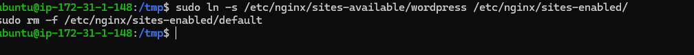
_Terminal Execution: Enabling the WordPress server block via symbolic link into /etc/nginx/sites-enabled/ and removing the default site link._

---

#### Part 7.4: Zero-Downtime Syntax Validation & Live Reload

Verify configuration integrity before touching the live production daemon:

```bash
sudo nginx -t
sudo systemctl reload nginx
```

- **`sudo nginx -t` (Production Safety Standard):** Tests configuration files for syntax errors or missing sockets. If a mistake exists, Nginx reports the exact error line and aborts without crashing the web server.
- **`sudo systemctl reload nginx` (Zero Downtime):** Instructs worker processes to pick up the new configuration gracefully without dropping existing active user connections (unlike `systemctl restart`).

#### Nginx Configuration Syntax Validation Reference

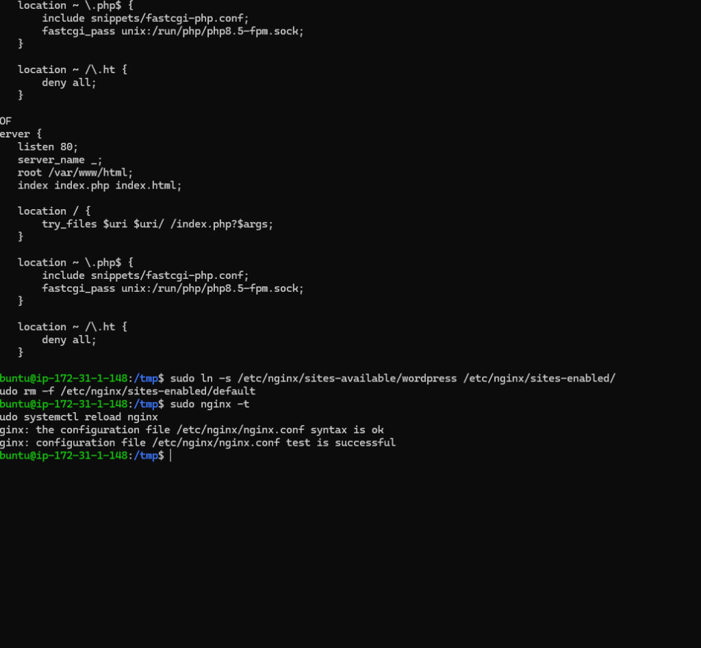
_Terminal Execution: Validating syntax via sudo nginx -t (syntax is ok, test is successful) and executing graceful reload with zero downtime._

---

### Step 8: Browser Setup (Definition of Done Verified ✅)

1. Navigated to `http://13.233.151.154/` in browser.
2. Selected language and completed database connection wizard using database name `wordpress`, user `wpuser`, and local MySQL host `localhost`.
3. Initialized WordPress installation with site title `AWS WordPress Lab` and provisioned administrator user.
4. Successfully authenticated and accessed the WordPress Dashboard at `http://13.233.151.154/wp-admin/`.

> **Definition of Done for Phase 1 PASSED:** `http://<IP>` shows the WordPress dashboard and administrative login succeeds without errors.

#### WordPress Admin Dashboard Verification Reference

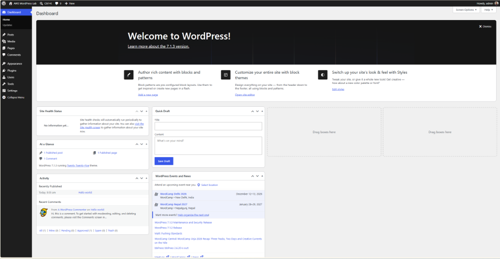
_Final Verification: WordPress 7.1.3 dashboard successfully loaded at http://13.233.151.154/wp-admin, proving full operational readiness of EC2, Ubuntu 26.04, Nginx, PHP 8.5-FPM, and MySQL 8.4._

</details>

---

<details>
<summary><h3>💡 What surprised me (Gotchas & Real-world Lessons) (Click to Expand)</h3></summary>

## What surprised me (Gotchas & Real-world Lessons)

1. **The security group silently dropped HTTP/HTTPS rules:**
   Checking "Allow HTTP" during the launch wizard did not persist. The browser gave `ERR_CONNECTION_TIMED_OUT`.
   _Core Rule:_ **Timeout = Firewall issue (AWS Security Group). Error page (502/404) = Server issue.**
2. **MySQL was killed by the Linux kernel:**
   `mysql.service failed because of an out-of-memory (OOM) situation`. 1 GB RAM is insufficient without swap. 2 GB swap on disk fixed it permanently.
3. **The PHP version cannot be copied blindly from tutorials:**
   Ubuntu 26.04 ships PHP 8.5 (`php8.5-fpm.sock`), whereas most tutorials hardcode `php8.1` or `php8.3`. Using the wrong socket results in `502 Bad Gateway`.
4. **Stopping and starting the instance changes the Public IP:**
   Auto-assigned public IPs are dynamic. Stopping the instance returns the IP to AWS pool. Starting it assigns a new one. WordPress breaks because `siteurl` is stored in the database. Fix for testing: override via `wp-config.php` (`WP_HOME`/`WP_SITEURL`). Permanent architectural fix: **Elastic IP (Phase 2)**.
5. **Formatting swap (`mkswap`) does not activate it in the kernel:**
   Creating the swap file and formatting it with `mkswap` prepares the structure, but `free -h` continued to show `Swap: 0B` until `sudo swapon /swapfile` was explicitly executed.
6. **SSH key path resolution in local terminals:**
   Running `ssh -i wp-lab-key.pem` threw `Identity file not accessible` because the terminal was executing from the project folder while keys were stored in a separate directory (`C:\Users\HP\Desktop\aws-key\`). Absolute paths or relative parent navigation (`..\aws-key\`) is required.
7. **Database User Password vs WordPress Admin Password Confusion:**
   During the initial setup wizard (`setup-config.php`), WordPress prompts for MySQL connection credentials. Entering an arbitrary custom password at this stage results in `Error establishing a database connection` because MySQL strictly validates against the credentials provisioned in Step 5 (`wpuser` / `StrongPasswordHere123!`). A custom administrator password can only be specified on the subsequent screen (`install.php`) once database connectivity is established.
   - **How to use a custom Database password:** If you want a different MySQL password, you must change it inside MySQL first:
     ```sql
     sudo mysql
     ALTER USER 'wpuser'@'localhost' IDENTIFIED BY 'YourNewPassword123!';
     FLUSH PRIVILEGES;
     EXIT;
     ```
   - Only after MySQL is updated can you use that new password in the WordPress browser setup (or update `DB_PASSWORD` in `/var/www/html/wp-config.php`). The two must always match!

#### Database Connection Error Troubleshooting Reference

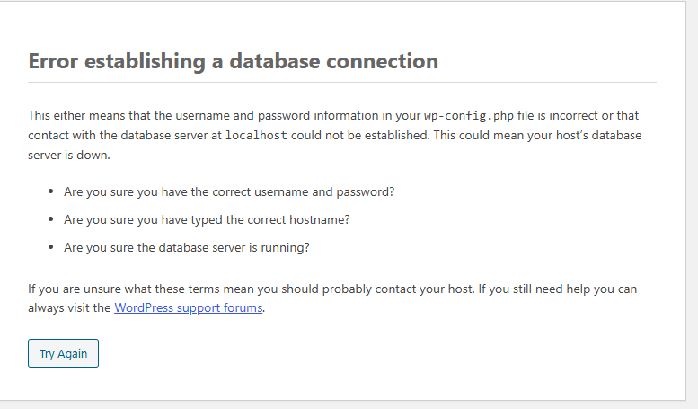
_Troubleshooting: 'Error establishing a database connection' occurs when credentials entered into setup-config.php do not match the MySQL database user grants. To change the password, it must first be altered in MySQL via ALTER USER before WordPress can authenticate._

</details>

---

<details>
<summary><h3>💰 Commands Worth Remembering (Click to Expand)</h3></summary>

## Commands Worth Remembering

```bash
ls /run/php/                       # Check the actual PHP-FPM socket name
curl -I http://localhost           # Server problem or network problem?
sudo ufw status                    # Rule out OS firewall before AWS Security Group
free -h                            # Confirm RAM and Swap usage
sudo systemctl status mysql        # Verify database is active
sudo nginx -t                      # Validate Nginx syntax before reloading
```

</details>

---

<details>
<summary><h3>💰 Cost & Teardown (Click to Expand)</h3></summary>

## Cost & Teardown

- **Hourly Cost:** `t3.micro` is ~$0.0112/hour (~₹1/hr).
- **Between sessions:** **Stop** the instance (bills only pennies for the EBS disk). Do **not terminate** until phase is completely finished.
- **Teardown:** EC2 → Instance state → **Terminate** (deletes root EBS volume). Release any unattached Elastic IPs to avoid idle IP hourly fees.

#### Billing & Free Tier Alerts Reference

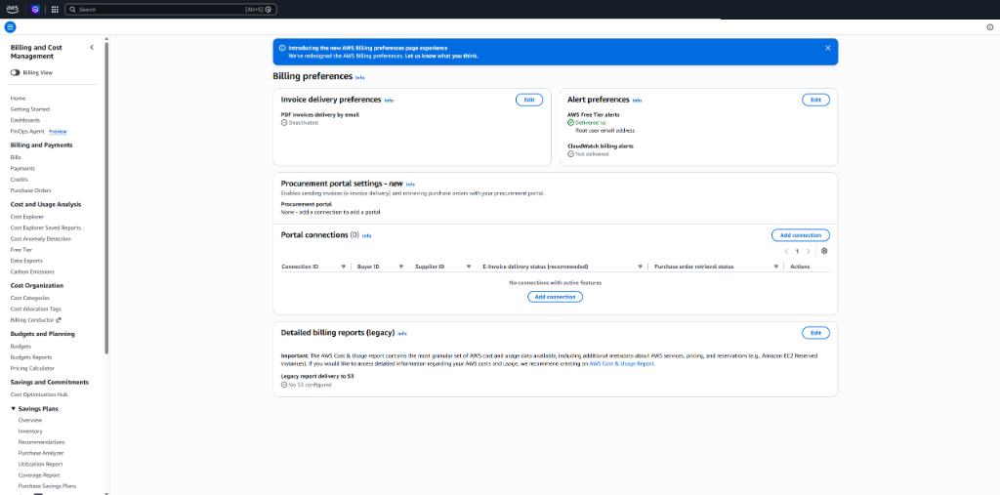
_Billing Preferences: Verifying that 'AWS Free Tier alerts' are active and delivered to the root user email to prevent accidental over-limit charges._

</details>

---

<details>
<summary><h3>🎯 Interview Questions & Answers (Technical Deep Dive) (Click to Expand)</h3></summary>

## Interview Questions & Answers (Technical Deep Dive)

### 📌 Category 1: Cloud Architecture & Economics

#### Q1: Why choose EC2 over managed WordPress hosting?

- **Question:** In an enterprise or startup setting, why would you choose raw AWS EC2 over managed solutions like WP Engine or Kinsta?
- **Answer:** Maximum control, custom stack flexibility, and extreme cost-efficiency, at the price of owning server administration, security patching, and infrastructure maintenance.
- **Key Trade-off:** Managed hosts automate OS updates, PHP patches, caching, and nightly backups for a premium ($35–$100+/month). EC2 costs pennies (~$8/month for `t3.micro`), allows custom Linux/Nginx modules, but places 100% of the operational responsibility (firewalls, OOM crashes, SSL renewals) on your shoulders.

---

#### Q2: Which parts of an EC2 setup are infrastructure-agnostic versus application-specific?

- **Question:** If you had to deploy Next.js, Python/Django, or Go instead of WordPress, what parts of your setup would stay the same and what would change?
- **Answer:**
  - **Layer 1: Infrastructure Layer (100% Agnostic):** EC2 instance sizing, VPC networking, Security Group rules, SSH keypair management, and disk Swap space are identical across all software stacks.
  - **Layer 2: Application Runtime Layer (Stack-Specific):** Diverges based on workload. WordPress requires PHP-FPM and MySQL. Next.js requires Node.js, npm, and PM2. Python requires Python3, Gunicorn, and PostgreSQL.
  - **Common Ground:** The package manager index (`sudo apt update`) and Nginx (acting as a generic reverse proxy) remain consistent across stacks.

---

#### Q3: How does the EC2 web stack architecture differ between WordPress (PHP) and Next.js (Node.js)?

- **Question:** How does Nginx communicate with WordPress versus a Node.js/Next.js application?
- **Answer:**
  - **WordPress (PHP-FPM):** WordPress cannot listen on network ports directly. Nginx receives HTTP requests and forwards PHP execution to a FastCGI daemon (`php-fpm`) over a local Unix domain socket (`/run/php/php8.5-fpm.sock`).
  - **Next.js (Node.js):** Next.js runs as its own standalone HTTP server (e.g. listening on `localhost:3000` managed by PM2). Nginx acts as a reverse proxy, forwarding HTTP traffic from port 80/443 directly to port 3000. PHP is completely omitted.

---

### 📌 Category 2: AWS Networking, IPs & Security

#### Q4: What is the difference between an auto-assigned Public IP and an Elastic IP?

- **Question:** What happens to an EC2 instance's IP address when you stop and start it, and how does Elastic IP solve this?
- **Answer:** An auto-assigned Public IPv4 address is **ephemeral**. When an instance stops, AWS releases that IP back into the global public pool. Starting the instance allocates a completely new, unpredictable IP. An **Elastic IP (EIP)** is a reserved, static public IPv4 address dedicated to your AWS account that persists across reboots, stops, and hardware replacements.

---

#### Q5: Why does WordPress break after restarting an EC2 instance without an Elastic IP?

- **Question:** If you stop and start your EC2 WordPress instance without an Elastic IP, why does the website fail to load properly?
- **Answer:** WordPress stores its site address (`siteurl` and `home`) in the MySQL `wp_options` table as an absolute URL (e.g. `http://13.233.151.154`). When restarted with a new dynamic IP, visitors hitting the new IP receive redirects or broken asset paths pointing back to the old, unassigned IP.
- **Temporary Workaround:** Define dynamic overrides in `wp-config.php` (`WP_HOME` / `WP_SITEURL`).
- **Production Fix:** Allocate an Elastic IP and bind it to a custom DNS domain (Phase 2).

---

#### Q6: Why restrict SSH (Port 22) to 'My IP' instead of 0.0.0.0/0, and what is the trade-off?

- **Question:** Why should administrative ports never be open to `0.0.0.0/0`, and what operational friction does 'My IP' introduce?
- **Answer:** Leaving port 22 open globally exposes the SSH daemon to automated botnets performing continuous credential brute-forcing. Restricting to `My IP` (/32) ensures only your current gateway IP can initiate a handshake.
- **The Trade-off:** If your ISP assigns a dynamic public IP or you switch Wi-Fi/mobile hotspots, SSH will hang until you log into the AWS Console and update the Security Group rule. (Phase 6 solves this permanently with AWS Systems Manager Session Manager, allowing port 22 to be closed completely).

---

#### Q7: Why wait for 'Status checks' (2/2 checks passed) instead of connecting immediately after launch?

- **Question:** What is the technical difference between an instance being in the 'Running' state versus passing '2/2 status checks'?
- **Answer:**
  - **Instance State: 'Running'** means AWS hypervisors have provisioned the virtual machine hardware. However, the guest operating system (Ubuntu) is still booting its kernel, initializing systemd, and starting the SSH daemon.
  - **2/2 Status Checks:** Confirms both **System Status Check** (AWS physical infrastructure & hypervisor health) and **Instance Status Check** (Guest OS boot, networking stack, and filesystem responsiveness) are operational. Connecting before checks pass causes false connection timeouts.

---

### 📌 Category 3: Linux System Administration & Memory

#### Q8: How do you debug a web application that won't load (Inside-Out Methodology)?

- **Question:** Walk me through your step-by-step diagnostic procedure when a client says their website is timing out.
- **Answer:** Always troubleshoot from the inside out:
  1. **Local Host Check:** Run `curl -I http://localhost` via SSH. If localhost responds with HTTP 200, the application and web server are healthy.
  2. **OS Firewall Check:** Run `sudo ufw status` to ensure Linux isn't blocking incoming traffic.
  3. **AWS Security Group Check:** Check inbound rules. If port 80/443 is missing, traffic drops silently (Browser: `ERR_CONNECTION_TIMED_OUT`).
  4. **DNS & Route Table:** Verify VPC Internet Gateway (IGW) route (`0.0.0.0/0 -> igw-xxx`) and domain DNS resolution.
  - **Rule of Thumb:** **Timeout = Firewall/Network issue. Error Code (502, 500, 404) = Web Server/Application issue.**

---

#### Q9: What would you monitor on a 1 GB RAM instance, and why did MySQL crash without swap?

- **Question:** Why does MySQL frequently die on a `t2.micro` or `t3.micro` instance, and how does Swap solve it?
- **Answer:** 1 GB of RAM is insufficient to comfortably host the Linux OS, Nginx, PHP-FPM, and MySQL 8+ concurrently. Under burst memory spikes, Linux runs out of memory, triggering the **OOM (Out-Of-Memory) Killer** which terminates the highest memory-consuming process (invariably `mysqld`).
- **The Solution:** Provisioning a 2 GB Swap file on the EBS disk acts as virtual memory overflow. While disk I/O is slower than RAM, it prevents hard OOM crashes, keeping the database running uninterrupted.

---

### 📌 Category 4: Nginx Web Server Architecture

#### Q10: Why do Debian and Ubuntu use `sites-available` and `sites-enabled` with symbolic links?

- **Question:** Why not write all server blocks directly in `/etc/nginx/nginx.conf`?
- **Answer:** Modular configuration and zero-risk rollbacks.
  - `/etc/nginx/sites-available/` serves as an offline repository of all site configurations.
  - `/etc/nginx/sites-enabled/` contains symbolic links pointing _only_ to active production sites.
  - Disabling a site requires removing a single symlink (`sudo rm /etc/nginx/sites-enabled/site.conf`) without altering or deleting the actual configuration file, enabling instant rollback during incidents.

---

#### Q11: Why is `try_files $uri $uri/ /index.php?$args;` critical for WordPress?

- **Question:** What happens if you omit the `try_files` directive from an Nginx WordPress server block?
- **Answer:** Nginx does not parse Apache `.htaccess` rewrite rules. When a user requests a custom permalink (e.g. `/my-first-post/`), Nginx looks for a literal physical folder at `/var/www/html/my-first-post/`. If it doesn't exist, it throws a `404 Not Found`.
- **The Directive:** `try_files` tells Nginx:
  1. Check if a physical static file exists (`$uri`) — serve directly.
  2. Check if a physical directory exists (`$uri/`).
  3. If neither exists, pass the request URI to WordPress's front controller (`/index.php?$args`), allowing WordPress internal routing to serve the post.

---

#### Q12: What is the operational difference between `systemctl restart nginx` and `systemctl reload nginx`?

- **Question:** In a high-traffic production environment, why should you avoid `restart` in favor of `reload`?
- **Answer:**
  - **`restart`:** Kills the master process and all active worker processes abruptly. All in-flight client TCP connections and active downloads are dropped, resulting in momentary user downtime.
  - **`reload`:** Graceful zero-downtime transition. The master process reads the new config, starts new worker processes with the updated settings, and instructs old workers to finish serving their existing requests before gracefully shutting down.
  - **Mandatory Pre-requisite:** Always execute `sudo nginx -t` before reloading. If there is a syntax error, `nginx -t` warns you and avoids passing invalid configs to production.

---

### 📌 Category 5: Database Security & Permissions

#### Q13: Why does `sudo mysql` not require a password on Ubuntu, and why can't WordPress use root directly?

- **Question:** Explain MySQL's `auth_socket` plugin and the principle of least privilege in web applications.
- **Answer:**
  - On modern Ubuntu, MySQL uses `auth_socket` authentication for `root@localhost`. It delegates security to the Linux OS: running `sudo mysql` verifies you already have OS root access, bypassing the password prompt.
  - WordPress runs under an unprivileged system user (`www-data`) and cannot invoke `sudo` or the root socket.
  - **Principle of Least Privilege:** Web apps must never run as database root. Creating a dedicated `wpuser` restricted strictly to `wordpress.*` guarantees that even if a WordPress vulnerability is exploited, the attacker cannot access other databases or modify system MySQL tables.

---

#### Q14: How do WordPress and MySQL authenticate with each other, and what happens if you change the database user password?

- **Question:** Where does WordPress store database credentials, and what happens when MySQL credentials fall out of sync?
- **Answer:** WordPress is a standard MySQL client that authenticates via TCP/socket using constants defined in `/var/www/html/wp-config.php` (`DB_USER`, `DB_PASSWORD`, `DB_NAME`, `DB_HOST`).
- **Changing Passwords:** Changing the password requires executing `ALTER USER 'wpuser'@'localhost' IDENTIFIED BY 'NewPass'; FLUSH PRIVILEGES;` inside MySQL first, and immediately updating `DB_PASSWORD` in `wp-config.php`. If they fall out of sync, WordPress crashes immediately with `Error establishing a database connection`.

---

#### Q15: Why configure `www-data:www-data` ownership and `755/644` permissions, and why is `chmod 777` dangerous?

- **Question:** Why separate directory permissions (`755`) from file permissions (`644`), and what are the security risks of `777`?
- **Answer:**
  - **`www-data:www-data`:** Nginx and PHP-FPM execute as `www-data`. Assigning ownership allows WordPress to handle media uploads, automatic plugin installations, and updates natively without asking for FTP credentials.
  - **Directories (`755` = `rwxr-xr-x`):** Allows directory traversal (`cd`) while restricting creation and deletion of folders to the owner.
  - **Files (`644` = `rw-r--r--`):** Strips execute (`x`) permissions entirely across all files.
  - **The Risk of `chmod 777`:** Grants full write and execute rights to every user and process on the server. If an attacker uploads a malicious PHP script disguised as an image into `/wp-content/uploads/`, `777` allows the web server to execute that file directly, leading to Remote Code Execution (RCE) and total server compromise.

</details>
