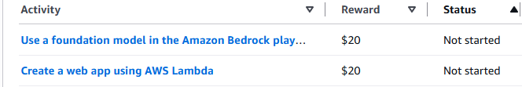

# Phase 12 — Modern Cloud Integrations & Serverless (Lambda, SQS, EventBridge & DynamoDB)

> **Definition of Done:** Each serverless integration has one verified working example executed, logged in CloudWatch, and cleanly torn down within the same session.

---

<h3>🧠 Conceptual Foundations, Architecture & Trade-offs (Click to Expand)</h3>

## What it does

Expands beyond monolithic compute into modern event-driven and serverless AWS architectures:
1. **AWS Lambda + Amazon S3 Event Notifications:** Deploys a serverless Python Lambda function automatically triggered whenever an image is uploaded to the S3 media bucket (e.g. generating custom watermarks or metadata extraction) without burdening the EC2 web server.
2. **Amazon EventBridge:** Configures scheduled cron rules triggering automated maintenance tasks.
3. **Amazon SQS / SNS:** Decouples background processing queues from the synchronous WordPress HTTP request cycle.
4. **Amazon DynamoDB:** Explores high-throughput NoSQL key-value storage for fast session storage or logging.

---

## Why choose it (Over Running Everything on the Web Server)

- **Event-Driven Asynchronous Decoupling:**
  Heavy tasks (image processing, PDF generation, bulk email dispatch) choke PHP-FPM processes and cause HTTP 504 Gateway Timeouts for web visitors. Offloading tasks to AWS Lambda or SQS keeps the web tier blazingly fast.
- **Pay-Per-Execution Serverless Economics:**
  Lambda charges $0 when idle (unlike EC2 which bills 24/7). You only pay for exact execution time in 1ms increments.
- **Infinite Scalability:**
  If 1,000 images are uploaded simultaneously, AWS Lambda scales out 1,000 concurrent executions in parallel without any server provisioning.

---

## Trade-offs

- **Cold Start Latency:**
  Infrequently invoked Lambda functions experience a 200–500ms delay while AWS spins up the micro-VM container.
- **Local Development & Debugging Complexity:**
  Debugging distributed serverless architectures requires CloudWatch Logs, AWS X-Ray, and distributed tracing rather than simple local PHP debuggers.

---

<h3>📋 Implementation Steps & Progress Tracker [Always Visible]</h3>

## Implementation Steps & Progress Tracker

- [ ] **Step 1: Lambda Image Metadata Trigger via S3**
  - Create Python Lambda function `wp-s3-image-processor`.
  - Add S3 Event Notification on bucket `wp-lab-media-akshat-01` (`s3:ObjectCreated:*`).
  - Upload image and inspect execution logs in Amazon CloudWatch Logs.
- [ ] **Step 2: Amazon EventBridge Scheduled Rule**
  - Create rule with schedule expression `rate(1 day)` or `cron(0 0 * * ? *)`.
  - Target Lambda function for automated cleanup.
- [ ] **Step 3: Amazon SQS Message Queue Integration**
  - Create standard SQS queue `wp-background-jobs`.
  - Push message from EC2 and consume via background worker.
- [ ] **Step 4: Clean Teardown**
  - Delete Lambda functions, SQS queues, and EventBridge rules immediately to maintain zero ongoing idle cost.

---

<h3>🧪 🎁 Bonus: Claiming AWS Credit Rewards ($40 Total) (Click to Expand)</h3>

## 🎁 Bonus: Claiming AWS Credit Rewards ($40 Total)

AWS provides direct promotional credit rewards for hands-on activities that directly align with Phase 12:

| Activity in AWS Console | Reward | Execution Plan in Phase 12 |
| :--- | :--- | :--- |
| **Create a web app using AWS Lambda** | **$20 Credits** | Covered in **Step 1 & Step 3**: Create a lightweight Python Lambda function with a Function URL / API Gateway trigger. |
| **Use a foundation model in the Amazon Bedrock playground** | **$20 Credits** | Open **Amazon Bedrock ➔ Playgrounds**, select a model (e.g. Amazon Titan / Claude 3), send a test prompt, and instantly claim $20. |

> **Total Extra Credits:** **$40 USD (~₹3,300)** added straight to your AWS account balance!

---

<h3>💡 Execution Details & Real-World Gotchas (Click to Expand)</h3>

## Execution Details & Real-World Gotchas

*(To be documented during Phase 12 live execution)*

---

<h3>🎯 Phase 12 Cloud Architecture Interview Questions & Answers (Click to Expand)</h3>

## Phase 12 Cloud Architecture Interview Questions & Answers

### Q1: What is an AWS Lambda "Cold Start", and what architectural techniques mitigate it?
- **Answer:** 
  - **Cold Start:** When a Lambda function is invoked after being idle, or when AWS scales out a new concurrent execution environment, AWS must allocate micro-VM compute (Firecracker), download the deployment package/container image, initialize the runtime (e.g. Python/NodeJS), and run initialization code outside the handler. This introduces a 100ms–2s latency spike.
  - **Subsequent Invocations (Warm Start):** The execution environment stays frozen in memory for ~15–30 minutes, handling subsequent invocations in single-digit milliseconds.
  - **Mitigation:**
    1. **Provisioned Concurrency:** Pre-initializes a requested number of warm execution environments 24/7 (costs a minor hourly fee).
    2. **Lean Packages:** Minimize bundle size and avoid heavy dependencies.
    3. **Architecture:** Use compiled/fast runtimes (Rust, Go, Node.js, Python) over heavy enterprise JVM runtimes.

### Q2: Compare Amazon SNS vs Amazon SQS vs Amazon EventBridge. When do you use each?
- **Answer:** 
  - **Amazon SNS (Pub/Sub Push):** One-to-many publisher-subscriber model. When a message is published, SNS instantly pushes copies to multiple subscribers simultaneously (email, SMS, Lambda, SQS). Messages are not queued; if a subscriber is offline and has no DLQ, the message is dropped.
  - **Amazon SQS (Message Queue Pull):** One-to-one decoupled buffer queue. Producers push messages, and consumers pull (poll) messages at their own processing speed. Ensures load leveling, retry logic, and zero message loss even if consumer servers crash.
  - **Amazon EventBridge (Serverless Event Bus):** Advanced enterprise event routing with JSON schema matching, payload transformation, and 40+ native SaaS integrations (Datadog, PagerDuty, Shopify). Ideal for complex event-driven microservices architectures.

### Q3: What is the difference between an SQS Standard Queue and an SQS FIFO Queue?
- **Answer:** 
  - **SQS Standard:**
    - **Throughput:** Unlimited transactions per second (TPS).
    - **Ordering:** Best-effort ordering (messages may occasionally arrive out of sequence).
    - **Delivery:** At-least-once delivery (a message might be delivered more than once; consumers must be idempotent).
  - **SQS FIFO (First-In-First-Out):**
    - **Throughput:** Up to 3,000 TPS with batching (or 300 TPS without batching).
    - **Ordering:** Strictly ordered (guarantees messages are processed in the exact order sent).
    - **Delivery:** Exactly-once processing (built-in 5-minute deduplication window).

### Q4: What is a Dead Letter Queue (DLQ), and why is it mandatory for enterprise serverless systems?
- **Answer:** 
  - When an asynchronous Lambda function or worker process fails to process a message (due to database corruption, bad input data, or an unhandled exception), it retries based on policy (default 2 retries).
  - Without a DLQ, a poison-pill message will repeatedly fail, consume compute resources, and eventually be dropped into oblivion.
  - A **Dead Letter Queue (DLQ)** intercepts repeatedly failing messages after `maxReceiveCount` is exceeded, isolating them in a separate SQS queue for inspection, alerting engineers via CloudWatch/SNS, and allowing engineers to debug the payload and replay it once the bug is fixed.

### Q5: How does AWS Lambda concurrency work, and how does the Account Concurrency Limit affect other services?
- **Answer:** 
  - **Concurrency:** The number of Lambda execution environments handling requests at any given instant: `Concurrency = (Invocations per second) * (Average execution duration in seconds)`.
  - **Account Limit:** AWS enforces a regional default limit of **1,000 concurrent executions** shared across all Lambda functions in the account.
  - **The Risk:** If an unthrottled function spikes to 1,000 concurrent instances, all other Lambda functions in the same region get throttled (`TooManyRequestsException`).
  - **Solution:** Configure **Reserved Concurrency** on critical functions (guarantees a dedicated pool of concurrency) and **Execution Limits** on non-critical functions to prevent account exhaustion.

