# Phase 2 — Domain and HTTPS (`lab.asaxenadev.com`)

> **Definition of Done:** `https://lab.asaxenadev.com` loads with a secure padlock (SSL/TLS), zero mixed-content warnings, and permanent persistence across instance reboots.

---

<details>
<summary><h3>🧠 Conceptual Foundations, Architecture & Trade-offs (Click to Expand)</h3></summary>

## What it does
Binds a permanent static public IP (AWS Elastic IP) to our EC2 instance, connects a custom subdomain (`lab.asaxenadev.com`) via Hostinger DNS, and secures all HTTP traffic using a free Let's Encrypt SSL/TLS certificate automated by Certbot.

---

## Why choose it
- **Elastic IP over Auto-assigned Public IP:** Auto-assigned IPs are dynamic and change every time an EC2 instance stops, breaking WordPress and DNS records. Elastic IP is a fixed static public IPv4 address reserved for our account that never changes across reboots.
- **Let's Encrypt & Certbot over Self-Signed or Paid SSL:** Self-signed certificates trigger scary red browser security warnings (`Your connection is not private`). Commercial SSL certificates cost $50–$200/year. Let's Encrypt provides automated, globally trusted, and 100% free certificates with automated renewals via Certbot.

---

## Trade-off
- **Elastic IP Cost Trade-off:** AWS charges **$0.005/hour (~$3.60/month)** for an Elastic IP *only if it is idle* (unattached to a running instance). As long as it is attached to a running instance, it is free. Therefore, when tearing down sessions, unattached Elastic IPs must be explicitly **Released** to prevent idle billing.
- **DNS Propagation Latency:** DNS changes are not instant; downstream ISPs cache records based on TTL (Time-To-Live). Setting TTL to 300 seconds minimizes wait times during setup.
- **Certbot Renewal Dependency:** Let's Encrypt certificates expire every 90 days. We rely on a systemd timer / cron job (`certbot renew`) to automatically refresh certificates before expiration.

</details>

---

<details>
<summary><h3>⚙️ Architecture & Step-by-Step Execution (Click to Expand)</h3></summary>

## Architecture & Step-by-Step Execution

```text
[User Browser]
      │  HTTPS (Port 443)
      ▼
[Hostinger DNS (Authoritative Nameservers)]
      │  Resolves: lab.asaxenadev.com ➔ Elastic IP
      ▼
[AWS Internet Gateway (VPC)]
      │  Routes public IPv4
      ▼
[AWS Security Group (wp-lab-sg)]
      │  Allows Inbound: Port 80 (HTTP) & Port 443 (HTTPS)
      ▼
[Nginx Web Server (Reverse Proxy & SSL Termination)]
      │  Certbot Let's Encrypt SSL Keys (/etc/letsencrypt/live/lab.asaxenadev.com/)
      │  Redirects: HTTP ➔ HTTPS
      ▼  Unix Domain Socket (/run/php/php8.5-fpm.sock)
[PHP 8.5-FPM & WordPress Core (/var/www/html)]
      ▼  TCP/Localhost
[MySQL 8.4 Database (wordpress)]
```

---

### Step 1: Allocate & Associate AWS Elastic IP (Permanent Static IP)

#### Why this step is required:
- In Phase 1, our EC2 instance ran on an **auto-assigned public IP** (`13.233.151.154`).
- When an EC2 instance is stopped, AWS immediately releases auto-assigned IPs back to the global pool. When started again, AWS assigns a completely random new IP.
- Since domain names (DNS) and SSL certificates must point to a fixed server, we need a **static IP that never changes across reboots**.
- An **Elastic IP (EIP)** reserves a static public IPv4 address for our AWS account and binds it permanently to `wp-lab`.

#### EC2 Console: Stopped Instances & Dynamic IP Dissolution
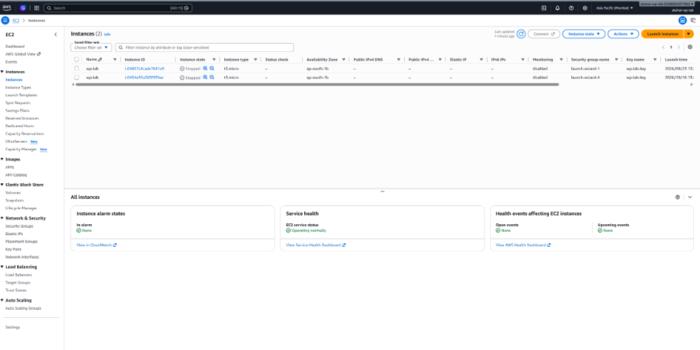
_EC2 Console: Instance `wp-lab` (`i-0454e55a303f5f9ae`) is in `Stopped` state. Notice that the Public IPv4 address column has reverted to empty (`-`), proving that auto-assigned IPs are ephemeral and disappear on stop. Next: Click 'Elastic IPs' on the left sidebar to allocate a permanent static IP._

1. Navigate to **AWS Console ➔ EC2 ➔ Network & Security ➔ Elastic IPs** (visible on the left sidebar).

#### EC2 Console: Elastic IP Dashboard
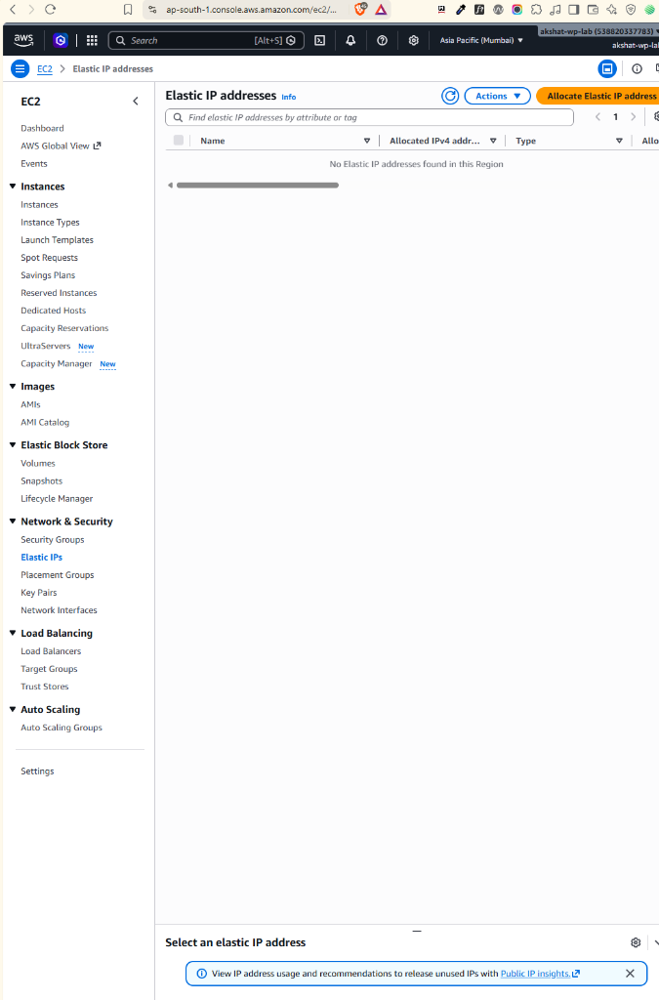
_EC2 Console: The Elastic IPs management view. Click the orange 'Allocate Elastic IP address' button on the top right to claim a static public IPv4 address from the AWS pool._

2. Click **Allocate Elastic IP address** ➔ Verify Region is `ap-south-1` (Mumbai).

#### EC2 Console: Allocate Elastic IP Address Configuration
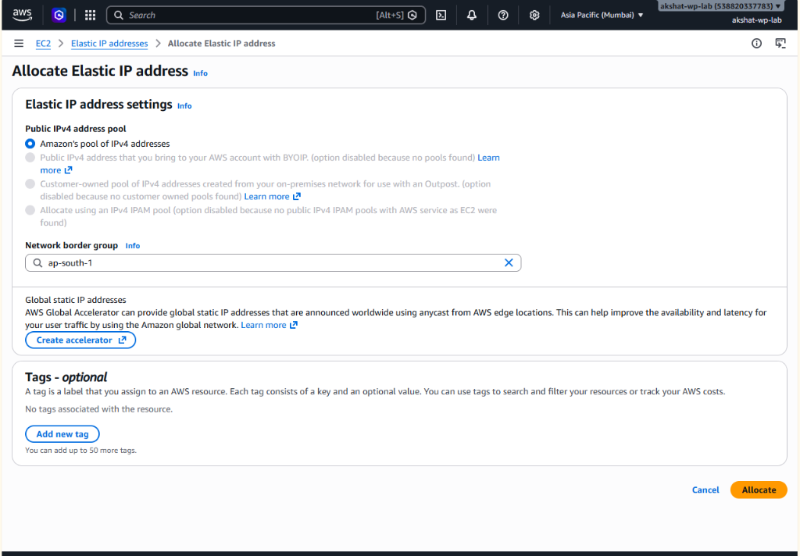
_EC2 Console: Allocation settings for Elastic IP. Leaves Amazon's IPv4 address pool and ap-south-1 border group default. Click the orange 'Allocate' button at the bottom right._

Click the orange **Allocate** button at the bottom right.

#### EC2 Console: Elastic IP Allocated Successfully
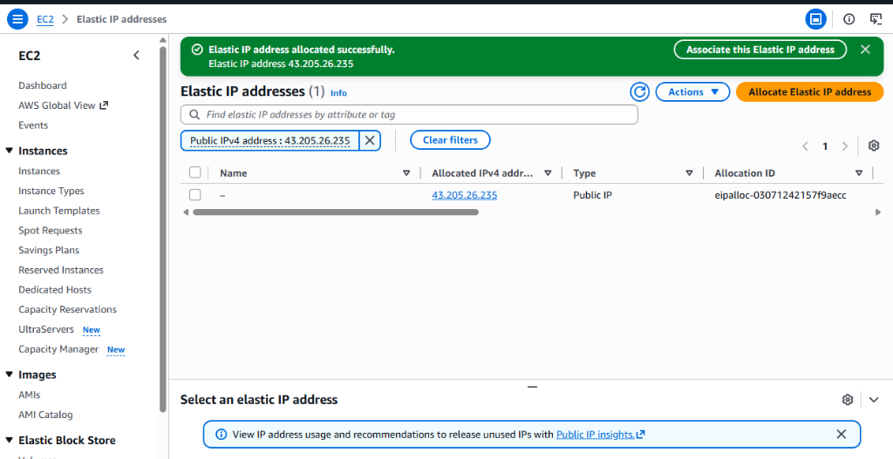
_EC2 Console: Allocation successful. Permanent Elastic IP `43.205.26.235` (Allocation ID: `eipalloc-03071242157f9aecc`) allocated. Click 'Associate this Elastic IP address' to bind it to `wp-lab`._

3. Select the allocated IP (`43.205.26.235`) ➔ Click the green banner button **"Associate this Elastic IP address"** (or **Actions ➔ Associate Elastic IP address**).

#### EC2 Console: Associate Elastic IP Address Form
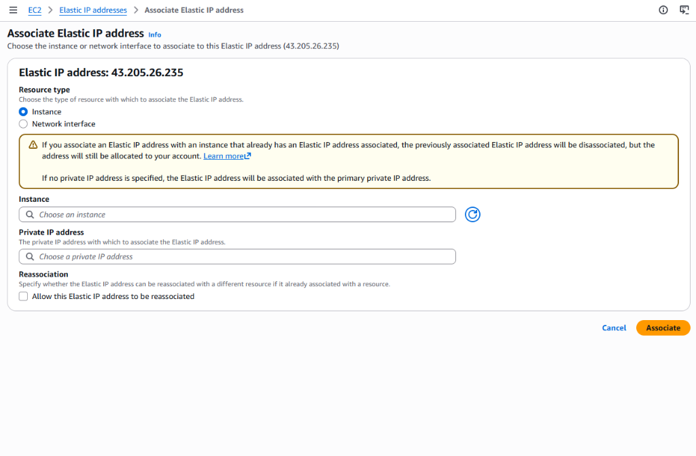
_EC2 Console: Associating Elastic IP 43.205.26.235. Select Resource type: Instance, pick 'wp-lab' (i-0454e55a303f5f9ae), and click the orange 'Associate' button._

4. Choose **Instance** ➔ Select `wp-lab` (`i-0454e55a303f5f9ae`) ➔ Click the orange **Associate** button.

#### EC2 Console: Elastic IP Associated Successfully
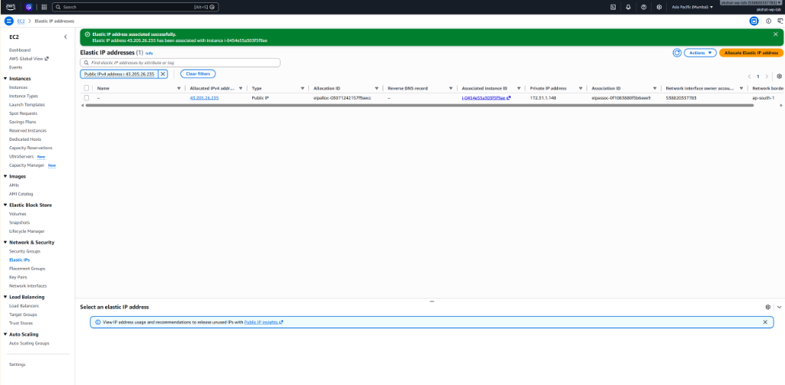
_EC2 Console: Elastic IP `43.205.26.235` successfully associated with instance `wp-lab` (`i-0454e55a303f5f9ae`, private IP `172.31.1.148`, Association ID: `eipassoc-0f1083880f5b6eee9`)._

5. **Allocated Elastic IP:** **`43.205.26.235`**. This static IP now permanently belongs to `wp-lab` even across instance stops and restarts.

#### EC2 Console: Instance Running with Permanent Elastic IP
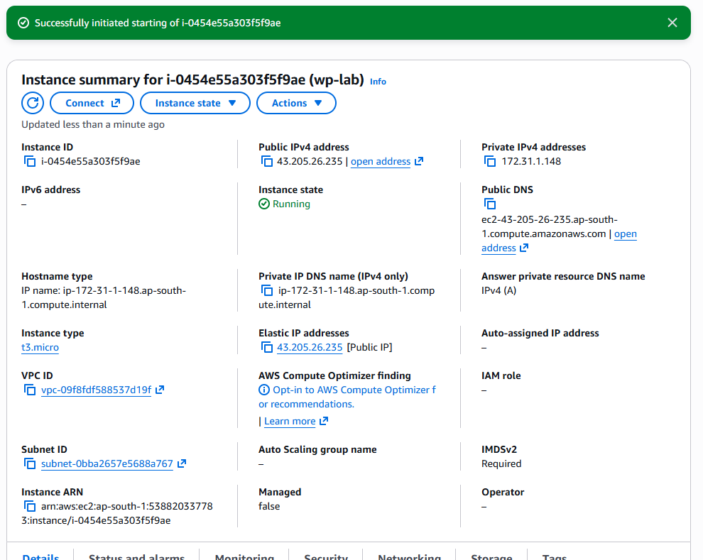
_EC2 Instance Summary: `wp-lab` (`i-0454e55a303f5f9ae`) is now `Running`. Notice that both Public IPv4 address and Elastic IP addresses display the permanent IP `43.205.26.235`._

---

### Step 2: Configure DNS A-Record on Hostinger hPanel

#### Why this step is required:
- Computers communicate via IP addresses (`43.205.26.235`), but humans remember names (`lab.asaxenadev.com`).
- DNS acts as the global internet phonebook. By creating an **`A` record**, we tell every DNS server worldwide: *"When someone visits `lab.asaxenadev.com`, send their traffic to AWS Elastic IP `43.205.26.235`."*
- **Safety of Main Website:** The existing `@` records for `asaxenadev.com` on Hostinger remain completely untouched and safe. Only traffic specifically asking for `lab` is directed to AWS.
- **Why TTL is 300 seconds:** Setting a low Time-To-Live (5 minutes) ensures that DNS caches refresh almost immediately during setup and testing.

1. Log into [Hostinger hPanel](https://hpanel.hostinger.com) ➔ Navigate to **Domains** ➔ Select `asaxenadev.com`.
2. Open the **DNS / Nameservers** tab ➔ Click **DNS records**.
3. Under **Manage DNS records**, create or edit the subdomain record:
   - **Type:** `A`
   - **Name:** `lab` (resolves to `lab.asaxenadev.com`)
   - **Points to / Value:** `43.205.26.235` (The permanent AWS Elastic IP)
   - **TTL:** `300` (5 minutes for rapid global propagation)

#### Hostinger DNS Zone Editor: Updating A-Record with Elastic IP
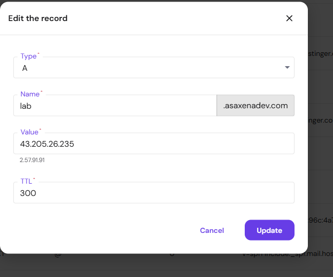
_Hostinger DNS Zone: Editing the A record for subdomain `lab.asaxenadev.com` to point to the AWS Elastic IP `43.205.26.235` with TTL 300._

4. Click **Update** (or **Add Record**).
5. Verify resolution locally from your workstation:
   ```powershell
   Resolve-DnsName lab.asaxenadev.com
   ```
   *Verified Output: `lab.asaxenadev.com` resolves directly to `43.205.26.235`!*

---

### Step 3: Configure Nginx & WordPress for the Custom Domain

#### ❓ Deep-Dive: Why is Step 3 strictly necessary if WordPress already opened via the domain?
*(Addressing the common thought: "Domain point karte hi website khul gayi, toh Step 3 ki kya zaroorat hai?")*

Jab humne Hostinger me `A` record add kiya, browser me `lab.asaxenadev.com` daalne par WordPress ka homepage khul gaya. Toh phir Nginx aur `wp-config.php` ko modify karne ki zaroorat kyun hai?

1. **Nginx `server_name` vs Certbot SSL Automation:**
   - Phase 1 me Nginx config me `server_name _;` tha (wildcard catch-all). Iska matlab tha: *"Is server par aane wali kisi bhi HTTP request ko serve karo, chahe request IP se aaye ya kisi bhi domain se."*
   - Lekin Step 4 me jab hum **Certbot (Let's Encrypt)** chalayenge, Certbot Nginx ki config files ko parse karta hai aur dekhta hai ki kis virtual host block me `server_name lab.asaxenadev.com;` likha hai, taaki wo wahan SSL certificate aur port 443 ka secure block inject kar sake.
   - Agar hum `server_name _;` chhod denge, toh Certbot ko matching server block nahi milega aur SSL setup fail ho jayega ya Certbot confuse hokar galat configuration bana dega.
2. **WordPress Database URLs (`wp_options`) vs Redirect Loops & Mixed Content:**
   - Phase 1 me WordPress install karte waqt database table `wp_options` me `siteurl` aur `home` ki value purani IP (`http://13.233.151.154`) save hui thi.
   - Jab aap `lab.asaxenadev.com` open karte hain, homepage toh load ho jata hai, lekin jaise hi aap kisi link par click karenge ya `/wp-admin` par jayenge, WordPress database se purani IP uthayega aur browser ko us purani (ab band ho chuki) IP par redirect kar dega!
   - Iske alawa, saare images, CSS aur JavaScript files purani IP se load hone ki koshish karengi, jisse site toot jayegi aur Step 4 me SSL aane ke baad browser **"Mixed Content / Insecure Connection"** warning fekega.
   - `wp-config.php` me `WP_HOME` aur `WP_SITEURL` define karke hum database values ko code-level par override kar dete hain, jisse WordPress hamesha `lab.asaxenadev.com` hi use kare.

---

#### 3.1: Reconnect via SSH using the Permanent Elastic IP

Connect to the instance using your private key and the newly allocated Elastic IP:
```powershell
ssh -i "C:\Users\HP\Desktop\aws-key\wp-lab-key.pem" ubuntu@43.205.26.235
# OR using the domain:
# ssh -i "C:\Users\HP\Desktop\aws-key\wp-lab-key.pem" ubuntu@lab.asaxenadev.com
```

##### 🔍 Breakdown of the SSH Command: Where does `ubuntu@43.205.26.235` come from?
- **`ubuntu`**: Yeh AWS EC2 Ubuntu AMI ka default system username hota hai (jaise Amazon Linux me `ec2-user` hota hai).
- **`@` (AT)**: Yeh bilkul email address (`user@example.com`) ki tarah kaam karta hai. Iska matlab hai: *"Mujhe `ubuntu` user bankar **AT** is address (`43.205.26.235`) par login karao."*
- **`43.205.26.235`**: Yeh hamara Step 1 me allocate kiya gaya static **Elastic IP** hai.

##### 🔍 Understanding the Terminal Shell Prompt: `ubuntu@ip-172-31-1-148:~$`
Jab login ho jata hai, terminal me prompt dikhta hai:
```text
ubuntu@ip-172-31-1-148:~$
```
Har hisse ka matlab:
| Prompt Element | Meaning | Architectural Context |
|---|---|---|
| `ubuntu` | Logged-in Username | Aap currently system ke `ubuntu` user account me hain. |
| `@` | "AT" (Location) | Separator jo user aur machine ke beech hota hai. |
| `ip-172-31-1-148` | Server Hostname | AWS VPC ke andar instance ko mila **Private IP** (`172.31.1.148`), jo AWS default hostname banata hai. |
| `:` | Separator | Hostname aur current directory path ko alag karta hai. |
| `~` | Current Directory | Tilde (`~`) Linux me user ki Home Directory (`/home/ubuntu`) ko represent karta hai. |
| `$` | Privilege Level | Normal standard user privilege (root user hota toh `#` dikhta). |

##### 🔍 Understanding the Welcome Banner (MOTD — Message of the Day):
Login karte hi screen par system information aati hai:
- **`System load: 0.0`**: CPU par koi load nahi hai, server bilkul free hai.
- **`Memory usage: 47%`**: Total 1GB RAM me se ~470MB use ho rahi hai (Nginx, PHP-FPM, MySQL chal rahe hain).
- **`Swap usage: 15%`**: Phase 1 me jo humne 2GB swap memory banayi thi, OS uska 15% use karke RAM par load kam kar raha hai.
- **`IPv4 address for ens5: 172.31.1.148`**: EC2 virtual network card (`ens5`) ka internal private IP.

##### ⚠️ Gotcha: Why did SSH say `Connection closed by 43.205.26.235 port 22` on the first attempt?
Jab aap AWS Console me instance ko `Start` karte hain, AWS dashboard turant status `Running` dikha deta hai kyunki hypervisor ne VM ko power-on kar diya hota hai.
Lekin guest operating system (Ubuntu) ko boot hone, kernel load karne aur `sshd` (SSH daemon) service start karne me 30 se 40 seconds ka time lagta hai.
Agar hum is window me connect karne ki koshish karein, toh initial network handshake toh ho jata hai lekin port 22 turant connection drop kar deta hai. 30 seconds wait karne ke baad SSH perfectly login ho jata hai.

#### Terminal: SSH Host Key Verification (`known_hosts`)
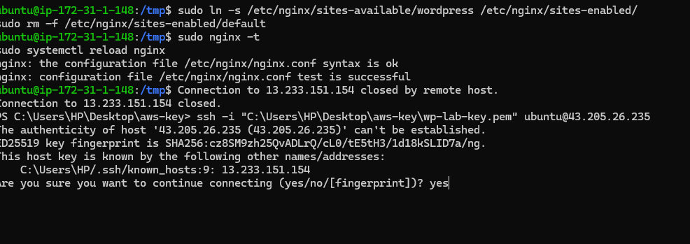
_SSH Verification: Connecting to the new Elastic IP for the first time prompts host key authenticity verification. Type 'yes' and press Enter to append the new IP to `~/.ssh/known_hosts`._

#### Terminal: Ubuntu SSH Session Established via Elastic IP
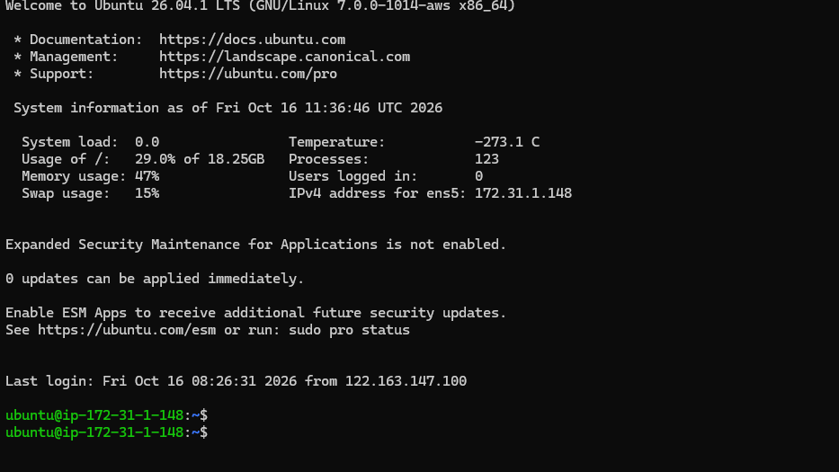
_Terminal Execution: Successfully connected to Ubuntu 26.04 over SSH via Elastic IP `43.205.26.235`. Notice Swap usage reports 15%, verifying persistent swap memory stability._

---

#### 3.2: Update Nginx Server Block with Subdomain
Update the virtual host configuration file to listen specifically for `lab.asaxenadev.com`:
```bash
sudo sed -i 's/server_name _;/server_name lab.asaxenadev.com;/' /etc/nginx/sites-available/wordpress
```
- **Command Breakdown:** `sed -i` (Stream Editor with in-place edit) file `/etc/nginx/sites-available/wordpress` me `server_name _;` dhoond kar use replace kar deta hai `server_name lab.asaxenadev.com;` se.

Validate configuration syntax and gracefully reload Nginx:
```bash
sudo nginx -t
sudo systemctl reload nginx
```
- **Command Breakdown:** `sudo nginx -t` syntax check karta hai. Agar syntax me koi typo ho toh service fail nahi hoti. `sudo systemctl reload nginx` bina active user connections drop kiye new config reload kar deta hai.

#### Nginx: Updating server_name for Subdomain Verification Reference
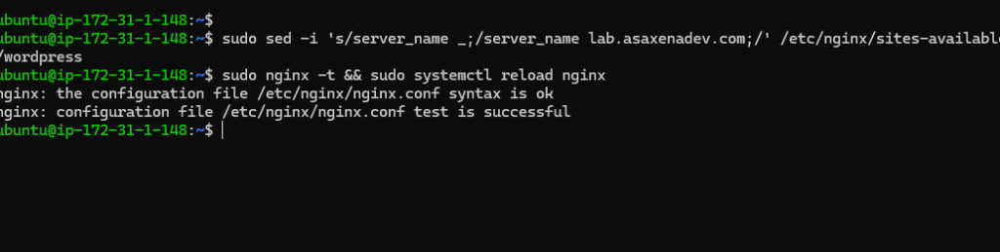
_Terminal Execution: Replacing wildcard server_name _; with server_name lab.asaxenadev.com; via sed, testing syntax (syntax is ok), and gracefully reloading Nginx._

---

#### 3.3: Update WordPress Site URL (`wp-config.php`)
Instruct WordPress core to generate all canonical URLs, admin redirects, and asset links using the subdomain instead of the Phase 1 raw IP:
```bash
sudo sed -i "/That's all, stop editing/i define('WP_HOME', 'http://lab.asaxenadev.com');\ndefine('WP_SITEURL', 'http://lab.asaxenadev.com');" /var/www/html/wp-config.php
```
- **Command Breakdown:**
  - `sed -i "/pattern/i <text>"`: `/* That's all, stop editing! Happy publishing. */` line ke theek upar (`i` = insert) dono constants add karta hai.
  - `WP_HOME`: Site ka public address jahan visitor homepage dekhta hai (`http://lab.asaxenadev.com`).
  - `WP_SITEURL`: WordPress core files ka address jahan admin dashboard aur core scripts hote hain (`http://lab.asaxenadev.com`).
- **Why this matters right now:** Abhi hum ise `http://` ke sath configure karte hain taaki Nginx reload ke baad site perfectly domain se chale. Step 4 me jab SSL install hoga, hum ise ek command se `https://` me switch kar denge.

#### Terminal: Updating wp-config.php with WP_HOME & WP_SITEURL
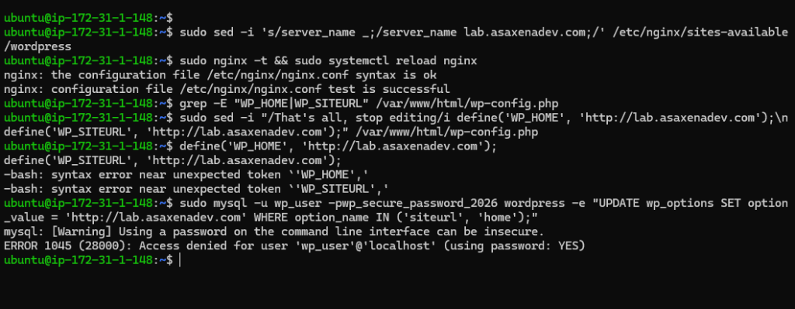
_Terminal Execution: Modifying `/var/www/html/wp-config.php` via `sed -i` to inject `WP_HOME` and `WP_SITEURL`. Once defined in `wp-config.php`, WordPress prioritizes these constants over the database `wp_options` table, preventing redirects back to the old IP `13.233.151.154`._

Verify that the constants are now present:
```bash
grep -E "WP_HOME|WP_SITEURL" /var/www/html/wp-config.php
```
*Expected Output:*
```text
define('WP_HOME', 'http://lab.asaxenadev.com');
define('WP_SITEURL', 'http://lab.asaxenadev.com');
```

#### 🛠️ Real-world Debugging Walkthrough: The Old IP Redirect Loop Trap (`13.233.151.154`)

During setup, when testing `http://lab.asaxenadev.com/wp-admin`, the browser unexpectedly bounced to:
```text
http://13.233.151.154/wp-login.php?redirect_to=http%3A%2F%2Flab.asaxenadev.com%2Fwp-admin%2F&reauth=1
```

##### 1. Root Cause Breakdown (Application Layer vs DNS Layer):
- **DNS Layer was working:** DNS correctly resolved `lab.asaxenadev.com` to Elastic IP `43.205.26.235`, and Nginx accepted the incoming connection.
- **Application Layer was stale:** Inside MySQL's `wp_options` table, `siteurl` was still set to the Phase 1 auto-assigned IP (`http://13.233.151.154`).
- **WordPress Authentication Router:** When an unauthenticated visitor hits `/wp-admin`, WordPress executes `wp_login_url()` which pulls `site_url('wp-login.php')`. Because `wp-config.php` did not yet contain `WP_SITEURL`, WordPress queried the database and issued an HTTP 302 redirect directly to the dead Phase 1 IP!

##### 2. The Browser Cache Trap (Why testing in the same tab fails even after fixing the server):
- When WordPress returns an HTTP 301/302 redirect header, modern browsers (Chrome, Edge) cache the redirect in local disk cache.
- Even **after** the `sed -i` command successfully inserted `WP_HOME` and `WP_SITEURL` into `wp-config.php`, refreshing the standard browser window re-triggered the old cached redirect without sending a new request to EC2!
- **Resolution:** Always test URL redirects in an **Incognito / Private Window** (`Ctrl + Shift + N`), or perform a hard refresh (`Ctrl + F5` / `Empty Cache and Hard Reload`).

##### 3. Diagnostic Checklist:
| Check | Command / Action | Result |
|---|---|---|
| 1. Verify file updated | `grep -E "WP_HOME\|WP_SITEURL" /var/www/html/wp-config.php` | Must output `WP_HOME` and `WP_SITEURL` |
| 2. Clear browser redirect cache | Open Incognito Window (`Ctrl + Shift + N`) | Bypasses local 302 redirect memory |
| 3. Test clean login page | Open `http://lab.asaxenadev.com/wp-admin` | Loads `http://lab.asaxenadev.com/wp-login.php` seamlessly |

---

### Step 4: Install Certbot & Provision Let's Encrypt SSL/TLS Certificate

#### Why this step is required:
- By default, HTTP traffic travels unencrypted over port 80. Anyone on the same network (e.g. coffee shop Wi-Fi or ISP) can intercept passwords and session cookies in plain text.
- Browsers display a prominent red warning: *"Not Secure"* for plain HTTP.
- **Let's Encrypt** is a non-profit global Certificate Authority (CA) that provides free, automated SSL/TLS certificates.
- **Certbot** is the official Electronic Frontier Foundation (EFF) tool that:
  1. Solves the ACME HTTP-01 challenge to prove domain ownership.
  2. Downloads the signed SSL certificates to `/etc/letsencrypt/live/lab.asaxenadev.com/`.
  3. Automatically updates Nginx configuration to enable port 443 with modern encryption ciphers.
  4. Injects an automatic 301 HTTP ➔ HTTPS redirect.
  5. Configures a systemd timer to renew the certificate automatically every 60-90 days.

#### 4.1: Install Snapd Core & Certbot
Ubuntu 26.04 uses `snap` for official, auto-updating Certbot distribution:

1. **Install and refresh snap runtime:**
```bash
sudo snap install core && sudo snap refresh core
```
- **What this does:** Sets up Canonical's base runtime environment for snap packages.

#### Terminal: Snap Core Installed Successfully
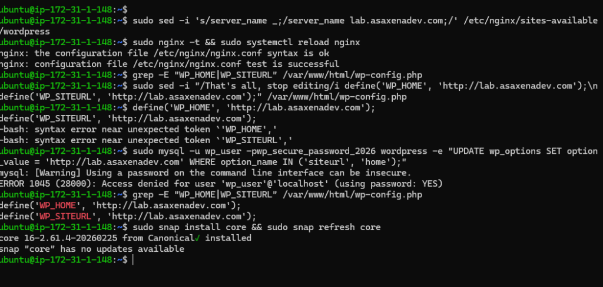
_Terminal Execution: Snap core runtime installed successfully (`core 16-2.61.4-20260225 from Canonical✓ installed`). Notice that `grep` in the preceding lines also confirmed `WP_HOME` and `WP_SITEURL` are safely set._

2. **Install Certbot client:**
```bash
sudo snap install --classic certbot
```
- **Why `--classic` is required:** By default, Snap packages run in strict sandboxes isolated from the host OS. Certbot needs direct access to inspect `/etc/nginx/`, modify virtual hosts, write certificates to `/etc/letsencrypt/`, and reload systemd daemons. The `--classic` flag grants Certbot the necessary system-level privileges.

#### Terminal: Certbot Installed Successfully
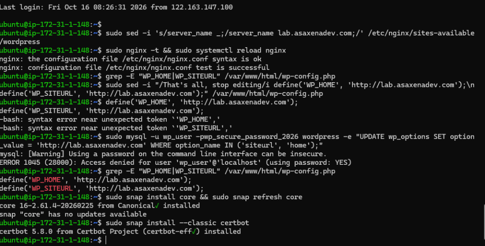
_Terminal Execution: Certbot 5.8.0 successfully installed from Canonical Snap repository (`certbot 5.8.0 from Certbot Project (certbot-eff✓) installed`)._

3. **Create a global symlink:**
```bash
sudo ln -s /snap/bin/certbot /usr/bin/certbot
```
- **Why this is done:** Maps the snap executable path to standard Linux `$PATH` so you can execute `certbot` anywhere without typing `/snap/bin/certbot`.

#### 4.2: Request SSL Certificate via Nginx Plugin
```bash
sudo certbot --nginx -d lab.asaxenadev.com
```
- Provide your email address for urgent renewal and security notices.
- Agree to the Terms of Service (`y`).
- Share email with EFF: (`n` or `y`).

#### Terminal: SSL Certificate Successfully Issued & Deployed
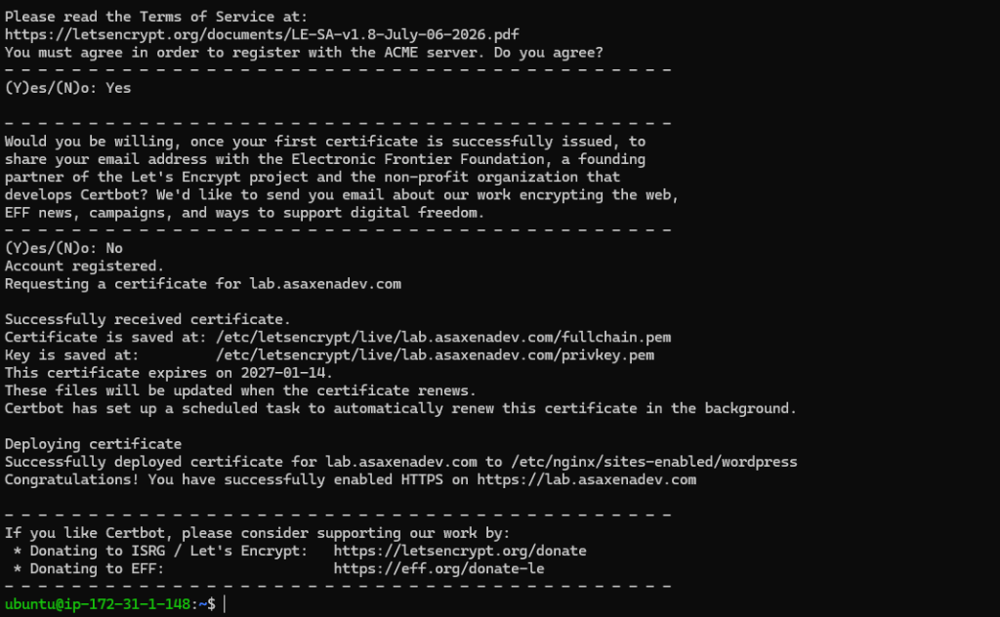
_Terminal Execution: Certbot successfully solves the ACME challenge, provisions an SSL certificate expiring 2027-01-14 (90-day validity), automatically injects SSL configuration and HTTP-to-HTTPS redirect into `/etc/nginx/sites-enabled/wordpress`, and configures automated background renewal._

##### 🔍 What Certbot did under the hood:
1. **ACME HTTP-01 Challenge:** Certbot created a temporary token at `/.well-known/acme-challenge/` and Let's Encrypt verified it over port 80 across the internet.
2. **Key Storage:**
   - Certificate: `/etc/letsencrypt/live/lab.asaxenadev.com/fullchain.pem`
   - Private Key: `/etc/letsencrypt/live/lab.asaxenadev.com/privkey.pem`
3. **Nginx Auto-Configuration:** Injected port 443 listen directives, SSL ciphers, and automatic `301 Moved Permanently` redirect from HTTP to HTTPS into `/etc/nginx/sites-available/wordpress`.
4. **Renewal Automation:** Created a background `systemd` timer (`certbot.timer`) to refresh the certificate 30 days before expiration.

---

#### 4.3: Switch WordPress to Enforce HTTPS
Now update WordPress core in `wp-config.php` to generate all asset URLs, script links, and canonical redirects using `https://` instead of `http://`:
```bash
sudo sed -i "s|http://lab.asaxenadev.com|https://lab.asaxenadev.com|g" /var/www/html/wp-config.php
```
Verify the change:
```bash
grep -E "WP_HOME|WP_SITEURL" /var/www/html/wp-config.php
```
*Expected Output:*
```text
define('WP_HOME', 'https://lab.asaxenadev.com');
define('WP_SITEURL', 'https://lab.asaxenadev.com');
```

#### 4.4: Verify Automated SSL Renewal
```bash
sudo certbot renew --dry-run
```
- **What this does:** Performs a complete simulated test of the automated certificate renewal process without counting against Let's Encrypt's strict production rate limits.

#### Terminal: Automated SSL Renewal Dry-Run Succeeded
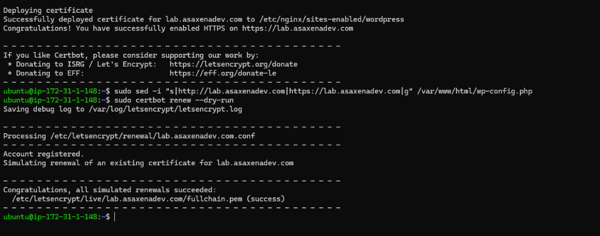
_Terminal Execution: Automated renewal dry-run succeeds (`Congratulations, all simulated renewals succeeded: /etc/letsencrypt/live/lab.asaxenadev.com/fullchain.pem (success)`). This confirms that the systemd timer can renew certificates automatically in the background without human intervention._

---

### Step 5: Browser Verification (Definition of Done)
1. Open `https://lab.asaxenadev.com/` in Chrome / Firefox / Brave.
2. Confirm the **Secure Padlock icon** appears next to the URL.
3. Inspect Security details: Click the padlock to confirm **"Connection is secure"** (issued by Let's Encrypt).
4. Test HTTP redirection: Typing `http://lab.asaxenadev.com` automatically redirects to `https://lab.asaxenadev.com` with HTTP 301.
5. Zero mixed-content warnings: WordPress Twenty Twenty-Five theme assets, stylesheets, fonts, and scripts load entirely over HTTPS.

#### Browser: Live Verification of HTTPS with Padlock
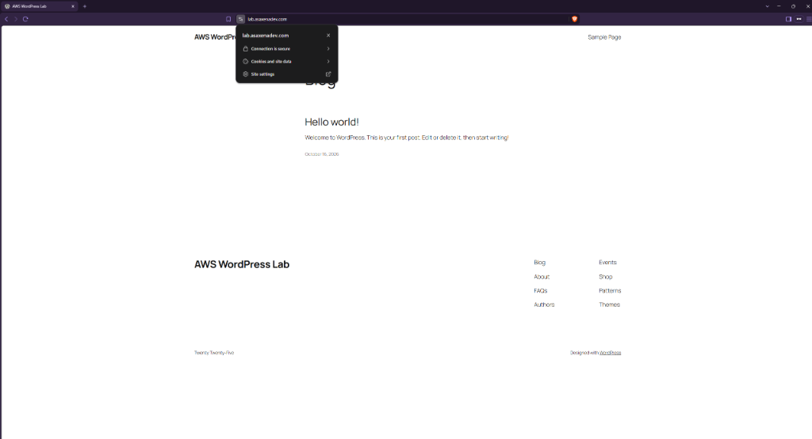
_Browser Verification (Definition of Done Passed): `https://lab.asaxenadev.com` loads securely over HTTPS with a valid Let's Encrypt SSL/TLS certificate. The browser security badge confirms 'Connection is secure' with zero mixed-content warnings, complete CSS styling, and perfect WordPress canonical resolution._

</details>

---

<details>
<summary><h3>💡 What surprised me (Gotchas & Real-world Lessons) (Click to Expand)</h3></summary>

## What surprised me (Gotchas & Real-world Lessons)

1. **Hostinger UI Trap — "Subdomains" Tab vs "DNS records" Tab:**
   In Hostinger hPanel under *DNS / Nameservers*, there is a dedicated horizontal tab named *Subdomains*. Clicking "Create Subdomain" there provisions an Apache/LiteSpeed web root on Hostinger's local hosting servers. To point a subdomain to an external cloud server like AWS EC2, you must ignore the *Subdomains* tab and add a manual `A` record under the **DNS records** tab.
2. **Certbot ACME HTTP-01 Validation Requires DNS First:**
   Certbot cannot issue a certificate before the DNS A-record has propagated globally. Let's Encrypt servers query public DNS to find the machine to challenge. Attempting to run Certbot before DNS propagation results in `NXDOMAIN` or `Connection Refused` errors.
3. **AWS Elastic IP Idle Billing Gotcha:**
   Allocating an Elastic IP and leaving it unassociated (or associated with a stopped instance) incurs an hourly fee ($0.005/hr) to discourage public IPv4 address hoarding. Always release unattached Elastic IPs when ending testing sessions.
4. **Mixed Content Warnings in WordPress:**
   If media files or stylesheets in WordPress remain hardcoded with `http://`, the browser displays an insecure warning despite having a valid SSL certificate. Defining `WP_HOME` and `WP_SITEURL` with `https://` forces core assets over SSL.
5. **SSH Connection Drop during OS Boot Window:**
   Immediately after starting a stopped EC2 instance, the AWS console marks the instance as `Running`, but Ubuntu's internal services are still initializing. Connecting via SSH during this exact window allows host key handshake but drops the connection with `Connection closed by 43.205.26.235 port 22`. Once the OS finishes booting (~30 seconds), SSH connects seamlessly.
6. **The Dual Meaning of the `@` Symbol (Linux/SSH vs DNS Zones):**
   - **In Linux & SSH:** `@` literally stands for **"AT"** (`[User] @ [Host]`). Running `ssh ubuntu@43.205.26.235` translates to *"Log in as user 'ubuntu' AT the host '43.205.26.235'"* (identical in syntax to email addresses like `user@domain.com`). Similarly, the bash shell prompt `ubuntu@ip-172-31-1-148:~$` signals that the current session is executing as user `ubuntu` AT the host machine `ip-172-31-1-148`.
   - **In DNS Zone Files:** `@` serves as an industry-standard shorthand alias for the **Root Apex Domain** (`asaxenadev.com`). Multiple `@` rows appear in DNS management consoles because distinct internet protocols operate concurrently: `A` records map the web server IPv4, `AAAA` handles IPv6, `MX` records direct mail servers (`mx1.hostinger.com`), and `TXT` records publish SPF anti-spoofing security policies.
7. **The Application Redirect Trap & Browser 302 Cache:**
   Pointing a domain to EC2 only connects the network pipe. The application (WordPress) still retains internal configuration from the initial IP setup in its database (`wp_options`). Accessing `/wp-admin` triggers a 302 redirect back to the dead IP. Furthermore, browsers aggressively cache HTTP 302 redirects in local disk cache, so testing in the same window after applying a server fix continues to bounce until tested in an Incognito window.

#### SSH Connection Drop during Boot Verification Reference
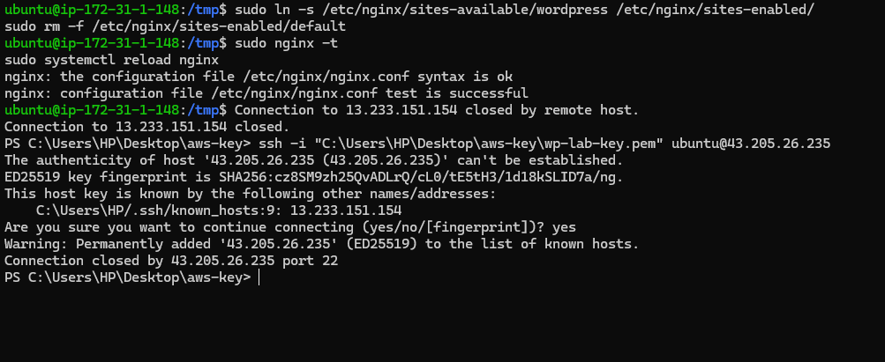
_Troubleshooting: Connection closed by port 22 immediately after saving known_hosts occurs when the SSH daemon is still finalizing its startup process._

</details>

---

<details>
<summary><h3>💰 Commands Worth Remembering (Click to Expand)</h3></summary>

## Commands Worth Remembering

```bash
Resolve-DnsName lab.asaxenadev.com            # Windows DNS verification
dig lab.asaxenadev.com +short                 # Linux/Mac DNS verification
sudo nginx -t                                 # Test Nginx syntax before reload
grep -E "WP_HOME|WP_SITEURL" /var/www/html/wp-config.php  # Verify WordPress domain override
sudo certbot renew --dry-run                  # Test automated SSL renewal simulation
systemctl list-timers | grep certbot          # Verify systemd automated certificate renewal timer
```

</details>

---

<details>
<summary><h3>💰 Cost & Teardown (Click to Expand)</h3></summary>

## Cost & Teardown

- **Elastic IP Attached to Running EC2:** **$0.00 / Free** (Included with 1 active EC2 instance).
- **Elastic IP Detached / Idle:** **$0.005 / hour (~₹0.40/hr)**.
- **Let's Encrypt SSL Certificate:** **$0.00 / 100% Free**.
- **End-of-Session Teardown:**
  - If stopping instance: Keep Elastic IP associated, or release it if you want to avoid stopped-instance IPv4 charges.
  - If terminating: Disassociate Elastic IP ➔ **Actions ➔ Release Elastic IP address**.

</details>

---

<details>
<summary><h3>🎯 Interview Questions & Answers (Phase 2 Deep Dive) (Click to Expand)</h3></summary>

## Interview Questions & Answers (Phase 2 Deep Dive)

### 📌 Category 1: AWS Elastic IPs & IPv4 Economics

#### Q1: What is an Elastic IP, and why is it necessary for a production EC2 web server?
* **Question:** Why can't a production website rely on the standard auto-assigned public IP provided by AWS EC2?
* **Answer:** Auto-assigned public IPv4 addresses are dynamic and ephemeral. When an instance is stopped (e.g. for maintenance, resizing, or hardware failure), AWS releases the IP back into the global pool. When restarted, a completely new IP is assigned, breaking all DNS records and SSL bindings. An **Elastic IP (EIP)** is a static, persistent public IPv4 address allocated to your AWS account that remains identical across reboots, stops, and can be instantly remapped to a replacement EC2 instance during a disaster recovery event.
* **Key Trade-off:** AWS charges for unattached or idle Elastic IPs ($0.005/hr) to prevent address hoarding due to global IPv4 exhaustion.

---

#### Q2: How does Elastic IP remapping enable zero-downtime disaster recovery?
* **Question:** If your primary EC2 web server suffers an unrecoverable hardware failure in Availability Zone A, how does an Elastic IP help?
* **Answer:** Because DNS records point to the Elastic IP (not the instance ID), you can launch a healthy standby EC2 instance in Availability Zone B and execute an **Elastic IP Reassociation** via AWS Console or CLI in under 10 seconds. Downstream visitors continue accessing the site without waiting hours for global DNS records to propagate.

---

### 📌 Category 2: DNS Architecture & Subdomains

#### Q3: What is the difference between an A Record and a CNAME, and why use an A Record for `lab.asaxenadev.com`?
* **Question:** When configuring `lab.asaxenadev.com`, why did we use an A Record pointing to an IP instead of a CNAME?
* **Answer:** An **A Record** maps a hostname directly to a numerical IPv4 address (`lab.asaxenadev.com ➔ 13.xxx.xxx.xxx`). A **CNAME** maps an alias hostname to another canonical hostname (`cdn.example.com ➔ d123.cloudfront.net`). Because our AWS EC2 instance has a dedicated static IP address (Elastic IP), an A Record is the direct and fastest resolution method without an extra DNS lookup hop.

---

#### Q4: Why is setting a low TTL (e.g. 300 seconds) recommended during migrations and testing?
* **Question:** What is the operational impact of setting a 24-hour TTL versus a 5-minute TTL when launching a new service?
* **Answer:** TTL (Time-To-Live) controls how long recursive DNS resolvers (ISPs, Google DNS) cache the IP mapping. A 24-hour TTL means if an IP mistake occurs or a server moves, users remain locked out for up to 24 hours. A 300-second (5-minute) TTL ensures changes propagate across the internet in minutes, enabling rapid troubleshooting and validation. Once production stabilizes, raising TTL to 86400s reduces DNS query traffic.

---

#### Q5: What does the `@` symbol represent in a DNS zone file, and why do multiple `@` records exist for a single domain?
* **Question:** In Hostinger or Route 53, why do you see multiple rows with Name `@`, and what does `@` actually mean?
* **Answer:** In DNS syntax, **`@`** is an industry-standard alias representing the **Root Apex Domain** (`asaxenadev.com` with no subdomain prefix). Multiple `@` records exist concurrently because different internet services require distinct routing protocols for the root domain:
  * **`A` record (`@`):** Routes HTTP web visitors to the web server's IPv4 address.
  * **`AAAA` record (`@`):** Routes IPv6 web traffic.
  * **`MX` records (`@`):** Tells email servers where to deliver inbound emails (e.g. `user@asaxenadev.com`).
  * **`TXT` records (`@`):** Publishes SPF (Sender Policy Framework) and DKIM keys so recipient mail systems can verify email legitimacy and prevent spam spoofing.

---

#### Q8: When pointing a custom domain to an EC2 WordPress instance, the homepage loaded fine, but visiting `/wp-admin` redirected to the old ephemeral EC2 IP. What was the root cause, and how do you resolve it?
* **Question:** You mapped DNS to an EC2 web server running WordPress. The homepage rendered, but any attempt to log into `/wp-admin` redirected the browser to the old, decommissioned IP address. Why did this happen, and how do you fix it?
* **Answer:**
  * **Root Cause:** DNS routes traffic to the server, but WordPress manages application-level canonical URLs independently via its database table `wp_options` (`siteurl` and `home`). When an unauthenticated user accesses `/wp-admin`, WordPress executes `wp_login_url()` and issues an HTTP 302 redirect based on the database value. Because the database was initialized with the old IP, WordPress bounced the user back to the old address.
  * **Resolution:** In `/var/www/html/wp-config.php`, define:
    ```php
    define('WP_HOME', 'http://lab.asaxenadev.com');
    define('WP_SITEURL', 'http://lab.asaxenadev.com');
    ```
    Defining these constants in PHP takes execution precedence over the database without needing complex MySQL query migrations.
  * **Browser Caching Trap:** Browsers cache 302/301 redirects locally. Even after fixing the server, verification must be performed in an Incognito / Private browsing window to bypass local disk redirect cache.

---

### 📌 Category 3: SSL/TLS & Let's Encrypt Automation

#### Q6: How does Certbot / Let's Encrypt prove domain ownership (ACME HTTP-01 Challenge)?
* **Question:** Explain the step-by-step handshake between Certbot, your EC2 Nginx server, and the Let's Encrypt Certificate Authority.
* **Answer:**
  1. Certbot contacts Let's Encrypt ACME servers requesting an SSL certificate for `lab.asaxenadev.com`.
  2. Let's Encrypt generates a unique cryptographic token and instructs Certbot to place it at a public web URI: `http://lab.asaxenadev.com/.well-known/acme-challenge/<TOKEN>`.
  3. Let's Encrypt servers make an independent HTTP request to `lab.asaxenadev.com` across the public internet.
  4. Nginx serves the file containing the expected token.
  5. Having mathematically proven that the requestor controls both the DNS routing and the web server, Let's Encrypt signs and issues the public certificate and intermediate chain.

---

#### Q7: Why do Let's Encrypt certificates expire in 90 days, and how does Ubuntu automate renewal?
* **Question:** Why doesn't Let's Encrypt issue 1-year or 2-year certificates like traditional Certificate Authorities?
* **Answer:** Security hardening. Shorter lifespans limit the window of vulnerability if a private key is compromised, and encourage full automation of the renewal process so human administrators never forget renewals. Ubuntu automates this via a systemd timer (`certbot.timer`) that runs twice daily, automatically renewing certificates within 30 days of expiration and executing an Nginx reload.

---

#### Q9: How does Certbot automate HTTP-to-HTTPS redirection, and why is Nginx redirection superior to a WordPress plugin?
* **Question:** How was the HTTP-to-HTTPS redirect configured, and what are the trade-offs of handling redirects at the Nginx web server level versus an application plugin (like Really Simple SSL)?
* **Answer:**
  * **How Certbot did it:** The `--nginx` flag invokes the Certbot Nginx plugin. Beyond requesting the certificate, it parses `/etc/nginx/sites-available/wordpress`, splits it into a Port 443 SSL block and a Port 80 redirect block, and injects `return 301 https://$host$request_uri;` into the port 80 block.
  * **Trade-off (Web Server vs Plugin Level):**
    * **Application Level (WordPress Plugin):** Requires Nginx to invoke PHP-FPM, bootstrap the entire WordPress core, connect to MySQL, execute plugin hooks, and only then emit a redirect header. This consumes significant CPU and RAM for every single unencrypted request.
    * **Web Server Level (Nginx):** Extremely lightweight and fast (~1-2 ms). Nginx intercepts port 80 requests at the edge socket and immediately fires a 301 redirect without waking up PHP or touching MySQL, preserving server capacity and ensuring optimal SEO crawl speed.

</details>
