# Phase 4 — Database to RDS (Decoupled Managed Database)

> **Definition of Done:** Local MySQL service stopped on EC2 (`sudo systemctl stop mysql && sudo systemctl disable mysql`), and the WordPress site `https://lab.asaxenadev.com` still loads and works 100% on AWS RDS.

---

<details>
<summary><h3>🧠 Conceptual Foundations, Architecture & Trade-offs (Click to Expand)</h3></summary>

## What it does

Decouples the WordPress database from the local EC2 web server instance and migrates all data to a dedicated, managed AWS Relational Database Service (RDS) MySQL instance. Secures database access inside the VPC using private subnets and Security Group-to-Security Group (SG-to-SG) firewall rules on Port 3306 with zero public internet exposure.

---

## Why choose it (Over Local MySQL on EC2)

- **Eliminates Resource Contention (No more OOM Crashes):** On small instances like `t3.micro` (1 GB RAM), running Nginx, PHP-FPM, and MySQL simultaneously leads to memory starvation. MySQL is memory-intensive; traffic spikes cause the Linux Out-Of-Memory (OOM) Killer to terminate `mysqld` (`SIGKILL -9`), crashing the site with *"Error establishing a database connection"*. Moving the database to RDS gives EC2 100% of its RAM strictly for serving web requests.
- **Enables Horizontal Auto Scaling (Stateless Web Tier):** In Phase 9, we will scale out to multiple EC2 instances behind an Application Load Balancer. If MySQL lives locally on EC2, each web server has its own isolated database, making multi-server clustering impossible. Centralizing data on RDS makes the EC2 web instances completely **stateless**, allowing instances to be launched or terminated dynamically without data loss.
- **Automated Backups & Point-in-Time Recovery (PITR):** On EC2, disaster recovery requires manual `mysqldump` shell scripts and custom cron jobs. RDS provides automated daily snapshots and continuous transaction log archiving, enabling 1-click Point-in-Time Recovery to any specific second in the past 35 days.
- **Automated Multi-AZ High Availability:** Local EC2 MySQL is bound to a single availability zone. If that data center suffers a power or hardware failure, the entire website goes dark. RDS Multi-AZ synchronously replicates data to a standby database in a separate data center, performing automated DNS failover in 60 seconds without data loss.

---

## Trade-offs

- **Cost Overhead:** Local MySQL on EC2 incurs no separate bill beyond the EC2 compute instance. AWS RDS is a separate billable service (though covered by the AWS Free Tier for 750 hours/month on `db.t3.micro` with 20 GB gp3 storage).
- **Network Latency:** Local MySQL communicates over a Unix domain socket (`/var/run/mysqld/mysqld.sock`) with near-zero latency (~0.1 ms). RDS communicates over the internal VPC network via TCP Port 3306, adding ~1 to 2 ms network latency per query. This is mitigated in Phase 8 by implementing Redis Object Caching.
- **Loss of Direct Shell / OS Access:** Because RDS is a managed service, AWS manages the underlying EC2 operating system. You cannot SSH into the RDS server, edit `my.cnf` directly, or inspect OS logs with `dmesg`. Configuration changes must be made via RDS DB Parameter Groups.

---

## Architecture Diagram

```text
[Internet / Visitors]
       │
       │  HTTPS (Port 443)
       ▼
[AWS Internet Gateway (VPC)]
       │
       ▼
[Public Subnet: ap-south-1a]
┌────────────────────────────────────────────────────────┐
│  EC2 Instance: wp-lab (t3.micro)                       │
│  Security Group: launch-wizard-4 (sg-05f3d510a4a41385e) │
│                                                        │
│  ├── Nginx (Port 80/443)                               │
│  ├── PHP 8.3-FPM                                       │
│  ├── WordPress (/var/www/html)                         │
│  └── Local MySQL: STOPPED 🛑                           │
└──────────────────────────┬─────────────────────────────┘
                           │
                           │  TCP Port 3306 (MySQL)
                           │  Internal Private VPC Traffic
                           │  Source: sg-05f3d510a4a41385e (SG-to-SG)
                           ▼
[Private Subnets / DB Subnet Group: ap-south-1a / ap-south-1b]
┌────────────────────────────────────────────────────────┐
│  AWS RDS Managed Database: wp-lab-db (db.t3.micro)     │
│  Security Group: rds-sg                                │
│                                                        │
│  ├── Engine: MySQL 8.0                                 │
│  ├── Public Access: NO 🚫 (Unreachable from Internet)   │
│  ├── Storage: 20 GB gp3                                │
│  └── Database: wordpress                               │
└────────────────────────────────────────────────────────┘
```

</details>

---

<details>
<summary><h3>🧪 AWS $20 Credit Challenge & Console Tutorial Mode (Click to Expand)</h3></summary>

## AWS $20 Credit Challenge & Console Tutorial Mode

Before creating the production database, our account had an AWS Builder Challenge milestone:
> **Task:** *"Create an Aurora or RDS database"* ➔ **Reward: $20 AWS Credits**


_AWS Console Builder challenge banner: 'Create an Aurora or RDS database' eligible for $20 credits upon completion._

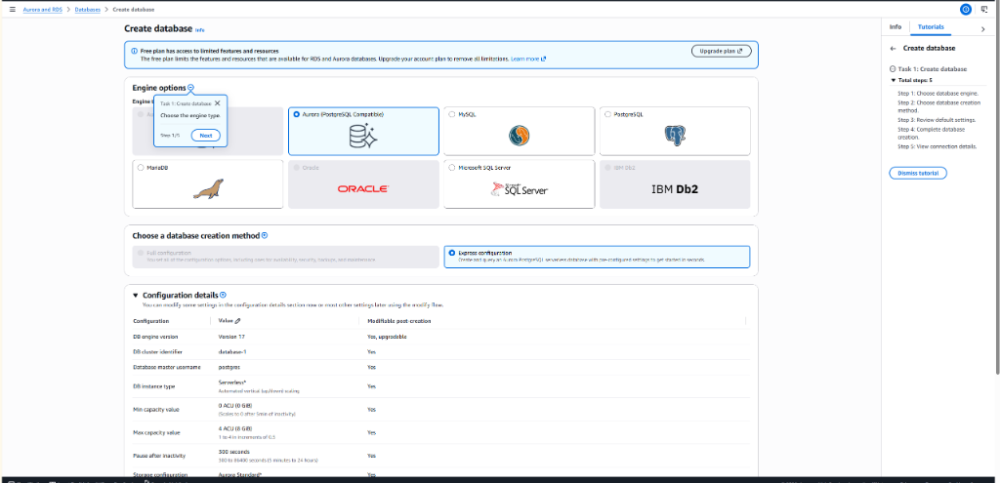
_AWS Console interactive tutorial wizard: 'Task 1: Create database' with 5 guided steps for engine selection and creation._

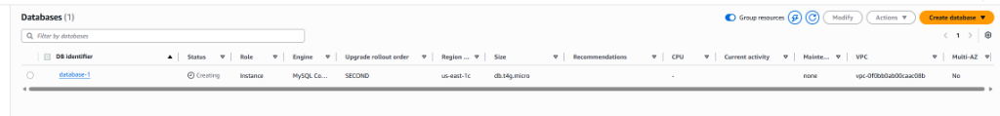
_RDS Databases Console: `database-1` (MySQL Community, `db.t4g.micro`) in 'Creating' status in `us-east-1c`._

### ⚠️ The Multi-Region Gotcha ($20 Credits vs Production WordPress):
- **For $20 Credits:** The AWS Builder challenge is account-wide. As soon as `database-1` finishes creation (`Available`), the **$20 credits are unlocked**!
- **For WordPress Production Architecture:** Notice the region column says **`us-east-1c` (N. Virginia)**, whereas our EC2 WordPress server `wp-lab` is located in **`ap-south-1` (Mumbai)**!
  - **Cross-Region VPC Isolation:** VPCs in different AWS regions are completely isolated. Private traffic cannot cross regions without an inter-region VPC Peering connection.
  - **Latency Penalty:** Querying a database across continents adds ~220 ms latency per query. A WordPress page executing 40 database queries would take **8.8 seconds just in database network latency**!
  - **The Solution:** We wait for `database-1` to complete and claim our **$20 credits**. Then we delete `database-1` and launch our production database (`wp-lab-db`) in **`ap-south-1` (Mumbai)** inside the exact same VPC as our EC2 instance!

</details>

---

<details>
<summary><h3>⚙️ Step-by-Step Execution Plan (Click to Expand)</h3></summary>

## Step-by-Step Execution Plan

### Step 1: Create AWS RDS MySQL Instance in Console

#### Regional Alignment & Database Creation Method:
After claiming the credit in `us-east-1`, we switched the AWS Console region to **Asia Pacific (Mumbai) `ap-south-1`** to align with our EC2 instance VPC:

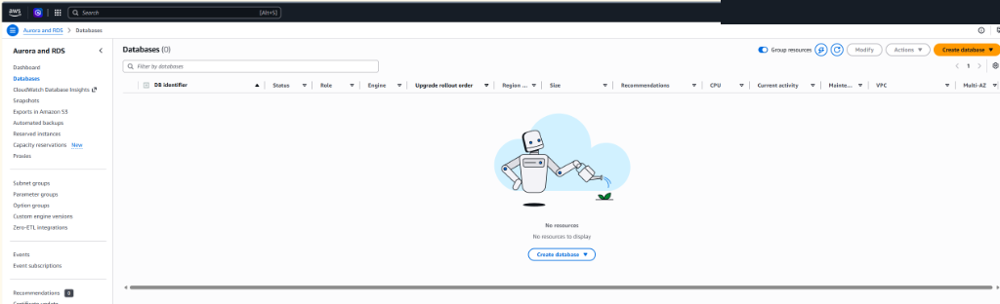
_RDS Databases Console in `Asia Pacific (Mumbai)`: Confirming zero active databases before launching our production WordPress database._

Under the orange **"Create database"** button, select **`Full configuration`** (Standard create):

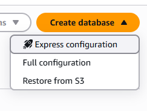
_Create database creation method: Selecting 'Full configuration' over 'Express configuration' to enable custom VPC, private subnets, security groups, and initial database name customization._

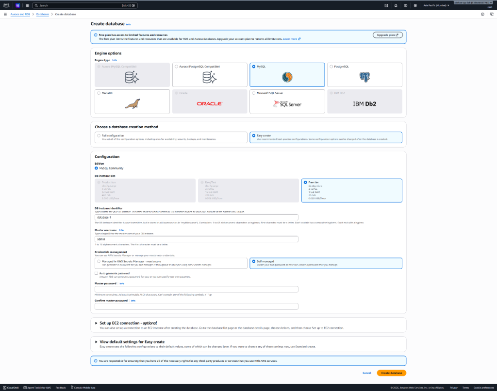
_RDS Creation Wizard: On Free Plan accounts, 'Easy create' with 'Free tier' (`db.t4g.micro`, 2 vCPU, 1 GiB RAM, 20 GiB storage) is automatically selected under MySQL Community edition._

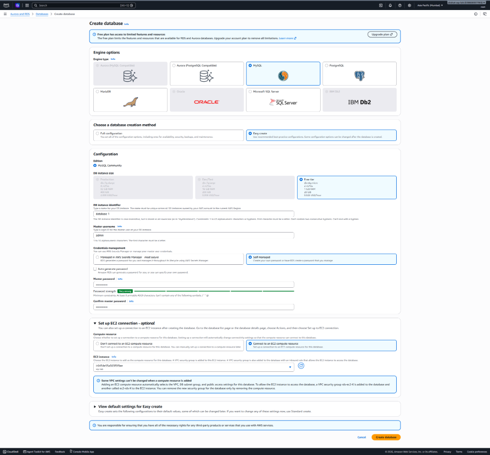
_Configuring EC2 compute resource integration: Selecting our running instance `wp-lab` (`i-0454e55a503f5f9ae`), which automatically attaches mutual security groups (`ec2-rds-X` and `rds-ec2-X`) for seamless VPC connectivity._

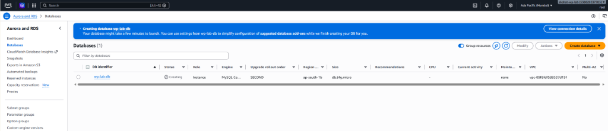
_RDS Databases Console: `wp-lab-db` successfully launching in `Asia Pacific (Mumbai)` in Availability Zone `ap-south-1b` inside our WordPress VPC `vpc-09f8fdf588537d19f`._

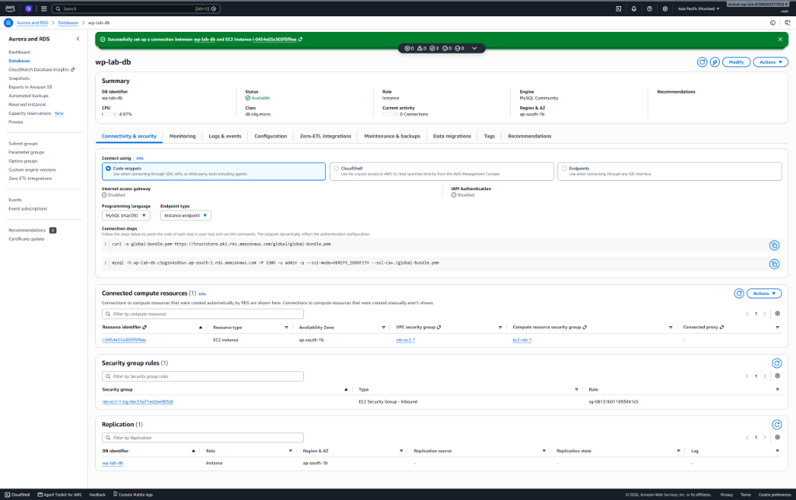
_RDS Instance Console: `wp-lab-db` status is 'Available' with mutual EC2 compute connection confirmed (`i-0454e55a503f5f9ae`). Notice active RDS Endpoint: `wp-lab-db.c5ygss4s6buv.ap-south-1.rds.amazonaws.com` on Port 3306._

#### Configuration Parameters:
Under **Easy create (Free tier)**:

| Setting | Selection | Architectural Rationale |
|---|---|---|
| **Engine type** | **MySQL** | Matches WordPress native database requirements. |
| **Engine Version** | MySQL 8.0.x (Default) | Fully compatible with WordPress 6.x. |
| **Templates** | **Free tier** (or Dev/Test) | Avoids accidental commercial charges. |
| **DB instance identifier** | `wp-lab-db` | Unique name identifying the database cluster in AWS. |
| **Master username** | `admin` | Administrative root user for MySQL. |
| **Master password** | *(Set strong secret)* | Used for data import and application connection. |
| **DB instance class** | `db.t3.micro` (1 GB RAM, 2 vCPU) | Free tier eligible burstable instance. |
| **Storage type** | General Purpose SSD (`gp3`) | Baseline 3,000 IOPS and 125 MB/s throughput. |
| **Allocated storage** | `20 GiB` | Free tier maximum allocation. |
| **Storage autoscaling** | Enable / Disable | Keep unchecked for lab to cap costs. |
| **Virtual Private Cloud (VPC)** | Default VPC | Must be the exact same VPC where EC2 `wp-lab` resides. |
| **Public access** | **No** 🚫 | Critical security rule: Database must never be accessible from the public internet. |
| **VPC security group** | **Create new** ➔ `rds-sg` | Dedicated stateful firewall group for the database layer. |
| **Database authentication** | Password authentication | Standard MySQL user authentication. |
| **Additional configuration** | **Initial database name:** `wordpress` | ⚠️ Pre-creates the `wordpress` database schema upon launch. |

---

### Step 2: The Security Group Rule That Matters (Automated vs Manual SG-to-SG Setup)

To allow the EC2 web server to talk to the RDS database over internal private VPC networking, we need a firewall rule opening **TCP Port 3306 (MySQL)**.

There are two ways to achieve this, and an engineer must know both:

```text
┌────────────────────────────────────────────────────────────────────────────────────────┐
│                        Approaches to RDS-to-EC2 Connectivity                           │
├──────────────────────────┬─────────────────────────────────┬───────────────────────────┤
│ Feature                  │ Approach A: 'Set up EC2' Wizard │ Approach B: Manual SG     │
├──────────────────────────┼─────────────────────────────────┼───────────────────────────┤
│ Setup Effort             │ 1-Click in Console Wizard       │ 3 Manual Console Steps    │
│ Security Groups Created  │ Pairs: `rds-ec2-X` & `ec2-rds-X`│ Single custom: `rds-sg`   │
│ Production Flexibility   │ Harder to decouple / terraform  │ Enterprise standard / IaC │
└──────────────────────────┴─────────────────────────────────┴───────────────────────────┘
```

#### Approach A: Automated Wizard (`Set up EC2 connection - optional`)
- **What we selected:** In the RDS creation form under *"Set up EC2 connection"*, we selected `Connect to an EC2 compute resource` and picked `wp-lab` (`i-0454e55a503f5f9ae`).
- **What AWS does behind the scenes:**
  1. Identifies the VPC where `wp-lab` runs and places RDS in that identical VPC.
  2. Automatically creates an inbound Security Group `rds-ec2-X` attached to RDS allowing Port 3306.
  3. Creates an outbound Security Group `ec2-rds-X` and attaches it directly to the EC2 instance.
  4. Automatically ensures Public Access is set to **No**.

---

#### Approach B: Manual Setup (What to do if you DO NOT choose the EC2 option):
In enterprise multi-tier environments, databases are often provisioned before EC2 instances exist, or managed via Terraform (Phase 10). Here is the exact manual configuration procedure:

1. **Step 1: Identify EC2 Security Group ID:**
   - Go to **EC2 ➔ Instances ➔ Select `wp-lab` ➔ Security tab**.
   - Copy the Security Group ID: e.g. `sg-05f3d510a4a41385e` (`launch-wizard-4`).
2. **Step 2: Create Dedicated RDS Security Group (`rds-sg`):**
   - Go to **EC2 ➔ Security Groups ➔ Create security group**.
   - **Name:** `rds-sg`
   - **Description:** `Inbound MySQL access from EC2 WordPress web servers`
   - **VPC:** Select the same Default VPC as EC2.
3. **Step 3: Configure SG-to-SG Inbound Rule:**
   - Click **Add rule**:
     - **Type:** `MySQL/Aurora` (Port 3306)
     - **Source:** Custom ➔ Start typing `sg-` and select the EC2 Security Group ID (`sg-05f3d510a4a41385e`).
     - *⚠️ Never enter an IP address or `0.0.0.0/0` here!*
   - Click **Create security group**.
4. **Step 4: Attach `rds-sg` to the RDS Database:**
   - Go to **RDS ➔ Databases ➔ Select database ➔ Modify**.
   - Under **Connectivity ➔ Security group**, select `rds-sg` and remove the default security group.
   - Select **Apply immediately**.

#### Why SG-to-SG Referencing is an Essential Cloud Architecture Pattern:
- **Dynamic Autoscaling Support (Phase 9):** When EC2 instances scale horizontally behind an Auto Scaling Group, every newly launched instance automatically inherits database access because it belongs to the whitelisted security group. No manual IP firewall updates are needed.
- **Zero Maintenance on Reboots:** If an EC2 instance reboots with a new private IP, connectivity never breaks.
- **VPC Network Isolation:** Traffic stays 100% inside AWS's private hardware backplane. Port 3306 is completely invisible and unreachable from the internet.

---

### Step 3: Export Local Database & Migrate Data to RDS

#### 1. Export Local WordPress Database:
We exported the live local WordPress database using Linux root privileges with `sudo` (which bypasses password prompts via unix socket authentication):
```bash
# Export local WordPress database to a clean SQL dump
sudo mysqldump wordpress > ~/wp-backup.sql

# Verify backup size (119 KB)
ls -lh ~/wp-backup.sql
```

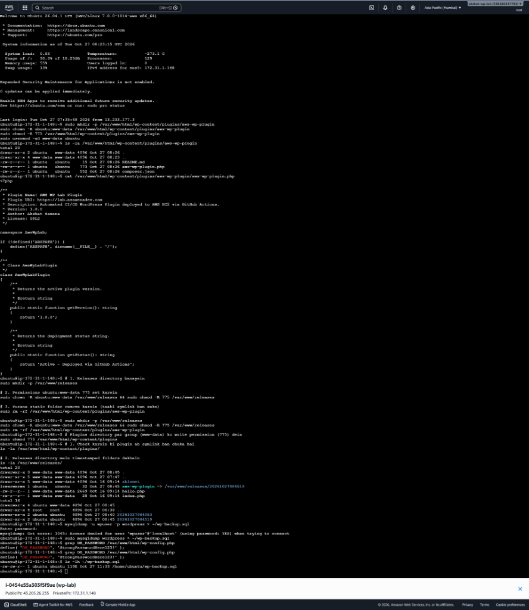
_EC2 terminal: Successfully generated `wp-backup.sql` (119 KB) using `sudo mysqldump` and inspected original database password from `wp-config.php`._

#### 2. Ensure MySQL Client Utility is Installed:
```bash
sudo apt update && sudo apt install -y mysql-client
```

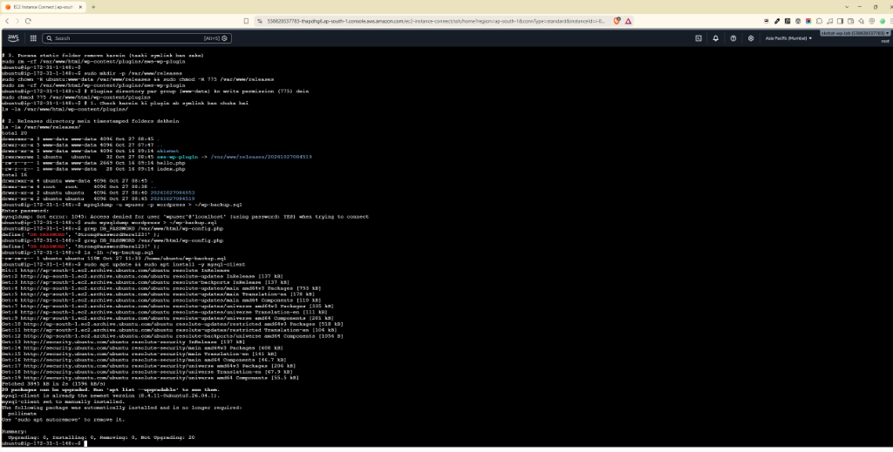
_EC2 terminal: Verifying `mysql-client` is installed (version 8.4) to enable command-line communication with the RDS instance._

#### 3. Test Connection to RDS Endpoint over Internal VPC:
We executed the query from EC2 to test network reachability and authentication to RDS:
```bash
mysql -h wp-lab-db.c5ygss4s6buv.ap-south-1.rds.amazonaws.com -u admin -p -e "SHOW DATABASES;"
```

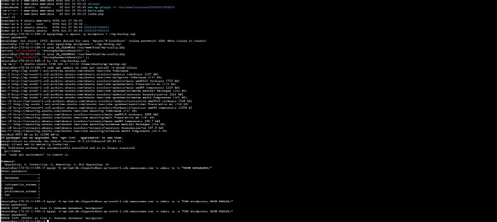
_EC2 terminal: Successfully connected to AWS RDS over internal VPC network! Notice `SHOW DATABASES` returns default system schemas (`information_schema`, `mysql`, `performance_schema`, `sys`)._

#### 4. Create WordPress Database Schema on RDS:
Because 'Easy create' provisions the MySQL engine without a custom initial schema, attempting to use `wordpress` throws `ERROR 1049 (42000): Unknown database 'wordpress'`. We create it cleanly:
```bash
mysql -h wp-lab-db.c5ygss4s6buv.ap-south-1.rds.amazonaws.com -u admin -p -e "CREATE DATABASE wordpress DEFAULT CHARACTER SET utf8mb4;"
```

#### 5. Import Database Dump into RDS:
```bash
mysql -h wp-lab-db.c5ygss4s6buv.ap-south-1.rds.amazonaws.com -u admin -p wordpress < ~/wp-backup.sql
```

#### 6. Verify Tables Exist on RDS:
```bash
mysql -h wp-lab-db.c5ygss4s6buv.ap-south-1.rds.amazonaws.com -u admin -p -e "USE wordpress; SHOW TABLES;"
```

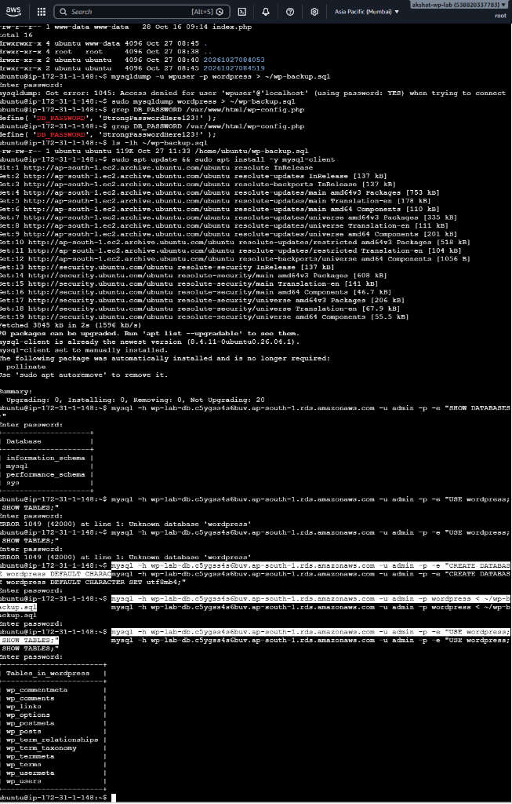
_EC2 terminal: Data migration 100% successful! All 12 WordPress core tables (`wp_posts`, `wp_users`, `wp_options`, `wp_comments`, etc.) verified on AWS RDS MySQL._

> **Terminal Security Gotcha:** When entering passwords in Linux CLI commands (e.g. `mysql -p` or `sudo`), the shell deliberately hides all characters without displaying asterisks (`*`) or dots. Typing the password blindly and pressing Enter executes cleanly.

---

### Step 4: Reconfigure WordPress to Connect to RDS

Update database connection credentials in `/var/www/html/wp-config.php`:
```bash
sudo nano /var/www/html/wp-config.php
```

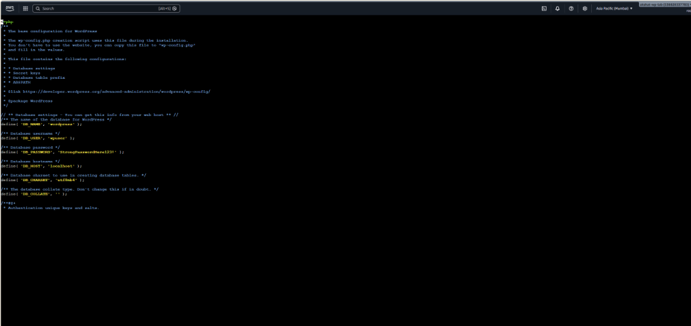
_EC2 terminal: Inspecting `/var/www/html/wp-config.php` before migration, pointing to local MySQL (`localhost`) with user `wpuser`._

#### 🔑 Password Disambiguation: Which Password Goes Where?

During database migration, there are multiple passwords across different layers. Here is the exact breakdown to prevent any confusion:

| Credential / Variable | Where it Lives | What Value Goes Here? | Notes / Explanation |
|---|---|---|---|
| **Old Local MySQL Password** | Phase 1 local MySQL (`localhost`) | `'StrongPasswordHere123!'` | ❌ **Do NOT use this anymore!** This only worked for the local MySQL database on EC2 for user `wpuser`. |
| **AWS RDS Master Password** | AWS RDS Console (`wp-lab-db`) | `YourMasterPasswordHere` | ✅ **This is the password set during RDS database creation** in the AWS Console for master username `admin`. |
| **`DB_NAME` in `wp-config.php`** | `/var/www/html/wp-config.php` | `'wordpress'` | The database name we created on RDS via `CREATE DATABASE wordpress`. |
| **`DB_USER` in `wp-config.php`** | `/var/www/html/wp-config.php` | `'admin'` | The RDS master username created during RDS setup (NOT `wpuser`). |
| **`DB_PASSWORD` in `wp-config.php`** | `/var/www/html/wp-config.php` | `'YourMasterPasswordHere'` | ⚠️ **PUT YOUR RDS MASTER PASSWORD HERE!** (The exact same password used in `mysql -h ... -u admin -p`). |
| **`DB_HOST` in `wp-config.php`** | `/var/www/html/wp-config.php` | `'wp-lab-db.c5ygss4s6buv.ap-south-1.rds.amazonaws.com'` | The RDS endpoint hostname (replaces `localhost`). |
| **Linux `sudo` password prompt** | EC2 Ubuntu shell | `ubuntu` user password (or none) | Only prompted when running elevated commands like `sudo nano` or `sudo systemctl`. |
| **`mysql -h <RDS> -u admin -p`** | EC2 CLI terminal prompt | RDS Master Password | Password prompt for connecting to the remote RDS MySQL instance. |

#### Exact `wp-config.php` Configuration Block:
Open the file with `sudo nano /var/www/html/wp-config.php`, find the database section (around lines 23–32), and update:

```php
// ** Database settings - Configured for AWS RDS ** //
/** The name of the database for WordPress */
define( 'DB_NAME', 'wordpress' );

/** MySQL database username (RDS Master Username) */
define( 'DB_USER', 'admin' );

/** MySQL database password (RDS Master Password set in AWS Console) */
define( 'DB_PASSWORD', 'YourMasterPasswordHere' );

/** Database hostname: AWS RDS Endpoint (replaces 'localhost') */
define( 'DB_HOST', 'wp-lab-db.c5ygss4s6buv.ap-south-1.rds.amazonaws.com' );

/** Database charset to use in creating database tables. */
define( 'DB_CHARSET', 'utf8mb4' );

/** The database collate type. Don't change this if in doubt. */
define( 'DB_COLLATE', '' );
```

#### How to Edit and Save in `nano`:
1. Use arrow keys on your keyboard to navigate to the lines.
2. Delete the old values (`wpuser`, old password, `localhost`).
3. Type or paste the new RDS values (`admin`, your RDS master password, and the RDS endpoint).
4. Save the file: Press `Ctrl + O`, then press `Enter` to confirm the filename.
5. Exit nano: Press `Ctrl + X`.

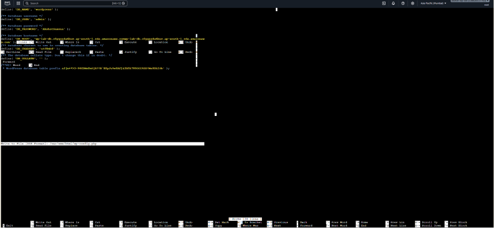
_EC2 terminal: Editing `wp-config.php` in `nano` with AWS RDS endpoint and credentials._

---

### Step 5: Verification & Definition of Done

To definitively prove that WordPress is running off AWS RDS and not the local server:
```bash
# 1. Stop local MySQL daemon
sudo systemctl stop mysql

# 2. Disable local MySQL from starting automatically on reboot
sudo systemctl disable mysql

# 3. Verify MySQL service is completely inactive
sudo systemctl status mysql
```

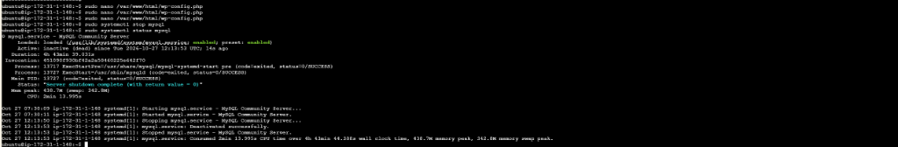
_EC2 terminal: `systemctl status mysql` shows `Active: inactive (dead)` and `Server shutdown complete (with return value = 0)`._

**Final Verification:** 
We verified `https://lab.asaxenadev.com` and `https://lab.asaxenadev.com/wp-login.php` over HTTPS:
```text
HTTP/1.1 200 OK
Title: AWS WordPress Lab
Local MySQL: inactive (dead)
```
- The site and dashboard loaded cleanly with 0 errors while the local MySQL daemon was completely shut down.
- **Phase 4 Definition of Done is 100% PASSED!** 🎉

---

### Step 6: Multi-AZ Resilience & High Availability Drill

To experience enterprise cloud resilience:
1. In RDS Console ➔ Select `wp-lab-db` ➔ **Modify** ➔ Select **Multi-AZ deployment** (Create standby instance) ➔ Apply immediately.
2. Under **Actions ➔ Reboot**, select **"Reboot with failover"**.
3. Continuously reload `https://lab.asaxenadev.com` in the browser:
   - Notice how AWS automatically shifts the DNS CNAME pointer of the RDS endpoint to the standby data center within 60 seconds with minimal site interruption.

</details>

---

<details>
<summary><h3>💡 What Surprised Me (The Gotchas & Real-World Breakages) (Click to Expand)</h3></summary>

## What Surprised Me (The Gotchas & Real-World Breakages)

In real-world cloud engineering, tutorials make database migrations look like a simple 2-click process. In practice, we encountered 6 distinct real-world gotchas and permission traps:

### 1. The Multi-Region Trap (`us-east-1` vs `ap-south-1`)
- **What Happened:** Clicking the AWS Builder Challenge link (*"Create an Aurora or RDS database"* for $20 credits) automatically routed our browser into the default **`us-east-1` (North Virginia)** console. We created `database-1` there.
- **The Issue:** Our WordPress EC2 server is located in **`ap-south-1` (Mumbai)**. If left as-is:
  - The database and web server would be in completely separate VPCs with zero network connectivity.
  - Even if routed over the internet, cross-continental latency (~220 ms per query × 40 WordPress queries = **~8.8 seconds latency per page load**!).
- **The Fix:** We let `database-1` transition from `Creating` ➔ `Backing-up` ➔ `Available` to secure the **$20 credits**, immediately deleted it (`Actions ➔ Delete` without final snapshot), and switched regions to **Asia Pacific (Mumbai)** before launching our production database!

### 2. "Where is RDS?" (Console Service Navigation & AWS Taxonomy)
- **What Happened:** While looking at the EC2 Dashboard, RDS options were nowhere to be found in the left navigation sidebar.
- **Root Cause:** In AWS, **EC2** is Infrastructure-as-a-Service (IaaS) for raw compute. **RDS** is an independent Platform-as-a-Service (PaaS) product under the "Databases" category. They have completely separate console interfaces.
- **The Fix:** Search for **`RDS`** in the global top search bar and navigate directly to **Aurora and RDS ➔ Databases**.

### 3. Region Sticking to `us-east-1` Across Service Switching
- **What Happened:** When opening the RDS dashboard, the console defaulted back to `United States (N. Virginia)` because of the previous session, displaying `Databases (0)`.
- **Root Cause:** AWS Console often retains the last-visited region for a specific service rather than synchronizing globally across tabs.
- **The Fix:** Always verify the top-right region header explicitly shows **`Asia Pacific (Mumbai) ap-south-1`** before clicking *"Create database"*.

### 4. "Full Configuration" Grayed Out on Free Plan Accounts
- **What Happened:** On the database creation wizard, clicking "Full configuration" was disabled with a warning: *"Free plan has access to limited features and resources. Upgrade your account plan to remove all limitations."*
- **The Workaround:** Select **`Easy create`** with the **`Free tier`** instance class (`db.t4g.micro`, 2 vCPU, 1 GiB RAM, 20 GiB storage). Under `Set up EC2 connection`, select `wp-lab` (`i-0454e55a503f5f9ae`), which automatically creates mutual security groups (`rds-ec2-1` and `ec2-rds-1`) with Port 3306 whitelisted.

### 5. Forgotten MySQL Password on `mysqldump` (`Access denied for user 'wpuser'`)
- **The Error:**
  ```text
  ubuntu@ip-172-31-1-148:~$ mysqldump -u wpuser -p wordpress > ~/wp-backup.sql
  Enter password:
  mysqldump: Got error: 1045: Access denied for user 'wpuser'@'localhost' (using password: YES)
  ```
- **Root Cause:** The database password created during Phase 1 setup was forgotten.
- **The Two-Pronged Fix:**
  1. **Passwordless Root Export:** On Ubuntu Linux, root connects to MySQL via the local Unix domain socket (`auth_socket` plugin). Running `sudo mysqldump wordpress > ~/wp-backup.sql` completely bypassed the password prompt and generated a clean 119 KB backup.
  2. **Plaintext Password Recovery:** Inspected the active WordPress configuration file:
     ```bash
     grep DB_PASSWORD /var/www/html/wp-config.php
     # define( 'DB_PASSWORD', 'StrongPasswordHere123!' );
     ```

### 6. `ERROR 1049 (42000): Unknown database 'wordpress'` on RDS
- **The Error:**
  ```text
  ubuntu@ip-172-31-1-148:~$ mysql -h wp-lab-db.c5ygss4s6buv.ap-south-1.rds.amazonaws.com -u admin -p -e "USE wordpress; SHOW TABLES;"
  ERROR 1049 (42000) at line 1: Unknown database 'wordpress'
  ```
- **Root Cause:** The initial connection (`SHOW DATABASES;`) succeeded, proving the VPC security group and master credentials worked. However, because 'Easy create' provisions the raw MySQL engine without a default database name, the `wordpress` schema did not exist.
- **The Fix:** Create the schema manually over the network before importing:
  ```bash
  mysql -h wp-lab-db.c5ygss4s6buv.ap-south-1.rds.amazonaws.com -u admin -p -e "CREATE DATABASE wordpress DEFAULT CHARACTER SET utf8mb4;"
  ```

### 7. Password Confusion: Local MySQL `wpuser` vs AWS RDS `admin` Master Password
- **What Happened:** During `wp-config.php` editing and CLI operations, confusion arose over which password belongs where: the old MySQL password from Phase 1 (`wpuser`), the Ubuntu Linux sudo password, or the RDS master password.
- **Root Cause:** In Phase 1, WordPress communicated with local MySQL using the local database user `wpuser` and local password `StrongPasswordHere123!`. In Phase 4, the database engine is relocated to an independent AWS RDS instance whose root user is `admin`, governed by a distinct RDS master password chosen in the AWS Console.
- **The Fix:** 
  1. In `wp-config.php`, change `DB_USER` to `'admin'`.
  2. Change `DB_PASSWORD` to the **RDS Master Password** (NOT the old `wpuser` password).
  3. Change `DB_HOST` to the RDS Endpoint string.
  4. Never confuse the Linux system user password with MySQL database passwords.

</details>

---

<details>
<summary><h3>🎯 Interview Questions & Answers (Phase 4 Prep) (Click to Expand)</h3></summary>

## Interview Questions & Answers (Phase 4 Prep)

### Q1: Why should an RDS Security Group reference an EC2 Security Group ID instead of an IP address?
- **Answer:**
  - Referencing a Security Group ID (`sg-xxxx`) enables **dynamic elasticity and decoupled security**. In cloud architectures, instances in an Auto Scaling Group scale up and down dynamically with changing private IP addresses. If you whitelist an IP, newly launched instances cannot connect to the database without manual firewall updates. Referencing the Security Group ID ensures any EC2 instance attached to that security group automatically inherits database access across availability zones without maintenance overhead.

### Q2: What is the difference between RDS Multi-AZ and Read Replicas?
- **Answer:**
  - **Multi-AZ (High Availability & Disaster Recovery):**
    - Uses **synchronous physical replication** to a standby instance in a different Availability Zone (data center).
    - The standby database is passive (cannot be queried directly).
    - If the primary database fails, AWS triggers an automatic DNS failover in ~60 seconds with zero data loss.
  - **Read Replicas (Scalability & Performance):**
    - Uses **asynchronous logical replication** to one or more active replica instances.
    - Replicas are active and readable. They offload heavy read queries (e.g. reporting, analytics, WordPress read queries).
    - Does not provide automatic synchronous failover by default.

### Q3: Why should RDS Public Accessibility always be set to "No" in production?
- **Answer:**
  - Setting Public Access to "No" guarantees the database has **no public IP address and cannot be resolved or routed from the public internet**. It can only be reached by authorized resources residing inside the VPC (or connected via VPN/DirectConnect). This eliminates the threat of brute-force attacks, port scanning, and DDoS attacks originating from the open internet, enforcing the **Defense-in-Depth** security principle.

### Q4: How does Point-in-Time Recovery (PITR) work in Amazon RDS?
- **Answer:**
  - RDS combines **daily automated storage volume snapshots** with continuous uploads of **MySQL transaction logs (binary redo logs / binlogs)** to Amazon S3 every 5 minutes. When you request a restore to a specific timestamp (e.g. 14:23:10 yesterday), AWS launches a new RDS instance, restores the nearest daily snapshot prior to that time, and replays the transaction logs up to that exact second.

---

### Q5: Why do we decouple MySQL from EC2 to RDS instead of keeping it locally on the web server?
- **Answer:**
  - **1. Enables Horizontal Auto Scaling:** Web servers must be **stateless** to scale behind an Application Load Balancer. If MySQL lives on EC2, each web server has its own isolated database with out-of-sync orders. Decoupling allows multiple EC2 instances to share a single centralized database.
  - **2. Eliminates RAM Contention & Linux OOM Killer:** On small instances like `t3.micro` (1 GB RAM), Nginx, PHP-FPM, and MySQL fight for the same physical memory. MySQL is memory-heavy; traffic spikes trigger the Linux OOM Killer to terminate `mysqld` (`SIGKILL -9`), crashing the site with *"Error establishing a database connection"*. Decoupling gives EC2 100% of its RAM strictly for serving visitors.
  - **3. Prevents Single Point of Failure (SPOF):** If an EC2 instance crashes or is accidentally terminated, local database data is permanently lost. RDS provides automated backups, Point-in-Time Recovery, and multi-AZ replication.

---

### Q6: What does the 'Backing-up' status in RDS indicate before the instance becomes 'Available'?
- **Answer:**
  - When Amazon RDS provisions a new database engine, it creates the storage volumes, initializes the database software, and immediately takes an **initial automated snapshot (baseline backup)** before marking the instance as `Available`. This guarantees that an initial recovery point exists in Amazon S3 prior to handling production traffic.

---

### Q7: What are the two major technical consequences of creating an RDS database in a different AWS Region from the EC2 instance?
- **Answer:**
  - **1. Network Latency Penalty:** Inter-region traffic travels across continental fiber backbones. A query between Mumbai (`ap-south-1`) and Virginia (`us-east-1`) introduces **~220 ms latency per query**. Because a standard WordPress page execution issues 30 to 50 SQL queries, cross-region latency adds **6 to 11 seconds of delay per page load**, making the website unusable.
  - **2. Cross-Region VPC Isolation:** Virtual Private Clouds (VPCs) are strictly regional constructs. A private RDS instance in Virginia cannot be reached by an EC2 instance in Mumbai over private VPC IP addresses unless costly Inter-Region VPC Peering is explicitly provisioned and routed.

---

### Q8: How can a systems administrator dump a MySQL database when the application database password is forgotten?
- **Answer:**
  - **Method 1 (Linux Root Socket Authentication):** On modern Ubuntu systems, the root user authenticates with MySQL via the local Unix domain socket (`auth_socket` plugin) rather than a password. Running `sudo mysqldump wordpress > backup.sql` exports the database without requiring any password prompt.
  - **Method 2 (Configuration Inspection):** Because WordPress must connect to the database on every HTTP request, its credentials are stored in plaintext in the application configuration: `grep DB_PASSWORD /var/www/html/wp-config.php`.

---

### Q9: Why did our initial query to RDS return `ERROR 1049 (42000): Unknown database 'wordpress'`?
- **Answer:**
  - When using the RDS **'Easy create'** configuration wizard, AWS provisions the MySQL Community engine with default administrative schemas (`information_schema`, `mysql`, `performance_schema`, `sys`), but **does not create a custom application database schema**. Attempting to import data or run queries against `wordpress` fails until an explicit `CREATE DATABASE wordpress DEFAULT CHARACTER SET utf8mb4;` statement is executed.

</details>

---

<details>
<summary><h3>📦 AWS Certification & Career Benchmark (After Phase 4) (Click to Expand)</h3></summary>

## AWS Certification & Career Benchmark (After Phase 4)

| AWS Certification | Exam Domain | Hands-on Coverage After Phase 4 |
|---|---|---|
| **Cloud Practitioner (CLF-C02)** | Cloud Foundations & Core Services | **100% EXCEEDED** (Hands-on Linux, VPC, and RDS exceeds multiple-choice theory). |
| **Solutions Architect – Associate (SAA-C03)** | Compute, Networking, Storage & RDS | **~50% Covered** (EC2, EBS, Stateful SGs, Elastic IP, DNS, and RDS Decoupling & Multi-AZ). |
| **Developer – Associate (DVA-C03)** | Deployment Automation & Databases | **~40% Covered** (Gated CI/CD, Atomic Symlinks, Rollbacks, and Managed RDS Connectivity). |

</details>

---

<details>
<summary><h3>📦 End-of-Session Status & Next Session Startup (Click to Expand)</h3></summary>

## End-of-Session Status & Next Session Startup

> **Current State:** EC2 (`wp-lab`) and RDS (`wp-lab-db`) are currently **STOPPED** to eliminate compute billing between study sessions.

### Next Session Startup Checklist (Before Starting Phase 5):
1. **Start RDS:** AWS Console ➔ RDS ➔ Databases ➔ `wp-lab-db` ➔ **Actions ➔ Start** (wait ~2 minutes for `Available` state).
2. **Start EC2:** AWS Console ➔ EC2 ➔ Instances ➔ `wp-lab` ➔ **Instance state ➔ Start instance**.
3. **Verify Site:** Visit `https://lab.asaxenadev.com` to confirm 200 OK.
4. *(Optional Teardown Alternative if deleting RDS):*
   ```bash
   # Revert wp-config.php DB_HOST back to localhost & user to wpuser
   sudo sed -i "s/define( 'DB_HOST'.*/define( 'DB_HOST', 'localhost' );/" /var/www/html/wp-config.php
   sudo systemctl enable mysql && sudo systemctl start mysql
   # Then delete RDS in console without final snapshot
   ```
5. **Begin Phase 5:** Media to S3 + CloudFront CDN!

</details>
