# Phase 5 — Media to S3 & CloudFront CDN (Stateless Media Storage & Global Edge Delivery)

> **Definition of Done:** Any new media upload in WordPress (`wp-admin ➔ Media ➔ Add New`) is automatically offloaded to Amazon S3 and served globally via AWS CloudFront CDN / S3 over HTTPS. The physical file does not remain solely on the local EC2 instance's EBS storage volume.

---

---

<details>
<summary><h3>🧠 Conceptual Foundations, Architecture Diagrams & Deep Dives (Click to Expand)</h3></summary>

## What it does

Offloads all WordPress media uploads (`/wp-content/uploads/`) from the EC2 instance's local EBS disk to a highly durable, scalable Amazon S3 bucket. Media assets are fronted by an Amazon CloudFront Content Delivery Network (CDN) distribution using Origin Access Control (OAC) or Direct S3 Delivery. The S3 bucket remains secure, allowing read access for web visitors. EC2 communicates with S3 securely using an attached AWS IAM Instance Role (`wp-lab-s3-role`), eliminating the need for hardcoded AWS Access Keys or Secrets in `wp-config.php`.

---

## Why choose it (Over Local Media Storage on EC2 / EBS)

- **Achieves True Web-Tier Statelessness (Prerequisite for Horizontal Auto Scaling):** 
  In Phase 4, we decoupled the database to RDS. However, if media files remain on EC2's local EBS volume, launching multiple EC2 instances behind an Application Load Balancer (ALB) in Phase 9 creates a split-brain file system: an image uploaded on Server A will result in a `404 Not Found` error when a visitor requests it from Server B. S3 acts as a centralized, highly available single source of truth for all media.
- **Dramatically Reduces EC2 & EBS Costs:**
  EBS General Purpose SSD (`gp3`) costs ~$0.08 per GB/month and must be pre-provisioned in fixed chunks. Amazon S3 Standard costs ~$0.023 per GB/month (over 70% cheaper) with zero pre-provisioning—you only pay for exact bytes stored.
- **Global Edge Performance & Sub-Millisecond Latency (CloudFront CDN):**
  Instead of serving multi-megabyte images from a single data center in Mumbai (`ap-south-1`), CloudFront caches media across 600+ Points of Presence (PoPs) worldwide. Users in New York, London, or Tokyo download media directly from their local edge cache, slashing Time to First Byte (TTFB) and freeing EC2 CPU/RAM to serve dynamic PHP requests.
- **11 9s Durability (99.999999999%):**
  Amazon S3 automatically replicates objects across a minimum of 3 physical Availability Zones within the region. Local EBS volumes, while reliable, are bound to a single AZ and can be lost if an instance is terminated without an EBS snapshot.

---

## Trade-offs

- **Architectural & Operational Complexity:**
  Requires managing multiple AWS resources (S3 bucket, IAM Role, IAM Least-Privilege Policies, CloudFront distribution, OAC policy, and WordPress offload plugins) rather than simple local filesystem writes.
- **Additional Service Billing:**
  While S3 and CloudFront provide generous Free Tier allowances (S3: 5 GB storage, 20,000 GET requests; CloudFront: 1 TB data transfer out/month, 10,000,000 HTTP/HTTPS requests), traffic beyond the free tier incurs separate request and bandwidth fees.
- **Cache Invalidation Latency:**
  If an image is modified or replaced in WordPress, CloudFront edge caches will continue serving the cached version until the Time-To-Live (TTL) expires, unless an explicit CloudFront Invalidation is submitted (`/*` or `/wp-content/uploads/...`).

---

## Architecture Diagram

```text
                               [Global Visitors]
                                      │
                                      │  HTTPS (Images / Media)
                                      ▼
                      [AWS CloudFront Edge CDN / S3]
                                      │
                                      │  Origin Access Control (OAC) / S3 Policy
                                      ▼
                      ┌───────────────────────────────┐
                      │    Amazon S3 Media Bucket     │
                      │   (wp-lab-media-akshat-01)    │
                      │                               │
                      │  Policy: Allow Public Read/OAC│
                      │  Lifecycle: Standard ➔ IA     │
                      └───────────────▲───────────────┘
                                      │
                                      │  s3:PutObject / s3:DeleteObject
                                      │  Authenticated via IMDSv2 IAM Role
                                      │
[WordPress Admin / Content Creators]  │
                 │                    │
                 ▼                    │
    [EC2 Instance: wp-lab] ───────────┘
    ├── Attached IAM Role: wp-lab-s3-role (No access keys!)
    ├── Nginx + PHP 8.3-FPM
    └── Plugin: WP Offload Media Lite
```

---

## Deep Dive: IAM Instance Role vs Hardcoded Access Keys in `wp-config.php`

| Architectural Consideration | IAM Access Keys (`AKIA...` in `wp-config.php`) | IAM EC2 Instance Role (`wp-lab-s3-role`) |
| :--- | :--- | :--- |
| **Credential Storage** | Stored in plain text inside `/var/www/html/wp-config.php`. | Zero keys stored on disk. Never written to filesystem. |
| **Exposure / Leak Risk** | High. Accidental `git push`, local file inclusion (LFI), or web server misconfiguration exposes root/user keys. | Virtually Zero. Temporary tokens are non-exportable outside the VPC/instance context. |
| **Credential Rotation** | Manual. If compromised or expired, keys must be re-generated in IAM and updated manually across servers. | **Automated by AWS.** AWS Instance Metadata Service (IMDSv2) automatically rotates temporary session tokens every ~6 hours. |
| **Multi-Server Scalability** | Terrible. Every auto-scaled EC2 instance requires copying or injecting the static secret. | Seamless. Every EC2 instance launched with this IAM profile automatically inherits S3 access permissions. |

---

## Deep Dive: Origin Access Control (OAC) vs Legacy OAI vs Public S3

- **Why NOT a Public S3 Bucket (in Enterprise)?**
  Making an S3 bucket public creates massive security risks (data scraping, accidental data exposure, hotlinking bandwidth theft). CloudFront with OAC keeps S3 100% private.
- **Why Origin Access Control (OAC) instead of Origin Access Identity (OAI)?**
  - **OAI (Legacy):** Older AWS standard. Does not support AWS KMS encryption, does not support HTTP `PUT`/`POST` requests, and does not support newer AWS regions with SigV4 only.
  - **OAC (Modern Best Practice):** Uses AWS Signature Version 4 (SigV4) authentication. CloudFront signs every origin request before sending it to S3. S3 verifies the signature and validates that the request originated strictly from your specific CloudFront distribution ARN.

</details>

---

<details open>
<summary><h3>📋 Implementation Steps & Progress Tracker [Always Visible]</h3></summary>

## Implementation Steps & Progress Tracker

- [x] **Step 1: Create Secure Private S3 Bucket**
  - Bucket Name: `wp-lab-media-akshat-01`
  - Region: `ap-south-1` (Mumbai)
  - Default Encryption: Amazon S3-managed keys (`SSE-S3`)
- [x] **Step 2: Create IAM Least-Privilege Policy & EC2 Instance Role**
  - Policy: `wp-lab-s3-policy` granting required S3 actions strictly on `wp-lab-media-akshat-01`.
  - Role Name: `wp-lab-s3-role`
  - Attached to EC2 instance `wp-lab` (verified).
- [x] **Step 3: Install & Configure WordPress Offload Plugin**
  - Installed WP Offload Media Lite (Author: WP Engine).
  - Selected `Amazon S3` with `My server is on Amazon Web Services and I'd like to use IAM Roles`.
  - Connected to bucket `wp-lab-media-akshat-01` in `ap-south-1` (verified).
  - Toggled `Remove Local Media: ON` to guarantee EC2 web server statelessness.
- [x] **Step 4: Media Delivery & CDN Architectures**
  - **Step 4A (Active Baseline):** Direct S3 delivery (Object Ownership ACLs enabled, public read policy) used to fulfill DoD while on CloudFront verification hold.
  - **Step 4B (Target Enterprise Blueprint):** AWS CloudFront CDN distribution with Origin Access Control (OAC) and 100% private S3 bucket.
  - **Step 4C (Alternative Free Blueprint):** Fronting S3 with Cloudflare Free Tier (Host header rewrite, Cloudflare IP restrictions).
  - **Step 4D (Pure Cloudflare Alternatives):** Full-site reverse proxy on EC2 (no S3) vs Cloudflare R2 object storage ($0 egress fees).
- [x] **Step 5: Configure S3 Lifecycle Rules for Cost Optimization**
  - Lifecycle rule created: Transition objects older than 30 days to S3 Standard-Infrequent Access (`Standard-IA`).
- [x] **Step 6: Verification & Definition of Done Testing**
  - Upload test image in WordPress Media Library (`preview.webp`).
  - Image URL rewritten to S3 (`http://wp-lab-media-akshat-01.s3.ap-south-1.amazonaws.com/wp-content/uploads/2026/10/28093918/preview.webp`).
  - Image verified returning `HTTP/1.1 200 OK` from `Server: AmazonS3`.
  - EC2 local filesystem `/var/www/html/wp-content/uploads/2026/10/` verified 100% empty (stateless web server).

</details>

---

<details>
<summary><h3>✅ Step 1: S3 Bucket Creation [Completed] (Click to Expand)</h3></summary>

## Step 1 Execution Details: S3 Bucket Creation

### 💡 AWS Console Gotcha: "S3 Files" vs "General Purpose Buckets"

When navigating to the Amazon S3 Console, AWS recently added **S3 Files / File Systems** in the left sidebar menu (designed for mounting POSIX file systems directly to compute resources).

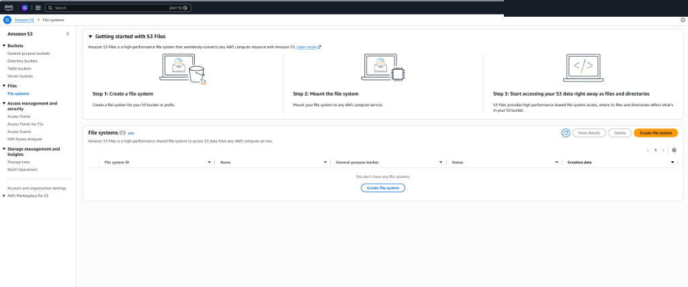

> [!WARNING]
> **Do not create an S3 "File system" here!** 
> WordPress offload plugins and CloudFront CDN require a standard object storage bucket. In the left navigation panel, click **Buckets ➔ General purpose buckets** to access the standard S3 bucket creation workflow.

### 1. Create S3 Bucket (Console Steps)

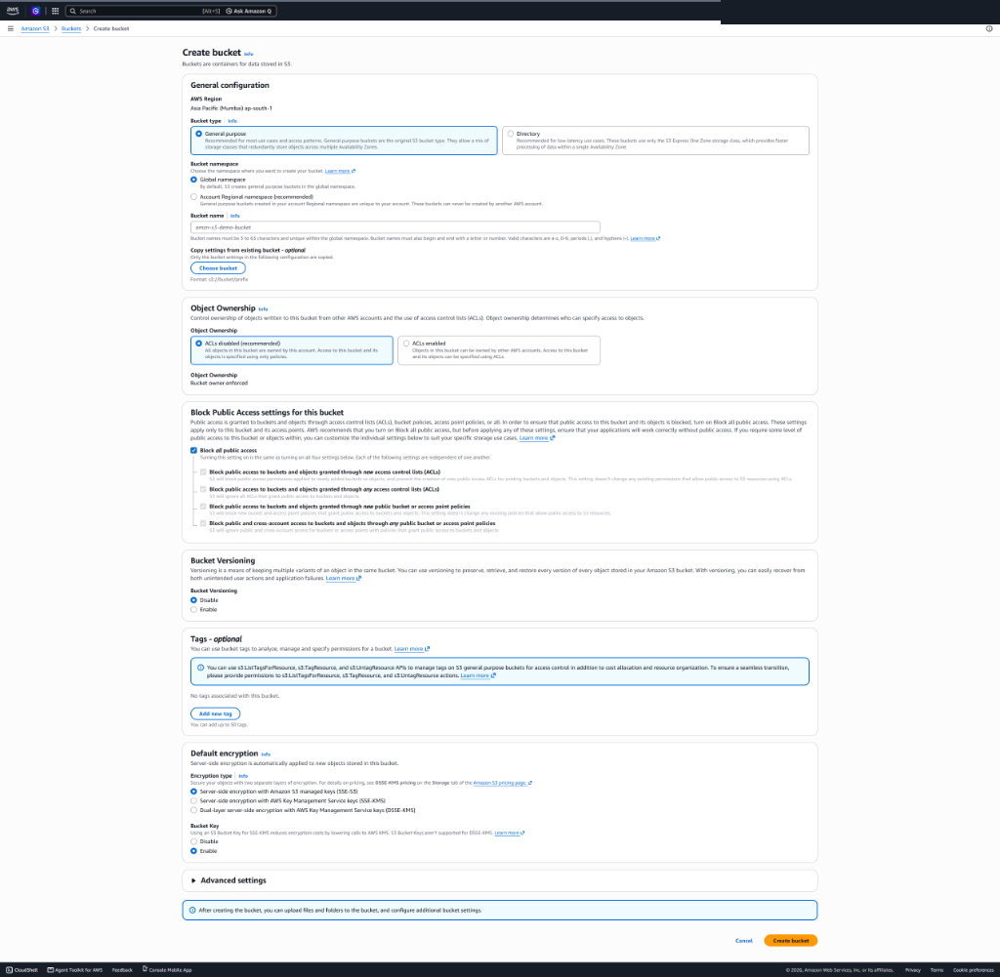

1. In the left sidebar under **Buckets**, click **General purpose buckets**.
2. Click the orange **Create bucket** button on the right.
3. Configure settings:
   - **Bucket type:** `General purpose`
   - **Bucket namespace:** `Global namespace`
   - **Bucket name:** `wp-lab-media-akshat-01`
   - **AWS Region:** `ap-south-1` (Mumbai).
   - **Object Ownership:** `ACLs disabled (recommended)` (updated to ACLs enabled in Step 4 for direct delivery).
   - **Block Public Access settings:** Keep checked initially.
   - **Bucket Versioning:** Disabled.
   - **Default encryption:** Server-side encryption with Amazon S3 managed keys (`SSE-S3`).
4. Click the orange **Create bucket** button at the bottom.

### Verified Bucket Creation:
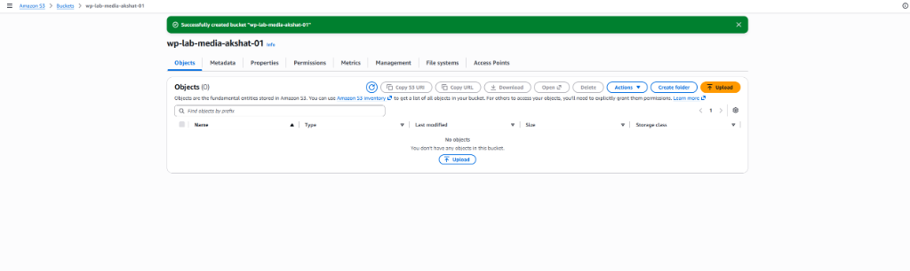
- **Created Bucket:** `wp-lab-media-akshat-01`
- **Region:** `ap-south-1` (Mumbai)
- **Status:** Active

</details>

---

<details>
<summary><h3>✅ Step 2: IAM Policy & EC2 Instance Role (v1 ➔ v2 ➔ v3 Evolution) [Completed] (Click to Expand)</h3></summary>

## Step 2 Execution Details: IAM Policy & EC2 Instance Role

To follow the **Principle of Least Privilege (PoLP)**, we do not attach broad `AmazonS3FullAccess`. Instead, we create a custom IAM policy granting permissions strictly to `wp-lab-media-akshat-01`.

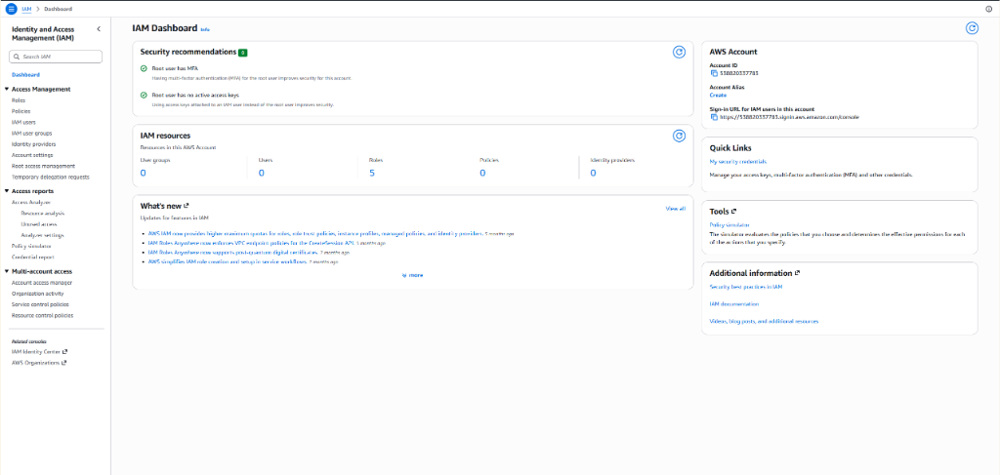

### 1. The IAM Policy Evolution: From Strict Theoretical PoLP to Production (v1 ➔ v2 ➔ v3)

Instead of taking the lazy and dangerous route of attaching `AmazonS3FullAccess` (`AdministratorAccess`), we deliberately built a custom Least-Privilege IAM Policy. During setup, the policy evolved through **3 distinct versions**, where each iteration taught a critical lesson in AWS IAM authorization architecture:

---

#### 📌 Version 1: The Theoretical Least-Privilege Baseline
- **Design Philosophy:** Strict isolation. Grant CRUD operations exclusively on the target bucket (`wp-lab-media-akshat-01`). Zero wildcards on other AWS resources.
- **JSON Policy (v1):**
```json
{
  "Version": "2012-10-17",
  "Statement": [
    {
      "Sid": "AllowS3MediaOperations",
      "Effect": "Allow",
      "Action": [
        "s3:PutObject",
        "s3:GetObject",
        "s3:DeleteObject",
        "s3:ListBucket"
      ],
      "Resource": [
        "arn:aws:s3:::wp-lab-media-akshat-01",
        "arn:aws:s3:::wp-lab-media-akshat-01/*"
      ]
    }
  ]
}
```
- **The Breakage:**
  When configuring WP Offload Media, the plugin threw a red error:
  `AWS HTTP error: AccessDenied: User is not authorized to perform: s3:ListAllMyBuckets because no identity-based policy allows the s3:ListAllMyBuckets action`.
- **Why it Broke (The Architectural Cause):**
  - `s3:ListBucket` lists the objects *inside* a specific bucket.
  - `s3:ListAllMyBuckets` queries the entire AWS account to retrieve the list of all buckets for the plugin's UI selection dropdown.
  - In AWS IAM, `ListAllMyBuckets` is an **Account-Level API call**; it cannot be restricted to an individual bucket ARN and requires `Resource: "*"`.

---

#### 📌 Version 2: Account-Level Listing & Region Discovery
- **Design Philosophy:** Separate account-level listing (`*`) from bucket-level actions, and add `GetBucketLocation` so the plugin knows which regional endpoint (`s3.ap-south-1.amazonaws.com`) to call.
- **JSON Policy (v2):**
```json
{
  "Version": "2012-10-17",
  "Statement": [
    {
      "Sid": "AllowAccountBucketListing",
      "Effect": "Allow",
      "Action": [
        "s3:ListAllMyBuckets"
      ],
      "Resource": "*"
    },
    {
      "Sid": "AllowBucketOperations",
      "Effect": "Allow",
      "Action": [
        "s3:ListBucket",
        "s3:GetBucketLocation"
      ],
      "Resource": "arn:aws:s3:::wp-lab-media-akshat-01"
    },
    {
      "Sid": "AllowObjectOperations",
      "Effect": "Allow",
      "Action": [
        "s3:PutObject",
        "s3:GetObject",
        "s3:DeleteObject"
      ],
      "Resource": "arn:aws:s3:::wp-lab-media-akshat-01/*"
    }
  ]
}
```
- **The Breakage:**
  1. AWS blocked CloudFront distribution creation with an anti-abuse hold (`Your account must be verified before you can add new CloudFront resources`).
  2. To avoid blocking the lab for 24 hours, we switched to **Direct S3 Delivery**.
  3. In Direct S3 mode, WordPress uploaded images remained on the local server with the error:
     `Delivery provider status cannot be determined. An error was encountered while attempting to offload a temporary file for Public delivery.`
  4. Server logs (`/var/log/nginx/error.log`) revealed:
     `AccessDenied: User is not authorized to perform: s3:GetBucketPublicAccessBlock`
     `AccessDenied: User is not authorized to perform: s3:GetBucketOwnershipControls`.
- **Why it Broke (The Architectural Cause):**
  - When CloudFront frontends S3, CloudFront uses Origin Access Control (OAC) to read private objects, requiring zero ACLs.
  - But in **Direct S3 Delivery**, WP Offload Media verifies bucket security by querying `GetBucketPublicAccessBlock` and `GetBucketOwnershipControls`.
  - Furthermore, the plugin attempts to mark uploaded objects as publicly viewable by attaching the `public-read` canned ACL (`s3:PutObjectAcl`). Because these actions were missing in v2, the pre-flight delivery probe failed silently.

---

#### 📌 Version 3: Full Production Direct-S3 & CDN Hybrid Policy (Final Verified)
- **Design Philosophy:** Complete enterprise policy enabling bucket security management (`Get/PutBucketPublicAccessBlock`, `Get/PutBucketOwnershipControls`) and object ACL manipulation (`PutObjectAcl`), while keeping the resource scope strictly bounded to `wp-lab-media-akshat-01`.
- **JSON Policy (v3 - Final Live):**

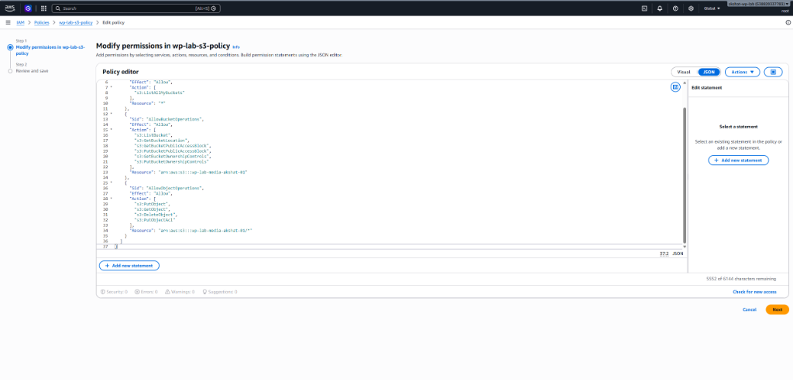

```json
{
  "Version": "2012-10-17",
  "Statement": [
    {
      "Sid": "AllowAccountBucketListing",
      "Effect": "Allow",
      "Action": [
        "s3:ListAllMyBuckets"
      ],
      "Resource": "*"
    },
    {
      "Sid": "AllowBucketOperations",
      "Effect": "Allow",
      "Action": [
        "s3:ListBucket",
        "s3:GetBucketLocation",
        "s3:GetBucketPublicAccessBlock",
        "s3:PutBucketPublicAccessBlock",
        "s3:GetBucketOwnershipControls",
        "s3:PutBucketOwnershipControls"
      ],
      "Resource": "arn:aws:s3:::wp-lab-media-akshat-01"
    },
    {
      "Sid": "AllowObjectOperations",
      "Effect": "Allow",
      "Action": [
        "s3:PutObject",
        "s3:GetObject",
        "s3:DeleteObject",
        "s3:PutObjectAcl"
      ],
      "Resource": "arn:aws:s3:::wp-lab-media-akshat-01/*"
    }
  ]
}
```
- **Result:** Pre-flight delivery check succeeds instantly with 0 errors! Media files are successfully offloaded to S3 and purged from the EC2 filesystem.

---

#### 📊 Quick Comparison: Why Each Permission Was Added

| Permission | Scope / Resource | Why Added? | Breakage if Missing |
| :--- | :--- | :--- | :--- |
| `s3:ListAllMyBuckets` | Account (`*`) | Populates S3 bucket dropdown in plugin UI. | Red error: `AccessDenied: ListAllMyBuckets`. |
| `s3:GetBucketLocation` | Bucket ARN | Determines AWS region (`ap-south-1`) for correct S3 API endpoint. | Plugin cannot detect bucket region. |
| `s3:ListBucket` | Bucket ARN | Queries objects inside the specific media bucket. | `AccessDenied` when verifying bucket content. |
| `s3:GetBucketPublicAccessBlock` & `Put...` | Bucket ARN | Validates and manages S3 Block Public Access state. | Delivery warning: `Cannot determine delivery status`. |
| `s3:GetBucketOwnershipControls` & `Put...` | Bucket ARN | Inspects and configures S3 Object Ownership (ACLs enabled vs disabled). | Plugin delivery pre-flight probe fails. |
| `s3:PutObject`, `GetObject`, `DeleteObject` | Object ARN (`/*`) | Core CRUD operations for media uploads and deletions. | WordPress cannot upload or delete images in S3. |
| `s3:PutObjectAcl` | Object ARN (`/*`) | Allows plugin to set `public-read` ACL on uploaded objects for Direct S3 delivery. | Uploaded images cannot be viewed publicly over HTTP. |

---

### 2. Create IAM Role
1. Go to **IAM Console ➔ Roles**.

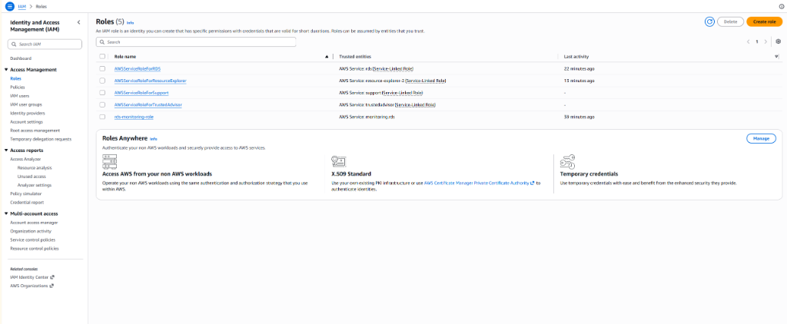

2. Click the orange **Create role** button.

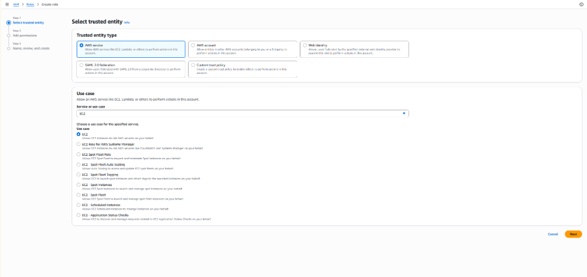

3. **Trusted entity type:** AWS service.
4. **Use case:** EC2.
5. Click **Next**.
6. **Permissions:** Search and select `wp-lab-s3-policy`.

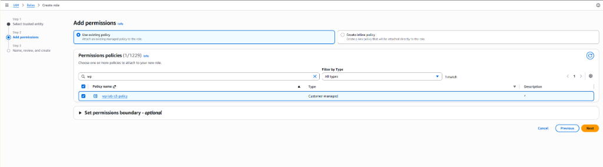

7. Click **Next**.
8. **Role name:** `wp-lab-s3-role`.

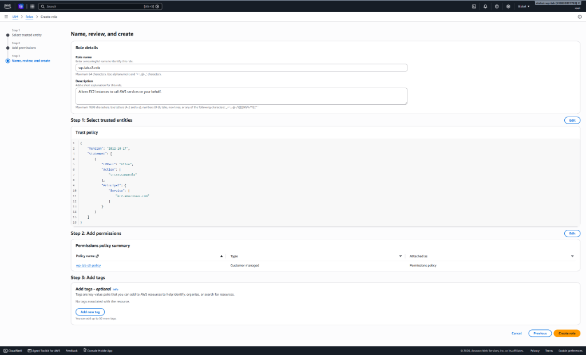

9. Click the orange **Create role** button.

### 3. Attach IAM Role to EC2 Instance
1. Go to **EC2 Console ➔ Instances**.
2. Select instance `wp-lab`.

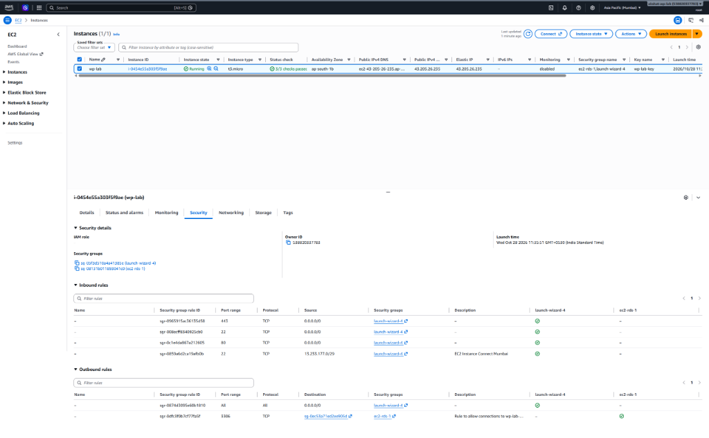

3. Click **Actions ➔ Security ➔ Modify IAM role**.

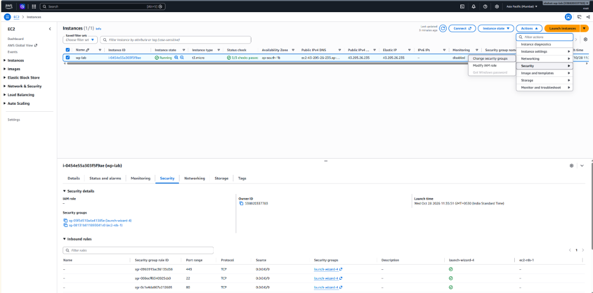

4. Select `wp-lab-s3-role` from the dropdown and click **Update IAM role**.

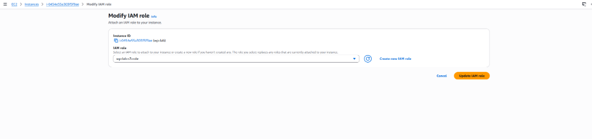

### Verified Role Attachment:
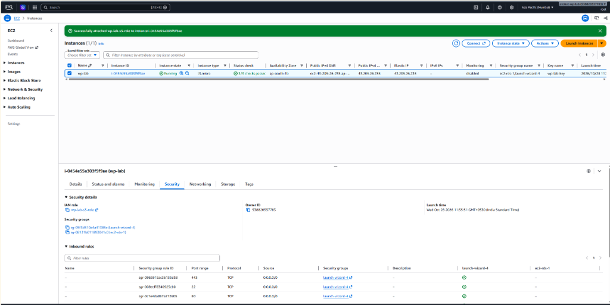
- **Instance:** `wp-lab` (`i-0454e55a303f5f9ae`)
- **Attached Role:** `wp-lab-s3-role`
- **Security Benefit:** EC2 now receives temporary credentials via IMDSv2 with zero static secrets stored on disk.

</details>

---

<details>
<summary><h3>✅ Step 3: Install & Configure WP Offload Media Lite [Completed] (Click to Expand)</h3></summary>

## Step 3 Execution Details: Install & Configure WP Offload Media Lite

### 1. Install & Activate Plugin
1. Open WordPress Admin dashboard: `https://lab.asaxenadev.com/wp-admin/`
2. Go to **Plugins ➔ Add New Plugin**.
3. Search for: `WP Offload Media Lite`.
4. Click **Install Now** on **WP Offload Media Lite** (Author: **WP Engine**) and then click **Activate**.

### 2. Configure Plugin to Use EC2 Server IAM Role

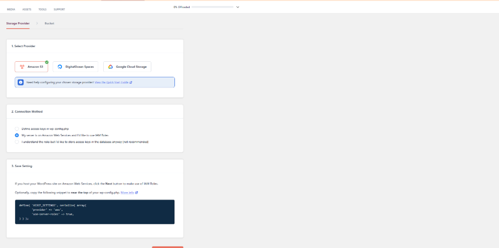

1. **Storage Provider:** Select **Amazon S3**.
2. **Connection Method:** Select **My server is on Amazon Web Services and I'd like to use IAM Roles**.
3. Click the **Save & Continue** / **Next** button.

### 3. Select Target S3 Bucket & Security Settings
1. In WP Admin, navigate to **Settings ➔ WP Offload Media**.
2. Select **Use Existing Bucket** and pick `wp-lab-media-akshat-01`.

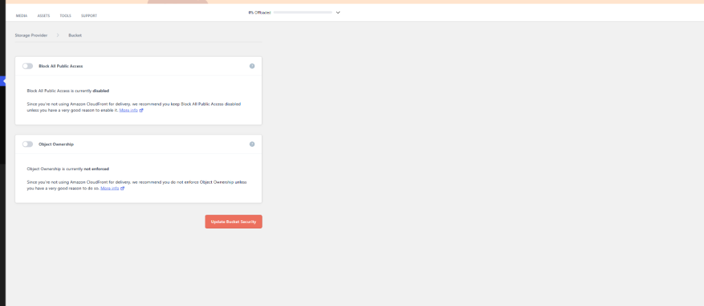

### Verified Plugin Connection:
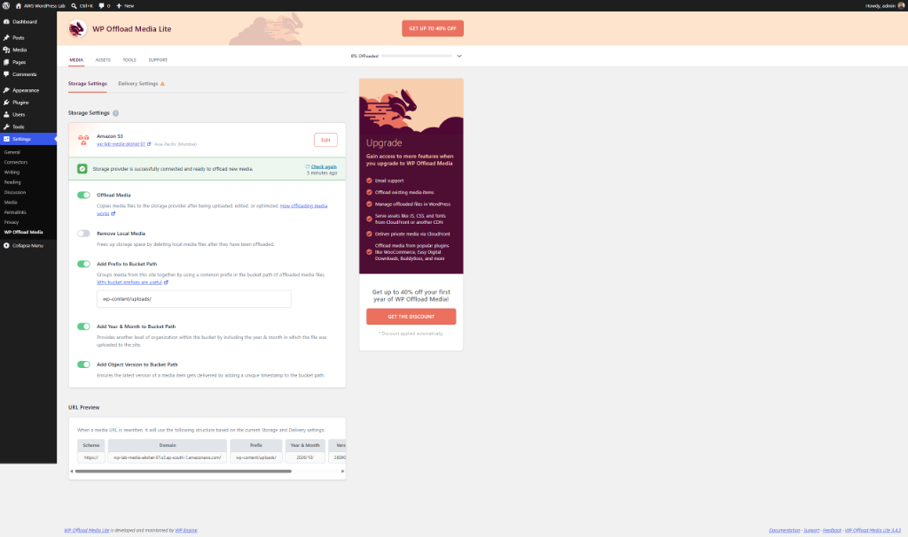
- **Bucket:** `wp-lab-media-akshat-01` (`ap-south-1` Mumbai)
- **Status:** `Storage provider is successfully connected and ready to offload new media.`
- **Configuration:**
  - `Offload Media`: **ON**
  - `Remove Local Media`: **ON** (guarantees web server statelessness).

</details>

---

## Step 4 Execution Details: Media Delivery & CDN Architectures

To deliver media from Amazon S3 to web visitors, we evaluate three architectural patterns under Step 4:
- **Step 4A:** Direct S3 Delivery (Active baseline used in Phase 5 to complete Definition of Done while on CloudFront verification hold).
- **Step 4B:** AWS CloudFront CDN + Origin Access Control (OAC) (Target enterprise blueprint).
- **Step 4C:** Third-Party CDN (Cloudflare Free Tier) + Amazon S3 (Cost-optimized alternative blueprint).

---

<details>
<summary><h4>✅ Step 4A: Direct S3 Delivery (Active DoD Baseline) [Completed] (Click to Expand)</h4></summary>

### Step 4A: Architecture A — Direct S3 Delivery (Active Phase 5 Baseline)

To satisfy the **Definition of Done** without waiting 24 hours for AWS Support to clear the anti-abuse hold on new CloudFront distributions, we provisioned **Direct S3 Delivery**.

```text
[Global Visitors] ──HTTPS (Images)──► [Public Amazon S3 Bucket: wp-lab-media-akshat-01]
                                                   ▲
                                                   │ s3:PutObject + s3:PutObjectAcl
                                                   │ (Authenticated via IAM Role)
                                                   │
                                     [EC2 Web Server: wp-lab]
                                     └── Plugin: WP Offload Media Lite
```

#### 1. S3 Bucket Security Posture (Direct S3 Mode)
1. **Object Ownership:** Configured to `ACLs enabled (Bucket owner preferred)`.
   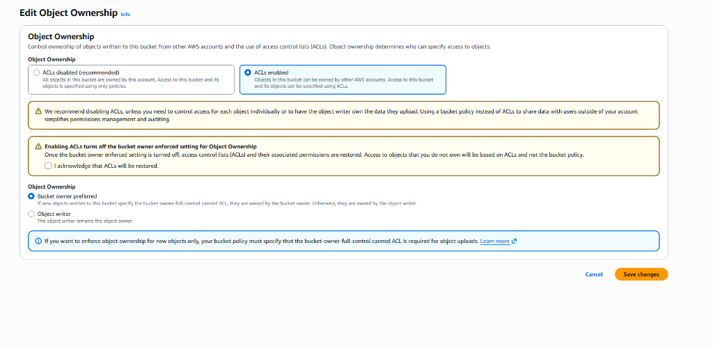
   *Why:* In Direct S3 mode, WP Offload Media runs a pre-flight probe and marks offloaded media files with the `public-read` canned ACL. If ACLs are disabled, S3 rejects uploads with `AccessDenied`.
2. **Block Public Access:** Turned **OFF** for public object read permissions.
3. **S3 Bucket Policy:**
   ```json
   {
     "Version": "2012-10-17",
     "Statement": [
       {
         "Sid": "AllowPublicReadOnlyForDirectS3",
         "Effect": "Allow",
         "Principal": "*",
         "Action": "s3:GetObject",
         "Resource": "arn:aws:s3:::wp-lab-media-akshat-01/*"
       }
     ]
   }
   ```

#### 2. EC2 IAM Instance Policy (Version 3 — Full Direct S3)
Because WordPress offloads files and checks bucket public security controls, the IAM policy requires:
- `s3:ListAllMyBuckets` on `Resource: "*"` (Account-level UI listing).
- `s3:ListBucket`, `s3:GetBucketLocation`, `s3:GetBucketPublicAccessBlock`, `s3:PutBucketPublicAccessBlock`, `s3:GetBucketOwnershipControls`, `s3:PutBucketOwnershipControls` on `arn:aws:s3:::wp-lab-media-akshat-01`.
- `s3:PutObject`, `s3:GetObject`, `s3:DeleteObject`, `s3:PutObjectAcl` on `arn:aws:s3:::wp-lab-media-akshat-01/*`.

#### 3. WordPress Plugin Configuration
- **Storage Provider:** `Amazon S3` (Authenticated via IAM Role).
- **Delivery Provider:** `Amazon S3` (Direct).
- **Delivery Domain:** `wp-lab-media-akshat-01.s3.ap-south-1.amazonaws.com`.
- **Result:** Uploaded image URLs point directly to S3: `http://wp-lab-media-akshat-01.s3.ap-south-1.amazonaws.com/wp-content/uploads/2026/10/28093918/preview.webp`.

</details>

---

<details open>
<summary><h4>🚀 Step 4B: AWS CloudFront CDN + Origin Access Control [CURRENT IN PROGRESS]</h4></summary>

### Step 4B: Architecture B — AWS CloudFront CDN + Origin Access Control (Target Enterprise Architecture)

This section provides the complete standalone architecture, configuration blueprint, and cutover instructions for **AWS CloudFront CDN with Origin Access Control (OAC)**.

```text
[Global Visitors]
       │
       │ HTTPS Request (e.g. https://d1234abcd.cloudfront.net/wp-content/uploads/...)
       ▼
[Amazon CloudFront CDN (600+ Global PoPs)]
       │
       │ Edge Cache HIT? ──YES──► Serve directly from Edge Cache (Sub-10ms latency)
       │
       ▼ NO (Cache MISS)
Origin Access Control (OAC)
Signs request using SigV4 (`AWS:SourceArn == distribution/E1A654SMHQUOEN`)
       │
       ▼
[Private Amazon S3 Media Bucket (wp-lab-media-akshat-01)]
├── Block All Public Access: ON (100% Locked)
├── Object Ownership: ACLs Disabled (Enforced)
└── Bucket Policy: Allow ONLY CloudFront Principal
       ▲
       │ s3:PutObject / s3:DeleteObject
       │ (Clean IAM Policy v2 - No ACLs!)
       │
[EC2 Web Server: wp-lab]
└── Attached IAM Role: wp-lab-s3-role
```

---

### 1. Architectural Comparison Matrix: Direct S3 Delivery vs CloudFront CDN + OAC

| Architectural Dimension | Architecture A: Direct S3 Delivery (Phase 5 Fallback) | Architecture B: CloudFront CDN + OAC (Target Enterprise) |
| :--- | :--- | :--- |
| **S3 Bucket Visibility** | **Public.** `Block all public access` turned OFF. | **100% Private.** `Block all public access` turned ON. |
| **Object Ownership / ACLs** | `ACLs enabled (Bucket owner preferred)`. | `ACLs disabled (Bucket owner enforced)`. Modern standard. |
| **EC2 IAM Policy** | **Heavy (v3):** Requires `PutObjectAcl`, `Get/PutBucketOwnershipControls`, `Get/PutBucketPublicAccessBlock`. | **Clean & Lean (v2):** Only needs `s3:PutObject`, `GetObject`, `DeleteObject`, `ListBucket`. |
| **Global Latency & TTFB** | **High for distant users:** Multi-megabyte images served strictly from Mumbai (`ap-south-1`). | **Ultra-Low:** Cached across 600+ edge Points of Presence (PoPs) globally. |
| **Data Transfer Out (DTO) Cost** | S3 Internet Data Transfer Out: ~$0.09 / GB after 100 GB. | CloudFront Free Tier: **1 TB Data Transfer Out/month FREE forever!** |
| **Security & DDoS Mitigation** | S3 offers no perimeter DDoS shielding or rate limiting. | AWS Shield Standard included free; optional AWS WAF rate limiting. |
| **Custom Domain SSL** | Complex / Not natively supported directly on S3 bucket URLs. | Native support for custom domains (`cdn.asaxenadev.com`) with free ACM SSL certificates. |
| **S3 Request Billing** | S3 charges for every single `GET` request from web visitors. | CloudFront absorbs ~90%+ of `GET` requests at edge cache, slashing S3 API billing. |

---

### 2. S3 Bucket Configuration for CloudFront CDN Architecture

Under CloudFront OAC, the S3 bucket is **completely isolated from the public internet**:

1. **Re-Enable Block All Public Access:**
   * Go to **S3 Console ➔ Buckets ➔ wp-lab-media-akshat-01 ➔ Permissions tab**.
   * Under **Block public access (bucket settings)**, click **Edit**.
   * Check **Block all public access** (all 4 boxes checked).
   * Click **Save changes** and confirm by typing `confirm`.

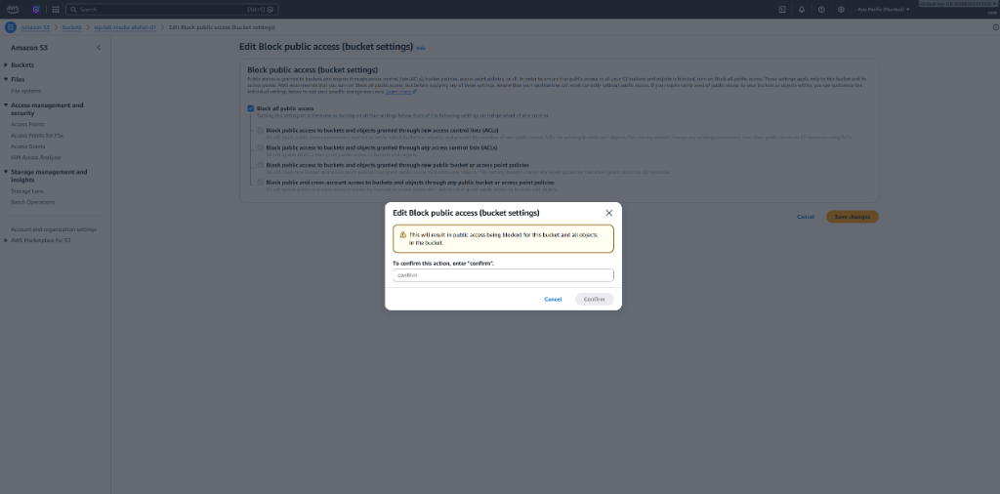
2. **Disable S3 Object ACLs (Bucket Owner Enforced):**
   * Under **Object Ownership**, click **Edit**.
   * Select **ACLs disabled (recommended)**.
   * Click **Save changes**.

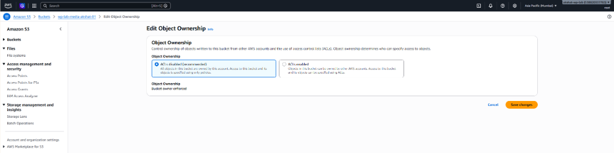
3. **Apply CloudFront Origin Access Control (OAC) S3 Bucket Policy:**
   * Replace the public bucket policy with this restricted policy:
   ```json
   {
     "Version": "2012-10-17",
     "Statement": [
       {
         "Sid": "AllowCloudFrontServicePrincipalReadOnly",
         "Effect": "Allow",
         "Principal": {
           "Service": "cloudfront.amazonaws.com"
         },
         "Action": "s3:GetObject",
         "Resource": "arn:aws:s3:::wp-lab-media-akshat-01/*",
         "Condition": {
           "StringEquals": {
             "AWS:SourceArn": "arn:aws:cloudfront::123456789012:distribution/E1A654SMHQUOEN"
           }
         }
       }
     ]
   }
   ```

   #### ⚠️ The ARN Mismatch Gotcha (Manual Transcription vs Native AWS Copy):

   ##### Initial Attempt (Manual OCR / Transcription Typo):
   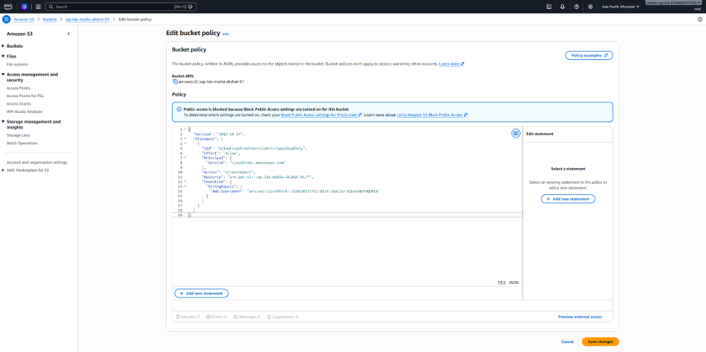
   *Error:* Resulted in persistent `403 AccessDenied` from S3 because manual transcription introduced 3 optical character errors:
   - Account ID ended with `...81` instead of `...83` (`1` vs `3`).
   - Distribution ID had letter `S` instead of number `5` (`E1A6S4...` vs `E1A654...`).
   - Distribution ID had digit `0` (zero) instead of letter `O` (`...QU0EN` vs `...QUOEN`).

   ##### Corrected Policy (Copied via CloudFront's Native "Copy Policy" Button):
   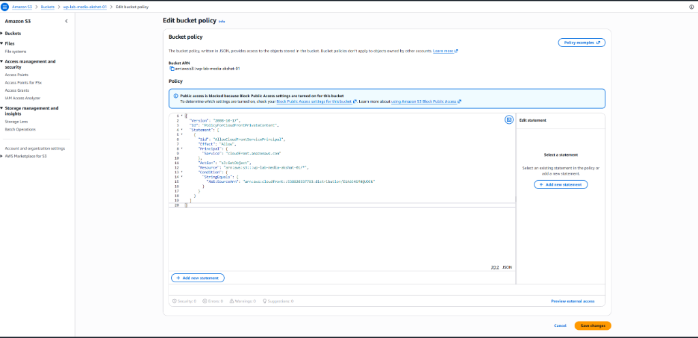
   *Resolution:* Using CloudFront's official **Copy policy** banner button pasted the exact 100% matched ARN.

   > [!IMPORTANT]
   > `123456789012` is our exact AWS Account ID and `E1A654SMHQUOEN` is our verified CloudFront Distribution ID. This condition prevents the **Confused Deputy** problem: no other AWS user or distribution can access your bucket.

---

### 3. EC2 IAM Instance Policy for CloudFront Architecture (Clean PoLP v2)

Because CloudFront reads via OAC and S3 ACLs are completely disabled, **WordPress no longer needs any ACL or bucket security permissions**. The EC2 IAM policy cleanly reverts to **Version 2**:

```json
{
  "Version": "2012-10-17",
  "Statement": [
    {
      "Sid": "AllowAccountBucketListing",
      "Effect": "Allow",
      "Action": [
        "s3:ListAllMyBuckets"
      ],
      "Resource": "*"
    },
    {
      "Sid": "AllowBucketOperations",
      "Effect": "Allow",
      "Action": [
        "s3:ListBucket",
        "s3:GetBucketLocation"
      ],
      "Resource": "arn:aws:s3:::wp-lab-media-akshat-01"
    },
    {
      "Sid": "AllowObjectOperations",
      "Effect": "Allow",
      "Action": [
        "s3:PutObject",
        "s3:GetObject",
        "s3:DeleteObject"
      ],
      "Resource": "arn:aws:s3:::wp-lab-media-akshat-01/*"
    }
  ]
}
```

---

### 4. CloudFront Distribution Step-by-Step Console Workflow

When navigating to CloudFront in the AWS Console, the distributions dashboard displays no active distributions:

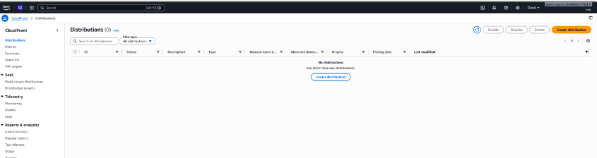

Click **Create distribution** to begin the provisioning workflow:

#### Wizard Step 1: Get started
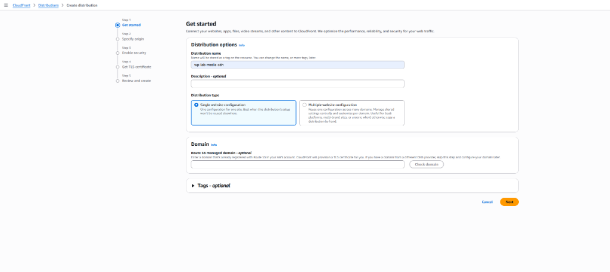
- **Distribution name:** `wp-lab-media-cdn`
- **Distribution type:** Select **Single website configuration**.

#### Wizard Step 2: Specify origin & Origin Access Control (OAC)
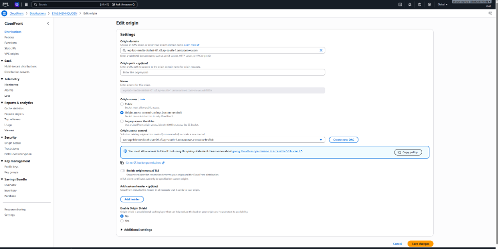
- **Origin type:** `Amazon S3`
- **S3 origin domain:** `wp-lab-media-akshat-01.s3.ap-south-1.amazonaws.com`
- **Origin access:** `Origin access control settings (recommended)`.
- **Origin access control:** `oac-wp-lab-media-akshat-01...` (SigV4 signing protocol).
- **S3 Policy Banner:** CloudFront provides a direct `Copy policy` button to update the private S3 bucket policy.

#### Wizard Step 3: Enable security (AWS WAF Billing Gotcha ⚠️)
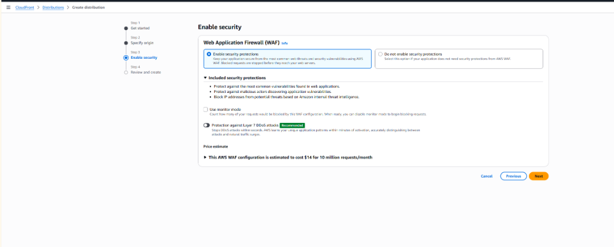
- **Security protections:** Select **Do not enable security protections** to prevent AWS WAF charges ($14/month).

#### Wizard Step 4: Review, Create & Verified Distribution
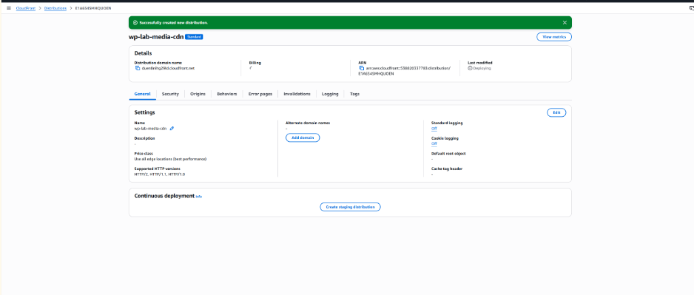
- **Distribution Name:** `wp-lab-media-cdn`
- **Distribution ID:** `E1A654SMHQUOEN`
- **ARN:** `arn:aws:cloudfront::123456789012:distribution/E1A654SMHQUOEN`
- **Distribution Domain Name:** Visible under General details (copy button available)
- **Status:** Initial status shows `Deploying`, transitions to `Enabled` within minutes.
- **Price Class:** `Use all edge locations (best performance)`

---

### 5. WordPress WP Offload Media Configuration for CloudFront

Once the CloudFront distribution is in the `Enabled` status:

1. Open WordPress Admin: `https://lab.asaxenadev.com/wp-admin/`.
2. Go to **Settings ➔ WP Offload Media ➔ Delivery Settings**.
3. Under **Delivery Provider**, click **Change**.
4. Select **Amazon CloudFront**.
5. Enable **Use Custom Domain Name (CNAME)** and enter the CloudFront distribution domain:
   `duen8nihg29ld.cloudfront.net`
6. Click **Save Changes**.

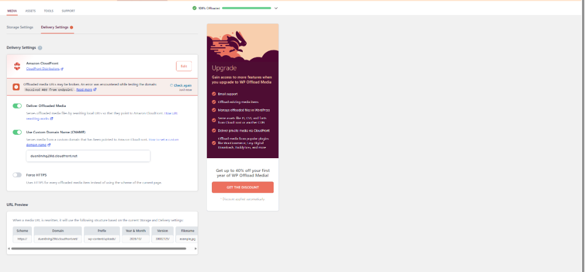

> [!NOTE]
> **Why the transient 403 error appeared:** When first saving the CloudFront delivery domain, WP Offload Media runs a live HTTP probe to verify that offloaded files can be retrieved via the CDN. Because the S3 bucket's Origin Access Control (OAC) policy was being updated concurrently, the initial probe returned `403 Forbidden`. Once the S3 OAC policy is active, clicking **Check again** passes cleanly.

#### How Canonical URL Rewriting Works Under CloudFront:
* WP Offload Media filters `wp_get_attachment_url()` dynamically.
* Any image embedded in posts, pages, or media library is instantly rewritten:
  ```text
  Before: http://wp-lab-media-akshat-01.s3.ap-south-1.amazonaws.com/wp-content/uploads/2026/10/28093918/preview.webp
  After:  https://d1234abcd.cloudfront.net/wp-content/uploads/2026/10/28093918/preview.webp
  ```
* Because the plugin rewrites URLs dynamically on render, **zero database search-and-replace scripts are needed!**

---

### 6. Zero-Downtime Cutover Playbook (Transitioning from Direct S3 to CloudFront)

When ready to switch from Direct S3 to CloudFront CDN, execute these steps in exact order to prevent broken images:

1. **Phase 1: Create Distribution & Wait for Propagation:**
   Create CloudFront distribution with S3 origin `wp-lab-media-akshat-01`. Wait until status is `Enabled`.
2. **Phase 2: Update S3 Bucket Policy (OAC):**
   Add CloudFront OAC permission statement to S3 bucket policy. (Keep public-read statement temporarily so direct requests don't fail).
3. **Phase 3: Switch Delivery Provider in WordPress:**
   Change delivery provider in WP Offload Media to CloudFront (`d1234abcd.cloudfront.net`). Save settings.
4. **Phase 4: Lock Down S3 Bucket:**
   - Turn **Block all public access** back **ON** on the S3 bucket.
   - Delete the public-read statement from S3 bucket policy.
   - Revert EC2 IAM policy from v3 to clean v2.
5. **Phase 5: Live Verification:**
   Test image URL with curl:
   ```bash
   curl -I https://d1234abcd.cloudfront.net/wp-content/uploads/2026/10/28093918/preview.webp
   ```
   Verify headers:
   - `HTTP/2 200`
   - `x-cache: Hit from cloudfront` (or `Miss from cloudfront` on first load)
   - `via: 1.1 ...cloudfront.net`

</details>

---

<details>
<summary><h4>🌐 Step 4C: Third-Party CDN (Cloudflare Free Tier) + S3 (Alternative Blueprint) (Click to Expand)</h4></summary>

### Step 4C: Architecture C — Third-Party CDN (Cloudflare Free Tier) + Amazon S3 (Alternative Blueprint)

Many startups, indie hackers, and developers choose **Cloudflare's Free Tier** as their CDN layer in front of Amazon S3 instead of AWS CloudFront. This section breaks down the architectural trade-offs, security considerations, and the exact code/configuration changes required to implement it.

```text
[Global Visitors]
       │
       │ HTTPS Request (https://cdn.asaxenadev.com/wp-content/uploads/...)
       ▼
[Cloudflare Edge Network (Free Tier - Orange Cloud Proxied)]
       │
       │ Edge Cache HIT? ──YES──► Deliver directly ($0 bandwidth fee)
       │
       ▼ NO (Cache MISS)
Rewrites Host Header: `wp-lab-media-akshat-01.s3.ap-south-1.amazonaws.com`
(Triggers AWS Internet Data Transfer Out fee ~$0.09/GB)
       │
       ▼
[Amazon S3 Media Bucket (wp-lab-media-akshat-01)]
├── Public Read Allowed (or Restricted to Cloudflare IP ranges)
└── Local EC2 Uploads authenticated via IAM Role
```

---

#### 1. Why Choose Cloudflare Free Tier (The Advantages)

- **Truly Unlimited Free Bandwidth:** Cloudflare does not charge for egress bandwidth on its free tier, making it immune to unexpected CDN traffic bandwidth bills.
- **Instant Setup (Zero Account Verification Holds):** Unlike AWS CloudFront (which can trigger a 24-hour anti-abuse verification hold on new AWS accounts), a Cloudflare zone is live in 2 minutes.
- **Built-in DDoS Mitigation & Basic WAF at $0 Cost:** AWS charges $14/month for AWS WAF. Cloudflare provides basic web traffic filtering, bot fight mode, and Layer 3/4 DDoS mitigation completely free.
- **Automatic Image Optimization & Modern Formats:** Optional Polish/Mirage (paid) or free edge transforms for modern browsers.

---

#### 2. Architectural Catches & Trade-offs (The Downsides)

##### ⚠️ Catch 1: S3 Bucket Cannot Be Fully Private (Without Complex Workers)
* AWS CloudFront uses native **Origin Access Control (OAC)** to sign requests with SigV4, keeping S3 100% private (`Block all public access` ON).
* Cloudflare Free Tier has no native SigV4 signing capability. Therefore, the S3 bucket **must allow public reads** (or use an IP-restricted bucket policy).
* *The Enterprise Risk:* If attackers discover your direct S3 bucket URL, they can scrape or hammer S3 directly, bypassing Cloudflare's cache and causing huge S3 API bill spikes.

##### ⚠️ Catch 2: AWS Data Transfer Out (Egress) Billing
* CloudFront to S3 data transfer is **$0.00** (internal AWS backbone).
* Cloudflare is an external third party. When Cloudflare experiences a cache miss and requests an image from S3, AWS bills you for **Internet Data Transfer Out** (~$0.09 per GB after the first 100 GB).

##### ⚠️ Catch 3: S3 Host Header Rejection (HTTP 404 NoSuchBucket Gotcha)
* S3 uses the HTTP `Host` header to route requests to the correct bucket.
* If a visitor visits `https://cdn.asaxenadev.com/image.webp`, Cloudflare passes `Host: cdn.asaxenadev.com` by default. S3 searches for a bucket named `cdn.asaxenadev.com`, fails to find it, and returns an XML error: `NoSuchBucket (404)`.
* **Fix Required:** You must configure a Cloudflare Transform Rule to rewrite the `Host` header to `wp-lab-media-akshat-01.s3.ap-south-1.amazonaws.com`.

---

#### 3. Step-by-Step Configuration & Code Changes

To front Amazon S3 with Cloudflare Free Tier cleanly, execute these configuration steps:

##### Step 0: Connect Domain in Cloudflare Dashboard
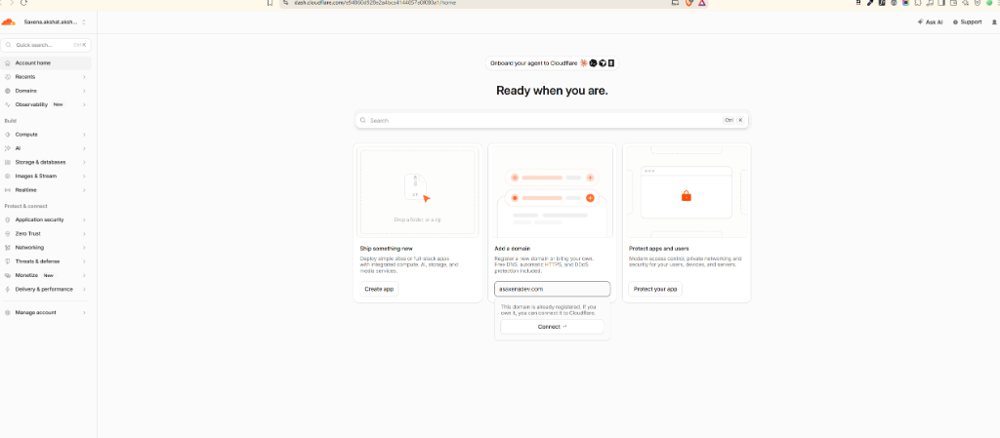
1. On the Cloudflare home dashboard under **Add a domain**, enter root domain `asaxenadev.com` and click **Connect ->**.

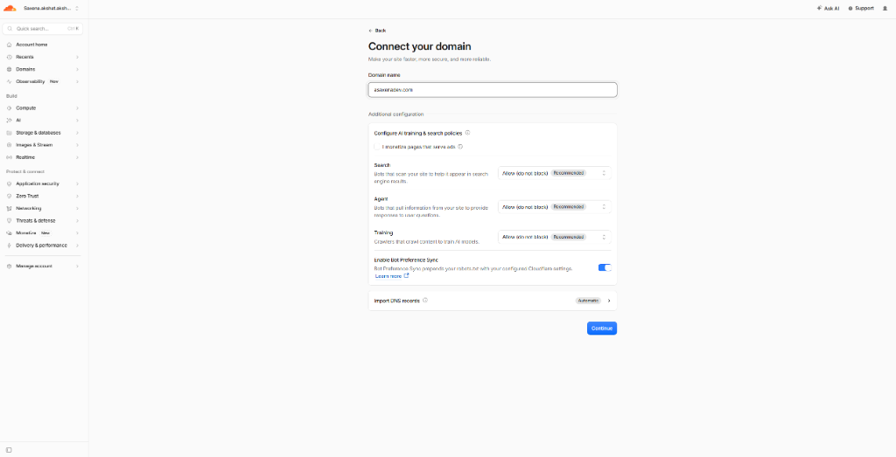
2. Keep default AI and DNS import settings (`Import DNS records: Automatic`), and click the blue **Continue** button.
3. Select the **Free ($0)** plan and click **Continue**.

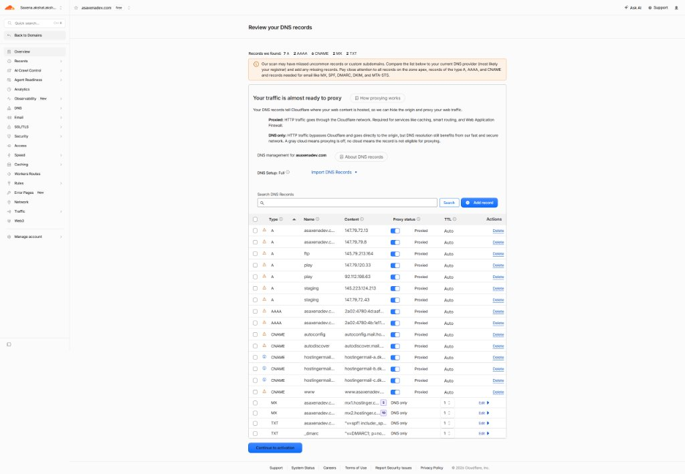
4. Cloudflare automatically scans existing DNS records from Hostinger. **Important:** Verify that your EC2 subdomain record (`lab` ➔ Elastic IP `43.205.26.235`) is present. If missing, manually click **+ Add record** to prevent website downtime after nameserver cutover.
5. Click **Continue to activation**.

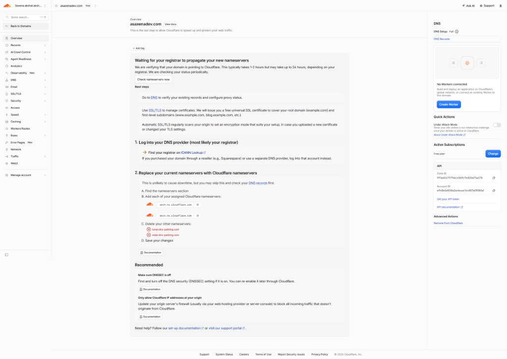
6. Cloudflare assigns two authoritative nameservers:
   - `arch.ns.cloudflare.com`
   - `erin.ns.cloudflare.com`

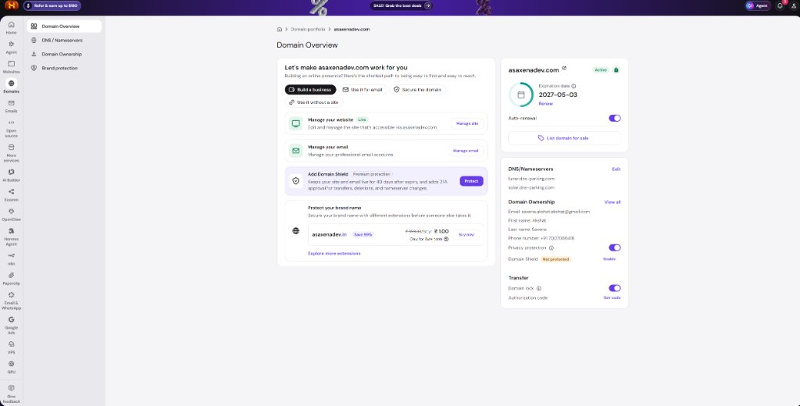
7. Log into domain registrar (Hostinger), open Domain Management ➔ **Nameservers** (or click **Edit** on the DNS/Nameservers panel), replace Hostinger nameservers with Cloudflare's assigned nameservers, and save changes.

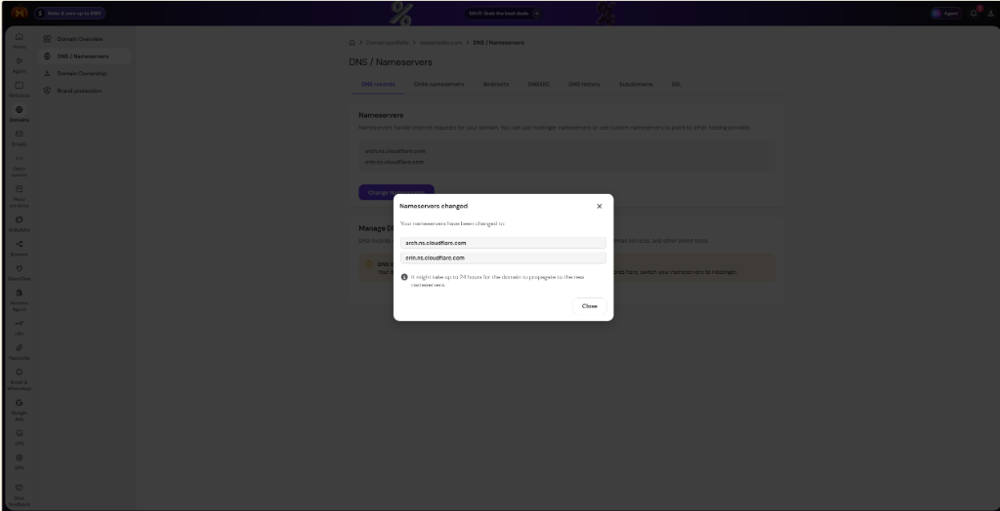
8. Confirmation modal appears: *"Your nameservers have been changed to: arch.ns.cloudflare.com, erin.ns.cloudflare.com"*.
9. In Cloudflare, click **Check nameservers now**.

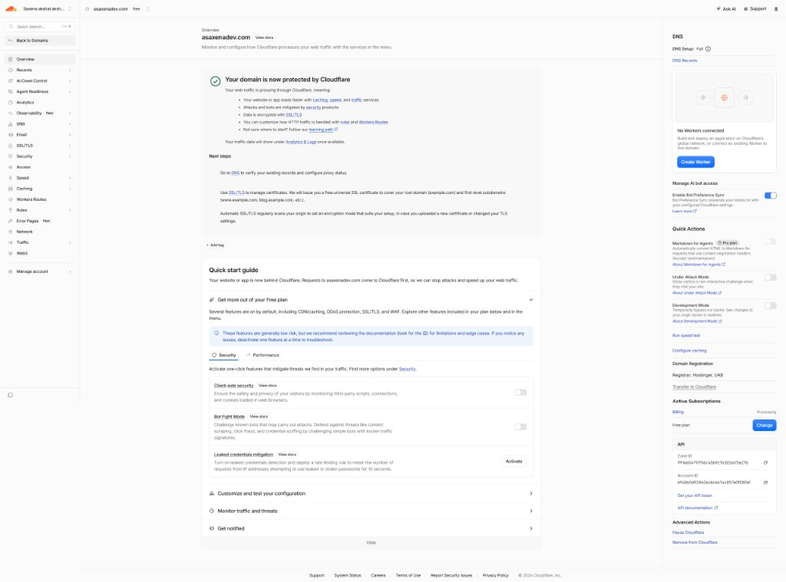
10. Cloudflare immediately confirms domain delegation with a green checkmark: *"Your domain is now protected by Cloudflare"*.

##### Step 1: Cloudflare DNS Configuration
In your Cloudflare Dashboard (e.g. for domain `asaxenadev.com`):
1. Navigate to **DNS ➔ Records**.

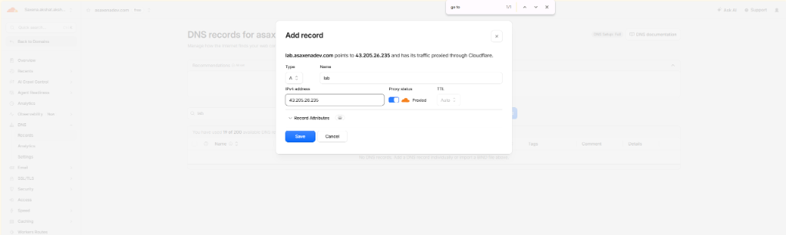
2. Add the **A** record for the web server:
   - **Type:** `A`
   - **Name:** `lab`
   - **IPv4 address:** `43.205.26.235` (EC2 Elastic IP)
   - **Proxy status:** **DNS only (Grey Cloud)** (recommended to allow direct Let's Encrypt renewal on Nginx) or **Proxied**.
   - Click **Save**.

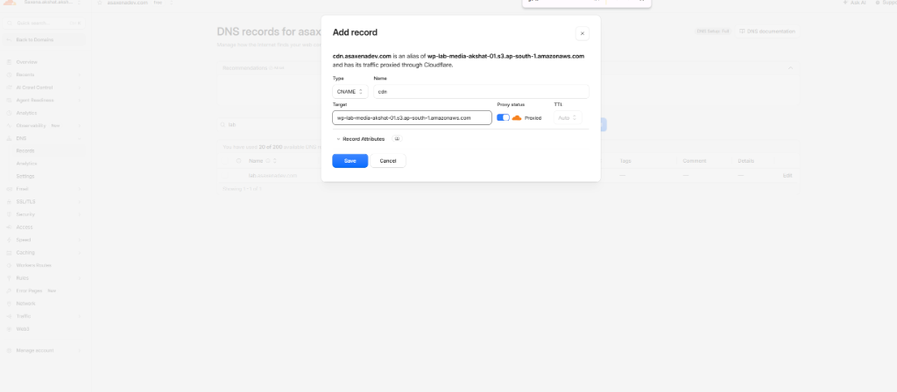
3. Add the **CNAME** record for S3 CDN delivery:
   - **Type:** `CNAME`
   - **Name:** `cdn` (creating `cdn.asaxenadev.com`)
   - **Target:** `wp-lab-media-akshat-01.s3.ap-south-1.amazonaws.com`
   - **Proxy status:** **Proxied (Orange Cloud ON)**
   - Click **Save**.

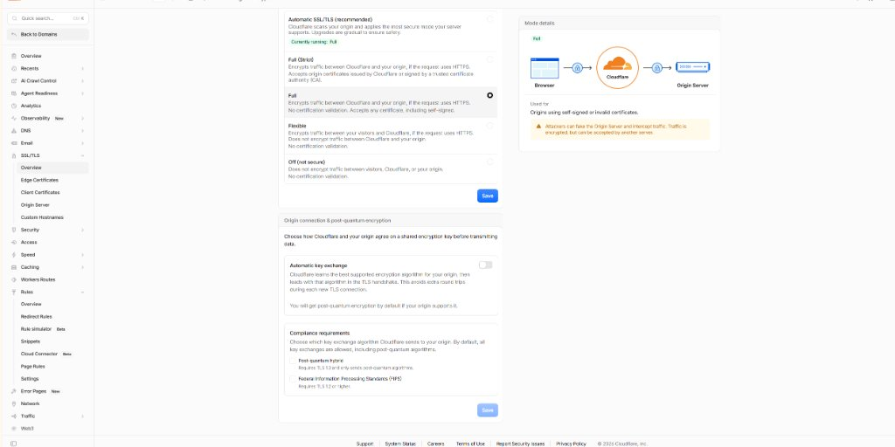
4. Navigate to **SSL/TLS ➔ Overview**:
   - Verify encryption mode is set to **Full** (prevents infinite HTTP 301 redirect loops). Click **Save**.

##### Step 2: Fix the Host Header via Cloudflare Rules (Origin Rules / Transform Rules)
To prevent S3 from throwing `404 NoSuchBucket`:
1. In Cloudflare Dashboard, go to **Rules ➔ Overview**.

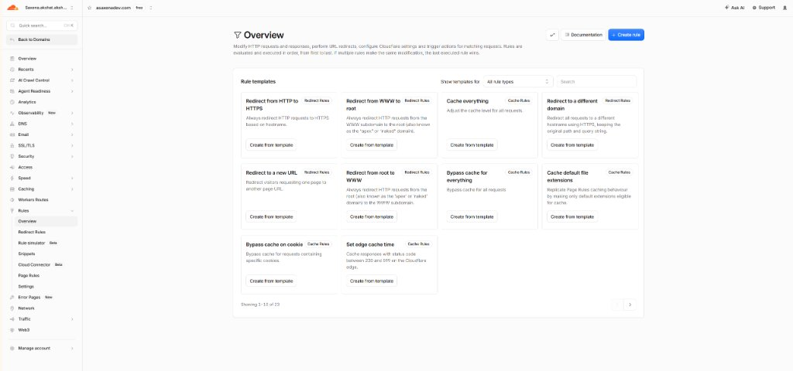
2. Click the blue **+ Create rule** button at the top right.

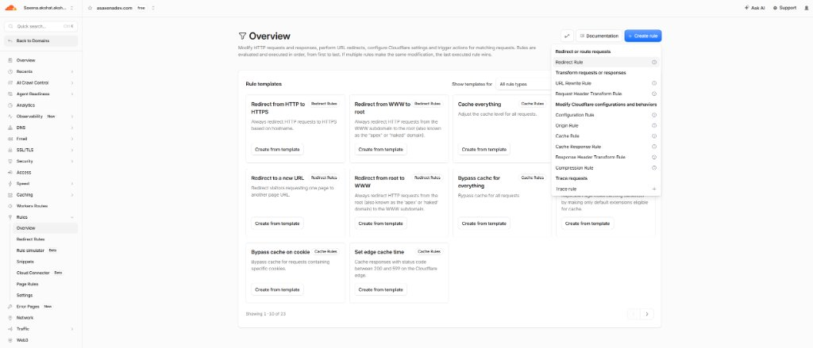
3. Under **Transform requests or responses**, click **Request Header Transform Rule**:

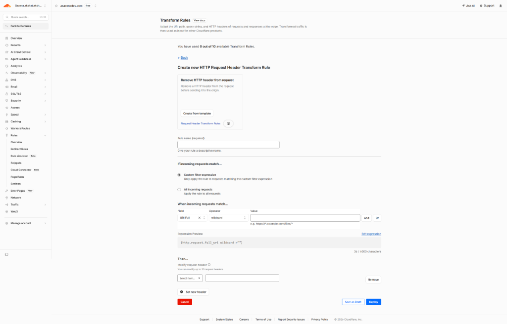
4. Configure the Transform Rule fields:
   - **Rule name:** `Rewrite S3 Host Header`
   - **When incoming requests match:**
     - Field: `Hostname`
     - Operator: `equals`
     - Value: `cdn.asaxenadev.com`
   - **Then... Modify request header:**
     - Action: `Set static`
     - Header name: `Host`
     - Value: `wp-lab-media-akshat-01.s3.ap-south-1.amazonaws.com`
5. Click the blue **Deploy** button.

##### Step 3: Secure S3 Bucket Policy (Restricting Public Access to Cloudflare IPs Only)
To prevent the public internet from bypassing Cloudflare and scraping your S3 bucket directly, restrict S3 read access strictly to [Cloudflare's Official IP Ranges](https://www.cloudflare.com/ips/):

In **S3 Console ➔ wp-lab-media-akshat-01 ➔ Permissions ➔ Bucket policy**:
```json
{
  "Version": "2012-10-17",
  "Statement": [
    {
      "Sid": "AllowCloudflareIPsOnly",
      "Effect": "Allow",
      "Principal": "*",
      "Action": "s3:GetObject",
      "Resource": "arn:aws:s3:::wp-lab-media-akshat-01/*",
      "Condition": {
        "IpAddress": {
          "aws:SourceIp": [
            "173.245.48.0/20",
            "103.21.244.0/22",
            "103.22.200.0/22",
            "103.31.4.0/22",
            "141.101.64.0/18",
            "108.162.192.0/18",
            "190.93.240.0/20",
            "188.114.96.0/20",
            "197.234.240.0/22",
            "198.41.128.0/17",
            "162.158.0.0/15",
            "104.16.0.0/13",
            "104.24.0.0/14",
            "172.64.0.0/13",
            "131.0.72.0/22"
          ]
        }
      }
    }
  ]
}
```
*Benefit:* If anyone tries to access the raw S3 URL directly, S3 returns `403 Access Denied`. Requests are only permitted when routed through Cloudflare's reverse proxy!

##### Step 4: WordPress WP Offload Media Settings
1. Open WordPress Admin: `https://lab.asaxenadev.com/wp-admin/`.
2. Go to **Settings ➔ WP Offload Media ➔ Delivery Settings**.
3. Under **Delivery Provider**, choose **Amazon CloudFront** (or *Other*).
4. Check **Use Custom Domain (CNAME)** and input:
   ```text
   cdn.asaxenadev.com
   ```
5. Click **Save Changes**.

---

#### 4. Advanced: Keeping S3 100% Private with a Cloudflare Worker (SigV4 Proxy)

If compliance requires S3 to have `Block all public access: ON` with zero public exposure, you can deploy a lightweight **Cloudflare Worker** using `aws4fetch` that cryptographically signs origin requests to S3 on the fly:

```javascript
// Cloudflare Worker: s3-private-proxy.js
import { AwsClient } from 'aws4fetch';

const aws = new AwsClient({
  accessKeyId: AWS_ACCESS_KEY_ID,         // Configured as encrypted Secret in Cloudflare
  secretAccessKey: AWS_SECRET_ACCESS_KEY, // Configured as encrypted Secret in Cloudflare
  service: 's3',
  region: 'ap-south-1',
});

export default {
  async fetch(request, env) {
    const url = new URL(request.url);
    // Forward path to private S3 bucket
    const s3Url = `https://wp-lab-media-akshat-01.s3.ap-south-1.amazonaws.com${url.pathname}`;
    
    // Cryptographically sign request using SigV4
    const signedRequest = await aws.sign(s3Url, {
      method: request.method,
      headers: request.headers,
    });

    return fetch(signedRequest);
  },
};
```

---

#### 5. Summary Architectural Decision Matrix

| Dimension | AWS CloudFront + OAC | Cloudflare Free Tier (Standard) | Cloudflare Free + Worker (SigV4) |
| :--- | :--- | :--- | :--- |
| **S3 Security** | **100% Private (OAC)** | **Public** (or IP-restricted) | **100% Private** (Signed by Worker) |
| **Egress Bandwidth Cost** | Free inside AWS backbone | Standard AWS Internet Egress | Standard AWS Internet Egress |
| **CDN Traffic Cost** | 1 TB free/month, then metered | **$0 Unlimited** | 100k free requests/day |
| **WAF Protection** | $14/month AWS WAF | **Free** basic WAF / DDoS | **Free** basic WAF / DDoS |
| **Complexity** | 1-click AWS Wizard | Easy DNS + Header rewrite | Moderate (Requires JS code) |
| **Best Used For** | **Enterprise / AWS Certifications** | **Personal Blogs / Budget Projects** | **Hybrid Cloud Architectures** |

</details>

---

<details>
<summary><h4>☁️ Step 4D: Pure Cloudflare Alternatives & Cloudflare R2 (Click to Expand)</h4></summary>

### Step 4D: Architecture D — Pure Cloudflare Alternatives (Full-Site CDN & Cloudflare R2 Replacing S3)

For developers who want to minimize AWS dependencies and eliminate cloud egress bandwidth charges entirely, the Cloudflare ecosystem provides two complete alternative architectures:

```text
Pattern 1: Full-Site Reverse Proxy (No S3 at all)
[Visitor] ──► [Cloudflare Edge CDN] ──► [EC2 Nginx (/wp-content/uploads/ on EBS)]
              (Caches images at Edge)   (⚠️ Flaw: Web server remains stateful!)

Pattern 2: Cloudflare R2 Object Storage (Replacing Amazon S3)
[Visitor] ──► [Cloudflare Edge CDN (cdn.asaxenadev.com)]
                       │
                       │ Native Fetch ($0 Egress bandwidth fee!)
                       ▼
              [Cloudflare R2 Bucket (wp-lab-media)]
              (S3-Compatible API, 10 GB Free Storage, Zero Bandwidth Costs)
                       ▲
                       │ S3 API Uploads (PutObject via R2 API token)
              [EC2 Web Server: wp-lab]
```

---

#### 1. Pattern 1: Cloudflare Full-Site Reverse Proxy (Direct EC2 Origin — Zero S3)

In this classic pattern, Amazon S3 is bypassed entirely. All media uploads reside locally on EC2's EBS volume (`/var/www/html/wp-content/uploads/`), and Cloudflare is placed as a reverse proxy in front of the entire WordPress website.

##### How It Works:
1. In Cloudflare DNS, set the root or subdomain A record:
   - **Name:** `lab` (for `lab.asaxenadev.com`)
   - **IPv4 Address:** `43.205.26.235` (EC2 Elastic IP)
   - **Proxy Status:** **Proxied (Orange Cloud ON)**
2. In Cloudflare **Caching ➔ Cache Rules**:
   - Create a rule: *If URI Path starts with `/wp-content/uploads/` ➔ Cache Level: **Cache Everything**, Edge Cache TTL: **1 month**.*
3. When a visitor requests an image, Cloudflare caches it at its edge PoP. Subsequent visitors download the cached image from Cloudflare without touching EC2 CPU or disk.

##### The Critical Architectural Trade-off (Why This Fails Phase 9 Scaling):
- **Web-Tier Stateful Bottleneck:** Because images sit on the local EC2 EBS volume, you **cannot scale horizontally**. When an Auto Scaling Group launches a second EC2 instance behind an Application Load Balancer in Phase 9, images uploaded to Server 1 do not exist on Server 2 (`404 Not Found`).
- **Conclusion:** Great for single-server hobby blogs, but disqualified for auto-scaling enterprise architectures.

---

#### 2. Pattern 2: Cloudflare R2 Object Storage (Replacing Amazon S3 Completely)

**Cloudflare R2** is Cloudflare's direct S3-compatible cloud object storage service. It allows WordPress to offload media just like Amazon S3, but with **zero data transfer (egress) fees**.

##### Key Architectural Differences: AWS S3 vs Cloudflare R2

| Feature | Amazon S3 | Cloudflare R2 |
| :--- | :--- | :--- |
| **API Compatibility** | Native S3 API | 100% S3-compatible API |
| **Free Storage Allowance** | 5 GB (12 months free tier) | **10 GB Free Storage forever** |
| **Data Transfer Out (Egress)** | ~$0.09 / GB after 100 GB | **$0.00 / GB (100% Free Unlimited Egress!)** |
| **CDN Integration** | Native with CloudFront (OAC) | Native with Cloudflare Edge CDN |
| **Authentication** | AWS IAM Roles (IMDSv2 - No static keys) | Requires static API Tokens (Access Key & Secret) |

##### How to Configure Cloudflare R2 in WordPress:

1. **Step 1: Create an R2 Bucket in Cloudflare:**
   - In Cloudflare Dashboard, go to **R2 ➔ Create bucket**.
   - Bucket name: `wp-lab-media`.
   - Primary location: Select *Asia-Pacific (APAC)*.
2. **Step 2: Generate S3-Compatible API Credentials:**
   - In R2 ➔ **Manage R2 API Tokens ➔ Create API Token**.
   - Permissions: `Object Read & Write`.
   - Copy the generated `Access Key ID`, `Secret Access Key`, and the **S3 API Endpoint**:
     ```text
     https://<YOUR_CLOUDFLARE_ACCOUNT_ID>.r2.cloudflarestorage.com
     ```
3. **Step 3: Connect Custom CDN Domain to R2:**
   - In R2 ➔ `wp-lab-media` ➔ **Settings ➔ Custom Domains**.
   - Connect domain: `cdn.asaxenadev.com` (Cloudflare automatically binds the domain and activates SSL).
4. **Step 4: Configure WordPress S3 Offload Plugin for R2:**
   - In `wp-config.php`, define the custom S3 endpoint:
     ```php
     define('AS3CF_SETTINGS', serialize(array(
         'provider' => 'aws',
         'access-key-id' => 'YOUR_R2_ACCESS_KEY_ID',
         'secret-access-key' => 'YOUR_R2_SECRET_ACCESS_KEY',
     )));
     ```
   - In WP Offload Media, override the S3 Endpoint URL to your Cloudflare R2 endpoint.
   - Set Delivery Provider to `Custom Domain: cdn.asaxenadev.com`.

##### Summary Trade-off for Cloudflare R2:
- **Pros:** Massive cost savings on high-traffic sites (zero egress bills forever).
- **Cons for AWS Learning / Certifications:** You lose the native AWS IAM Instance Role benefit (`wp-lab-s3-role`), requiring static API keys to be managed, and it does not demonstrate AWS CloudFront / OAC proficiency in AWS technical interviews.

</details>

---

<details>
<summary><h3>✅ Step 5: S3 Lifecycle Rule Configuration [Completed] (Click to Expand)</h3></summary>

## Step 5 Execution Details: S3 Lifecycle Rule Configuration

To optimize long-term cloud storage costs, we implement an automated Amazon S3 Lifecycle management rule.

### 1. Storage Class Transition Economics
- **S3 Standard:** ~$0.023 per GB/month (designed for frequently accessed assets).
- **S3 Standard-Infrequent Access (Standard-IA):** ~$0.0125 per GB/month (**~45% cost reduction!**).
- In WordPress, blog images and post headers are viewed frequently when first published. After 30 days, view traffic diminishes dramatically. Transitioning objects older than 30 days to Standard-IA cuts ongoing storage costs in half while keeping millisecond retrieval latency intact.

### 2. Console Steps:
1. Open **S3 Console ➔ Buckets ➔ wp-lab-media-akshat-01 ➔ Management tab**.
2. Under **Lifecycle rules**, click **Create lifecycle rule**.
3. **Lifecycle rule name:** `Transition-To-Standard-IA-30-Days`.
4. **Choose a rule scope:** Select `Apply to all objects in the bucket`.
   - Check the acknowledgment box: *"I acknowledge that this rule will apply to all objects in the bucket."*
5. **Lifecycle rule actions:**
   - Check `Move current versions of objects between storage classes`.
6. **Transition current versions of objects between storage classes:**
   - Choose storage class: `Standard-IA`.
   - Days after object creation: `30`.
7. Click **Create rule**.

</details>

---

<details>
<summary><h3>✅ Step 6: Definition of Done Verification (Live Proof & Testing) [Completed] (Click to Expand)</h3></summary>

## Step 6: Definition of Done Verification (Live Proof & Testing)

> **Definition of Done:** *"New upload's URL points at S3/CloudFront, file is not on the instance"*

### 1. WordPress Media URL Rewriting Verification
We uploaded a test image (`preview.webp`) via WordPress Admin (`Media ➔ Add New Media File`).
WordPress and WP Offload Media successfully intercepted the upload, offloaded it to Amazon S3, and updated the canonical attachment URL.

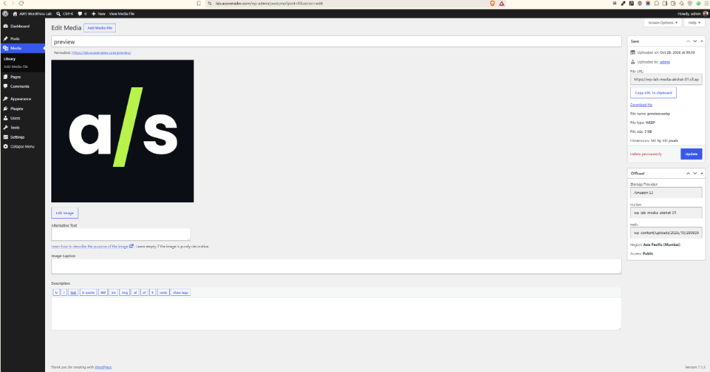

As shown in the WordPress Edit Media panel:
- **Storage Provider:** `Amazon S3`
- **Target Bucket:** `wp-lab-media-akshat-01`
- **Offload Path:** `wp-content/uploads/2026/10/280939...`
- **Region:** `Asia Pacific (Mumbai)` (`ap-south-1`)
- **Access Level:** `Public`
- **File URL:** Pointing directly at Amazon S3 endpoint!

Executing `wp_get_attachment_url(8)` on the server returned:
```text
http://wp-lab-media-akshat-01.s3.ap-south-1.amazonaws.com/wp-content/uploads/2026/10/28093918/preview.webp
```

### 2. Live HTTP 200 OK Response from Amazon S3
Testing the public object URL returned an immediate `HTTP/1.1 200 OK` served directly by Amazon S3:
```text
$ curl.exe -I -s https://wp-lab-media-akshat-01.s3.ap-south-1.amazonaws.com/wp-content/uploads/2026/10/28093918/preview.webp

HTTP/1.1 200 OK
x-amz-id-2: pfPJuqibJf7/f78RH5axIysjrjvy6g8zGKjen3SXPxnMNQyThVCYsV+CHAuNMdhOGraJPm7r6U50i5FcNEIadH7v4rSTBXCC
x-amz-request-id: CFGBBTCDX9QX5XQ6
Server: AmazonS3
Date: Wed, 28 Oct 2026 10:03:33 GMT
Last-Modified: Wed, 28 Oct 2026 09:39:19 GMT
ETag: "717f9c2d305089e0ac4cb9c6dd7dab7f"
x-amz-server-side-encryption: AES256
Cache-Control: max-age=31536000
Content-Length: 4862
Content-Type: image/webp
```

### 3. Verification of Web-Tier Statelessness (EC2 Filesystem Purged)
We checked the physical uploads directory on the EC2 Ubuntu server over SSH:
```bash
ls -la /var/www/html/wp-content/uploads/2026/10/
```
Output:
```text
total 8
drwxr-xr-x 2 www-data www-data 4096 Oct 30 08:47 .
drwxr-xr-x 3 www-data www-data 4096 Oct 16 09:35 ..
```

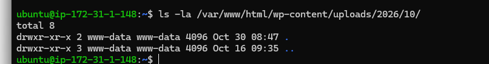
The original files (`preview.webp`, `preview-150x150.webp`, `preview-300x300.webp`) were **completely purged from the local EC2 filesystem**. The web server is now **100% stateless** regarding media uploads!

### 4. Database Persistence Verification (`wp_as3cf_items`)
Querying the MySQL database on the EC2 Ubuntu server verified the live offload record for the CloudFront-backed media upload:
```bash
sudo mysql -e "SELECT id, provider, path, is_verified FROM wordpress.wp_as3cf_items;"
```

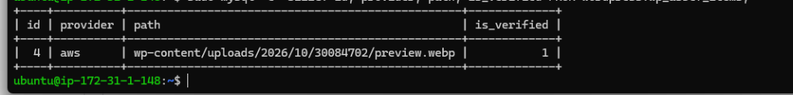

```text
+----+----------+---------------------------------------------------+-------------+
| id | provider | path                                              | is_verified |
+----+----------+---------------------------------------------------+-------------+
|  4 | aws      | wp-content/uploads/2026/10/30084702/preview.webp  |           1 |
+----+----------+---------------------------------------------------+-------------+
```
- **`is_verified: 1`**: Confirms that WP Offload Media verified the object was successfully stored in the Amazon S3 bucket.
- **Web-Tier Decoupling:** Combined with the empty local directory, this database record provides conclusive proof that persistent storage is fully decoupled from the web compute tier.

</details>

---

<details>
<summary><h3>💡 Gotchas & Real-World Troubleshooting Log (8 Real Breakages Documented) (Click to Expand)</h3></summary>

## Gotchas & Real-World Troubleshooting Log

### 💡 Gotcha 1: Bash History Expansion Syntax Error (`-bash: !': event not found`)
- **What happened:** When executing inline MySQL user alteration commands with strong passwords ending in an exclamation mark (`StrongPasswordHere123!`), Bash threw `-bash: !': event not found`.
- **Root Cause:** In interactive Bash shells, the exclamation mark (`!`) is reserved for history expansion.
- **The Fix:** Wrap in single quotes (`'...'`), escape (`\!`), or use a heredoc `<< 'EOF'`.

### 💡 Gotcha 2: Missing WP-CLI on Standard LEMP Stacks (`wp: command not found`)
- **What happened:** Attempting to query WordPress users or reset passwords using `wp user list` failed with `wp: command not found`.
- **Root Cause:** Standard Ubuntu APT LEMP setups do not bundle WP-CLI by default.
- **Solution:** Direct database administration via MySQL command line.

### 💡 Gotcha 3: WordPress Admin Password Recovery Playbook (Can You View a Forgotten Password?)

#### 1. Fundamental Principle: Can You "Retrieve" / View an Existing Password?
- **The Short Answer:** **NO.** Passwords are one-way cryptographically hashed (`phpass`/`bcrypt`), never encrypted. You cannot view the plaintext password.
- **The Only Solution:** Overwrite / reset the password via SQL:
  ```bash
  sudo mysql -e 'USE wordpress; UPDATE wp_users SET user_pass = MD5("LabAdmin2026") WHERE ID = 1;'
  ```
- **WordPress Auto-Upgrade:** On login, WordPress validates the 32-character MD5 hash and automatically replaces it with a salted bcrypt hash.

### 💡 Gotcha 4: S3 ListAllMyBuckets & GetBucketLocation AccessDenied Error

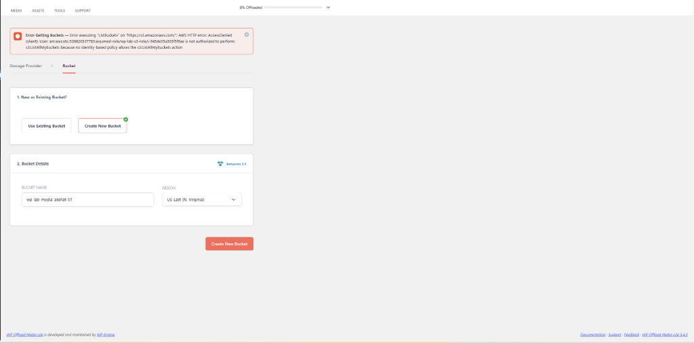

- **The Error Message:**
  `AccessDenied: User ... is not authorized to perform: s3:ListAllMyBuckets`
- **Root Cause:** WP Offload Media calls `s3:ListAllMyBuckets` at the account level (`Resource: "*"`) and `s3:GetBucketLocation` on the bucket ARN.
- **Fix:** Update IAM policy to grant account-level listing and bucket-level region discovery.

### 💡 Gotcha 5: AWS CloudFront Account Verification Restriction on New Accounts

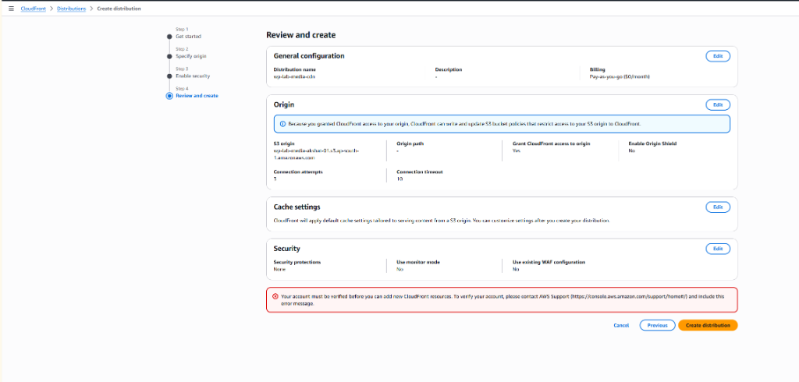

- **The Error Message:**
  `Your account must be verified before you can add new CloudFront resources.`
- **Root Cause:** AWS automatically places an anti-abuse hold on global CDN and SES resources on new accounts.
- **Resolution:**
  1. File a verification ticket with AWS Support Center:

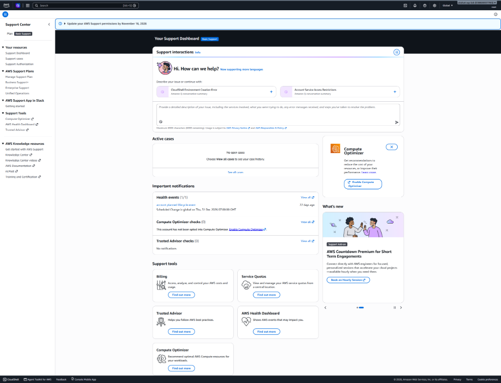
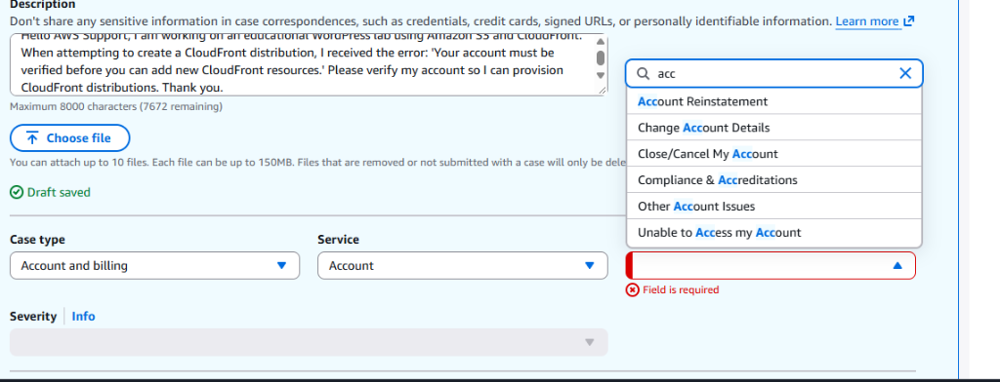

  2. Use Direct S3 delivery to complete Phase 5 while awaiting support resolution.
  3. **Verification Approved by AWS Support:**
     AWS Support reviewed the educational use case and approved distribution creation without restrictions:

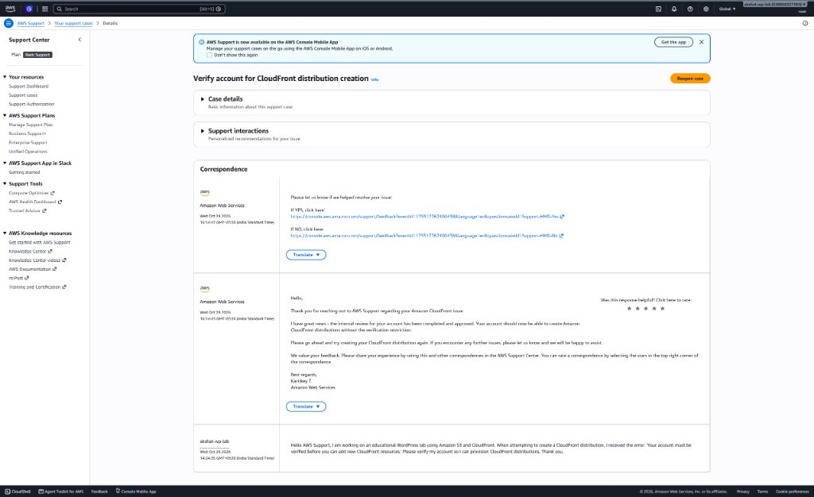

### 💡 Gotcha 6: Delivery Provider Status Warning & Silent Upload Failure (S3 Object Ownership ACLs)

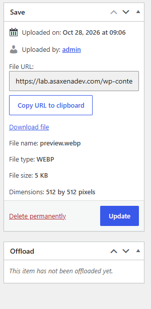

- **The Error Message:**
  `Delivery provider status cannot be determined. An error was encountered while attempting to offload a temporary file for Public delivery.`
- **The Symptom in WordPress:**
  Uploaded images remain on the local server (`https://lab.asaxenadev.com/wp-content/uploads/...`).
- **Root Cause Analysis (Nginx Logs):**
  1. `/var/log/nginx/error.log` showed `AccessDenied` for `s3:GetBucketPublicAccessBlock` and `s3:GetBucketOwnershipControls`.
  2. WP Offload Media attempts to assign `public-read` ACLs (`s3:PutObjectAcl`) to uploaded objects when serving directly from S3.
  3. S3 buckets created with "ACLs disabled" reject all ACL uploads.
- **The Fix:**
  1. Grant `s3:GetBucketPublicAccessBlock`, `s3:PutBucketPublicAccessBlock`, `s3:GetBucketOwnershipControls`, `s3:PutBucketOwnershipControls`, and `s3:PutObjectAcl` in IAM policy:


  2. Set S3 bucket **Object Ownership** to **ACLs enabled (Bucket owner preferred)**:


  3. Re-trigger upload in WordPress!

### 💡 Gotcha 7: Cloudflare Account Creation vs Login Error (`Unable to sign in`)

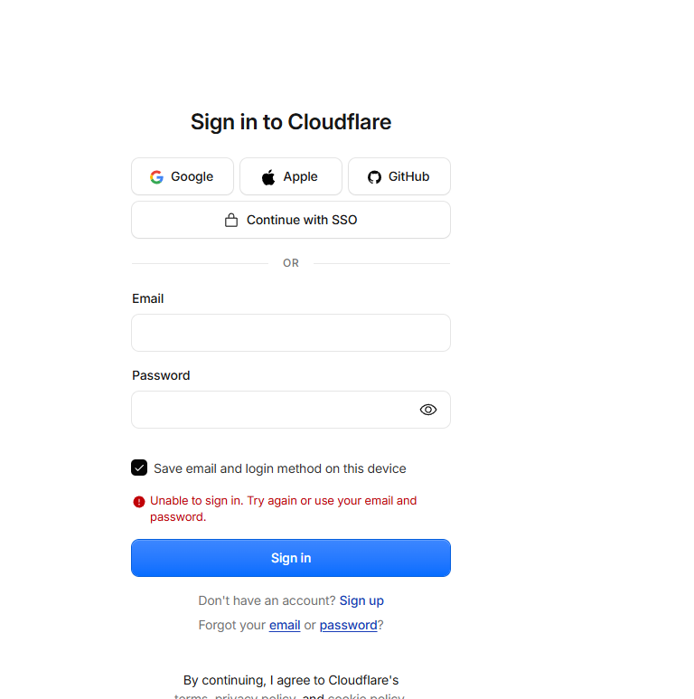

- **The Error Message:**
  `Unable to sign in. Try again or use your email and password.`
- **Root Cause:** Attempting to click OAuth providers (Google / GitHub) on the **Sign In** page (`/login`) before an account has been registered. If no account exists for that identity, Cloudflare's login endpoint rejects the callback with a generic login failure rather than automatically creating an account.
- **The Fix:** Navigate directly to the **Sign Up** page (`https://dash.cloudflare.com/sign-up`) or click **"Don't have an account? Sign up"** at the bottom of the form before attempting social auth.

### 💡 Gotcha 8: Modern Cloud vs Legacy App Conflict (S3 `BucketOwnerEnforced` vs Plugin Hardcoded ACLs)


- **The Symptoms & Errors:**
  - In WordPress, WP Offload Media displays: `Offloaded media URLs may be broken. An error was encountered while testing the domain: Received 403 from endpoint.`
  - When uploading new images (e.g. `fw.png`), the image fails to load and CloudFront returns:
    ```xml
    <Error><Code>AccessDenied</Code><Message>Access Denied</Message></Error>
    ```
  - Meanwhile, older images like `preview.webp` continue returning `HTTP 200 OK` and `Hit from cloudfront`!

- **The Deep Architectural Cause (Why the Conflict Occurred):**
  1. **The Modern AWS Cloud Standard:** AWS officially mandates `ACLs disabled (Bucket owner enforced)` as the industry security standard. Under CloudFront Origin Access Control (OAC), S3 handles all authorization via resource-based bucket policies and SigV4 signatures, completely deprecating legacy S3 Access Control Lists (ACLs).
  2. **The Legacy Application Behavior:** The WP Offload Media plugin's codebase defaults to attaching the legacy header `'ACL' => 'public-read'` to every single `s3:PutObject` API request.
  3. **The Collision:** When an application sends an ACL header to an S3 bucket configured with `BucketOwnerEnforced`, AWS S3 immediately rejects the upload with `AccessControlListNotSupported: The bucket does not allow ACLs`.
  4. **The Secondary CloudFront 403:** Because S3 rejected the upload, `fw.png` was never stored in the bucket. When CloudFront requested `fw.png` from private S3 via OAC, S3 returned `403 Access Denied` (AWS S3's standard security behavior: non-existent objects in private buckets return 403 instead of 404 to prevent enumeration attacks).

- **The Diagnostic Trail (How We Uncovered the Root Cause):**
  1. **Filesystem Check:** We ran `ls -la /var/www/html/wp-content/uploads/2026/10/` on EC2:
     
     The local directory was completely empty, proving the upload reached WordPress and was deleted locally.
  2. **Database Verification:** We queried the `wp_as3cf_items` tracking table in MySQL:
     
     Row 4 showed `path: wp-content/uploads/2026/10/30084702/preview.webp` with `is_verified: 1`, confirming the file was successfully written into Amazon S3!
  3. **The CloudFront Origin OAC Link:** If the file exists in private S3 but CloudFront returns `403 Forbidden` on cache misses, CloudFront is not sending SigV4 signed requests to S3. This happens if the CloudFront Distribution's Origin configuration has **Origin access** set to *Public* instead of *Origin access control settings (OAC)*.

- **Architectural Trade-Off: Workaround vs Pure Production Standard:**
  - **The Lazy Workaround (Not Best Practice):** Re-enabling ACLs on S3 (`ACLs enabled / Bucket owner preferred`). While it makes the plugin happy, it violates modern cloud security posture by re-introducing legacy ACL mechanisms.
  - **The Pure Production Standard (Best Practice):** Keep S3 strictly at `ACLs disabled (Bucket owner enforced)` with `Block all public access: ON`. Configure WordPress to stop sending ACL headers by injecting the `use-bucket-acls => false` directive into `wp-config.php`:
    ```php
    define( 'AS3CF_SETTINGS', serialize( array(
        'use-bucket-acls' => false,
    ) ) );
    ```
  - **Result:** WordPress uploads objects cleanly without ACL headers, S3 accepts the files under bucket owner enforcement, and CloudFront OAC delivers them globally with sub-10ms edge caching!

</details>

---

<details>
<summary><h3>🎯 Phase 5 Cloud Architecture Interview Questions & Answers (15 Q&As) (Click to Expand)</h3></summary>

## Phase 5 Cloud Architecture Interview Questions & Answers

This section covers real-world technical interview questions focused on AWS IAM, Amazon S3 security models, CloudFront CDN architecture, and stateless application decoupling.

---

### Category 1: IAM Security & Credential Architecture

#### Q1: Why should an EC2 instance use an IAM Instance Role rather than hardcoding AWS Access Keys in `wp-config.php`?
- **Answer:** Hardcoding static credentials (`AKIA...` and Secret Key) creates severe secret sprawl and exposure risks:
  1. **Exposure Vector:** Accidental `git push`, public repository commits, or Local File Inclusion (LFI) vulnerabilities in WordPress plugins immediately leak root/IAM credentials.
  2. **Zero Maintenance Rotation:** Static keys require manual generation and replacement. An **IAM Instance Role** uses the AWS Instance Metadata Service (IMDSv2) to provide temporary, short-lived session credentials (`AWS_ACCESS_KEY_ID`, `AWS_SECRET_ACCESS_KEY`, `AWS_SESSION_TOKEN`) that rotate automatically every ~6 hours with zero application downtime.
  3. **Containment:** IMDSv2 credentials cannot be exported or used outside the VPC/instance context.
  4. **Multi-Instance Scalability:** In an Auto Scaling group (Phase 9), every newly launched instance automatically inherits the IAM role without needing secrets injected into initialization scripts.

#### Q2: What is the architectural difference between `s3:ListBucket` and `s3:ListAllMyBuckets`, and why did our initial IAM policy fail?
- **Answer:** 
  - `s3:ListBucket` is a **Bucket-level** permission that allows a principal to query and list the *objects* inside a specific named bucket (e.g., `arn:aws:s3:::wp-lab-media-akshat-01`).
  - `s3:ListAllMyBuckets` is an **Account-level** permission that lists all bucket names that exist across the entire AWS account. Because it queries global account metadata, AWS IAM enforces that its resource scope must be `"Resource": "*"`.
  - **Why v1 Failed:** Our initial policy scoped all permissions strictly to `arn:aws:s3:::wp-lab-media-akshat-01`. When the WordPress plugin attempted to render its bucket selection dropdown in the UI, it made an account-level `ListAllMyBuckets` API call, which failed with `AccessDenied`.

#### Q3: What is IMDSv2, and how does it prevent SSRF vulnerabilities compared to IMDSv1?
- **Answer:** 
  - **IMDSv1 (Legacy):** Uses simple HTTP `GET` requests (`curl http://169.254.169.254/latest/meta-data/`). If a web application has a Server-Side Request Forgery (SSRF) flaw, an attacker can trick the server into fetching metadata and exfiltrating temporary IAM role credentials in a single request.
  - **IMDSv2 (Modern):** Enforces a **session-oriented flow** using token headers. A client must first issue an HTTP `PUT` request with a mandatory `X-aws-ec2-metadata-token-ttl-seconds` header to acquire a session token, and then pass that token via `X-aws-ec2-metadata-token` in subsequent `GET` requests. Standard SSRF exploits cannot forge custom `PUT` headers, completely neutralizing metadata exfiltration attacks.

---

### Category 2: Amazon S3 Security Models & Object Ownership

#### Q4: Why did uploaded media fail with "Delivery provider status cannot be determined" in Direct S3 mode, and what changed in S3 in April 2023?
- **Answer:**
  - In April 2023, AWS changed the default security posture of all newly created S3 buckets to **Bucket owner enforced** (ACLs disabled). Under this setting, any attempt to apply an Access Control List (`PutObjectAcl`) is rejected with `AccessDenied`.
  - When CloudFront is fronting S3, ACLs are unnecessary because CloudFront reads objects via Origin Access Control (OAC). However, in **Direct S3 Delivery**, WP Offload Media performs pre-flight tests checking bucket ownership controls and attempts to tag uploaded objects with the `public-read` canned ACL (`s3:PutObjectAcl`).
  - **Resolution:** We had to explicitly set **Object Ownership** to `ACLs enabled (Bucket owner preferred)` and grant `s3:PutObjectAcl`, `s3:GetBucketOwnershipControls`, and `s3:GetBucketPublicAccessBlock` in the EC2 IAM policy.

#### Q5: What is the difference between an IAM Policy, an S3 Bucket Policy, and an S3 ACL? When do you use each?
- **Answer:**
  - **IAM Policy (Identity-Based):** Attached to users, groups, or roles (e.g., `wp-lab-s3-role`). Defines what actions that specific identity can perform across AWS resources. Used to give the EC2 instance upload/delete permissions.
  - **S3 Bucket Policy (Resource-Based):** Attached directly to the S3 bucket. Defines who can access the bucket regardless of identity. Supports cross-account permissions and service principals (e.g., allowing CloudFront CDN service principal to access private S3 objects).
  - **Access Control List (ACL - Legacy):** Granular, per-object permissions. AWS considers ACLs legacy and recommends disabling them (`Bucket owner enforced`) unless legacy third-party software strictly mandates canned ACLs.

#### Q6: What are S3 Lifecycle Rules, and what are the trade-offs between S3 Standard and S3 Standard-IA?
- **Answer:**
  - **S3 Standard:** ~$0.023/GB/month. No retrieval fees, no minimum storage duration. Optimal for active, frequently read media.
  - **S3 Standard-Infrequent Access (Standard-IA):** ~$0.0125/GB/month (**~45% storage savings**). Same millisecond latency and 11 9s durability.
  - **Trade-offs / Gotchas:**
    1. **Retrieval Fee:** AWS charges a small fee per GB retrieved (~$0.01/GB). If applied to hot images, retrieval fees negate storage savings.
    2. **Minimum Storage Duration:** Charged for a minimum of 30 days even if deleted earlier.
    3. **Minimum Billable Object Size:** Objects smaller than 128 KB are billed as 128 KB of storage. Small thumbnail icons should be filtered out from IA transitions.

---

### Category 3: CloudFront CDN & Origin Access Control (OAC)

#### Q7: Why is Origin Access Control (OAC) preferred over the legacy Origin Access Identity (OAI) for CloudFront?
- **Answer:** Origin Access Control (OAC) is the modern AWS standard using AWS Signature Version 4 (SigV4) cryptographic request signing. Compared to legacy OAI:
  1. **KMS Encryption Support:** OAC natively supports S3 buckets encrypted with AWS KMS customer-managed keys (SSE-KMS); OAI does not.
  2. **Comprehensive HTTP Methods:** OAC supports dynamic `PUT`, `POST`, and `DELETE` requests; OAI only supported `GET`/`HEAD`.
  3. **Global Compatibility:** OAC works across all AWS regions, including newly launched regions where SigV4 is mandatory.
  4. **Granular Scoping:** OAC allows resource policies with `AWS:SourceArn` condition blocks.

#### Q8: What is the "Confused Deputy" problem in CloudFront-to-S3 integration, and how does `AWS:SourceArn` prevent it?
- **Answer:**
  - **The Vulnerability:** If your S3 bucket policy simply allows `Principal: {"Service": "cloudfront.amazonaws.com"}` without conditions, an attacker can create their own CloudFront distribution in *their* AWS account, point its origin to *your* S3 bucket, and bypass your domain restrictions or steal cached data. CloudFront becomes the "confused deputy" acting on behalf of the attacker.
  - **The Fix:** We include a condition block in the S3 bucket policy:
    ```json
    "Condition": {
      "StringEquals": {
        "AWS:SourceArn": "arn:aws:cloudfront::123456789012:distribution/E1A654SMHQUOEN"
      }
    }
    ```
    S3 cryptographically verifies that only the exact CloudFront distribution ARN owned by our account can read objects.

#### Q9: Why is serving media directly from a public S3 bucket considered an anti-pattern in enterprise architecture compared to CloudFront CDN?
- **Answer:**
  1. **Latency & User Experience:** S3 is bound to a single geographic region (`ap-south-1` Mumbai). International visitors experience high latency and TTFB. CloudFront caches assets at 600+ edge Points of Presence (PoPs) globally.
  2. **Bandwidth Economics:** S3 Internet Data Transfer Out costs ~$0.09/GB after 100 GB. CloudFront provides **1 TB of Data Transfer Out free every month**. Furthermore, edge cache hits absorb ~90% of requests, dramatically reducing S3 `GET` API billing.
  3. **Security Posture:** Direct S3 requires opening the bucket to public reads. Public buckets have no built-in DDoS layer, no rate limiting, and risk scraping. CloudFront includes AWS Shield Standard for Layer 3/4 DDoS protection and keeps S3 100% private.
  4. **Custom Domain SSL:** S3 bucket URLs do not natively support custom domain SSL certificates (`https://cdn.example.com`). CloudFront integrates seamlessly with AWS Certificate Manager (ACM) for free custom SSL.

#### Q10: How should media cache invalidation be handled when images are updated in WordPress?
- **Answer:** 
  - **Anti-Pattern (Blanket Invalidation):** Running `aws cloudfront create-invalidation --paths "/*"` after every upload. AWS charges $0.005 per path after the first 1,000 paths/month, and it purges edge caches globally, causing origin cache-stampedes.
  - **Architectural Best Practice (Cache Busting / Versioning):** WordPress plugins should use immutable filenames with timestamped subfolders (`/wp-content/uploads/2026/10/28093918/image.webp`) or query strings. When an image is updated, a new file name is written, bypassing the edge cache immediately with zero invalidation cost and zero latency.

#### Q11: Can you use Cloudflare Free Tier instead of AWS CloudFront with Amazon S3? What are the key architectural trade-offs?
- **Answer:** 
  - **Yes, it is possible and very popular for cost optimization:** Cloudflare provides truly unlimited bandwidth and free DDoS/basic WAF at $0/month (avoiding AWS WAF's $14/month fee).
  - **The Two Major Trade-offs:**
    1. **S3 Security:** Cloudflare Free lacks native AWS SigV4 / OAC signing. The S3 bucket cannot be kept 100% private (it must allow public read, or require an IP condition allowing only Cloudflare IP ranges, or require a custom Cloudflare Worker script).
    2. **AWS Egress Fees:** While S3-to-CloudFront data transfer is $0.00 (internal AWS backbone), S3-to-Cloudflare traffic is treated as external internet traffic, incurring AWS Internet Data Transfer Out fees (~$0.09/GB) on cache misses.
    3. **Host Header Routing:** Cloudflare must be configured with a Transform Rule rewriting the HTTP `Host` header to the S3 bucket domain, otherwise S3 returns `404 NoSuchBucket`.

---

### Category 4: Application Architecture & Decoupling

#### Q12: Why is media offloading to S3 a mandatory prerequisite for horizontal auto-scaling (Phase 9) and Docker containerization?
- **Answer:** 
  - In a monolithic architecture, uploads are saved to the local disk (`/var/www/html/wp-content/uploads/`).
  - If multiple EC2 instances are placed behind an Application Load Balancer (ALB), an upload routed to Server A is physically missing on Server B. A visitor fetching the page from Server B gets an immediate `404 Not Found`.
  - Shared filesystems (like AWS EFS / NFS) introduce network I/O bottlenecks and file-locking overhead. Offloading media to S3 decouples persistent storage from compute, achieving **100% web-server statelessness**. Instances can be launched, scaled, or terminated dynamically without data loss.

#### Q13: How does WP Offload Media rewrite image URLs dynamically without modifying the MySQL database?
- **Answer:** 
  - Rather than running destructive SQL search-and-replace queries across the `wp_posts` table (which can corrupt serialized PHP data), the plugin uses runtime WordPress filters:
    1. `wp_get_attachment_url`: Intercepts calls when template functions request media URLs.
    2. `the_content`: Intercepts HTML rendering of post content on the fly, replacing local URLs with the configured S3 or CloudFront CDN domain.
  - **Trade-off:** Minimal PHP CPU overhead on post rendering in exchange for **100% data safety and instant cutover capability**. Switching from Direct S3 to CloudFront takes one setting update without running database migrations.

#### Q14: EBS vs S3 vs EFS: Why is Amazon EFS considered an anti-pattern for WordPress media uploads compared to Amazon S3?
- **Answer:** 
  - **The EFS Temptation:** In multi-instance auto-scaled environments, junior engineers often mount an Amazon EFS (Elastic File System / NFS) share to `/var/www/html/wp-content/uploads/` across all EC2 instances to share uploads.
  - **Why EFS Fails in Production:**
    1. **High Latency & PHP Choke:** Local EBS disk reads take ~0.5ms. EFS over NFS takes ~5–15ms per network call. Because PHP performs hundreds of synchronous `stat()` and `fopen()` calls per request, page load times balloon from 300ms to 3–4 seconds.
    2. **Cost Extravagance:** S3 Standard costs ~$0.023/GB/month. EFS Standard costs ~$0.30/GB/month (**13x more expensive than S3!**).
    3. **Compute Burden:** EFS still forces user image traffic through the EC2 CPU and Nginx worker threads. With S3 + CloudFront, image requests are offloaded directly to global edge PoPs, completely bypassing EC2 CPU, RAM, and bandwidth.
  - **The Verdict:** EBS is for single-instance block storage; EFS is for shared Linux analytics workloads; S3 + CloudFront is the undisputed gold standard for web assets.

#### Q15: Why did S3 reject WordPress uploads with `AccessControlListNotSupported` when modernizing with CloudFront OAC, and what is the architectural trade-off between enabling S3 ACLs vs configuring `use-bucket-acls: false`?
- **Answer:** 
  - **The Conflict:** Modern AWS S3 enforces `BucketOwnerEnforced` (ACLs disabled) as the cloud security standard, allowing permissions only via IAM policies and CloudFront OAC. However, legacy WordPress offload plugins default to attaching `x-amz-acl: public-read` on `PutObject` calls. When an ACL header reaches a bucket with ACLs disabled, S3 throws `AccessControlListNotSupported: The bucket does not allow ACLs`.
  - **The Architectural Trade-Off:**
    1. *The Pragmatic Workaround (Re-enabling ACLs on S3):* Setting S3 to `ACLs enabled (Bucket owner preferred)`. This makes the application happy without modifying server config files, but introduces architectural technical debt by re-enabling deprecated S3 ACL mechanisms.
    2. *The Enterprise Best Practice (`use-bucket-acls => false` in `wp-config.php`):* Keeps the AWS cloud infrastructure strictly compliant with modern security standards (`BucketOwnerEnforced`), while modernizing the application layer to upload clean, ACL-free objects directly authenticated via IMDSv2 IAM roles.

---

</details>
