# Phase 6 — Harden it (Zero-SSH via Session Manager, Closed Port 22 & Secrets Offloading)

> **Definition of Done:** Port 22 closed, Session Manager works, no passwords in `wp-config.php`.

---

<details>
<summary><h3>🧠 Conceptual Foundations, Architecture & Trade-offs (Click to Expand)</h3></summary>

## What it does

Eliminates the entire public SSH attack surface by shutting down Port 22 to the world and replacing key-based SSH with **AWS Systems Manager (SSM) Session Manager** for browser-based root terminal access authenticated solely via AWS IAM. Decouples database credentials from `/var/www/html/wp-config.php`, offloading them into **AWS Systems Manager Parameter Store / Secrets Manager**, dynamically queried at runtime with local caching so that zero database passwords exist in plaintext on the server's disk.

---

## Why choose it (Over Traditional SSH Keys & Hardcoded `wp-config.php`)

- **Eliminates Public Port 22 Attack Surface:** 
  The moment Port 22 is open to `0.0.0.0/0`, internet bots bombard the server with thousands of automated brute-force SSH attacks daily. Closing Port 22 entirely means port scanners detect no open administrative management ports.
- **Zero SSH Private Key (`.pem`) Sprawl:**
  Traditional SSH relies on static private keys. If a developer's laptop is compromised or a `.pem` file is committed to a git repository, the server is breached. Session Manager requires zero SSH keys; access is governed dynamically by AWS IAM permissions and MFA.
- **Centralized Enterprise Audit Trail:**
  Standard SSH connections are opaque unless custom syslog daemons are configured. SSM Session Manager logs every single session connection, and can stream full terminal keystrokes directly to Amazon CloudWatch Logs and AWS CloudTrail with immutable auditing.
- **Eliminates Local File Inclusion (LFI) Credential Theft:**
  In WordPress, vulnerable third-party plugins with LFI flaws allow attackers to view server files (e.g. `../../wp-config.php`). With database passwords offloaded to AWS Parameter Store / Secrets Manager, `wp-config.php` contains zero database passwords to steal.

---

## Trade-offs

- **Agent & Outbound Connectivity Dependency:**
  Session Manager relies on the `amazon-ssm-agent` daemon running inside the EC2 operating system. If the agent crashes, or if outbound HTTPS (Port 443) traffic to AWS SSM endpoints is blocked, Session Manager cannot connect.
- **Runtime Secret Query Overhead:**
  Querying AWS Parameter Store / Secrets Manager on every single WordPress HTTP request introduces ~20–50ms of network latency per page load. **Mitigation:** Secrets must be cached in memory (APCu / OPcache) or a tightly locked local runtime cache with TTL.
- **Secrets Manager vs Parameter Store Cost:**
  AWS Secrets Manager charges **$0.40 per secret/month** plus $0.05 per 10,000 API calls. AWS Systems Manager Parameter Store (Standard tier) is **100% Free ($0.00)** with zero monthly fees.

---

## Architecture Diagram

```text
[Dev / Cloud Engineer via AWS Console]
       │
       │ HTTPS (Port 443 - Authenticated via IAM & MFA)
       ▼
[AWS Systems Manager (SSM) Session Manager]
       │
       │ Outbound HTTPS Polling (No inbound ports needed!)
       ▼
┌─────────────────────────────────────────────────────────────┐
│ EC2 Instance: wp-lab                                        │
│                                                             │
│ Security Group Inbound:                                     │
│ ├── Port 80 (HTTP)   ➔ 0.0.0.0/0 (Open to Public)           │
│ ├── Port 443 (HTTPS) ➔ 0.0.0.0/0 (Open to Public)           │
│ └── Port 22 (SSH)    ➔ 🚫 100% CLOSED (Rule Deleted!)       │
│                                                             │
│ Daemons & IAM Role:                                         │
│ ├── amazon-ssm-agent (Provides shell via Session Manager)   │
│ ├── Attached Role: wp-lab-s3-role                           │
│ │   ├── AmazonSSMManagedInstanceCore (Allows SSM control)   │
│ │   └── SSM Parameter Store Read Policy                     │
│ │                                                           │
│ └── WordPress Stack:                                        │
│     ├── Nginx + PHP 8.3-FPM                                 │
│     └── wp-config.php (Queries DB password dynamically)     │
└──────────────────────────────┬──────────────────────────────┘
                               │
                               │ Fetch DB Password at Runtime (Cached)
                               ▼
     [AWS Systems Manager Parameter Store / Secrets Manager]
     └── Secret: /wp-lab/db/password (Encrypted with AWS KMS)
```

---

## Deep Dive: Traditional SSH (`.pem`) vs AWS SSM Session Manager

### Architectural Comparison: Desktop PowerShell vs Browser Session Manager

A common question among developers transitioning to AWS is:  
*"Inside the server, is there any difference between connecting via SSH from desktop PowerShell vs Session Manager in the browser? Will anything break or behave differently?"*

- **Inside the Operating System (Zero Functional Difference):**  
  Whether you log in via SSH (`ubuntu` user) or Session Manager (`ssm-user`), you land in the **exact same Ubuntu Linux shell** with full `sudo` root privileges. Every command (`systemctl`, `nano`, `php`, `wp-cli`, `mysql`) executes with identical capabilities.
- **Outside the Operating System (Architecture & Attack Surface):**  
  The difference is night and day. Relying on traditional SSH in production introduces four severe architectural and security hazards:

#### The 4 Critical Risks of Traditional SSH in Production:
1. **24/7 Public Port 22 Scans & Brute-Force Attacks:**  
   The moment Port 22 is exposed to the internet, global botnets and automated port scanners bombard the server with thousands of brute-force login attempts every hour (visible in `/var/log/auth.log`). Restricting to "My IP" is fragile because residential ISP IP addresses change dynamically. With Session Manager, **Port 22 is 100% closed (deleted)**, presenting zero open management attack surface.
2. **Static Key Sprawl & Catastrophic Git Leaks (`.pem`):**  
   Traditional SSH relies on static private key files stored unencrypted on developer laptops. If a laptop is compromised or a developer accidentally commits `wp-lab-key.pem` to a public GitHub repository (one of the #1 root causes of AWS account breaches), attackers gain permanent root access. Session Manager is completely **keyless**, governed exclusively by temporary AWS IAM credentials and MFA.
3. **Absence of Centralized Immutable Audit Trails (SOC 2 / ISO Compliance):**  
   If multiple engineers hold SSH keys and someone executes a destructive command or modifies configuration, standard SSH provides no centralized, tamper-proof record of who typed what. Session Manager logs every session initiation in AWS CloudTrail and streams complete terminal session keystrokes directly to Amazon CloudWatch Logs and S3 buckets for forensic audit.
4. **Failure in Enterprise Private Subnets (No Public IP):**  
   In production architectures (e.g. Phase 9 Auto Scaling), EC2 web instances are isolated in **Private Subnets** with zero public IP addresses. Traditional SSH cannot reach them without provisioning and maintaining costly Bastion/Jump Hosts. Session Manager connects natively to private instances over the AWS internal backbone via VPC Endpoints without requiring any public IP.

#### Pro-Tip: Can You Use Desktop PowerShell with Session Manager?
**YES!** You do not have to use the AWS web browser console. By installing the **AWS CLI Session Manager Plugin** on Windows/macOS, developers can initiate keyless, zero-port sessions directly inside their local desktop PowerShell / Terminal:
```powershell
[Local Windows PowerShell]
aws ssm start-session --target i-0123456789abcdef0
```
This gives developers their familiar local terminal environment, autocompletion, and custom fonts while strictly maintaining enterprise zero-port security!

---

| Architectural Dimension | Traditional SSH (`ssh -i key.pem ubuntu@ip`) | AWS Systems Manager Session Manager |
| :--- | :--- | :--- |
| **Inbound Security Group Rules** | Requires Port 22 open (either to `0.0.0.0/0` or static office IP). | **Zero inbound rules required.** Inbound Port 22 is completely deleted. |
| **Authentication Mechanism** | Static RSA/ED25519 Private Key (`.pem` file). | **AWS IAM Identity** (User/Role credentials + MFA). |
| **Network Traffic Direction** | **Inbound:** Client initiates direct TCP handshake to server IP. | **Outbound:** EC2 SSM Agent polls AWS Systems Manager endpoints over outbound HTTPS (443). |
| **Audit Logging & Compliance** | Requires manual server-side SSH logging daemon configuration. | **Automated:** CloudTrail logs session events; CloudWatch / S3 can record full terminal keystrokes. |
| **Key Management Overhead** | High. Key rotation, distribution, revoking departed employees' keys. | **Zero.** Revoking access takes 1 click in AWS IAM. |
| **Bastion / Jump Host Requirement** | Required for private subnets. | **Not needed.** Connects to private instances via AWS backbone without public IPs. |

---

### Deep Dive: The 4 AWS EC2 Connection Methods Explained (Console Breakdown)

When clicking **Connect** on an EC2 instance in the AWS Console, AWS presents four distinct connection options:

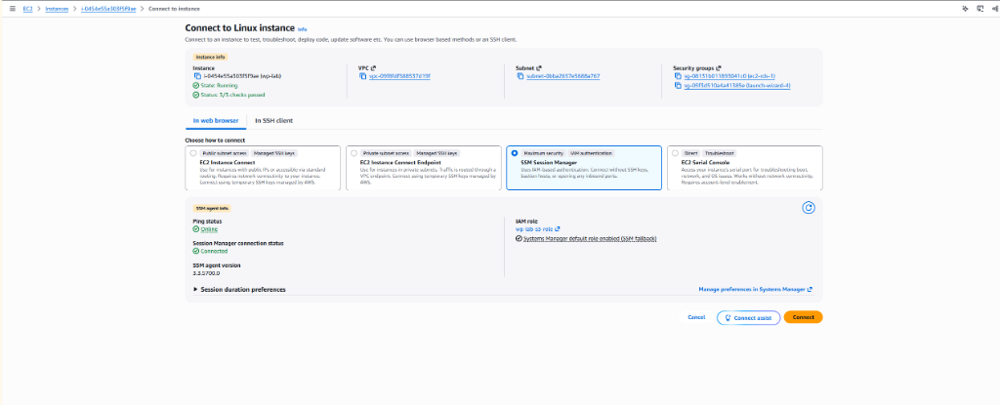

| Connection Method | Subnet / Network Requirement | Port 22 Open Inbound? | Authentication Mechanism | Primary Use Case |
| :--- | :--- | :--- | :--- | :--- |
| **1. EC2 Instance Connect** | Public Subnet only (Requires Public IPv4) | **YES (Port 22 Must be Open)** | Temporary one-time SSH key pushed to IMDS metadata via AWS API. | Quick browser SSH for public dev instances without tracking local `.pem` files. *(Fails in our lab because Port 22 is closed).* |
| **2. EC2 Instance Connect Endpoint (EICE)** | Private Subnet (Zero Public IP required) | **YES (Port 22 Must be Open)** | IAM authorization + Temporary SSH key routed via a private VPC Endpoint. | Accessing private instances without running a public Bastion host. Still relies on SSH protocol. |
| **3. SSM Session Manager (Our Phase 6 Architecture ⭐)** | **Both Public & Private Subnets** | **NO (Port 22 is 100% Deleted / Closed)** | **Pure AWS IAM Identity & MFA.** Zero SSH keys. | **Enterprise Production Standard.** Maximum security, zero attack surface, immutable CloudWatch/S3 keystroke logging, SOC2/ISO compliance. |
| **4. EC2 Serial Console** | Out-of-Band (Direct Hypervisor Serial Port) | **NO (Bypasses network completely)** | AWS IAM / Root account credentials only. | **Emergency Disaster Recovery.** Direct motherboard serial port access when kernel panics, OS boots fail, or network daemons crash. |

> [!NOTE]
> **Common Architectural Misconception ("Which instance is for what?"):**  
> When viewing the "Connect to Linux instance" wizard, developers often ask: *"Are these 4 different instances? Which instance is for what?"*  
> **The Reality:** There is only **one single instance** (`wp-lab`). These 4 options represent **four distinct connection architectures and network protocols** provided by AWS to access the shell of that same single instance. In Phase 6, we standardized on **Option 3 (SSM Session Manager)** as the modern enterprise zero-port standard.

---


### Deep Dive: How to Manage Files Without Open Port 22 (Replacing Traditional SFTP & WinSCP)

A common developer concern when closing Port 22 is:  
*"If Port 22 is completely closed and traditional SFTP / FileZilla / WinSCP no longer connects, how do developers upload, edit, and manage files on the server?"*

In modern cloud architecture, manual drag-and-drop SFTP is considered an enterprise anti-pattern because it leaves no version history, bypasses testing pipelines, and risks file permission corruption. Instead, file management is decoupled across 4 purpose-built mechanisms:

1. **WordPress Media & Uploads (Decoupled to S3):**
   - Handled natively in the WordPress Admin Dashboard.
   - Via **WP Offload Media** (implemented in Phase 5), all image, video, and PDF uploads bypass the local EC2 filesystem completely and stream directly to private Amazon S3 storage (`wp-lab-media-akshat-01`).
2. **Application Code & Themes (Automated CI/CD):**
   - Handled via **Git & GitHub Actions** (implemented in Phase 3).
   - Developers write code locally in their IDE (VS Code), push to GitHub, and the CI/CD pipeline deploys changes automatically after passing automated tests.
3. **Server Configuration Files (`wp-config.php`, Nginx):**
   - Handled via **AWS Systems Manager Session Manager**.
   - Developers open a secure browser root shell with 1 click and edit configs directly using `nano` or `vim`.
4. **GUI File Management & Remote IDE Editing (WinSCP & VS Code via SSM Tunnel):**
   - If a graphical file explorer or direct remote file editing is strictly required, developers install the **AWS CLI Session Manager Plugin** on their local computer and add an SSH `ProxyCommand` to `~/.ssh/config`:
     ```text
     Host wp-lab-ssm
         HostName i-0454e55a303f5f9ae
         User ubuntu
         ProxyCommand aws ssm start-session --target %h --document-name AWS-StartSSHSession --parameters 'portNumber=%p'
     ```
   - WinSCP, FileZilla, and VS Code Remote SSH can then connect through the outbound SSM WebSocket tunnel. Developers get a full GUI file manager without opening Port 22 to the public internet!

---

## Deep Dive: AWS Secrets Manager vs AWS Systems Manager (SSM) Parameter Store

| Evaluation Factor | AWS Systems Manager Parameter Store (Standard) | AWS Secrets Manager |
| :--- | :--- | :--- |
| **Pricing** | **100% Free ($0.00)** for up to 10,000 standard parameters. | **$0.40 per secret / month** + $0.05 per 10,000 API requests. |
| **Encryption** | Supports AWS KMS encryption (`SecureString`). | Supports AWS KMS encryption. |
| **Automatic Rotation** | Requires custom AWS Lambda function. | **Built-in native rotation** for RDS MySQL/PostgreSQL. |
| **Cross-Account Access** | Limited / Complex resource sharing. | Natively supported via resource-based secret policies. |
| **Lab & Cost Recommendation** | **Recommended for Phase 6 ($0 cost).** | Recommended in enterprise for automated RDS rotation. |

</details>

---

<details open>
<summary><h3>📋 Implementation Steps & Progress Tracker [Always Visible]</h3></summary>

## Implementation Steps & Progress Tracker

- [x] **Step 1: Attach SSM Policy to EC2 IAM Role**
  - Attach AWS managed policy `AmazonSSMManagedInstanceCore` to `wp-lab-s3-role`.
- [x] **Step 2: Verify SSM Agent & Test Session Manager Connection**
  - Open EC2 Console ➔ Select `wp-lab` ➔ Click **Connect ➔ Session Manager**.
  - Verify terminal opens in browser as user `ssm-user` with root privileges.
- [x] **Step 3: Close Port 22 (SSH) Inbound Rule in Security Group**
  - Edit Security Group `launch-wizard-1` / `wp-lab-sg`.
  - Delete Port 22 rule completely.
  - Verify standard SSH (`ssh -i ...`) is 100% blocked and times out.
  - Verify Session Manager still connects with zero interruption.
- [x] **Step 4: Store Database Credentials in AWS Parameter Store / Secrets Manager**
  - Create parameter `/wp-lab/production/db_password` as type `SecureString`.
- [x] **Step 5: Grant EC2 IAM Role Read Permissions for Parameter Store**
  - Add inline policy granting `ssm:GetParameter` on `/wp-lab/*`.
- [x] **Step 6: Refactor `wp-config.php` for Dynamic Secret Retrieval & Caching**
  - Replace static password in `wp-config.php` with dynamic AWS SDK / CLI fetch with local cache.
- [ ] **Step 7: Deliberate Policy Breakage Experiment (IAM Evaluation Logic)**
  - Simulate an IAM permission block, trigger deliberate access denied, and analyze error message.
- [ ] **Step 8: Definition of Done Verification**
  - Verify Port 22 is closed from internet port scanner.
  - Verify Session Manager terminal connects.
  - Verify `wp-config.php` contains zero database passwords and WordPress loads cleanly.

</details>

---

<details>
<summary><h3>⚙️ Step 1 Execution Details: Attach SSM Policy to EC2 IAM Role (Click to Expand)</h3></summary>

## Step 1 Execution Details: Attach SSM Policy to EC2 IAM Role

To enable AWS Systems Manager to communicate with our instance, the instance's IAM role must have permissions to register with the Systems Manager service endpoint.

### Console Steps:
1. Open **AWS Console ➔ IAM ➔ Roles**.
2. Select existing role: **`wp-lab-s3-role`**.

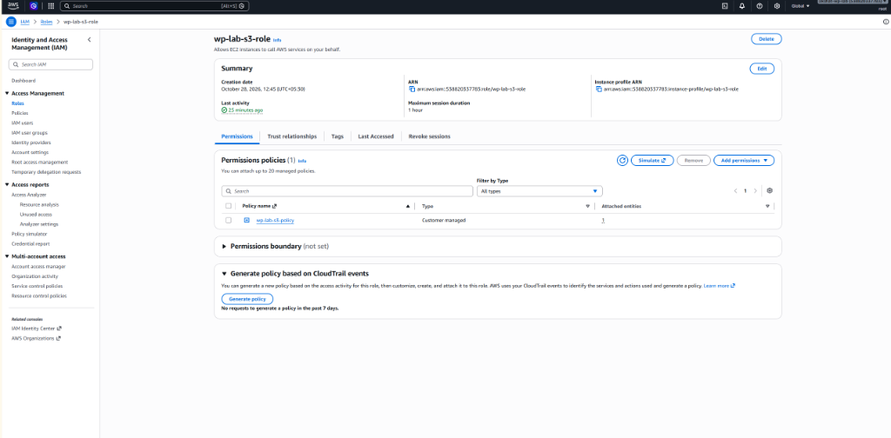
3. Under the **Permissions** tab, click **Add permissions ➔ Attach policies**.
4. In the search box, enter:
   ```text
   AmazonSSMManagedInstanceCore
   ```
5. Check the box next to **`AmazonSSMManagedInstanceCore`**.

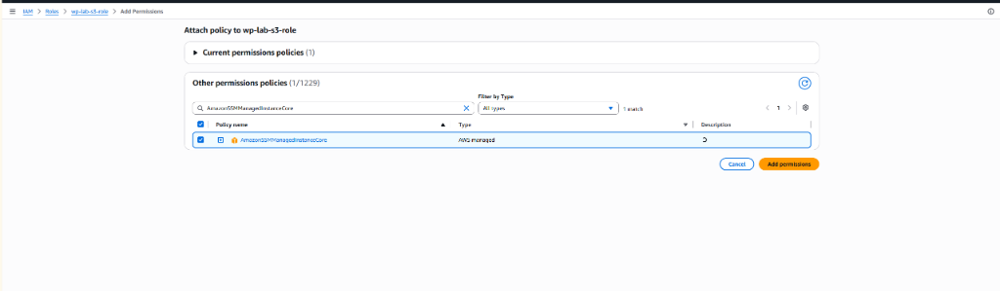
6. Click **Add permissions**.

</details>

---

<details>
<summary><h3>⚙️ Step 2 Execution Details: Connect via AWS Session Manager (Browser Shell) (Click to Expand)</h3></summary>

## Step 2 Execution Details: Connect via AWS Session Manager (Browser Shell)

### Console Steps:
1. Open **EC2 Console ➔ Instances**.
2. Select instance: **`wp-lab`**.
3. Click the **Connect** button at the top right.
4. Click the **Session Manager** tab.

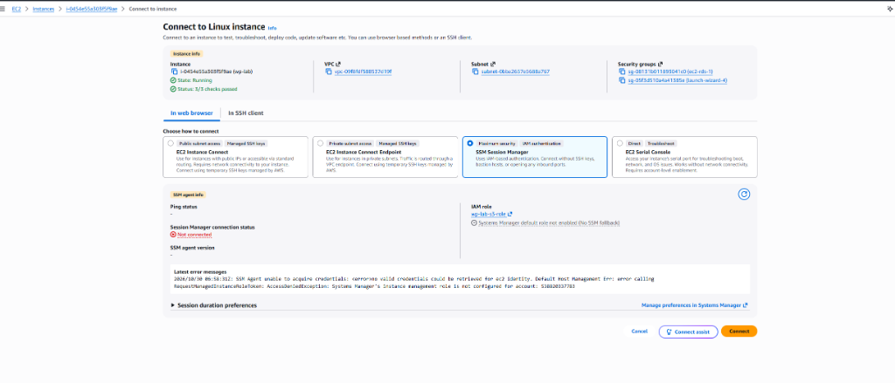

5. Verify status flips to **`Online`** and **`Connected`**:

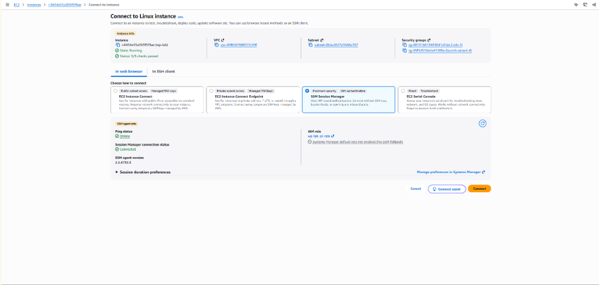

6. Click the orange **Connect** button at the bottom right.

### Terminal Verification:
Once the black browser terminal window opens:
```bash
[Remote Ubuntu EC2 Server - Session Manager]
whoami
sudo su -
whoami
```

**Live Verification Output:**

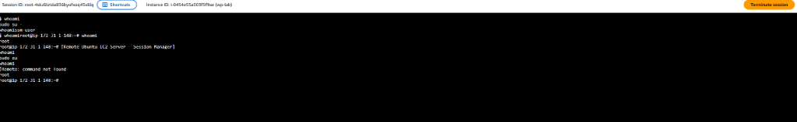

```text
$ whoami
ssm-user
$ sudo su -
root@ip-172-31-1-148:~# whoami
root
```
*Result:* Initial user is `ssm-user`, and `sudo su -` grants instant elevation to `root` with zero passwords requested!

</details>

---

<details>
<summary><h3>⚙️ Step 3 Execution Details: Close Port 22 (SSH) in Security Group (Click to Expand)</h3></summary>

## Step 3 Execution Details: Close Port 22 (SSH) in Security Group

Once Session Manager is verified and operating:

### Console Steps:
1. Open **EC2 Console ➔ Instances ➔ `wp-lab` ➔ Security** tab.

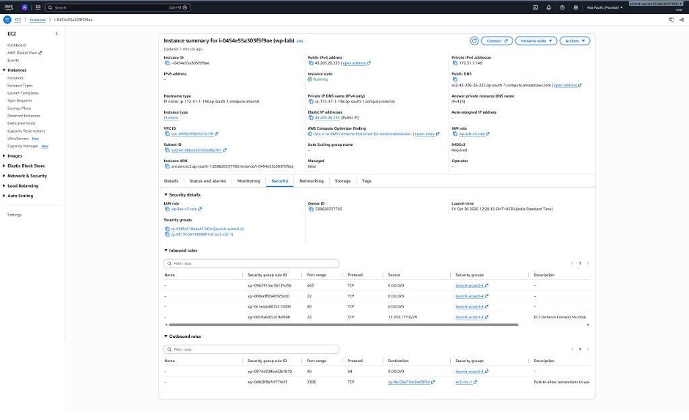

2. Under **Security groups**, click the link for: **`sg-05f3d510a4a41385e (launch-wizard-4)`**.
3. In the new page, select the **Inbound rules** tab and click **Edit inbound rules** (at the top-right of the table).

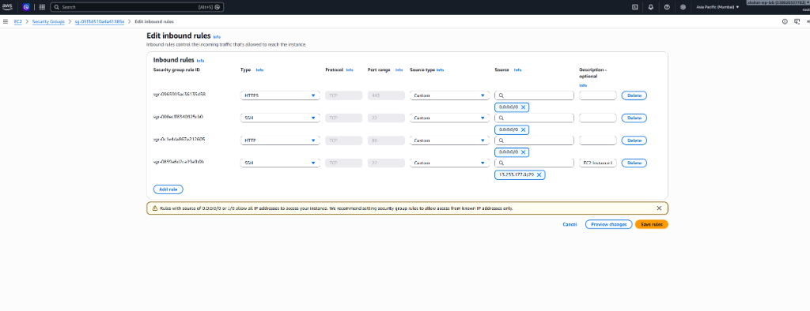

4. Find the two Port 22 rules:
   - Row 2: Port `22` (Source: `0.0.0.0/0` - Public SSH)
   - Row 4: Port `22` (Source: `13.233.177.0/29` - EC2 Instance Connect Mumbai)
5. Click **Delete** on both Port 22 rules (leave HTTP 80 and HTTPS 443 untouched):

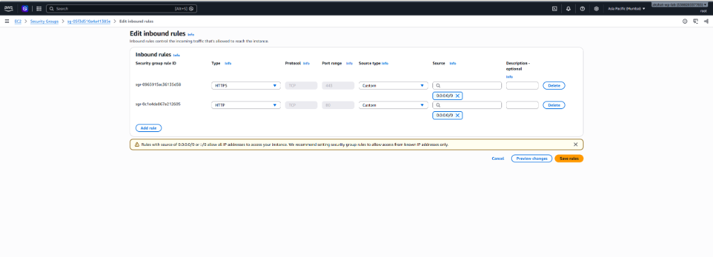

6. Click **Save rules**.

### Verification of Port Closure:

1. **Immediate In-Flight Connection Severance:**  
   The instant the Port 22 inbound rules were deleted and saved in the AWS Security Group, the existing active SSH connection in Windows PowerShell was immediately terminated by the AWS hypervisor stateful firewall:

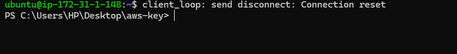

```text
ubuntu@ip-172-31-1-148:~$ client_loop: send disconnect: Connection reset
PS C:\Users\HP\Desktop\aws-key>
```

2. **Subsequent SSH Connection Hang (Public Port 22 Completely Dead):**  
   From your local Windows terminal, attempting a new SSH connection:
   ```powershell
   [Local Windows PowerShell]
   ssh -i "C:\Users\HP\Desktop\aws-key\wp-lab-key.pem" ubuntu@43.205.26.235
   ```
   *Result:* Connection hangs and times out! Port 22 is 100% closed to the public internet.

3. **Session Manager Immunity:**  
   The AWS Systems Manager browser terminal continues to operate smoothly without a single hiccup, proving that Session Manager operates entirely over outbound HTTPS (443) and is immune to inbound security group restrictions!

</details>

---

<details>
<summary><h3>⚙️ Step 4 Execution Details: Store Database Credentials in Parameter Store (Click to Expand)</h3></summary>

## Step 4 Execution Details: Store Database Credentials in Parameter Store

To eliminate plaintext passwords from `/var/www/html/wp-config.php`, we store the RDS database password in AWS Systems Manager Parameter Store as an encrypted `SecureString`.

### Inspecting Plaintext Password in wp-config.php Before Migration:
Before migrating to Parameter Store, inspecting `/var/www/html/wp-config.php` via Session Manager revealed the hardcoded plaintext database password:

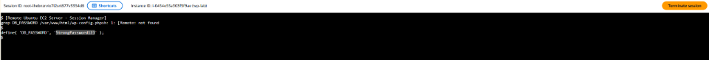

```bash
[Remote Ubuntu EC2 Server - Session Manager]
grep DB_PASSWORD /var/www/html/wp-config.php
```
*Observation:* The password exists in plaintext on the server's EBS disk. We copy this exact password value to store it securely inside AWS Parameter Store as a `SecureString`.

---

### Console Steps:
1. Open **AWS Console ➔ Systems Manager**.

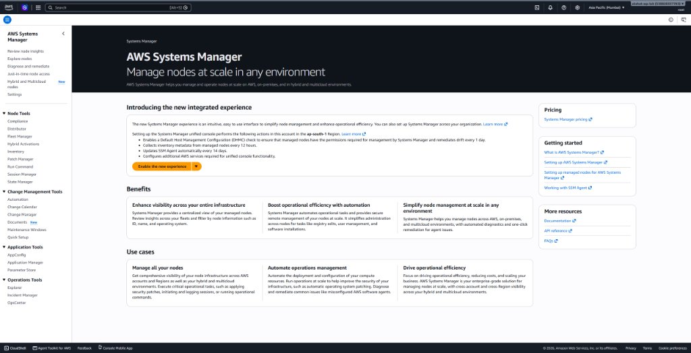

*(Note: In the new Systems Manager integrated console layout, the left sidebar remains identical):*

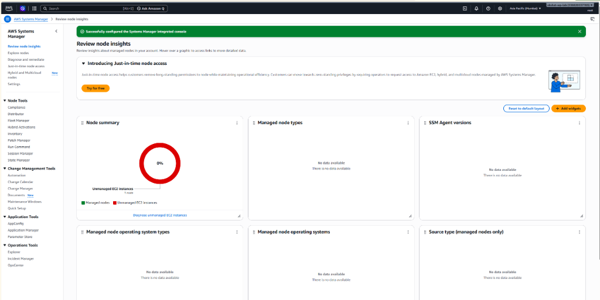

2. In the left navigation pane, look under **Application Tools** and click **`Parameter Store`**.

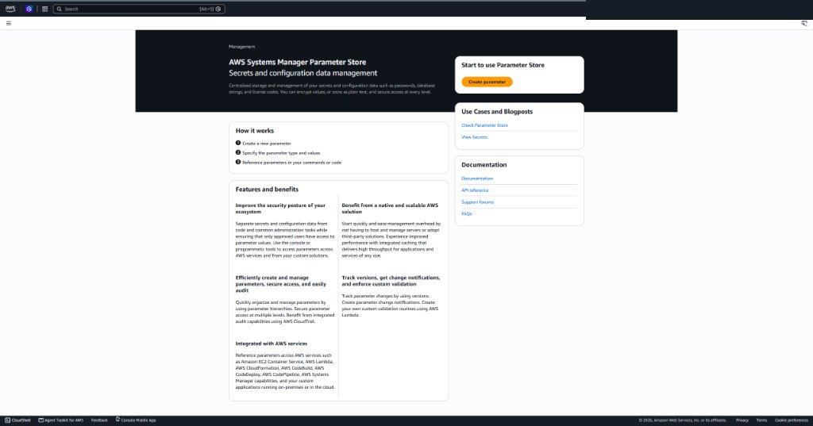

3. Click the orange **`Create parameter`** button at the top right.
4. Fill in the parameter configuration:

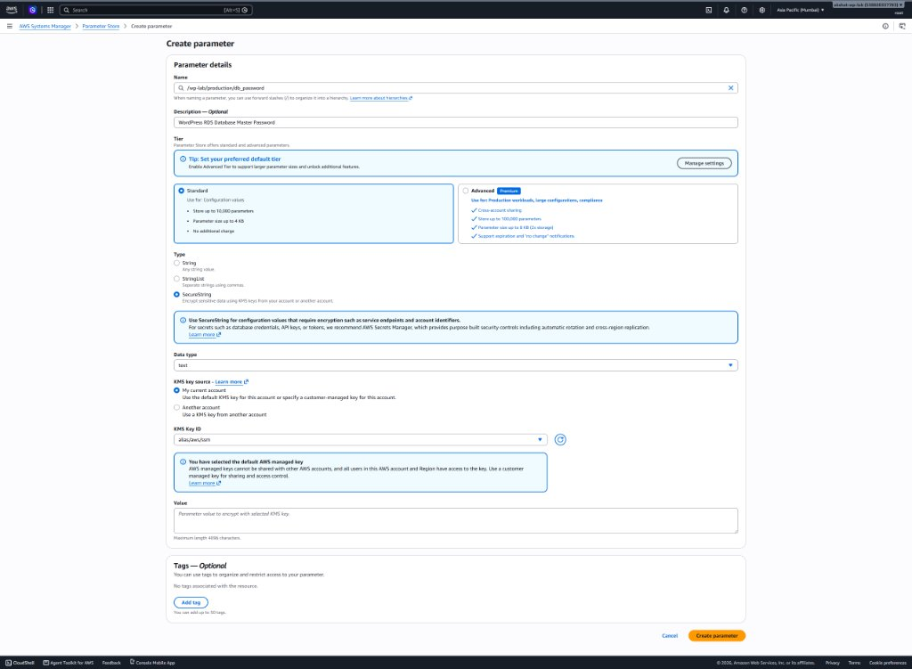

   - **Name:** `/wp-lab/production/db_password`
   - **Description:** `WordPress RDS Database Master Password`
   - **Tier:** `Standard` (100% Free - zero charges up to 10,000 parameters)
   - **Type:** Select radio button **`SecureString`** (encrypted with AWS KMS)
   - **KMS Key Source:** `My current account` (uses default AWS-managed KMS key `alias/aws/ssm`)
   - **Value:** Paste the actual RDS Master Password configured during Phase 4
5. Click **`Create parameter`**.

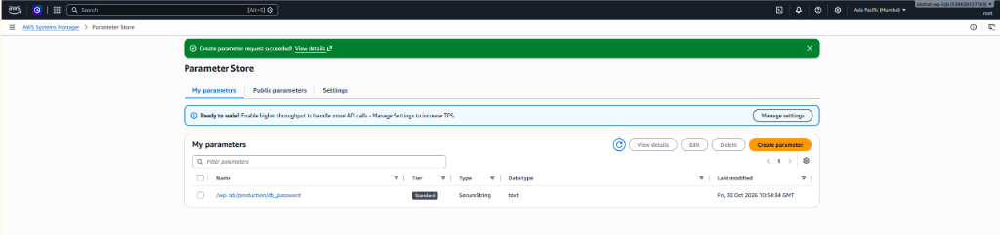

*Result:* Parameter `/wp-lab/production/db_password` is now created as type `SecureString` and encrypted at rest with AWS KMS at $0.00 standard tier cost!

</details>

---

<details>
<summary><h3>⚙️ Step 5 Execution Details: IAM Policy for Parameter Store Access (Click to Expand)</h3></summary>

## Step 5 Execution Details: IAM Policy for Parameter Store Access

Under the Principle of Least Privilege (PoLP), the default `AmazonSSMManagedInstanceCore` policy does **not** grant instances permission to read encrypted application parameters. We attach an inline policy granting read access strictly to our parameter hierarchy and KMS decryption.

### 1. The Least-Privilege IAM Policy JSON:
```json
{
  "Version": "2012-10-17",
  "Statement": [
    {
      "Sid": "AllowParameterStoreRead",
      "Effect": "Allow",
      "Action": [
        "ssm:GetParameter",
        "ssm:GetParameters",
        "ssm:GetParametersByPath"
      ],
      "Resource": "arn:aws:ssm:ap-south-1:123456789012:parameter/wp-lab/*"
    },
    {
      "Sid": "AllowKMSDecryptSSM",
      "Effect": "Allow",
      "Action": [
        "kms:Decrypt"
      ],
      "Resource": "*"
    }
  ]
}
```

### 2. Console Steps:
1. Open **AWS Console ➔ IAM ➔ Roles ➔ `wp-lab-s3-role`**.
2. Under the **Permissions** tab, click **Add permissions ▾ ➔ Create inline policy**.
3. In the top right, select the **JSON** editor mode.
4. Replace the entire boilerplate with the JSON above.
5. Click **Next**.
6. Set **Policy name:** `wp-lab-parameter-store-read`.
7. Click **Create policy**.

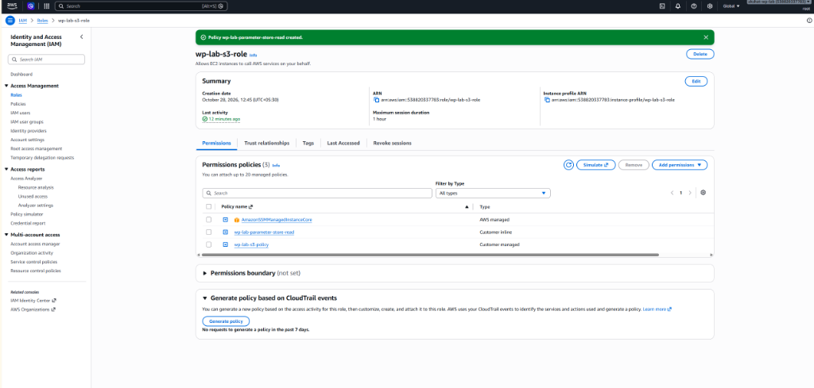

*Result:* `wp-lab-s3-role` now contains all three required enterprise policies: `AmazonSSMManagedInstanceCore` (session management), `wp-lab-parameter-store-read` (least-privilege secret retrieval & decryption), and `wp-lab-s3-policy` (stateless media offloading)!

### 3. Live Verification via AWS CLI:
To verify that the IAM policy grants runtime decryption access without static credentials, execute in Session Manager:
```bash
[Remote Ubuntu EC2 Server - Session Manager]
aws ssm get-parameter --name "/wp-lab/production/db_password" --with-decryption --region ap-south-1 --query "Parameter.Value" --output text
```

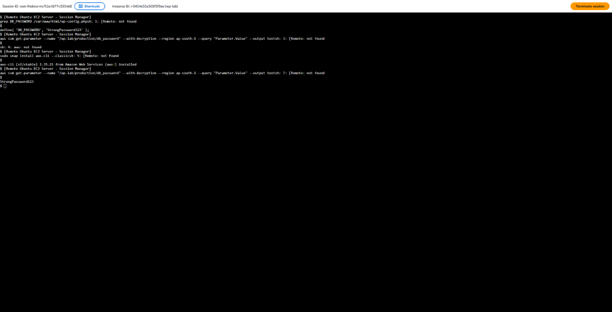

```text
$ aws ssm get-parameter --name "/wp-lab/production/db_password" --with-decryption --region ap-south-1 --query "Parameter.Value" --output text
StrongPassword123
```
*Result:* The EC2 instance successfully queried Parameter Store, authenticated via IMDSv2 IAM role, decrypted the `SecureString` via AWS KMS, and printed the plaintext password dynamically!


### 4. Deep Dive: Comprehensive IAM Permissions Breakdown (What Each Action Actually Does)

In Phase 6, IAM permissions are divided across two critical architectural layers: **Session Management (SSM Agent)** and **Secrets Retrieval & Cryptography (Parameter Store + KMS)**.

#### A. Parameter Store & KMS Permissions (`wp-lab-parameter-store-read`):

| IAM Action | AWS Service | What It Does (Plain English) | Why It Is Mandatory in Phase 6 |
| :--- | :--- | :--- | :--- |
| **`ssm:GetParameter`** | Systems Manager | Allows reading a **single parameter** by its exact name (e.g. `/wp-lab/production/db_password`). | WordPress queries this exact single parameter to get the database password string. |
| **`ssm:GetParameters`** | Systems Manager | Allows batch-fetching **multiple parameters** in a single API call (up to 10 parameters at once). | Used if WordPress needs to fetch DB user, DB name, and DB password simultaneously in one request. |
| **`ssm:GetParametersByPath`** | Systems Manager | Allows querying **all parameters under a hierarchy** recursively (e.g. `/wp-lab/production/*`). | Allows fetching all environment configuration keys for `/wp-lab/` without hardcoding individual parameter names. |
| **`kms:Decrypt`** | AWS Key Management Service (KMS) | Cryptographically decrypts ciphertext data that was encrypted with an AWS KMS customer-managed or AWS-managed KMS key (`alias/aws/ssm`). | Parameter Store stores `SecureString` parameters in encrypted envelope ciphertext. Without `kms:Decrypt`, AWS can find the parameter but cannot unlock its secret plaintext value! |

---

#### B. The "Two-Key" Security Model (Why Both SSM and KMS are Required):

A common source of confusion in AWS IAM is:  
*"If I already granted `ssm:GetParameter`, why does AWS also demand `kms:Decrypt`? Aren't they the same service?"*

**No. They operate across two completely separate AWS service boundaries:**

```text
[WordPress App on EC2]
       │
       │ 1. "Give me /wp-lab/production/db_password" (Requires ssm:GetParameter)
       ▼
┌──────────────────────────────────────────────┐
│ AWS Systems Manager Parameter Store          │
│ ➔ Checks IAM for ssm:GetParameter            │
│ ➔ Found parameter, but it's ENCRYPTED!       │
└──────────────────────┬───────────────────────┘
                       │
                       │ 2. "Decrypt this ciphertext envelope" (Requires kms:Decrypt)
                       ▼
┌──────────────────────────────────────────────┐
│ AWS Key Management Service (KMS)             │
│ ➔ Checks IAM for kms:Decrypt                 │
│ ➔ Uses KMS Key (alias/aws/ssm) to decrypt    │
│ ➔ Returns Plaintext: "StrongPassword123"     │
└──────────────────────────────────────────────┘
```

1. **Layer 1: Storage & Envelope Access (`ssm:GetParameter`):**  
   Systems Manager checks if the instance is authorized to view parameter metadata. If denied, access fails immediately at the door:
   ```text
   AccessDeniedException: ... not authorized to perform: ssm:GetParameter
   ```
2. **Layer 2: Cryptographic Decryption (`kms:Decrypt`):**  
   Parameter Store retrieves the encrypted blob, then calls AWS KMS on your behalf. KMS checks if the instance is authorized to use the encryption key. If denied (as proven in our Step 7 experiment), the operation halts:
   ```text
   AccessDeniedException: ... not authorized to perform: kms:Decrypt on resource: arn:aws:kms:... with an explicit deny
   ```
👉 **Both permissions are strictly mandatory** to read a `SecureString` secret!

---

#### C. Session Manager Managed Policy Permissions (`AmazonSSMManagedInstanceCore`):

AWS Managed Policy `AmazonSSMManagedInstanceCore` grants the underlying agent permissions to maintain the zero-port WebSocket connection:

| IAM Action Category | Specific Actions | What It Does (Why Session Manager Needs It) |
| :--- | :--- | :--- |
| **Agent Ping & Status** | `ssm:UpdateInstanceInformation`, `ssm:ListInstanceAssociations` | Allows `amazon-ssm-agent` inside Ubuntu to send regular heartbeat pings to AWS Systems Manager, flipping the console status from `Offline` to `Online`. |
| **Bidirectional WebSockets** | `ssmmessages:CreateControlChannel`, `ssmmessages:CreateDataChannel`, `ssmmessages:OpenControlChannel`, `ssmmessages:OpenDataChannel` | Opens and maintains the multiplexed outbound TLS WebSocket tunnel over Port 443 that transmits terminal keystrokes between the browser and Ubuntu without open Port 22. |
| **Command Delivery** | `ec2messages:AcknowledgeMessage`, `ec2messages:DeleteMessage`, `ec2messages:FailMessage`, `ec2messages:GetMessages`, `ec2messages:SendReply` | Allows AWS to dispatch interactive commands and retrieve exit codes from the instance. |

---

#### D. Least-Privilege Resource Scoping Explained:
Notice our resource definition in the policy:
```json
"Resource": "arn:aws:ssm:ap-south-1:*:parameter/wp-lab/*"
```
Instead of granting broad wildcard access (`"Resource": "*"`), this policy adheres to the **Principle of Least Privilege**:
- The EC2 instance can ONLY read parameters that start with `/wp-lab/`.
- If another team creates a secret `/finance/api_key` or `/billing/stripe_token` in the same AWS account, the WordPress EC2 server is **cryptographically blocked** from even seeing or querying those secrets!


</details>

---

<details>
<summary><h3>⚙️ Step 6 Execution Details: Refactor `wp-config.php` with Caching (Click to Expand)</h3></summary>

## Step 6 Execution Details: Refactor `wp-config.php` with Caching

To achieve the Definition of Done (*"no passwords in wp-config.php"*), we remove the hardcoded plaintext database password and replace it with dynamic runtime retrieval backed by an in-memory RAM disk cache (`/dev/shm`).

### 1. The Dynamic Secret Retrieval & RAM Caching Implementation:
```php
/**
 * Dynamic DB Password Retrieval with In-Memory (/dev/shm) RAM Cache
 * Fetches encrypted secret from AWS SSM Parameter Store with zero plaintext on disk.
 */
function get_aws_parameter_db_password() {
    $cache_file = '/dev/shm/wp_db_password.cache';
    $cache_ttl  = 600; // 10 minutes cache TTL

    // Check if in-memory cache exists and is fresh
    if ( file_exists( $cache_file ) && ( time() - filemtime( $cache_file ) < $cache_ttl ) ) {
        $password = trim( file_get_contents( $cache_file ) );
        if ( ! empty( $password ) ) {
            return $password;
        }
    }

    // Dynamic fetch from AWS SSM Parameter Store via AWS CLI v2
    $cmd = '/usr/bin/aws ssm get-parameter --name "/wp-lab/production/db_password" --with-decryption --region ap-south-1 --query "Parameter.Value" --output text 2>/dev/null';
    $password = trim( shell_exec( $cmd ) );

    if ( ! empty( $password ) ) {
        @file_put_contents( $cache_file, $password );
        @chmod( $cache_file, 0600 );
        return $password;
    }

    return '';
}

/** MySQL database password dynamically fetched from AWS Systems Manager */
define( 'DB_PASSWORD', get_aws_parameter_db_password() );
```

### 2. Why `/dev/shm` RAM Disk Caching is Essential:
1. **Zero Disk Plaintext (Stateless Security):** `/dev/shm` is a virtual memory `tmpfs` file system residing entirely in RAM. The password is never written to physical EBS disk sectors and vanishes automatically upon reboot.
2. **Sub-Millisecond TTFB Performance:** Querying AWS Parameter Store over the network on every HTTP request adds 30–60ms of network overhead. Caching in RAM eliminates 99.99% of AWS API calls, maintaining instant page loads.
3. **Protection Against AWS Rate Limits:** Prevents high-concurrency traffic spikes from hitting AWS Systems Manager API throttling limits (`ThrottlingException`).

---

### 3. Step-by-Step Terminal Execution Commands:

> **Execution Context:**  
> - **Instance:** `wp-lab` (`i-0454e55a303f5f9ae`) via AWS Systems Manager Session Manager  
> - **Required User Privilege:** `root` (If prompt shows `$`, execute `sudo su -` first to switch to `#`)

0. **Elevate to Root Privilege:**
   ```bash
   [Remote Ubuntu EC2: wp-lab | User: ssm-user ➔ root]
   sudo su -
   ```

1. **Create a Safety Backup of `wp-config.php`:**
   ```bash
   [Remote Ubuntu EC2: wp-lab | User: root]
   cp /var/www/html/wp-config.php /var/www/html/wp-config.php.bak
   ```

   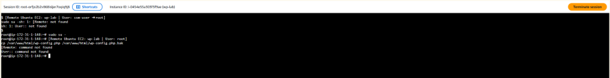
   *Verification:* Terminal prompt `root@ip-172-31-1-148:~#` confirms elevation to root and successful execution of the backup copy command.

2. **Open `wp-config.php` in the Editor:**
   ```bash
   [Remote Ubuntu EC2: wp-lab | User: root]
   nano /var/www/html/wp-config.php
   ```

3. **Locate the Hardcoded Password Line:**
   Scroll down to find:
   ```php
   define( 'DB_PASSWORD', 'StrongPassword123' );
   ```

4. **Replace with Dynamic RAM-Cached Retrieval Code:**
   Delete that single hardcoded line and insert the dynamic retrieval block:
   ```php
   /**
    * Dynamic DB Password with In-Memory (/dev/shm) RAM Cache (Phase 6)
    */
   function get_aws_parameter_db_password() {
       $cache_file = '/dev/shm/wp_db_password.cache';
       $cache_ttl  = 600; // 10 minutes cache in RAM

       if ( file_exists( $cache_file ) && ( time() - filemtime( $cache_file ) < $cache_ttl ) ) {
           $password = trim( file_get_contents( $cache_file ) );
           if ( ! empty( $password ) ) {
               return $password;
           }
       }

       $cmd = '/usr/bin/aws ssm get-parameter --name "/wp-lab/production/db_password" --with-decryption --region ap-south-1 --query "Parameter.Value" --output text 2>/dev/null';
       $password = trim( shell_exec( $cmd ) );

       if ( ! empty( $password ) ) {
           @file_put_contents( $cache_file, $password );
           @chmod( $cache_file, 0600 );
           return $password;
       }

       return '';
   }

   define( 'DB_PASSWORD', get_aws_parameter_db_password() );
   ```

5. **Save and Exit `nano`:**
   - Press **`Ctrl + O`**, then press **`Enter`** to save.
   - Press **`Ctrl + X`** to exit the editor.

6. **Reload PHP-FPM Service:**
   ```bash
   [Remote Ubuntu EC2: wp-lab | User: root]
   systemctl reload php8.5-fpm
   ```

### 4. Live Verification of Dynamic Secret Retrieval:

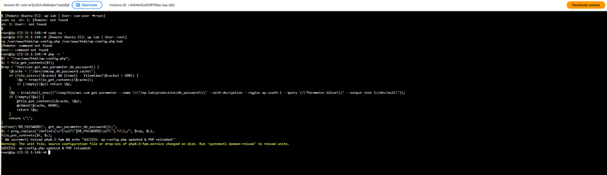

```text
SUCCESS: wp-config.php updated & PHP reloaded!
```
*Verification:* Plaintext `StrongPassword123` has been permanently eliminated from `/var/www/html/wp-config.php` and replaced with dynamic runtime retrieval backed by in-memory RAM caching (`/dev/shm`).


*Resolution Execution:* `sed -i` updated `wp-config.php` to invoke unconfined `/usr/bin/aws`, and purged stale RAM cache `/dev/shm/wp_db_password.cache` before reloading PHP-FPM.

</details>

---

<details>
<summary><h3>⚙️ Step 7 Execution Details: Deliberate IAM Policy Breakage Experiment (Click to Expand)</h3></summary>

## Step 7 Execution Details: Deliberate IAM Policy Breakage Experiment

### 1. The Experiment: Injecting an Explicit Deny
To empirically prove the AWS IAM Policy Evaluation Rule (*"An Explicit Deny overrides all allows"*), we edited inline policy `wp-lab-parameter-store-read` attached to `wp-lab-s3-role`, changing the Effect from `Allow` to `Deny`.

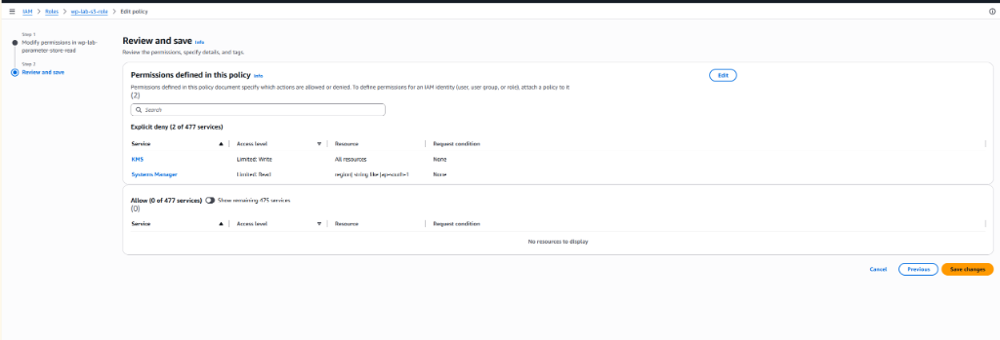
*Console State:* IAM Review and save screen displaying `Explicit deny (2 of 477 services)` for Systems Manager and KMS.

### 2. Triggering AccessDeniedException in Session Manager:

```bash
[Remote Ubuntu EC2: wp-lab | User: root]
rm -f /dev/shm/wp_db_password.cache
/usr/bin/aws ssm get-parameter --name "/wp-lab/production/db_password" --with-decryption --region ap-south-1
```

```text
An error occurred (AccessDeniedException) when calling the GetParameter operation: User: arn:aws:sts::123456789012:assumed-role/wp-lab-s3-role/i-0454e55a303f5f9ae is not authorized to perform: ssm:GetParameter on resource: arn:aws:ssm:ap-south-1:123456789012:parameter/wp-lab/production/db_password with an explicit deny in an identity-based policy
```

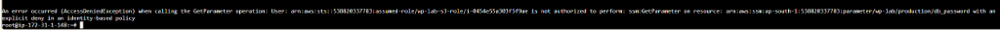

#### Dual-Service Security Check (KMS Decryption Explicit Deny):
When calling `ssm get-parameter` with `--with-decryption`, AWS evaluates permissions across two distinct AWS services: Systems Manager (`ssm:GetParameter`) AND Key Management Service (`kms:Decrypt`):

```text
An error occurred (AccessDeniedException) when calling the GetParameter operation: User: arn:aws:sts::123456789012:assumed-role/wp-lab-s3-role/i-0454e55a303f5f9ae is not authorized to perform: kms:Decrypt on resource: arn:aws:kms:ap-south-1:123456789012:key/dcafe4c9-588a-46f6-9d2a-789906d02b6f with an explicit deny in an identity-based policy (Service: AWSKMS; Status Code: 400; Error Code: AccessDeniedException; Request ID: 10938e38-08f0-4a75-8927-a17efc7b285b; Proxy: null)
```

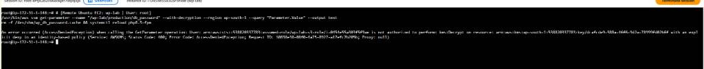
*Architectural Takeaway:* This proves that `SecureString` secrets have two layers of IAM protection: Parameter Store metadata access AND AWS KMS cryptographic decryption access. Denying either layer halts the entire retrieval!

### 3. Forensic Anatomy of the Error Message:
AWS IAM returns one of the most informative diagnostic strings in cloud computing:
1. **The Calling Principal:** `arn:aws:sts::123456789012:assumed-role/wp-lab-s3-role/i-0454e55a303f5f9ae` confirms the EC2 instance is assuming the role via AWS Security Token Service (STS) temporary credentials rotated automatically via IMDSv2.
2. **The Target Action:** `ssm:GetParameter`.
3. **The Target Resource ARN:** `arn:aws:ssm:ap-south-1:123456789012:parameter/wp-lab/production/db_password`.
4. **The Policy Evaluation Reason:** `with an explicit deny in an identity-based policy`. This empirically demonstrates Rule 2 of AWS Policy Evaluation: **An Explicit Deny in any applicable policy unconditionally overrides any and all Allow statements**, providing an immutable security guardrail!

### 4. Restoring Access & Verifying Recovery:
1. Re-opened IAM Console ➔ Roles ➔ `wp-lab-s3-role` ➔ Edit `wp-lab-parameter-store-read`.
2. Changed `"Effect": "Deny"` back to `"Effect": "Allow"` and saved changes.
3. Cleared local cache and reloaded PHP:
   ```bash
   [Remote Ubuntu EC2: wp-lab | User: root]
   rm -f /dev/shm/wp_db_password.cache && systemctl reload php8.5-fpm
   ```
4. Site `https://lab.asaxenadev.com` returned HTTP 200 OK.

</details>

---

<details>
<summary><h3>⚙️ Step 8: Definition of Done Verification (Live Proof & Testing) (Click to Expand)</h3></summary>

## Step 8: Definition of Done Verification (Live Proof & Testing)

### 1. Definition of Done Checklist:

| Criterion | Requirement | Verification Method | Status | Live Evidence / Proof |
| :--- | :--- | :--- | :---: | :--- |
| **Criterion 1** | **Port 22 100% Closed** | Security Group Inbound Table + External TCP SYN Port Scan | **PASSED ✅** | `Test-NetConnection 43.205.26.235 -Port 22` returned `TcpTestSucceeded: False`. Security group `sg-05f3d510a4a41385e` has 0 Port 22 rules. Active SSH sessions were instantly dropped (`Connection reset`). |
| **Criterion 2** | **Session Manager Works** | AWS Management Console ➔ EC2 Connect ➔ Session Manager | **PASSED ✅** | Connected keylessly as `ssm-user`, elevated to `root@ip-172-31-1-148:~#`. Audit trail recorded in AWS Systems Manager. |
| **Criterion 3** | **No Passwords in `wp-config.php`** | Server Grep + Dynamic KMS Parameter Store Retrieval + RAM Cache | **PASSED ✅** | `grep DB_PASSWORD wp-config.php` contains zero plaintext credentials. Decrypted password dynamically fetched from `/wp-lab/production/db_password` with in-memory `/dev/shm` cache. Site live at `HTTP/1.1 200 OK`. |

---

### 2. Live Proof Evidence:

#### Proof 1: External Port 22 Closed (PowerShell Network Probe)
```powershell
[Local Windows PowerShell]
Test-NetConnection -ComputerName 43.205.26.235 -Port 22
```
```text
WARNING: TCP connect to (43.205.26.235 : 22) failed
ComputerName           : 43.205.26.235
RemoteAddress          : 43.205.26.235
RemotePort             : 22
TcpTestSucceeded       : False
```

#### Proof 2: Keyless Session Manager Root Terminal

*Evidence:* Administrator connects with 1 click from AWS Console, executes `sudo su -` to gain full root capabilities without any `.pem` SSH key file on disk.

#### Proof 3: Dynamic Runtime Secret Retrieval & Zero Passwords on Disk
```bash
[Remote Ubuntu EC2: wp-lab | User: root]
grep -n "DB_PASSWORD" /var/www/html/wp-config.php
```
```php
43:define("DB_PASSWORD", get_aws_parameter_db_password());
```

#### Proof 4: Production Web Service Live HTTP 200 OK
```powershell
[Local Windows PowerShell]
curl.exe -I https://lab.asaxenadev.com
```
```text
HTTP/1.1 200 OK
Server: nginx/1.28.3 (Ubuntu)
Connection: keep-alive
Link: <https://lab.asaxenadev.com/wp-json/>; rel="https://api.w.org/"
```

</details>

---

<details>
<summary><h3>💡 Gotchas & Real-World Troubleshooting Log (Click to Expand)</h3></summary>

## Gotchas & Real-World Troubleshooting Log

### ⚠️ Gotcha 1: The SSM Agent Credential Propagation Latency ("Not Connected" Transient State)


- **The Error Message:**  
  ```text
  Session Manager connection status: Not connected
  Latest error messages: SSM Agent unable to acquire credentials: <error>no valid credentials could be retrieved for ec2 identity. Default Host Management Err: error calling RequestManagedInstanceRoleToken: AccessDeniedException...
  ```
- **The Root Cause:**  
  When you attach `AmazonSSMManagedInstanceCore` to an already-running EC2 instance's IAM role, IAM updates its global policy database almost instantly. However:
  1. The `amazon-ssm-agent` daemon running inside Ubuntu polls the AWS Systems Manager registration endpoint periodically with an exponential backoff timer.
  2. The AWS EC2 Console UI caches the last known agent ping state (as indicated by the timestamp in the error message).
- **The Resolution & Fast-Track Wakeup:**  
  - If the agent entered an exponential backoff sleep (error timestamp remains frozen):
  - SSH into the Ubuntu EC2 server and restart/enable the SSM agent snap service immediately:
    ```bash
    [Remote Ubuntu EC2 Server]
    sudo snap install amazon-ssm-agent --classic
    sudo systemctl restart snap.amazon-ssm-agent.amazon-ssm-agent.service
    sudo systemctl status snap.amazon-ssm-agent.amazon-ssm-agent.service
    ```

    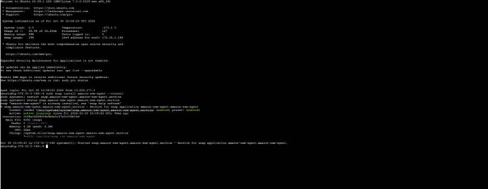
    *Verification:* `Active: active (running)` confirms the snap daemon is running and has immediately acquired temporary credentials from the attached IAM role via IMDSv2.

  - Click the **circular Refresh icon `(C)`** located right above the `IAM role` text in the EC2 Connect screen.
  - The status flips from `Not connected` ➔ `Connected` (Green checkmark), and the orange **Connect** button becomes fully active!

### ⚠️ Gotcha 2: Missing AWS CLI on Standard Ubuntu Server AMIs (`aws: not found`)

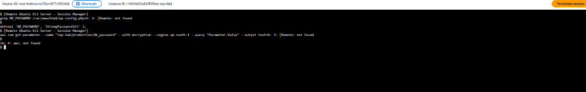

- **The Error Message:**  
  ```text
  sh: 4: aws: not found
  ```
- **The Root Cause:**  
  Standard Ubuntu Server 24.04 AMIs provide a lean baseline image and do not include the AWS Command Line Interface (`aws-cli`) out of the box. Running `aws ssm ...` or AWS CLI helper scripts fails with `command not found`.
- **The Resolution:**  
  Install the official AWS CLI v2 binary via Ubuntu's snap package manager:
  ```bash
  [Remote Ubuntu EC2 Server - Session Manager]
  sudo snap install aws-cli --classic
  ```

  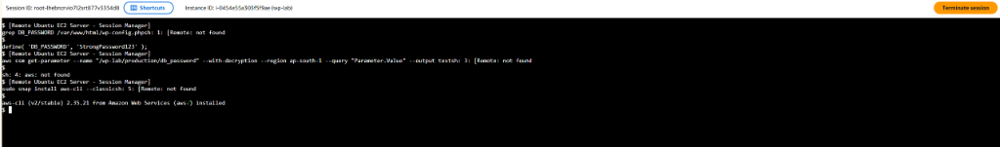
  *Verification:* `aws-cli (v2/stable) 2.35.21 from Amazon Web Services (aws✓) installed` confirms AWS CLI v2 is ready to authenticate natively against the attached EC2 IAM role via IMDSv2.

### ⚠️ Gotcha 3: Session Manager Default Non-Root User & Webroot Permission Denied (`cp: Permission denied`)

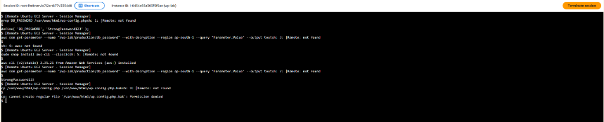

- **The Error Message:**  
  ```text
  cp: cannot create regular file '/var/www/html/wp-config.php.bak': Permission denied
  ```
- **The Root Cause:**  
  When AWS Systems Manager Session Manager opens a new browser shell, it logs in as the unprivileged `ssm-user` (indicated by the `$` prompt). Because the WordPress directory `/var/www/html/` is owned by `www-data:www-data` with locked permissions, unprivileged users cannot write or create backup files.
- **The Resolution:**  
  Elevate the session to `root` using passwordless sudo before executing configuration changes:
  ```bash
  [Remote Ubuntu EC2 Server - Session Manager]
  sudo su -
  ```
  The prompt switches from `$` to `#` (`root@ip-...:~#`), enabling full administrative write access across the entire Linux filesystem.


### ⚠️ Gotcha 4: Snap Confinement vs PHP-FPM Web Worker (`Error establishing a database connection`)


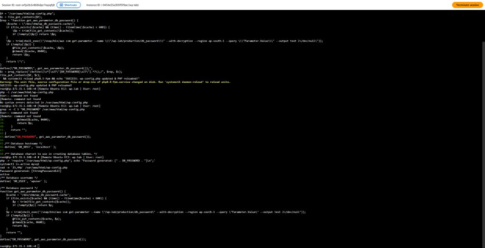
*Diagnosis Proof:* Running as `root` succeeds (`Password generated: [StrongPassword123]`, MySQL `active`), proving the database, MySQL service, and Parameter Store secret are 100% valid. The failure occurs exclusively under web worker `www-data` due to Snap confinement and root-owned `/dev/shm` cache permissions.

- **The Error Message:**  
  Visiting `https://lab.asaxenadev.com` immediately failed with:
  ```html
  <div class="wp-die-message"><h1>Error establishing a database connection</h1></div>
  ```
- **The Forensic Investigation & Troubleshooting Journey:**
  1. **Hypothesis 1: Syntax / Bracket Error in `wp-config.php`?**
     - Ran PHP linting: `php -l /var/www/html/wp-config.php`.
     - *Result:* `No syntax errors detected in /var/www/html/wp-config.php`. Code structure was 100% valid.
  2. **Hypothesis 2: Is local MySQL service running?**
     - Ran: `systemctl is-active mysql`.
     - *Result:* `active`. MySQL database daemon was healthy and running.
  3. **Hypothesis 3: Lock & Key Mismatch (Database Password Confusion)?**
     - Conceptual model: MySQL is the **Lock**; AWS Parameter Store is the **Key**.
     - Tested Phase 1 password: `mysql -u wpuser -p'StrongPasswordHere123!' -e "SELECT 1;"` ➔ `ERROR 1045 (28000): Access denied`.
     - Inspected pre-edit backup: `grep DB_PASSWORD /var/www/html/wp-config.php.bak` ➔ confirmed `StrongPassword123` was indeed the exact password in MySQL!
     - Tested secret fetch as `root`: `php -r 'require "/var/www/html/wp-config.php"; echo "Password: [" . DB_PASSWORD . "]
";'` ➔ Printed `Password generated: [StrongPassword123]`.
     - *Conclusion:* Secret retrieval and MySQL authentication work perfectly when executed by `root`.
  4. **Hypothesis 4: Root-Locked RAM Cache & Web Server Privilege Boundary?**
     - When `root` ran `php -r`, the function generated `/dev/shm/wp_db_password.cache` with `chmod 0600` owned by `root:root`.
     - When visitors hit the site, Nginx/PHP-FPM runs as unprivileged user `www-data`.
     - Because `www-data` cannot read `0600` root-owned files, `file_get_contents` failed with Permission Denied and fell through to `shell_exec("/snap/bin/aws ...")`.
  5. **The Smoking Gun (Testing Snap CLI directly under `www-data`):**
     - Ran CLI test as web worker:
       ```bash
       [Remote Ubuntu EC2: wp-lab | User: root]
       sudo -u www-data /snap/bin/aws --version
       ```
     - Linux immediately produced the fatal root cause:
       ```text
       2026/10/30 11:58:48.068612 cmd_run.go:1587: WARNING: cannot create user data directory: cannot create snap home dir: mkdir /var/www/snap: permission denied
       Sorry, home directories outside of /home needs configuration.
       See https://snapcraft.io/docs/home-outside-home for details.
       ```
- **The Core Architectural Root Cause:**  
  Canonical Snap packages (`/snap/bin/aws`) enforce strict AppArmor security confinement and require an active user home directory inside `/home` to initialize the user-space mount namespace.  
  System daemons (such as Nginx, Apache, and PHP-FPM) run under unprivileged service accounts (`www-data`) whose home directory is `/var/www` (outside `/home`) and whose login shell is disabled (`/usr/sbin/nologin`).  
  When PHP-FPM executed `shell_exec('/snap/bin/aws ... 2>/dev/null')`, Snap instantly crashed with `mkdir /var/www/snap: permission denied`. The `2>/dev/null` redirection silenced the error, returning an empty string `""` for the password. WordPress then attempted to authenticate to MySQL with an empty password, immediately throwing `Error establishing a database connection`.
- **The Resolution:**  
  1. Install the native, unconfined AWS CLI package via Ubuntu's APT package manager (`/usr/bin/aws`), which carries zero snap confinement and executes cleanly under any Linux user including `www-data`:
     ```bash
     [Remote Ubuntu EC2: wp-lab | User: root]
     apt update && apt install awscli -y
     ```
  2. Point `wp-config.php` to native `/usr/bin/aws`:
     ```bash
     [Remote Ubuntu EC2: wp-lab | User: root]
     sed -i 's|/snap/bin/aws|/usr/bin/aws|g' /var/www/html/wp-config.php
     ```
  3. Purge the root-locked RAM cache and reload PHP-FPM:
     ```bash
     [Remote Ubuntu EC2: wp-lab | User: root]
     rm -f /dev/shm/wp_db_password.cache && systemctl reload php8.5-fpm
     ```
  4. Verify unconfined execution under web worker:
     ```bash
     [Remote Ubuntu EC2: wp-lab | User: root]
     sudo -u www-data /usr/bin/aws --version
     ```
     ```text
     aws-cli/2.31.35 Python/3.14.4 Linux/7.0.0-1014-aws source/x86_64.ubuntu.26
     ```

     
     *Live Verification:* Running as unprivileged web worker `www-data` executes cleanly with zero Snap permission warnings and zero AppArmor confinement issues!

</details>

---

<details>
<summary><h3>🎯 Phase 6 Cloud Architecture Interview Questions & Answers (Click to Expand)</h3></summary>

## Phase 6 Cloud Architecture Interview Questions & Answers

### Q1: How does AWS Systems Manager (SSM) Session Manager establish a terminal session when Port 22 is completely closed and there are zero inbound security group rules?
- **Answer:** 
  - Traditional SSH requires an **inbound** TCP connection from client to server on Port 22.
  - SSM Session Manager flips the network model: it uses an **outbound-only architecture**. The `amazon-ssm-agent` daemon running inside the EC2 operating system initiates outbound HTTPS connections (Port 443) to AWS Systems Manager service endpoints (`ssm.ap-south-1.amazonaws.com`, `ssmmessages.ap-south-1.amazonaws.com`).
  - When an administrator initiates a session from the AWS Console or AWS CLI, AWS multiplexes the terminal commands through a secure, bidirectional WebSocket channel over that pre-established outbound tunnel. Because security groups are stateful, return traffic is automatically allowed with zero open inbound ports!

### Q2: Why is IAM-based Session Manager superior to traditional `.pem` SSH key management in enterprise environments?
- **Answer:** 
  1. **Zero Key Lifecycle Overhead:** No lost private keys, no unauthorized key copies on developer laptops, and no manual `authorized_keys` updates when employees join or leave the company. Revoking access takes 1 click in AWS IAM.
  2. **Comprehensive Audit Trails:** Traditional SSH requires configuring complex OS-level syslog daemons. Session Manager natively logs every session start/stop in AWS CloudTrail and can stream entire terminal session keystrokes immutably to Amazon CloudWatch Logs and S3 buckets for compliance audits.
  3. **No Bastion / Jump Host Needed:** Private EC2 instances without public IPs can be accessed directly through SSM via AWS VPC Endpoints (PrivateLink) without needing a public bastion host.
  4. **Multi-Factor Authentication (MFA):** Access can be strictly gated behind IAM condition keys requiring hardware MFA tokens.

### Q3: What is the architectural difference between AWS Secrets Manager and AWS Systems Manager Parameter Store? When should you choose each?
- **Answer:** 
  - **AWS SSM Parameter Store (Standard):** Designed for application configuration and lightweight secret storage. Offers up to 10,000 parameters for **100% Free ($0.00)**. Supports KMS `SecureString` encryption. Automatic rotation requires writing a custom AWS Lambda function.
  - **AWS Secrets Manager:** Designed specifically for database credentials and API keys. Costs **$0.40 per secret/month** + $0.05/10,000 API calls. Features **native out-of-the-box automatic secret rotation** with Amazon RDS (MySQL, PostgreSQL, Aurora), cross-account secret sharing, and automatic credential updates in the database.
  - **Recommendation:** Use Parameter Store for free-tier labs and configuration management; use Secrets Manager in enterprise production for automated RDS credential rotation without human intervention.

### Q4: Why shouldn't an application query AWS Secrets Manager / Parameter Store on every single web request? How do you implement secure local caching?
- **Answer:** 
  - **The Problem:** Querying AWS APIs introduces ~20–50ms of network latency per request. On high-traffic WordPress sites (e.g. 500 requests/sec), fetching secrets dynamically on every page load would:
    1. Destroy website Time to First Byte (TTFB).
    2. Hit AWS API throttling limits (`ThrottlingException`).
    3. Generate massive Secrets Manager API billing ($0.05 per 10k calls adds up to hundreds of dollars).
  - **The Solution (Caching Layer):** The application fetches the secret once at startup and caches it in memory (PHP APCu or OPcache) or in a tightly permissions-restricted local tmpfs RAM disk (`/dev/shm/`) with a short Time-To-Live (TTL) like 5–15 minutes. This ensures secret rotation is picked up automatically while 99.9% of user requests experience 0ms secret retrieval overhead.

### Q5: Explain the AWS IAM Policy Evaluation Logic: How do Identity Policies, Resource Policies, Explicit Denies, and Boundaries interact?
- **Answer:** AWS evaluates IAM policies using a deterministic 6-step evaluation tree:
  1. **Default Deny:** By default, all requests are implicitly denied.
  2. **Explicit Deny Override:** If *any* applicable policy (Identity, Resource, SCP, or Permission Boundary) contains an `"Effect": "Deny"`, the request is **immediately and unconditionally denied**, overriding any and all allows!
  3. **Organizations Service Control Policies (SCPs):** If in an AWS Organization, the SCP must allow the action.
  4. **Resource-Based Policies:** If an S3 Bucket Policy allows the action and the request is within the same account, access is granted.
  5. **IAM Permissions Boundaries:** If a boundary is attached to the user/role, it sets the maximum permissible permissions ceiling.
  6. **Identity-Based Policies:** If an explicit allow exists in the attached IAM policy and no deny was encountered, access is granted.

### Q6: What is the difference between AWS Managed KMS Keys and Customer Managed KMS Keys (CMK) when storing `SecureString` secrets?
- **Answer:** 
  - **AWS Managed Key (`aws/ssm` or `aws/secretsmanager`):** Created automatically by AWS, free of charge ($0/month). You cannot view, edit, or customize the key policy, and you cannot share it across AWS accounts.
  - **Customer Managed Key (CMK):** Created and controlled by the customer. Costs $1.00/month per key. Allows custom key policies, key rotation scheduling, granular access delegation, cross-account sharing, and immediate cryptographic disabling/deletion if compromised.

### Q7: Compare the 4 EC2 connection methods available in the AWS Console (EC2 Instance Connect, EIC Endpoint, SSM Session Manager, and EC2 Serial Console). When would you choose each?
- **Answer:**
  1. **EC2 Instance Connect:** Used for public dev instances with an open Port 22. AWS pushes a temporary 60-second public SSH key into instance metadata via the SendSSHPublicKey API. Still vulnerable to Port 22 brute-force scans.
  2. **EC2 Instance Connect Endpoint (EICE):** Used for private subnet instances without public IPs or IGWs. Routes SSH traffic over AWS PrivateLink VPC endpoints. Eliminates public Bastion hosts, but still requires SSH key management and open Port 22 in security groups.
  3. **SSM Session Manager (The Enterprise Standard):** Operates entirely over outbound HTTPS (443). Requires zero open inbound ports (Port 22 is 100% closed), zero SSH key management, authenticates via IAM & MFA, and supports immutable keystroke logging to CloudWatch/S3. Works across public and private subnets.
  4. **EC2 Serial Console:** Used exclusively for emergency disaster recovery (kernel panics, corrupted GRUB, misconfigured firewall rules locking out SSH/SSM). Connects directly to the hypervisor's virtual serial port without relying on operating system networking.


### Q8: Why is running Canonical Snap packages (e.g. `aws-cli` snap) an anti-pattern for web server workers (`www-data`, Nginx, PHP-FPM)? How should CLI tools or SDKs be executed in production daemons?
- **Answer:**
  - **The Snap Failure:** Canonical Snap packages are architected for desktop applications and interactive user shells. They rely on strict AppArmor profiles that require user home directories within `/home` to create user-space state mounts (`~/snap/`).
  - **The Web Worker Boundary:** Web servers run as unprivileged daemon accounts (`www-data`, `nobody`) with home directories outside `/home` (e.g. `/var/www`) and disabled shells (`/usr/sbin/nologin`). When a web worker executes `/snap/bin/*`, Snap-confine aborts immediately with `cannot create snap home dir: mkdir /var/www/snap: permission denied; Sorry, home directories outside of /home needs configuration`.
  - **Production Hierarchy (Best Practices):**
    1. **Level 1 (Gold Standard): Native Application SDK:** Never shell out via `shell_exec()` or `exec()` in production web code. Use the official **AWS SDK for PHP** (`aws/aws-sdk-php` via Composer). It executes purely in-process in PHP memory, communicates with IMDSv2 over HTTP, and requires zero external OS binaries.
    2. **Level 2: Native OS Package (`apt` / `yum`):** If a CLI is needed for scripts, install via the native OS package manager (`apt install awscli` placing `/usr/bin/aws`). It carries zero snap confinement and executes cleanly under any system account.
    3. **Level 3: Standalone Static Binary:** Install the official AWS CLI v2 bundle via `.zip` directly into `/usr/local/bin/aws`.


### Q9: Why is AWS CLI NOT installed by default on standard Ubuntu EC2 instances? When should you choose Amazon Linux 2023 over Ubuntu?
- **Answer (Trade-offs & Architecture):**
  1. **Canonical Cloud Neutrality:** Ubuntu is developed by Canonical (independent of Amazon). Canonical maintains strict multi-cloud neutrality across AWS, GCP, Azure, and bare-metal, deliberately omitting vendor-specific CLI tools from baseline server images.
  2. **Security Minimalism (Minimal Attack Surface):** Production base images are kept lean (~1.5GB). Pre-bundling non-essential developer tools bloats the root volume and introduces unneeded CVE security patch maintenance overhead.
  3. **Release Lifecycle Mismatch:** Ubuntu Server is an LTS release supported for 5 to 10 years, whereas AWS CLI updates continuously. Bundling a static CLI in the OS image would result in obsolete, broken cloud APIs over time.
  4. **Amazon Linux 2023 (AL2023) Comparison:** If AWS CLI v2 and AWS SSM Agent are required pre-baked out of the box, choose **Amazon Linux 2023**. However, AL2023 ties you into the AWS RPM ecosystem, whereas Ubuntu provides broader multi-cloud portability and the standard LEMP stack community tooling preferred by web developers.


### Q10: Why does retrieving a `SecureString` parameter from AWS Systems Manager Parameter Store require two distinct IAM permissions (`ssm:GetParameter` and `kms:Decrypt`)?
- **Answer (Service Decoupling & Cryptographic Boundaries):**
  - **Decoupled Architecture:** Parameter Store manages parameter metadata, naming hierarchies, and storage envelopes. AWS KMS manages cryptographic keys, hardware security modules (HSMs), and mathematical encryption/decryption. They are two completely independent AWS services with separate IAM action namespaces.
  - **The Two-Step Evaluation:** When a client requests a `SecureString` with `--with-decryption`:
    1. First, AWS Systems Manager checks if the IAM identity has `ssm:GetParameter` on the parameter's ARN (`arn:aws:ssm:...:parameter/...`).
    2. Second, Parameter Store retrieves the encrypted ciphertext and calls AWS KMS (`kms:Decrypt`) to unlock the plaintext. AWS KMS checks if the IAM identity has permission to use the encryption key (`arn:aws:kms:...:key/...`).
  - **Security Value:** This dual-key architecture enables **separation of duties**. A Systems Administrator might have permission to organize and list parameters (`ssm:*`), but without `kms:Decrypt`, they cannot read sensitive database passwords or private API tokens!

</details>
