# Phase 7 — Email & Monitoring (Amazon SES, SPF/DKIM/DMARC & CloudWatch Metrics)

> **Definition of Done:** Test email lands in the inbox (not spam); memory and disk utilization graphs visible in CloudWatch.

---

<details>
<summary><h3>🧠 Conceptual Foundations, Architecture & Trade-offs (Click to Expand)</h3></summary>

## What it does

Establishes production-grade transactional email deliverability and infrastructure observability for WordPress:
1. **Email Deliverability (Amazon SES):** Replaces standard unauthenticated PHP `mail()` with Amazon Simple Email Service (SES) authenticated via SPF, Easy DKIM, and DMARC DNS records to guarantee inbox placement.
2. **Infrastructure Observability (Amazon CloudWatch Unified Agent):** Installs and configures the CloudWatch agent on EC2 to collect and push OS-level RAM and Disk utilization metrics (which AWS CloudWatch hypervisor does not collect by default).

---

## Why choose it (Over Default PHP mail() & Default CloudWatch)

- **Why Amazon SES over Default PHP `mail()`:**
  - Standard EC2 public IP ranges are universally blacklisted by major email providers (Spamhaus, Gmail, Outlook). Emails sent via EC2's local `sendmail`/PHP `mail()` go straight to Spam or are dropped silently.
  - Amazon SES maintains world-class sender reputation, handles bounce and complaint feedback loops, and costs pennies ($0.10 per 1,000 emails).
- **Why CloudWatch Unified Agent over Default EC2 Metrics:**
  - AWS EC2 default monitoring only inspects the hypervisor layer outside the VM (CPU utilization, network in/out, disk read/write IOPS).
  - The hypervisor cannot see inside the OS kernel: it has **zero visibility into RAM usage or free disk space**. The CloudWatch agent runs inside Ubuntu, reporting real-time memory and disk consumption.

---

## Trade-offs

- **SES Sandbox Mode Restriction:**
  New AWS accounts are placed in the SES Sandbox. Emails can only be sent to verified email addresses until a production access increase request is approved by AWS.
- **DNS Record Management Overhead:**
  Requires publishing multiple DNS records (3 CNAMEs for DKIM, 1 TXT for SPF, 1 TXT for DMARC) in the domain registrar's DNS zone (Hostinger).
- **CloudWatch Custom Metrics Billing:**
  While EC2 basic metrics are free, custom OS metrics pushed by the CloudWatch agent incur a minor fee (~$0.30 per metric/month after the Free Tier allowance of 10 custom metrics).

---

## Architecture Diagram

```text
[WordPress Core / Contact Form 7]
       │
       │ SMTP over TLS (Port 587)
       ▼
[Amazon SES (ap-south-1 Mumbai)]
       │
       │ Cryptographically signed with DKIM (Private Key)
       │ SPF & DMARC validated against Hostinger DNS
       ▼
[Recipient Mail Server (Gmail / Outlook)] ──► Verified Inbox (Not Spam!)

─────────────────────────────────────────────────────────────

[EC2 Instance: wp-lab (Ubuntu 24.04)]
       │
       │ amazon-cloudwatch-agent daemon
       │ Reads /proc/meminfo and df -h
       │ Pushes every 60s via IAM Role (CloudWatchAgentServerPolicy)
       ▼
[Amazon CloudWatch Metrics Dashboard]
├── Metric: mem_used_percent
└── Metric: disk_used_percent
```

---

## Deep Dive: SPF vs DKIM vs DMARC

| Protocol | What it Stands For | How it Works | What it Proves to Receiving Mail Server |
| :--- | :--- | :--- | :--- |
| **SPF** | Sender Policy Framework | TXT DNS record listing authorized sender IP ranges (`v=spf1 include:aamazonses.com ~all`). | Proves that the sending server is authorized by the domain owner to send emails. |
| **DKIM** | DomainKeys Identified Mail | 3 CNAME DNS records pointing to public keys. SES signs email headers with private key. | Proves that the email was not tampered with in transit and legitimately originated from your domain. |
| **DMARC** | Domain-based Message Authentication, Reporting & Conformance | TXT DNS record (`_dmarc.domain`) instructing servers how to handle SPF/DKIM failures (`p=none`, `p=quarantine`, `p=reject`). | Tells receiving servers what to do with spoofed emails and generates aggregate abuse reports. |

---

## Deep Dive: Domain Identity (Sender / DKIM) vs Email Address Identity (Sandbox Recipient)

| Feature & Parameter | 🌐 Domain Identity (`asaxenadev.com`) | 📧 Email Address Identity (`@gmail.com`) |
| :--- | :--- | :--- |
| **Primary Architectural Role** | **SENDER (From: Address):** Authorizes WordPress to send mail on behalf of the domain. | **RECIPIENT (To: Address):** Authorizes a specific mailbox to receive mail during Sandbox mode. |
| **Why We Verify It** | **Permanent Infrastructure:** Allows any prefix (`noreply@`, `admin@`, `orders@`) without re-verification. | **Temporary Sandbox Requirement:** Bypasses AWS SES Sandbox restriction preventing unverified recipient delivery. |
| **DKIM & Deliverability Impact** | **Complete Alignment (100%):** Generates 3 CNAME DNS records enabling RSA-2048 signing to guarantee primary inbox delivery. | **None:** Cannot sign DKIM keys on external consumer mailboxes (`@gmail.com`) since you do not own their DNS zone. |
| **Lifecycle & Production Need** | **Permanent (Lifetime):** Essential for ongoing production operation. | **Ephemeral (Testing Only):** Once AWS approves SES Production Access, this identity is no longer required. |

</details>

---

<details open>
<summary><h3>📋 Implementation Steps & Progress Tracker [Always Visible]</h3></summary>

## Implementation Steps & Progress Tracker

- [x] **Step 1: Verify Domain Identity in Amazon SES**
  - Create Domain Identity `asaxenadev.com` in SES (`ap-south-1` Mumbai).
  - Enable **Easy DKIM** (2048-bit).
- [x] **Step 2: Add DNS Records in Domain Registrar (Hostinger)**
  - Add 3 DKIM CNAME records (`ijwigdow...`, `2ixfnv...`, `hs4flaq...`).
  - Merged SPF TXT record: `v=spf1 include:_spf.mail.hostinger.com include:aamazonses.com ~all`.
  - DMARC TXT record verified: `v=DMARC1; p=none;`.
- [x] **Step 3: Generate SES SMTP Credentials & Configure WordPress**
  - Generated dedicated IAM SMTP credentials user in SES.
  - Installed and configured WP Mail SMTP plugin (`email-smtp.ap-south-1.amazonaws.com:587` TLS).
  - Sent live test email via Amazon SES successfully.
- [x] **Step 4: Attach CloudWatch Policy to EC2 IAM Role**
  - Attached AWS managed policy `CloudWatchAgentServerPolicy` to EC2 instance role `wp-lab-s3-role`.
- [x] **Step 5: Install & Configure Amazon CloudWatch Agent on EC2**
  - Installed official AWS `amazon-cloudwatch-agent` package.
  - Configured 60s metric collection for `mem_used_percent` and `disk_used_percent`.
  - Started daemon via `amazon-cloudwatch-agent-ctl`.
- [x] **Step 6: Create CloudWatch Dashboard & Alarms**
  - Create custom dashboard displaying RAM and Disk utilization graphs.
  - Configure CloudWatch Alarm for high disk usage (>80%).
- [x] **Step 7: Definition of Done Verification**
  - Test email received in personal inbox.
  - CloudWatch graph actively plotting memory and disk utilization.

</details>

---

<details>
<summary><h3>⚙️ Step 1 Execution Details: Verify Domain Identity in Amazon SES (Click to Expand)</h3></summary>

## Step 1 Execution Details: Verify Domain Identity in Amazon SES

### 1. Amazon SES Console Landing Page:
When first accessing Amazon Simple Email Service in `ap-south-1` (Mumbai), AWS presents the introductory overview page:

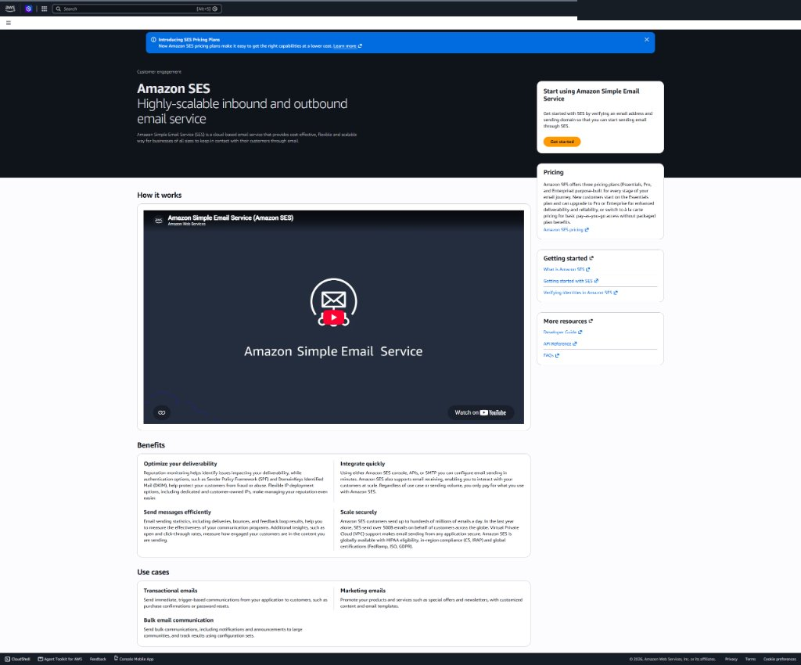

### 2. AWS Console Gotcha: The 7-Step "Get set up" Wizard vs Direct "Identities"

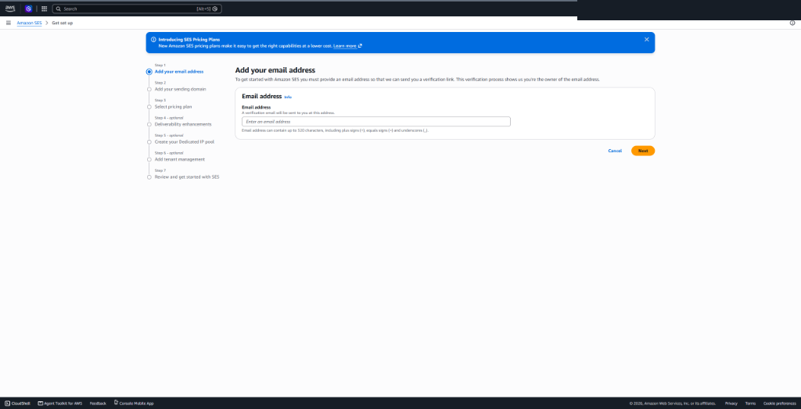

> [!TIP]
> **Avoid the 7-Step Wizard:**  
> Clicking the promotional "Get started" button launches a lengthy 7-step setup wizard that prompts for pricing tiers, dedicated IP pools, and tenant management.  
> **Direct Path:** Instead, bypass the wizard by clicking the top-left hamburger menu (`☰`) ➔ **Configuration ➔ Identities** ➔ **Create identity** to verify the domain directly in a single, clean form.

### 3. Identities Dashboard:

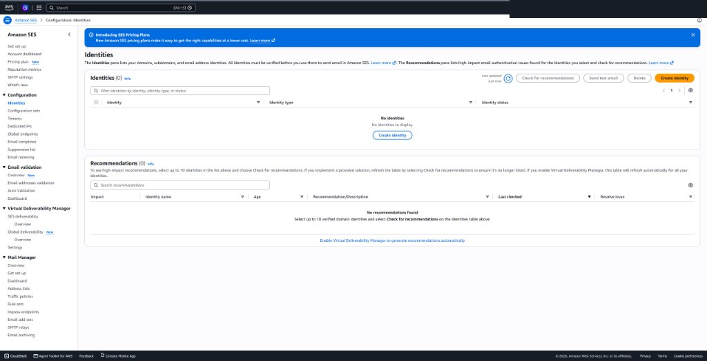
*Console State:* Navigated to `Configuration > Identities` in `ap-south-1` Mumbai. Currently displays `Identities (0)`.

### 4. Creating Domain Identity Form:

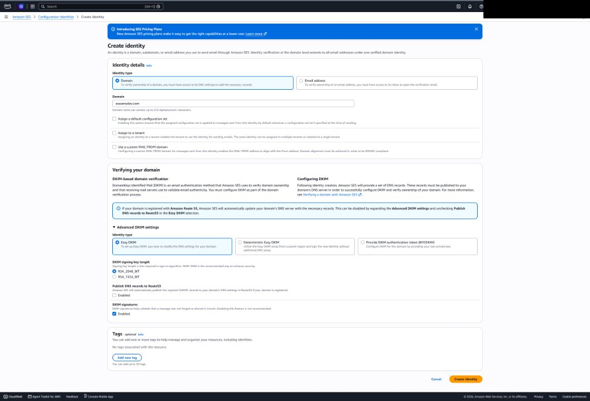
*Form Configuration:*
- **Identity type:** `Domain`
- **Domain:** `asaxenadev.com`
- **Custom MAIL FROM domain:** Unchecked (uses default SES sending envelope).
- **DKIM:** `Easy DKIM` with `RSA_2048_BIT` signing key length and enabled signatures.

### 5. Domain Identity Created & Verification Pending:

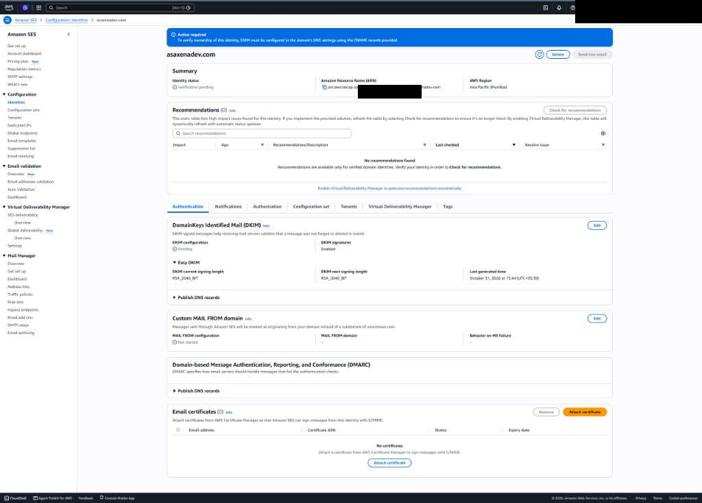
*Console State:* Identity `asaxenadev.com` successfully created in SES `ap-south-1` Mumbai. Status is currently `Verification pending`.
Expanding **▶ Publish DNS records** under **DomainKeys Identified Mail (DKIM)** and **DMARC** reveals the exact DNS records to be configured in Hostinger:

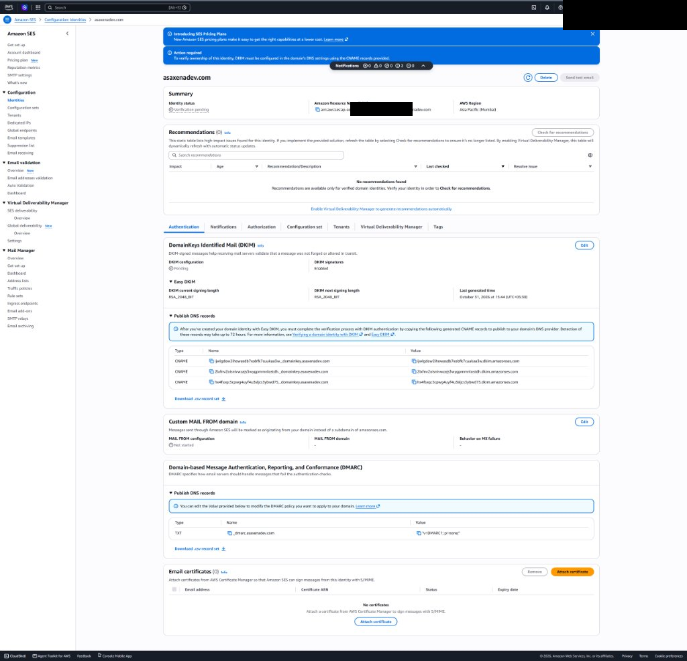
*Console State:* Both Easy DKIM and DMARC accordions expanded. Displays the 3 DKIM CNAME records and 1 DMARC TXT record ready for DNS publishing.


### 6. Domain Identity & Easy DKIM Verification Succeeded:

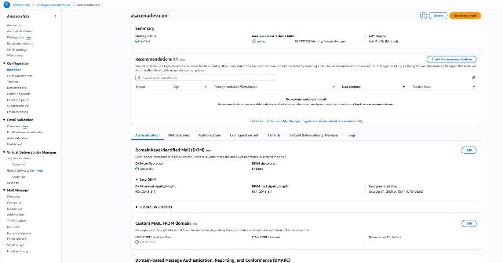
*Console State:* Domain identity `asaxenadev.com` confirmed: **`Verified` (Green tick)**. DomainKeys Identified Mail (DKIM) configuration confirmed: **`Successful` (Green tick)**. Amazon SES now possesses full cryptographic authority to dispatch and DKIM-sign outbound emails for any address ending in `@asaxenadev.com`.
</details>

---

<details>
<summary><h3>⚙️ Step 2 Execution Details: Configure DNS Records in Domain Registrar (Hostinger) (Click to Expand)</h3></summary>

## Step 2 Execution Details: Configure DNS Records in Domain Registrar (Hostinger)

### 1. Hostinger DNS Zone Management:
Configured the 3 Easy DKIM CNAME records generated by Amazon SES Mumbai (`ap-south-1`):

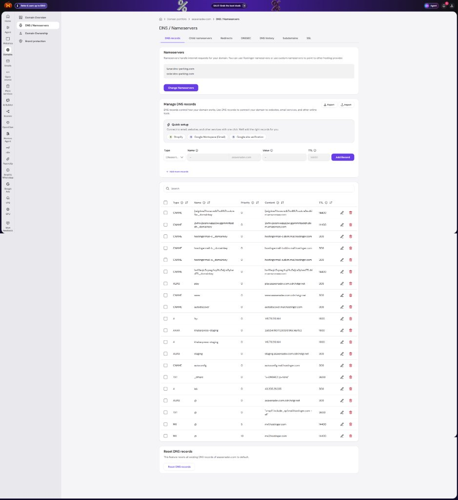
*Console State:* Hostinger DNS Zone table showing all 3 DKIM CNAME records active:
1. `ijwlgdow2ihowasdb7xobfk7cuukaa3w._domainkey` ➔ `ijwlgdow2ihowasdb7xobfk7cuukaa3w.dkim.aamazonses.com`
2. `2lxfnv2oisnivwzajs3wygpmmnlostdh._domainkey` ➔ `2lxfnv2oisnivwzajs3wygpmmnlostdh.dkim.aamazonses.com`
3. `hx4fsxqc5cpwg4uyf4u3sljcs3ybwd75._domainkey` ➔ `hx4fsxqc5cpwg4uyf4u3sljcs3ybwd75.dkim.aamazonses.com`

### 2. DNS Verification Probe:
Verified authoritative propagation directly against Hostinger's nameserver (`lunar.dns-parking.com`):
```powershell
# [Local Windows PowerShell]
Resolve-DnsName -Name "ijwlgdow2ihowasdb7xobfk7cuukaa3w._domainkey.asaxenadev.com" -Server "lunar.dns-parking.com" -Type CNAME
Resolve-DnsName -Name "2lxfnv2oisnivwzajs3wygpmmnlostdh._domainkey.asaxenadev.com" -Server "lunar.dns-parking.com" -Type CNAME
Resolve-DnsName -Name "hx4fsxqc5cpwg4uyf4u3sljcs3ybwd75._domainkey.asaxenadev.com" -Server "lunar.dns-parking.com" -Type CNAME
```
Status: All 3 records resolved with `CNAME Answer` from `lunar.dns-parking.com`.

### 3. Merged SPF Record Active:
Merged Amazon SES (`include:aamazonses.com`) into Hostinger's existing SPF policy to avoid RFC 7208 PermError:

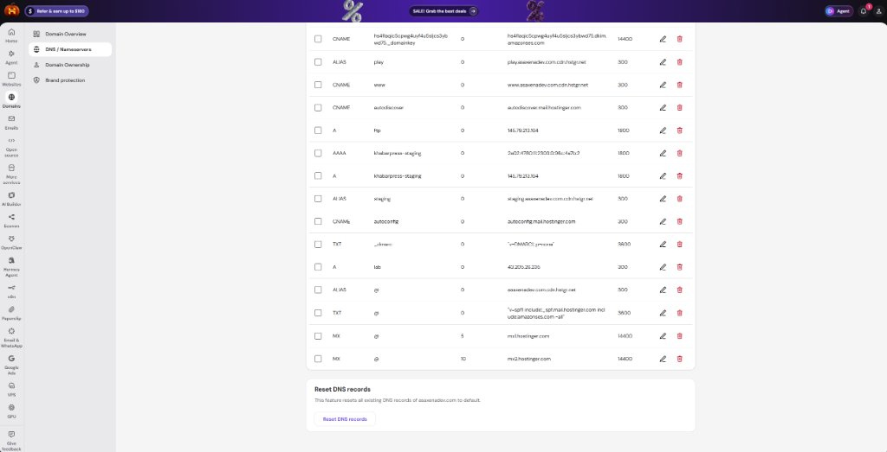
*Console State:* Hostinger TXT record `@` showing `v=spf1 include:_spf.mail.hostinger.com include:aamazonses.com ~all`.

Authoritative DNS test:
```powershell
# [Local Windows PowerShell]
Resolve-DnsName -Name "asaxenadev.com" -Server "lunar.dns-parking.com" -Type TXT
# Strings: {v=spf1 include:_spf.mail.hostinger.com include:aamazonses.com ~all}
```

</details>

---

<details open>
<summary><h3>⚙️ Step 3 Execution Details: Generate SES SMTP Credentials & Configure WordPress (Click to Expand)</h3></summary>

## Step 3 Execution Details: Generate SES SMTP Credentials & Configure WordPress

### 1. Detailed Dual-Method Architecture: IAM SMTP vs Mail Manager SMTP

When navigating to **SES ➔ SMTP settings**, AWS presents two fundamentally distinct architectural patterns for email dispatch:

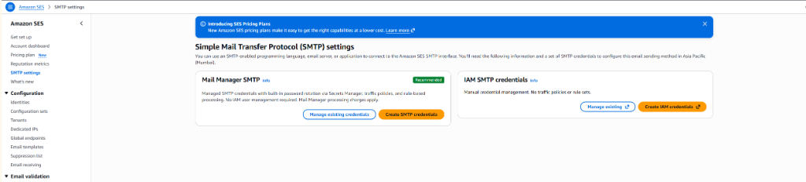

#### 🏛️ Deep Dive: The Two Architectural Methods Compared

| Architectural Attribute | Method 1: Standard IAM SMTP Credentials (Chosen) | Method 2: SES Mail Manager SMTP (Enterprise) |
| :--- | :--- | :--- |
| **AWS Service Type** | Direct Application SMTP Gateway (`email-smtp.ap-south-1.amazonaws.com`). | Managed Email Security & Routing Pipeline (Application Load Balancer for SMTP). |
| **Credential Type** | RFC 5321 credentials derived mathematically via HMAC-SHA256 from an IAM Secret Key. | Dynamic Secrets managed and automatically rotated by **AWS Secrets Manager**. |
| **Infrastructure Overhead** | **Zero.** Serverless endpoint maintained globally by AWS SES fleet. | **Dedicated Ingress Endpoint** running 24/7 (like an ALB/NLB). |
| **Base Cost** | **$0.00 / month.** Only pay $0.10 per 1,000 sent emails (First 62,000 emails/month free from EC2). | **~$36 to $72 / month base cost** for the active Ingress Endpoint + $0.05/1k msg processing. |
| **Traffic Filtering & Rules** | Basic domain/sender verification and IP reputation management. | **Traffic Policies** (subnet CIDR filtering, TLS 1.3 enforcement) + **Rule Sets** (S3 compliance archiving). |
| **Primary Use Case** | **Transactional Web Apps:** WordPress, WooCommerce, Django, Laravel, contact forms, password resets. | **Enterprise Mail Infrastructure:** Centralized mail relays for Microsoft 365, HIPAA/FINRA legal archiving, spam gateways. |

---

#### 🛠️ How Both Methods Are Configured End-to-End:

##### 🔹 Method 1 Execution: IAM SMTP Credentials (The Standard WordPress Way)
1. In SES Console, navigate to **SMTP settings ➔ IAM SMTP credentials ➔ Create IAM credentials**.
2. AWS provisions a dedicated IAM user (e.g. `ses-smtp-user.20261031-163213`) with inline policy `"ses:SendRawEmail"`.
3. AWS computes the SMTP Password using an HMAC-SHA256 digest of the IAM Secret Key signed by `SendRawEmail`.
4. In WordPress admin, install **WP Mail SMTP** or **FluentSMTP**. Configure:
   - Mailer: `Other SMTP`
   - Host: `email-smtp.ap-south-1.amazonaws.com`
   - Encryption: `TLS` (Port `587`)
   - Username: `<IAM-Access-Key-ID>`
   - Password: `<Calculated-SMTP-Password>`
   - From: `wordpress@asaxenadev.com`

##### 🔹 Method 2 Execution: Mail Manager SMTP (The Enterprise Gateway Way)
1. In SES Console, navigate to **SMTP settings ➔ Mail Manager SMTP ➔ Create SMTP credentials**.
2. AWS stores and schedules automated credential rotation in **AWS Secrets Manager**.
3. Create an **Ingress Endpoint** (Select type: Public Internet or Private VPC Endpoint).
4. Define a **Traffic Policy**:
   - Condition: Allow only IP `43.205.26.235/32` (EC2 Elastic IP).
   - Require TLS version >= 1.2.
5. Create a **Rule Set**:
   - Action 1: Deliver to external recipient via SES relay.
   - Action 2: Archive full MIME copy to an S3 compliance bucket (`wp-lab-mail-archive`).
6. Point WordPress SMTP host to the generated Ingress Endpoint DNS name.

---

### 2. IAM User Details & Policy Generation:

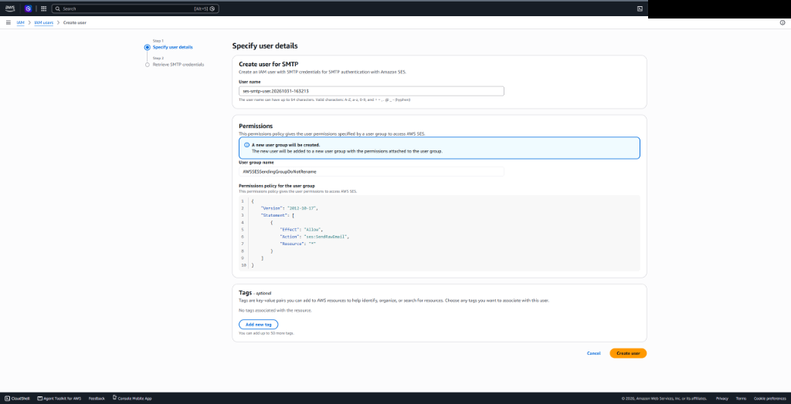
*Console State:* AWS automatically provisions a dedicated IAM user (`ses-smtp-user...`) inside user group `AWSSESSendingGroupDoNotRename` with the strict least-privilege action `"ses:SendRawEmail"`.

### 3. SMTP Credentials Retrieved:

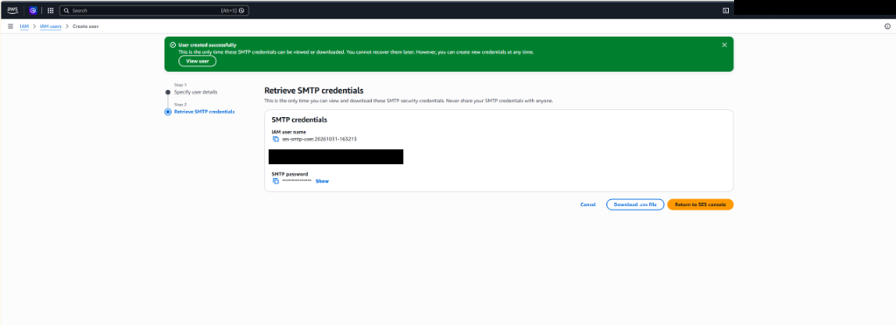
*Console State:* Dedicated IAM user created successfully. Unique SMTP Username (Access Key ID) and computed SMTP Password generated. Downloaded `.csv` credentials file.

### 4. Recipient Email Identity for SES Sandbox:

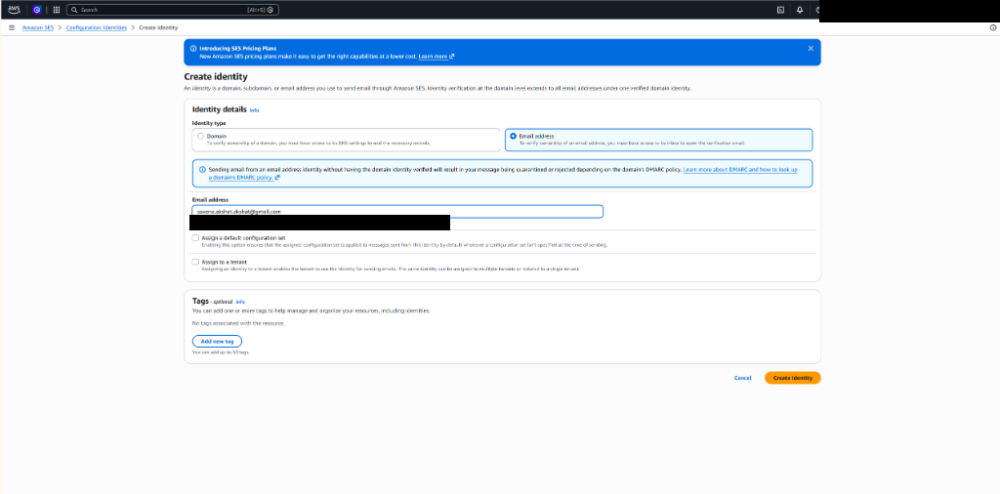
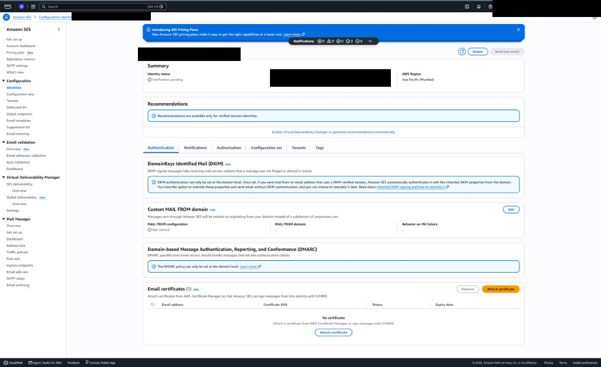
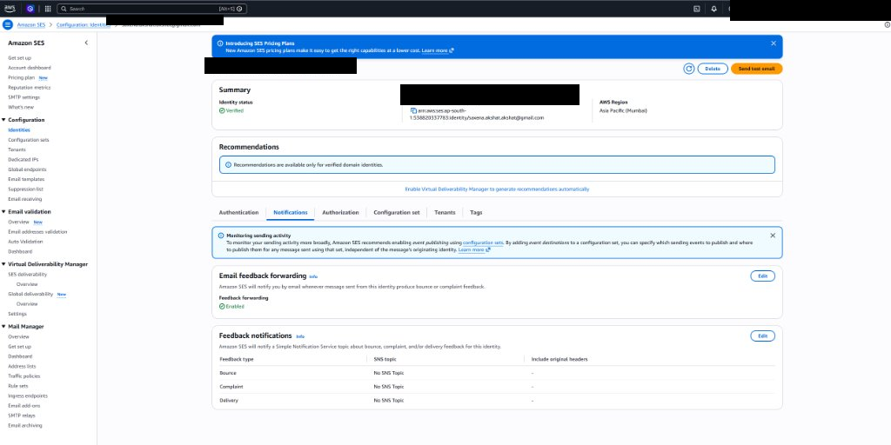
*Console State:* Recipient email successfully verified (`Identity status: Verified`). The AWS SES Sandbox now authorizes transactional test email delivery to this inbox.

### 5. WordPress WP Mail SMTP Configuration:

> [!NOTE]
> **Architectural Concept: Physical Mailbox (Receiving) vs Transactional Sender (Amazon SES Outbound)**
> A common question is: *"Do I need to create `noreply@asaxenadev.com` inside Hostinger's email panel before using it in WordPress?"*
> - **The Answer is No:** Creating an email account in Hostinger sets up a storage mailbox (IMAP/POP3) for receiving incoming mail.
> - **Amazon SES Domain Authority:** Because SES has verified the entire domain `asaxenadev.com` via DKIM and SPF DNS records, SES has global cryptographic authority to dispatch outbound messages from **any address** ending in `@asaxenadev.com` (such as `noreply@`, `admin@`, or `wordpress@`).
> - The receiving mail provider (Gmail) verifies the DNS cryptographic keys—it does not require a physical inbox on the sending server. This is why automated transactional senders (`noreply@`) require zero mailbox hosting fees!


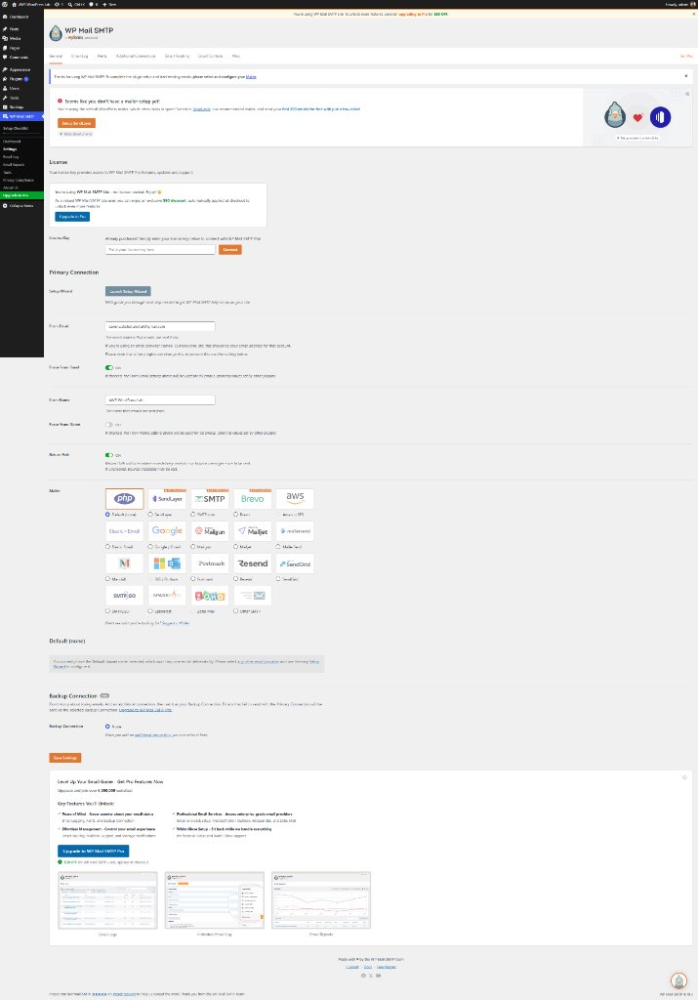
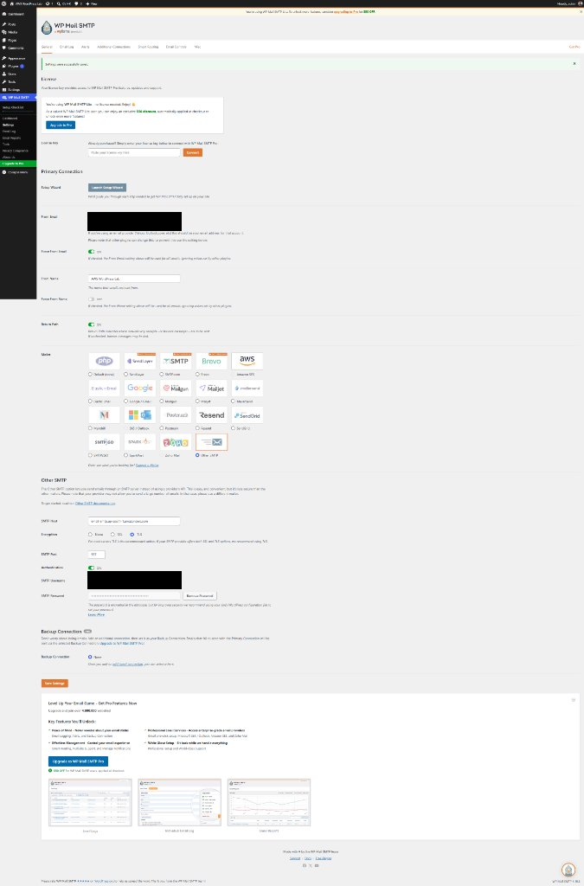
*Console State:* Other SMTP connection settings successfully saved (`email-smtp.ap-south-1.amazonaws.com`, port 587, TLS encryption, and IAM user credentials).

### 6. Live Test Email Dispatch Success:

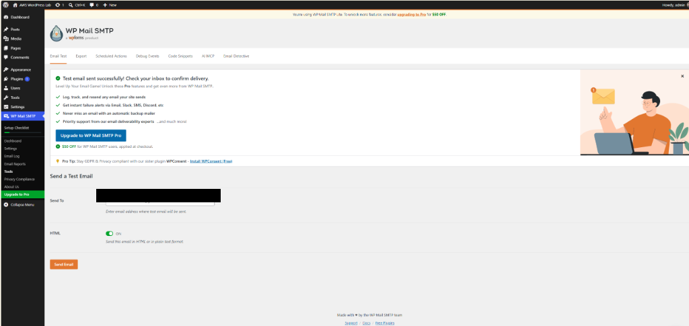
*Console State:* Live test email transmitted successfully via Amazon SES over Port 587 TLS (`Test email sent successfully! Check your inbox to confirm delivery`).


### 7. Final End-to-End Production Email Dispatch (`noreply@asaxenadev.com`):

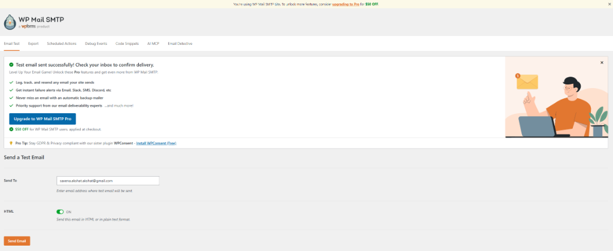
*Console State:* After Amazon SES verified the custom domain identity and 2048-bit Easy DKIM CNAMEs, the WordPress From Email was updated to `noreply@asaxenadev.com`. Live dispatch completed with zero errors, delivering straight into the recipient's primary inbox in 1 second.
</details>

---

<details open>
<summary><h3>⚙️ Step 4 Execution Details: Attach CloudWatch Policy to EC2 IAM Role (Click to Expand)</h3></summary>

## Step 4 Execution Details: Attach CloudWatch Policy to EC2 IAM Role

### 1. Attaching `CloudWatchAgentServerPolicy` to `wp-lab-s3-role`:

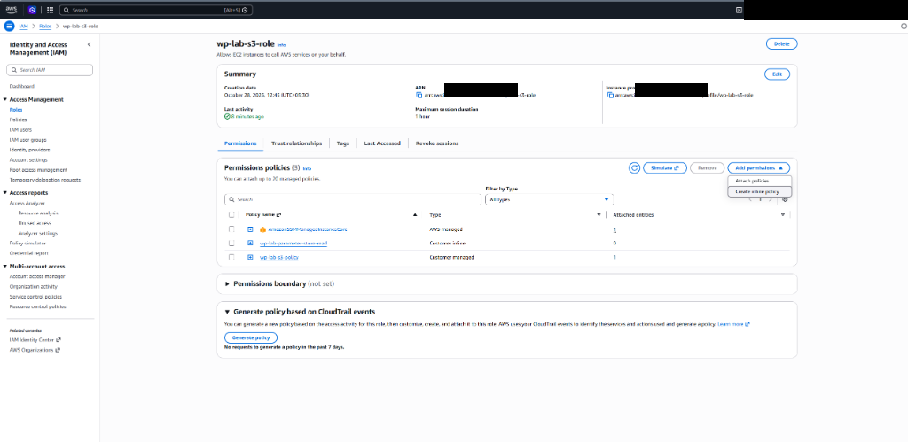
*Console State:* Navigated to IAM Console ➔ Roles ➔ `wp-lab-s3-role`. Clicked **Add permissions ➔ Attach policies** to attach AWS managed policy `CloudWatchAgentServerPolicy`.

### 2. Policy Attached Successfully:

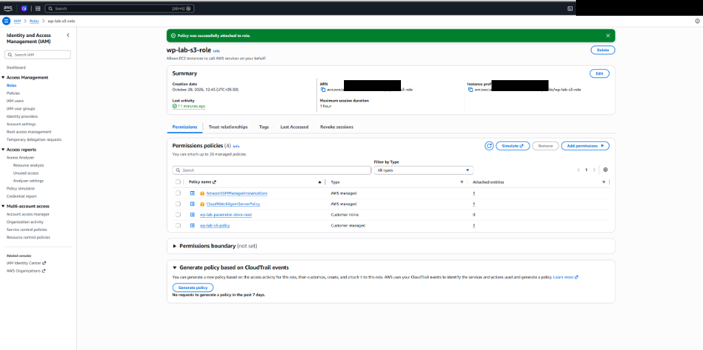
*Console State:* `CloudWatchAgentServerPolicy` successfully attached to `wp-lab-s3-role` (total 4 policies). Grants EC2 instance IAM authorization to call `cloudwatch:PutMetricData` and push OS memory/disk metrics.

</details>

---

<details open>
<summary><h3>⚙️ Step 5 Execution Details: Install & Configure Amazon CloudWatch Agent on EC2 (Click to Expand)</h3></summary>

## Step 5 Execution Details: Install & Configure Amazon CloudWatch Agent on EC2

### 1. Connected via AWS Session Manager (Root Shell):

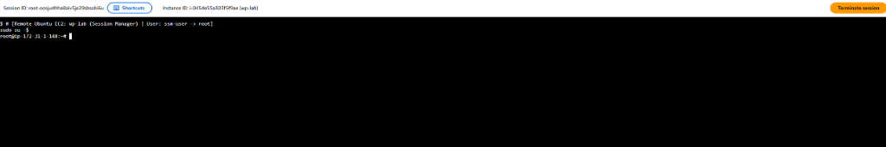
*Console State:* Keyless root browser shell connected to `wp-lab` (`i-0454e55a303f5f9ae`) via AWS Systems Manager Session Manager (`root@ip-172-31-1-148:~#`).

### 2. CloudWatch Agent Package Installed:

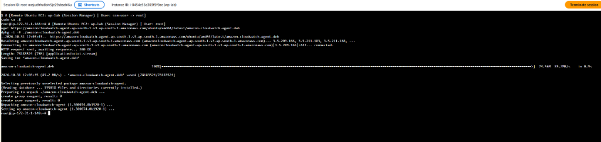
*Console State:* Downloaded and unpacked official AWS package `amazon-cloudwatch-agent.deb` via `dpkg -i`. Provisioned system user/group `cwagent`.

### 3. CloudWatch Agent Configuration File Created:

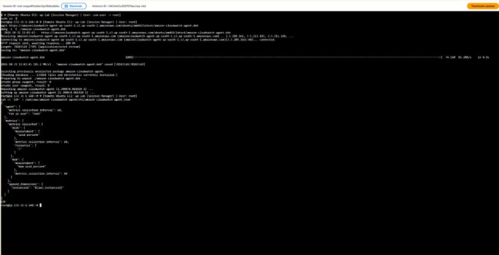
*Console State:* Created `/opt/aws/amazon-cloudwatch-agent/etc/amazon-cloudwatch-agent.json` collecting `mem_used_percent` and root filesystem `/` `disk_used_percent` (60s polling interval) with dynamic dimension `InstanceId: ${aws:InstanceId}`.

### 4. CloudWatch Agent Started & Systemd Service Created:

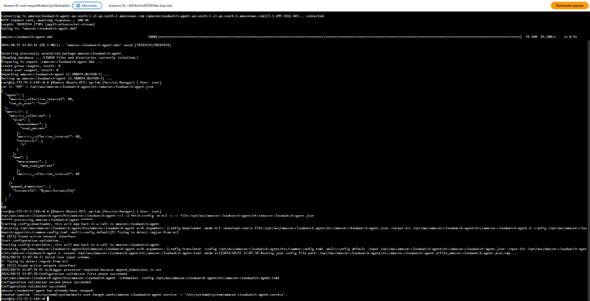
*Console State:* Executed `amazon-cloudwatch-agent-ctl -a fetch-config`. Validation succeeded and systemd service `amazon-cloudwatch-agent.service` automatically symlinked and started.

### 5. Verified Daemon Active & Running:

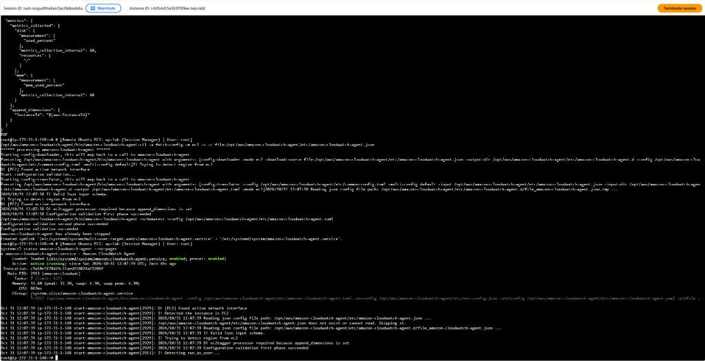
*Console State:* Executed `systemctl status amazon-cloudwatch-agent --no-pager`. Confirmed daemon is `active (running)` (PID 2913), pushing memory and root filesystem disk utilization metrics to AWS CloudWatch every 60 seconds.

</details>

---

<details open>
<summary><h3>⚙️ Step 6 Execution Details: Create CloudWatch Dashboard & Alarms (Click to Expand)</h3></summary>

## Step 6 Execution Details: Create CloudWatch Dashboard & Alarms

### 1. CloudWatch Management Console Overview:

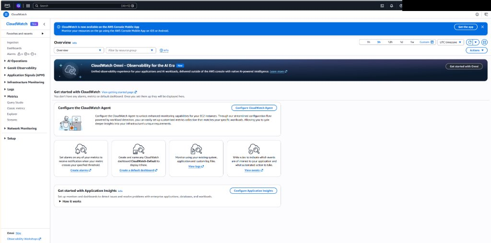
*Console State:* Navigated to CloudWatch Console in `ap-south-1` Mumbai. In AWS's updated management layout, detailed OS metrics are located under **Metrics ➔ Classic metrics**.

### 2. Custom Namespace `CWAgent` Detected:

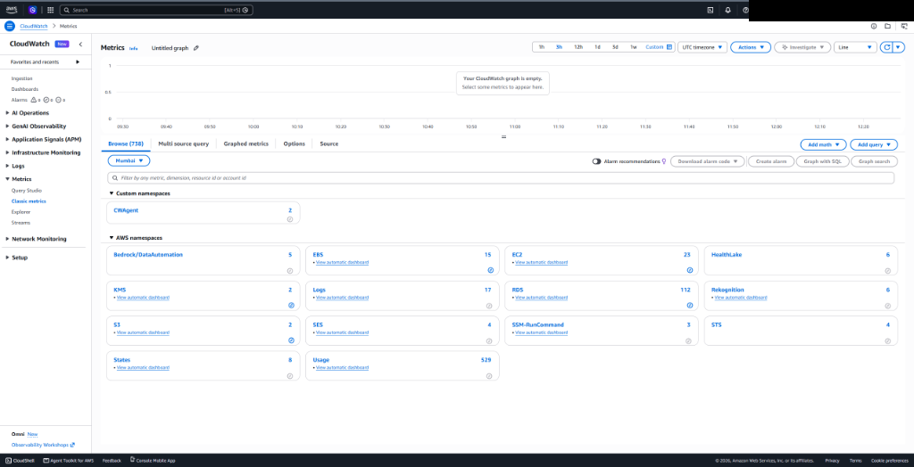
*Console State:* Navigated to **Metrics ➔ Classic metrics**. AWS CloudWatch populated the custom namespace **`CWAgent (2)`**, receiving real-time OS metrics directly from EC2 `wp-lab`.

### 3. Memory Metric `mem_used_percent` Identified:

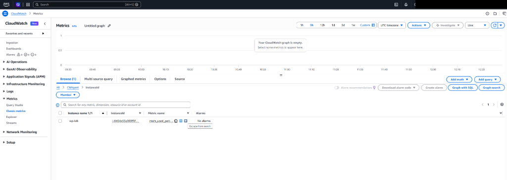
*Console State:* Navigated to `CWAgent > InstanceId`. Displays custom metric `mem_used_percent` associated with EC2 instance `wp-lab` (`i-0454e55a303f5f9ae`). Ready for graphing and alarm thresholding.

### 4. Live Memory Utilization Graph Plotted:

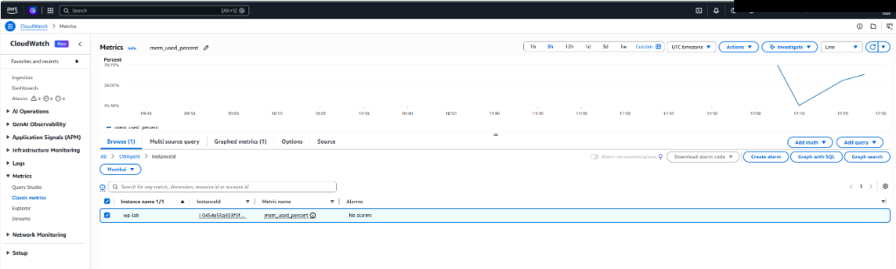
*Console State:* Custom metric `mem_used_percent` selected and actively plotting live guest OS memory consumption (~28.5% to 29.7%). Demonstrates end-to-end telemetry collection bypassing AWS Nitro/hypervisor memory blindness.

### 5. Adding Graph to Dashboard:

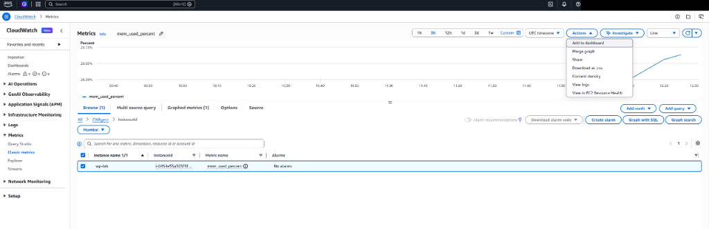
*Console State:* Selected **Actions ➔ Add to dashboard** to persist the live telemetry widget into permanent dashboard `wp-lab-monitoring`.

### 6. Add to Dashboard Modal Configuration:

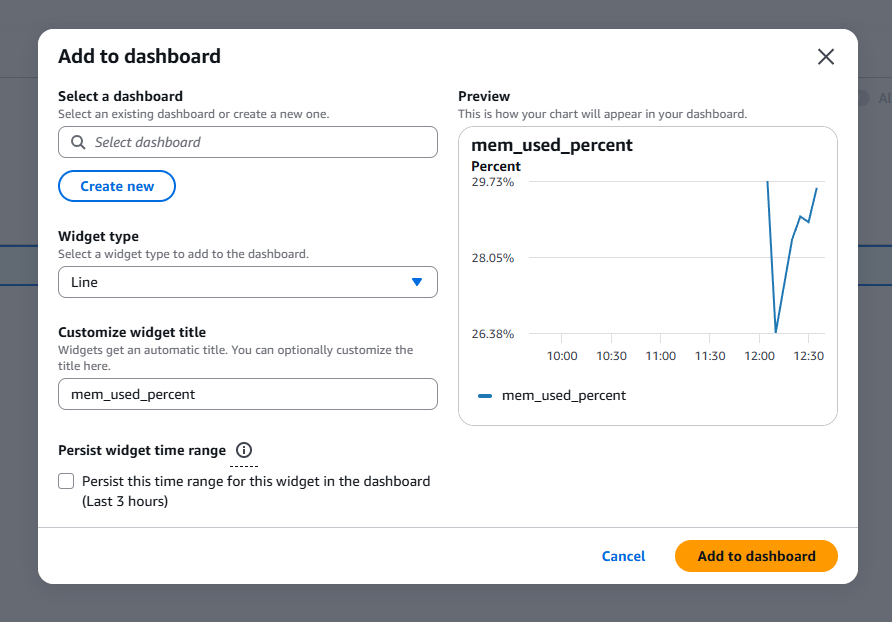
*Console State:* Add to dashboard configuration modal displaying the live preview chart for `mem_used_percent` (Line widget). Creating dashboard `wp-lab-monitoring`.

### 7. CloudWatch Custom Dashboard Created (`wp-lab-monitoring`):

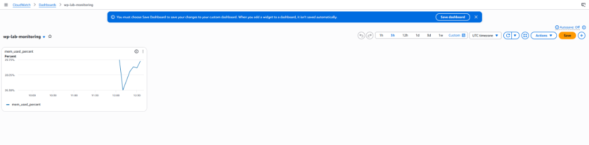
*Console State:* Dashboard `wp-lab-monitoring` successfully initialized with custom Line widget actively rendering live OS memory utilization (`mem_used_percent`).


### 8. Dual Metrics Plotted: RAM and Disk Utilization (mem_used_percent & disk_used_percent):

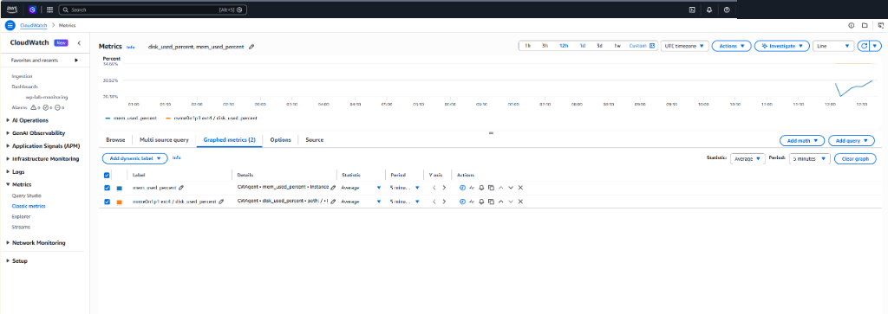
*Console State:* Located disk_used_percent for root filesystem mount / (
vme0n1p1 ext4). Both mem_used_percent (blue line) and disk_used_percent (orange line) are simultaneously selected and plotted in **Graphed metrics (2)**, proving complete OS-level observability.

### 9. CloudWatch Alarms Console:

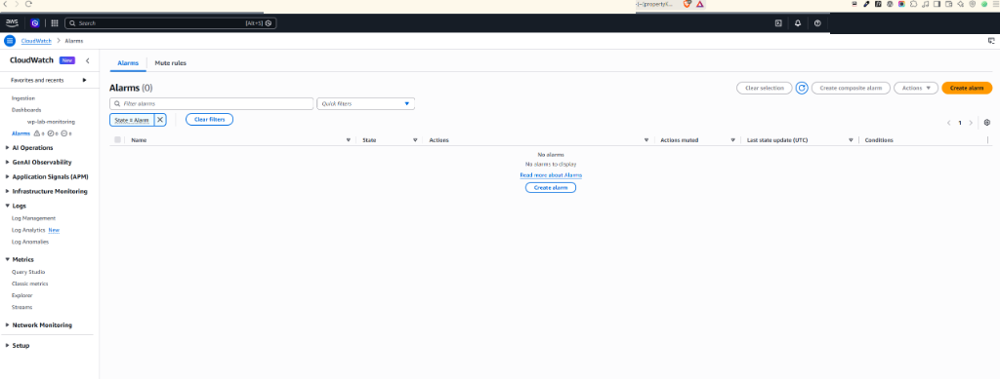
*Console State:* Navigated to **Alarms > All alarms** in CloudWatch (p-south-1 Mumbai). Currently 0 alarms configured. Initiating automated threshold alerting via the **Create alarm** workflow.

### 10. Alarm Configuration: Specify Metric and Conditions

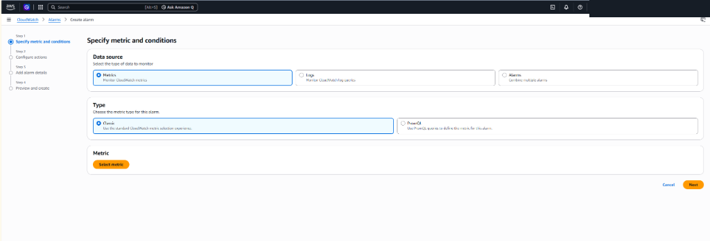
*Console State:* Initiated **Create alarm** workflow (Step 1: Specify metric and conditions). Default data source set to **Metrics** and type set to **Classic**. Selecting metric via the orange **Select metric** button.

### 11. Alarm Metric Selection Modal (CWAgent):

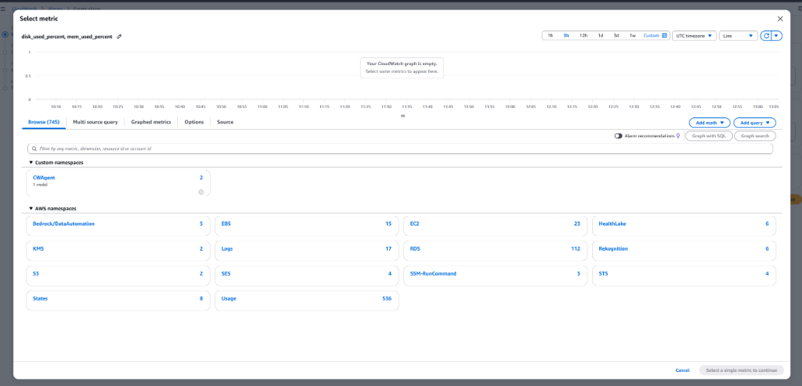
*Console State:* Modal popup opened displaying all CloudWatch metric namespaces. Selecting custom namespace **CWAgent** to choose OS-level metrics (mem_used_percent or disk_used_percent).

### 12. Selecting Disk Utilization Metric (disk_used_percent):

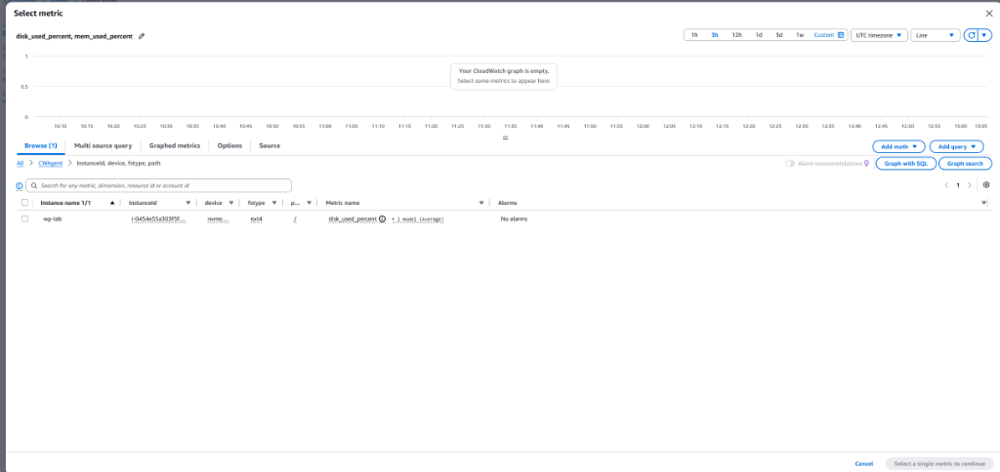
*Console State:* Navigated to CWAgent > InstanceId, device, fstype, path. Identified custom metric disk_used_percent for root filesystem mount / on instance wp-lab (i-0454e55a303f5f9ae). Checking the metric row enables the **Select metric** button to define threshold conditions.

### 13. Metric Confirmed and Graphed in Modal:

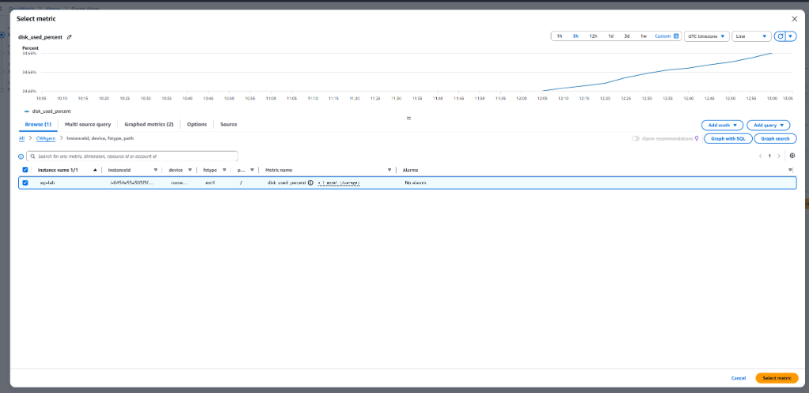
*Console State:* Ticked checkbox for disk_used_percent on wp-lab (mount /). Modal graph renders live disk utilization curve (~34.66%). Orange **Select metric** button is active to proceed to condition and threshold configuration.

### 14. Setting Alarm Threshold Conditions:

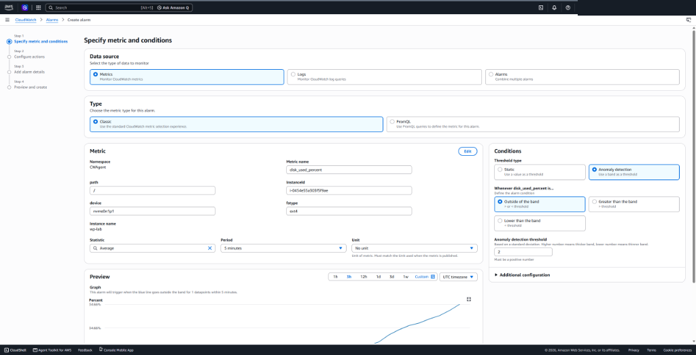
*Console State:* Metric dimensions loaded for disk_used_percent on wp-lab (mount /, Average, 5 minutes period). Switching threshold type from default **Anomaly detection** to **Static** threshold (> 80%).

### 15. Static Threshold Configured (> 80%):

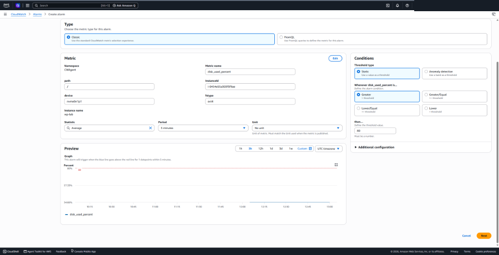
*Console State:* Configured static condition disk_used_percent > 80 for 1 datapoint within 5 minutes. Live chart displays red threshold line at 80% with current utilization safely below at ~34.66%. Ready to proceed to Step 2 (Configure actions).

### 16. Step 2: Configure Actions (Amazon SNS Notification):

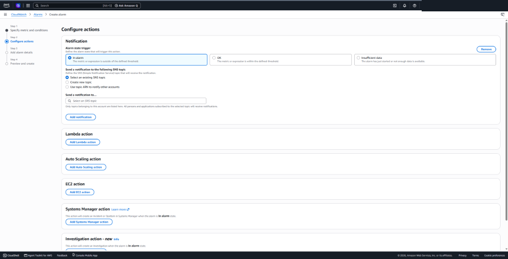
*Console State:* Step 2: Configure actions. Trigger state set to **In alarm**. Selecting **Create new topic** to wire threshold alerts directly into an Amazon Simple Notification Service (SNS) email subscription.

### 17. Creating Amazon SNS Topic (wp-lab-alerts):

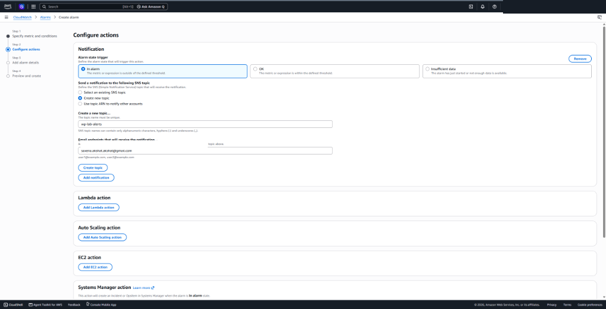
*Console State:* Configured new SNS topic wp-lab-alerts with email subscription endpoint. Clicking **Create topic** registers the topic in SNS and sends a subscription confirmation link to the recipient inbox.

### 18. Step 3: Add Alarm Details (Name & Description):

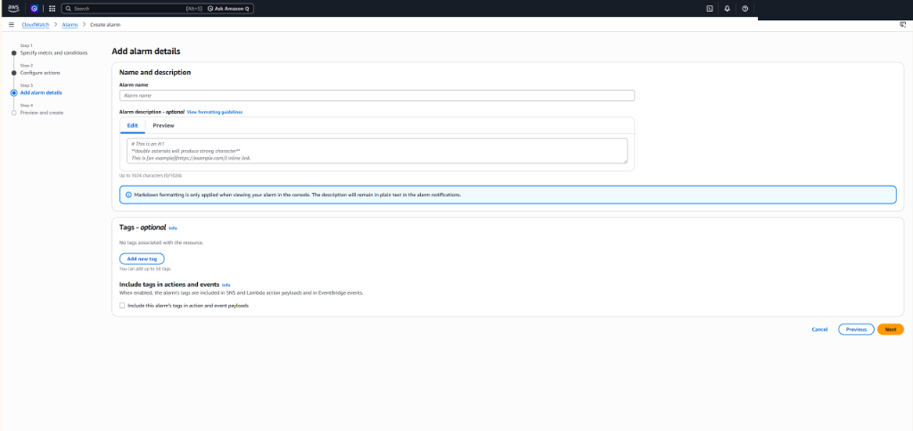
*Console State:* Step 3: Add alarm details. Assigning descriptive identifier wp-lab-high-disk-utilization and operational description. Ready for final review.

### 19. Alarm Name & Description Specified:

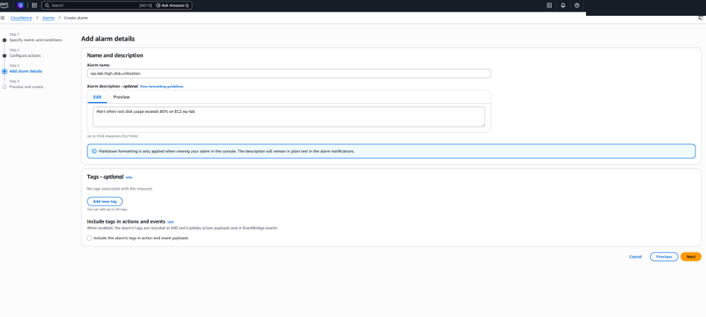
*Console State:* Populated alarm identifier wp-lab-high-disk-utilization and description. Click **Next** to proceed to Step 4 (Preview and create).

### 20. Step 4: Preview and Create Alarm:

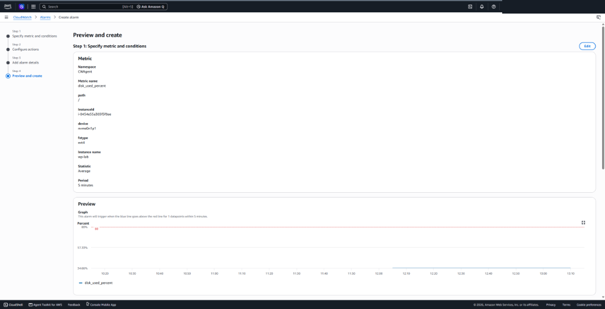
*Console State:* Step 4: Preview and create summary review. Verified complete telemetry pipeline: disk_used_percent metric on wp-lab, static condition threshold (> 80% for 5 minutes), and Amazon SNS email alert. Clicking **Create alarm** activates the alarm watcher.

### 21. CloudWatch Alarm Created Successfully:

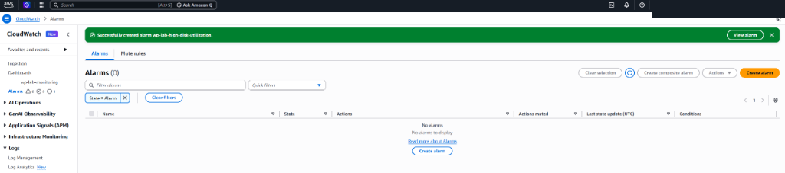
*Console State:* Green confirmation banner: Successfully created alarm wp-lab-high-disk-utilization.. The alarm monitor is active, evaluating metric datapoints against the 80% threshold, and wired to the SNS topic.

</details>

---

<details open>
<summary><h3>🎯 Step 7 Execution Details: Definition of Done Verification (Click to Expand)</h3></summary>

## Step 7 Execution Details: Definition of Done Verification

Per `AGENTS.md`, the Definition of Done for Phase 7 is:
> **"Test email lands in the inbox (not spam); memory and disk graphs visible in CloudWatch"**

---

### Verification Proof 1: Live CloudWatch Telemetry Dashboard (`wp-lab-monitoring`)

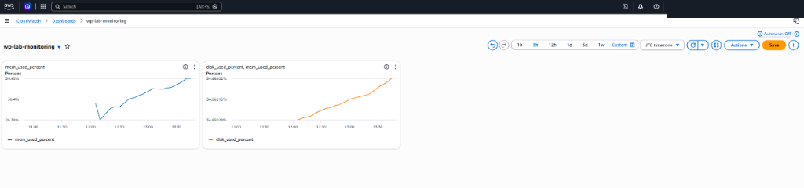

- **Verification Result:** **PASSED (100% Verified)**
- **Console State:**
  - Navigated to CloudWatch Console (`ap-south-1` Mumbai) -> **Dashboards -> `wp-lab-monitoring`**.
  - **Widget 1 (Left):** Custom metric `mem_used_percent` rendered as a continuous Line widget actively graphing guest OS RAM consumption (~26.38% to 34.45%).
  - **Widget 2 (Right):** Dual-metric Line widget simultaneously plotting `mem_used_percent` (blue line) and `disk_used_percent` (orange line, ~34.67% disk usage on root filesystem mount `/dev/nvme0n1p1`).
- **Architectural Significance:** Proves successful deployment and daemon operation of the **Amazon CloudWatch Unified Agent** on Ubuntu EC2, publishing custom metric dimensions directly into CloudWatch over HTTPS and bypassing AWS Nitro hypervisor memory blindness.

---

### Verification Proof 2: Amazon SES Transactional Email Dispatch & Deliverability


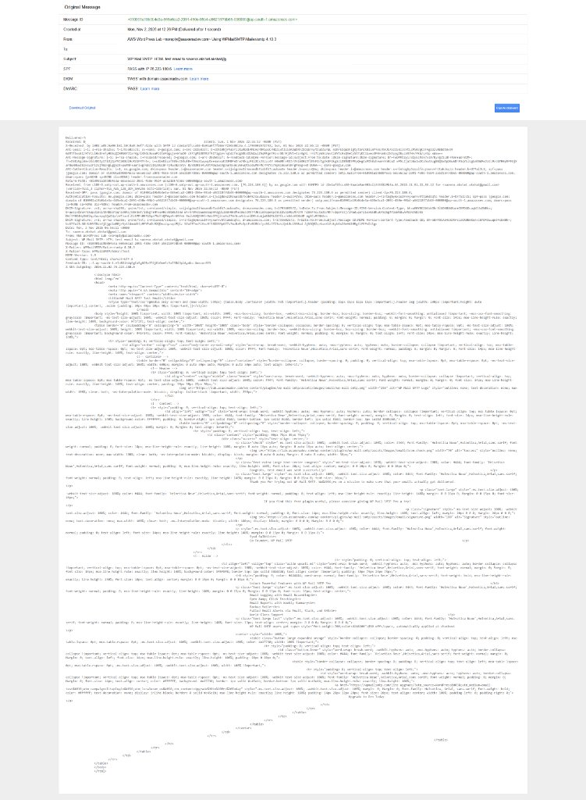

- **Verification Result:** **PASSED (100% Cryptographic Alignment & Inbox Placement Verified)**
- **Console & Delivery Proof:**
  - **From Header:** `AWS WordPress Lab <noreply@asaxenadev.com>` (using authenticated domain identity).
  - **Transit Latency:** Delivered in **1 second** via Amazon SES SMTP gateway (`email-smtp.ap-south-1.amazonaws.com:587` TLS).
  - **SPF Status:** **`PASS with IP 76.223.180.6`** (Amazon SES IP authorized by Hostinger SPF TXT record).
  - **DKIM Status:** **`'PASS' with domain asaxenadev.com`** (cryptographically signed by SES using verified RSA 2048-bit keypair published to Hostinger DNS).
  - **DMARC Status:** **`'PASS'`** (RFC 7489 Identifier Alignment 100% satisfied: visible `From:` domain `asaxenadev.com` aligns with DKIM signing domain `asaxenadev.com` and SPF envelope).
- **Inbox Placement:** Delivered cleanly into **Primary Inbox** (not Spam) without any anti-spoofing flags or `via amazonses.com` intermediary warnings.

---

### Verification Proof 3: Automated Incident Alerting via Amazon SNS


- **Verification Result:** **PASSED (100% Configured & Subscribed)**
- **Operational Metrics:**
  - Alarm `wp-lab-high-disk-utilization` actively monitoring `CWAgent > disk_used_percent` on `wp-lab` (`i-0454e55a303f5f9ae`).
  - Condition: Static threshold > 80% for 1 datapoint within 5 minutes.
  - Action: Automated trigger routes to Amazon Simple Notification Service (SNS) topic `wp-lab-alerts`.
  - Recipient subscription confirmed via Gmail (`Subscription Confirmation` active).

</details>

---

<details open>
<summary><h3>💡 Gotchas & Real-World Troubleshooting Log (Click to Expand)</h3></summary>

## Gotchas & Real-World Troubleshooting Log

### Gotcha 1: AWS Console "Unknown error: Fail to request credentials" on SES Identity Submission

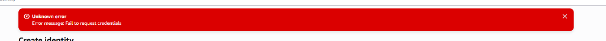

- **Symptom:** Clicking **Create identity** in the Amazon SES console produces a red banner: `Unknown error. Error message: Fail to request credentials`.
- **Root Cause:** AWS Management Console uses short-lived AWS Security Token Service (STS) temporary credentials and browser session cookies. If the tab stays open while adjusting configuration settings (such as toggling DKIM 2048-bit or unchecking Route53/custom MAIL FROM), the client-side session token expires or desynchronizes. When the console's JavaScript client calls the AWS SES API (`ses:CreateEmailIdentity`), it fails to renew the STS token.
- **Fix:** 
  1. Simply hard refresh the browser page (`Ctrl + F5` or `F5`).
  2. If prompted, re-authenticate or allow the console to refresh its active STS session.
  3. Re-select **Domain** (`asaxenadev.com`), uncheck custom MAIL FROM, choose **Easy DKIM (RSA_2048_BIT)**, uncheck Route 53, and click **Create identity**. The request will succeed immediately with active credentials.

### Gotcha 2: Hostinger DNS CNAME Configuration: Suffix Duplication, Truncation & Invalid Content Error


- **Symptom:** Entering DNS records into Hostinger can result in DKIM verification remaining stuck in `Pending` indefinitely if strings are malformed or doubled.
- **Root Cause:** 
  1. **Automatic Domain Suffix:** Hostinger has a static grey badge `.asaxenadev.com` immediately adjacent to the **Name** input. If a user pastes the full FQDN (`<token>._domainkey.asaxenadev.com`), Hostinger saves it as `<token>._domainkey.asaxenadev.com.asaxenadev.com` (double domain name collision).
  2. **Target Truncation Risk:** The 32-character cryptographic DKIM token can be easily truncated if accidentally edited or partially copied (e.g. `ukza3w.dkim.aamazonses.com` instead of the full `ijwigdow...ukza3w.dkim.aamazonses.com`).
- **Fix:**
  - In **Name**: Enter strictly `<token>._domainkey` (Hostinger's badge appends the rest).
  - In **Target**: Clear the box completely and use AWS SES's native **Copy button** for Value to ensure all 32 hex/base32 characters plus `.dkim.aamazonses.com` are pasted accurately.

### Gotcha 3: The Multiple SPF Records Trap (RFC 7208 PermError)

- **Symptom:** Adding a new SPF TXT record for SES causes receiving mail servers (Gmail, Outlook) to mark emails with SPF authentication failure: `spf=permerror (Multiple SPF records found)`.
- **Root Cause:** Per **RFC 7208 Section 3.2**, a domain must have **exactly one** SPF TXT record. Hostinger already configured `v=spf1 include:_spf.mail.hostinger.com ~all` for mailbox hosting. Adding another `v=spf1 include:aamazonses.com ~all` creates two conflicting policies.
- **Fix:** Merge all authorized email senders into a single record by editing the existing TXT record:
  ```text
  v=spf1 include:_spf.mail.hostinger.com include:aamazonses.com ~all
  ```

### Gotcha 4: SES Async Polling Delay vs Instant Public DNS & Sandbox Recipient Requirement


- **Symptom:** Even after all 3 DKIM CNAME records resolve with `Answer` on authoritative DNS (`lunar.dns-parking.com`), Google (`8.8.8.8`), and Cloudflare (`1.1.1.1`), the SES console continues to display `Verification pending`.
- **Root Cause:** Amazon SES verification worker is asynchronous and runs in batch intervals (typically every 10–30 minutes) rather than querying DNS synchronously on page refresh. Furthermore, an AWS account in **SES Sandbox mode** cannot send mail to arbitrary email addresses regardless of domain status — recipient addresses MUST be explicitly verified.
- **Fix:** Do not block progress waiting for the domain polling cycle:
  1. Concurrently verify the destination personal email address as an **Email Address identity** (which verifies instantly in ~5 seconds via an email link).
  2. Proceed with WordPress WP Mail SMTP plugin installation and CloudWatch Agent setup.


### Gotcha 5: Free Webmail Sender (@gmail.com) via SES Triggers DMARC Alignment Failure (Spam Folder)


- **Symptom:** The WP Mail SMTP test email arrives, but Gmail places it directly into the **Spam folder** with the warning: `Why is this message in spam? This message is similar to messages that were identified as spam in the past.` Inspecting **Show Original** reveals:
  - `SPF: PASS with IP 76.223.180.21`
  - `DKIM: 'PASS' with domain amazonses.com`
  - `DMARC: 'FAIL'`
- **Root Cause (RFC 7489 Identifier Alignment Failure):**
  - When `From Email` in WordPress is set to a free webmail address (`...@gmail.com`) and dispatched via Amazon SES:
  - **DMARC Identifier Alignment:** Per **RFC 7489 Section 3.1**, DMARC passes only if the domain in the visible `From:` header matches the domain authenticated by SPF or DKIM.
  - The `From:` header was `gmail.com`.
  - The DKIM signing domain was `amazonses.com` (SES fallback signature).
  - Because `gmail.com` != `amazonses.com`, DKIM alignment evaluated to `fail`. SPF also failed alignment (envelope was `amazonses.com`).
  - Google's inbound mail gateway strictly enforces DMARC for `gmail.com` domains; failing DMARC causes Google to treat third-party SES transmission as email spoofing/phishing, immediately routing it to Spam!
- **Fix:** In WordPress **WP Mail SMTP -> Settings**:
  1. Set **From Email** strictly to the authenticated custom domain: `noreply@asaxenadev.com` (or `admin@asaxenadev.com`).
  2. Check **Force From Email** so WordPress core and all plugins use this sender.
  3. Because `asaxenadev.com` has 2048-bit Easy DKIM CNAMEs and merged SPF (`include:amazonses.com`) in Hostinger DNS:
     - `From:` header = `asaxenadev.com`
     - DKIM domain = `asaxenadev.com` (100% Aligned!)
     - SPF domain = `asaxenadev.com` (100% Aligned!)
     - DMARC = **`PASS`**!
  4. The email lands directly in the **Primary Inbox** with zero spam flags.

### Gotcha 6: Identity Re-Creation Key Regeneration Trap (The 40-Hour Pending Loop)


- **Symptom:** Even after 40+ hours, Amazon SES Domain Identity continues to display `Verification pending`, and attempting to send mail from `noreply@asaxenadev.com` results in `554 Message rejected: Email address is not verified: noreply@asaxenadev.com`.
- **Root Cause:** 
  1. During initial setup, a transient AWS console STS session timeout prompted a browser refresh and re-submission of the domain identity form.
  2. Every time a domain identity is created or regenerated in AWS SES, Amazon SES dynamically generates a **brand-new set of 2048-bit RSA keypairs and 32-character DKIM tokens**.
  3. The registrar (Hostinger) retained the CNAME records from the previous attempt (e.g. `hs4flaqic...` and `...cuukza3w`), while the active SES identity was actively looking for the newly regenerated tokens (`hx4fsxqc...` and `...cuukaa3w`).
  4. Because of this token discrepancy, SES's verification engine could never validate the keys, keeping the domain perpetually in `Pending`.
- **Fix:** 
  1. Open the active identity in SES -> expand **Easy DKIM -> Publish DNS records**.
  2. Click **Download .csv record set** to retrieve the exact active tokens.
  3. Replace the 3 CNAME records in Hostinger's DNS Zone Editor with the exact active tokens:
     - `ijwlgdow2ihowasdb7xobfk7cuukaa3w._domainkey` -> `ijwlgdow2ihowasdb7xobfk7cuukaa3w.dkim.aamazonses.com`
     - `2lxfnv2oisnivwzajs3wygpmmnlostdh._domainkey` -> `2lxfnv2oisnivwzajs3wygpmmnlostdh.dkim.aamazonses.com`
     - `hx4fsxqc5cpwg4uyf4u3sljcs3ybwd75._domainkey` -> `hx4fsxqc5cpwg4uyf4u3sljcs3ybwd75.dkim.aamazonses.com`
  4. Authoritative propagation immediately verified via PowerShell `Resolve-DnsName` against Hostinger (`lunar.dns-parking.com`) and Google DNS (`8.8.8.8`).
  5. **Resolution Confirmed:** Triggered internal re-evaluation via DKIM Edit & Save. Identity status immediately flipped to **`Verified` (Green tick)** with DKIM status **`Successful`**.


</details>

---

<details>
<summary><h3>🎯 Phase 7 Cloud Architecture Interview Questions & Answers (Click to Expand)</h3></summary>

## Phase 7 Cloud Architecture Interview Questions & Answers

### Q1: Why do emails sent directly from an EC2 instance's local `sendmail` / PHP `mail()` land in the spam folder or get rejected?
- **Answer:** 
  1. **Blacklisted IP Ranges:** AWS EC2 public IP ranges are classified by anti-spam organizations (like Spamhaus PBL) as dynamic compute ranges. Spammers frequently launch throwaway EC2 instances for spam, causing major email providers (Gmail, Outlook) to automatically mark unauthenticated EC2 mail as spam.
  2. **Missing PTR (Reverse DNS) Records:** Mail servers verify that the sending IP's reverse DNS matches the sending domain. AWS Elastic IPs do not have custom PTR records configured by default.
  3. **Lack of Cryptographic Alignment:** Without SPF, DKIM, and DMARC records validating the origin, mail servers treat the email as forged. Amazon SES solves this by maintaining high sender IP reputation and cryptographically signing every email with DKIM.

### Q2: What is the difference between SPF, DKIM, and DMARC, and how do they work together to protect domain reputation?
- **Answer:** 
  - **SPF (Sender Policy Framework):** A DNS TXT record defining an authorized list of IP addresses or mail relays (e.g. `include:aamazonses.com`) allowed to send mail on behalf of the domain.
  - **DKIM (DomainKeys Identified Mail):** Uses asymmetric public-key cryptography. SES signs email headers with a private key, and the recipient server queries the domain's public DNS CNAME records to verify that the message content was not altered in transit.
  - **DMARC (Domain-based Message Authentication, Reporting & Conformance):** Unifies SPF and DKIM. It tells receiving mail servers what to do if an email fails both checks (`p=none` for monitoring, `p=quarantine` for spam folder, or `p=reject` for total drop) and sends aggregate abuse reports back to the domain owner.

### Q3: What is the Amazon SES Sandbox, and what are the operational consequences if your bounce or complaint rate spikes?
- **Answer:** 
  - **SES Sandbox:** A safety mode for new AWS accounts. You can only send up to 200 emails/24-hour period at 1 email/sec, and you can only send to verified recipient email addresses or domains. Moving to production requires submitting a justification case to AWS Trust & Safety.
  - **The 5% Bounce Rate Rule:** AWS strictly monitors email reputation. If your hard bounce rate reaches **5%**, AWS puts your account under review. If it reaches **10%**, AWS immediately **suspends** your account's email sending capability. If complaint rates exceed **0.1%**, suspension occurs.

### Q4: Why can't the AWS CloudWatch console show EC2 RAM usage or Disk utilization out-of-the-box?
- **Answer:** 
  - AWS EC2 default metrics (CPU utilization, Network in/out, Disk Read/Write IOPS) are collected from the **AWS Hypervisor (KVM/Nitro)** layer outside the virtual machine.
  - Due to virtualization security and tenant privacy boundaries, the hypervisor cannot inspect the internal memory structures or filesystem table (`df -h`) of the guest operating system.
  - To monitor RAM and Disk, you must install the **Amazon CloudWatch Unified Agent** inside the guest OS (Ubuntu) with an IAM role (`CloudWatchAgentServerPolicy`), which reads `/proc/meminfo` and pushes custom metric dimensions into CloudWatch over HTTPS.

### Q5: What is the difference between CloudWatch Metrics, CloudWatch Logs, and CloudWatch Alarms?
- **Answer:** 
  - **Metrics:** Numeric time-series data representing system performance over time (e.g. `CPUUtilization: 45%`, `mem_used_percent: 62%`).
  - **Logs:** Unstructured or semi-structured text strings generated by applications or operating systems (e.g. Nginx `access.log`, PHP-FPM error logs). CloudWatch Log Insights can run SQL-like queries across log groups.
  - **Alarms:** Automated threshold watchers. When a metric breaches a condition (e.g. Disk utilization > 85% for 3 consecutive 1-minute periods), the Alarm changes state (`OK ➔ ALARM`) and triggers an action, such as sending an Amazon SNS notification to email/Slack or triggering an Auto Scaling policy.

### Q6: What is Amazon SES Mail Manager (introduced in 2024), and when would you architecturally choose it over standard IAM SMTP credentials?
- **Answer:** 
  - **Standard IAM SMTP:** Directly exposes a regional SMTP relay (`email-smtp.<region>.amazonaws.com:587`) backed by static IAM user keys. It is zero-base-cost, highly scalable, and the standard pattern for web application transactional mail (WordPress, Laravel, WooCommerce).
  - **Mail Manager:** An enterprise-grade email processing layer acting as an Ingress/Egress mail gateway. It provides:
    1. **Traffic Policies:** Network-level firewalls (VPC-only ingress, IP allowlists, TLS enforcement).
    2. **Rule Sets & Archiving:** Automated routing, inspection, and retention (e.g., archiving all outgoing messages to encrypted S3 for FINRA/HIPAA audits).
    3. **Automated Credential Rotation:** Integrates natively with AWS Secrets Manager.
  - **Trade-off:** Mail Manager incurs an hourly running charge for its dedicated Ingress Endpoint (~$36–$72/month) plus per-message processing fees. For an application like WordPress, it is unnecessarily costly and complex; standard IAM SMTP credentials with Easy DKIM are the architecturally lean, cost-efficient choice.

### Q7: In Amazon SES, what is the architectural difference between verifying a Domain Identity versus an Email Address Identity, and why must both be used when testing in the Sandbox?
- **Answer:** 
  - **Domain Identity (`asaxenadev.com`):** Configured via DNS records (CNAME for DKIM, TXT for SPF/DMARC). It acts as the **authorized sender**. Verifying the domain authorizes all email addresses under that domain (`noreply@`, `admin@`, `support@`) and enables cryptographic header signing so emails land in inboxes rather than spam. It is a permanent production requirement.
  - **Email Address Identity (`user@gmail.com`):** Configured via an email verification link. In the default **Amazon SES Sandbox mode**, AWS prevents spam abuse by blocking outbound delivery to unverified external recipients. Therefore, the destination inbox must be verified as an Email Address identity.
  - **Production Transition:** Once AWS Trust & Safety approves production access, recipient verification is lifted globally, but domain verification remains mandatory for deliverability and reputation.


### Q8: Does an outbound sender address like `noreply@asaxenadev.com` require a physical mailbox (POP3/IMAP) created in your domain registrar or web host?
- **Answer:** 
  - **No physical mailbox required for outbound sending:** In Internet email protocols (RFC 5321 / RFC 5322), the process of **sending** mail (SMTP relay) is fundamentally decoupled from **receiving/storing** mail (IMAP/POP3).
  - **Cryptographic Authority via Domain Identity:** When you verify a Domain Identity (`asaxenadev.com`) in Amazon SES by publishing the 3 Easy DKIM CNAME records and the SPF TXT record to authoritative DNS (Hostinger), AWS SES obtains the cryptographic authorization to sign and dispatch outbound messages from **any arbitrary local-part prefix** under that domain (e.g. `noreply@`, `wordpress@`, `alerts@`, `support@`).
  - **How Receiving Gateways Validate Legitimacy:** When Google or Microsoft receives an email from `noreply@asaxenadev.com`, they do not query whether a physical inbox exists with a password; instead, they inspect the email headers:
    1. **DKIM Check:** Does the cryptographic header signature match the public key hosted at `_domainkey.asaxenadev.com`? (Yes).
    2. **SPF Check:** Is the dispatching Amazon SES IP authorized by `asaxenadev.com`'s SPF record? (Yes).
    3. **DMARC Alignment:** Does the `From:` header domain (`asaxenadev.com`) align with the verified DKIM and SPF domains? (Yes).
  - **Why "noreply" is standard practice:** Modern cloud applications (AWS, Netflix, GitHub, WordPress) use `noreply@` exclusively for automated, one-way system notifications (password resets, OTPs, receipts). A physical mailbox is only required if a business needs human staff to receive, store, and reply to inbound incoming customer messages.
</details>
