# Phase 9 — Horizontal Scaling & High Availability (ALB, Auto Scaling Group & Stateless Web Tier)

> **Definition of Done:** Terminate one EC2 instance — the Application Load Balancer (ALB) URL continues serving the site with zero downtime, and Auto Scaling automatically launches a healthy replacement instance.

---

<details>
<summary><h3>🧠 Conceptual Foundations, Architecture & Trade-offs (Click to Expand)</h3></summary>

## What it does

Transforms the single-server WordPress deployment into a **fault-tolerant, highly available, horizontally auto-scaling architecture**:
1. Creates a **Golden Amazon Machine Image (AMI)** capturing the stateless WordPress configuration (Nginx, PHP-FPM, WP Offload Media, Redis client).
2. Provisions an **Application Load Balancer (ALB)** spanning multiple Availability Zones (`ap-south-1a`, `ap-south-1b`) with HTTP/HTTPS health checks.
3. Configures an **EC2 Launch Template** and **Auto Scaling Group (ASG)** set to maintain minimum 2 healthy instances, dynamically scaling up under CPU load and automatically replacing terminated or unhealthy instances.

---

## Why choose it (Over Vertical Scaling / Bigger EC2 Instances)

- **Eliminates the Single Point of Failure (SPOF):**
  If a single EC2 instance suffers an underlying AWS hardware failure, kernel panic, or runaway process, the entire website goes offline. An Auto Scaling Group with an ALB automatically redirects traffic to healthy nodes and spawns replacements.
- **True Elasticity & Cost Efficiency:**
  Instead of paying for an expensive `t3.xlarge` instance 24/7 to handle peak hours, horizontal scaling runs minimal `t3.micro` instances during low traffic and spins up additional instances only when traffic spikes occur.
- **Seamless Rolling Zero-Downtime Deployments:**
  Updates to OS packages, PHP versions, or code can be deployed by updating the Launch Template and triggering an Instance Refresh without taking the site offline.

---

## Trade-offs

- **Cost of Additional Infrastructure:**
  Application Load Balancers incur a flat hourly fee (~$0.0225/hour or ~$16/month) plus LCU (Load Balancer Capacity Unit) charges. Multiple EC2 instances also increase compute hours.
- **Strict Requirement for Web-Tier Statelessness:**
  Every server must be identical and disposable. All persistent state must be decoupled:
  - Database ➔ Amazon RDS (Phase 4)
  - Media Uploads ➔ Amazon S3 (Phase 5)
  - Session / Object Cache ➔ ElastiCache Redis (Phase 8)
- **Deployment Coordination Complexity:**
  Plugin updates or WordPress core updates cannot be applied on a single server's filesystem; they must be baked into a new AMI or synchronized via CI/CD.

---

## Architecture Diagram

```text
                                [Global Web Visitors]
                                          │
                                          │ HTTPS (lab.asaxenadev.com)
                                          ▼
                       [Application Load Balancer (ALB)]
                       ├── Public Subnet AZ-a (ap-south-1a)
                       └── Public Subnet AZ-b (ap-south-1b)
                                          │
                                          │ HTTP Health Checks (/wp-login.php ➔ 200 OK)
                                          ▼
                     ┌────────────────────────────────────────┐
                     │    EC2 Auto Scaling Group (Min: 2)     │
                     │                                        │
                     │  ┌────────────────┐  ┌───────────────┐ │
                     │  │ EC2 Instance A │  │ EC2 Instance B│ │
                     │  │ (AZ: ap-south1a)  │ (AZ: ap-south1b)│
                     │  └───────┬────────┘  └───────┬───────┘ │
                     └──────────┼───────────────────┼─────────┘
                                │                   │
                 ┌──────────────┴───────────────────┴──────────────┐
                 │                                                 │
                 ▼                                                 ▼
    [Amazon RDS MySQL Database]                       [Amazon S3 Media Bucket]
    (Decoupled DB state - Phase 4)                   (Decoupled Media state - Phase 5)
```

</details>

---

<details open>
<summary><h3>📋 Implementation Steps & Progress Tracker [Always Visible]</h3></summary>

## Implementation Steps & Progress Tracker

- [ ] **Step 1: Create Amazon Machine Image (AMI) of `wp-lab`**
  - Select running instance `wp-lab` (`i-0454e55a303f5f9ae`).
  - Actions ➔ Image and templates ➔ Create image (`wp-lab-golden-ami`).
  - Wait for status to transition from `pending` to `available`.
- [x] **Step 2: Create Application Load Balancer Security Group (`wp-lab-alb-sg`)**
  - Created `wp-lab-alb-sg` (`sg-0307c2acd8052208f`) allowing Inbound HTTP (80) & HTTPS (443) from `0.0.0.0/0`.
  - Updated EC2 web server SG `launch-wizard-4` (`sg-05f3d510a4a41385e`) to accept HTTP (80) strictly from `sg-0307c2acd8052208f` (**Security Group Chaining Verified**).
- [x] **Step 3: Create Target Group (`wp-lab-tg`)**
  - Target type: Instances, Protocol: HTTP, Port: 80, VPC: Default VPC.
  - Health check path: `/` (or `/wp-login.php`), Success codes: `200,301,302`.
- [x] **Step 4: Provision Application Load Balancer (`wp-lab-alb`)**
  - Internet-facing ALB deployed across at least 2 public AZs (`ap-south-1a`, `ap-south-1b`).
  - Attach listener forwarding traffic to `wp-lab-tg`.
- [x] **Step 5: Create EC2 Launch Template (`wp-lab-lt`)**
  - Base AMI: `wp-lab-golden-ami`, Instance Type: `t3.micro`.
  - Security Group: `wp-lab-sg`, IAM Role: `wp-lab-s3-role` / SSM profile.
- [x] **Step 6: Provision Auto Scaling Group (`wp-lab-asg`)**
  - Desired: 2, Min: 1, Max: 3 across multiple AZs.
  - Attach to existing Target Group `wp-lab-tg` and enable ELB health checks.
- [x] **Step 7: Verify "Done When" Criteria (High Availability & Self-Healing)**
  - Access site via ALB DNS name: `http://<alb-dns-name>` loads cleanly.
  - Manually terminate one EC2 instance from EC2 Dashboard.
  - Verify zero site downtime on ALB URL and confirm ASG automatically spawns a replacement node.

</details>

---

<details open>
<summary><h3>⚙️ Step 1 Execution Details: Create Golden AMI from Web Server (Click to Expand)</h3></summary>

## Step 1 Execution Details: Create Golden AMI from Web Server

A **Golden AMI** (Amazon Machine Image) is a pre-configured, battle-tested machine image containing the entire operating system, web server (Nginx), PHP runtime (PHP 8.5-FPM), compiled C-extensions (`php-redis`), application code (WordPress), and configuration (`wp-config.php`). 

### Why a Golden AMI is Essential for Auto Scaling:
If an Auto Scaling Group launches generic Ubuntu instances from scratch, each new instance must execute bootstrap scripts (`apt update`, `apt install nginx`, download WordPress, configure DB salts). This bootstrapping process takes 5 to 10 minutes, creating a dangerous lag during sudden traffic spikes. With a Golden AMI, new instances boot up into a fully operational, warm state in under 60 seconds.

### Step-by-Step Console Walkthrough:
1. Navigate to **EC2 Dashboard ➔ Instances** (`ap-south-1` Mumbai).
2. Select the checkbox for running instance `wp-lab` (`i-0454e55a303f5f9ae`).
3. Click top-right dropdown: **Actions ➔ Image and templates ➔ Create image**.
4. Configure the image parameters:
   - **Image name:** `wp-lab-golden-ami`
   - **Image description:** `Golden AMI for WordPress lab auto scaling (Phases 1-8 configured)`
   - **No reboot:** Keep **unchecked** (default) to ensure dirty filesystem buffers are cleanly synced to EBS.
   - **Tag:** `Key: Name`, `Value: wp-lab-golden-ami`
5. Click **Create image** button.
6. Verify status in **Images ➔ AMIs** (Status transitions from `pending` to `available`).

### 1. EC2 Dashboard Instance Selection & Create Image Action:

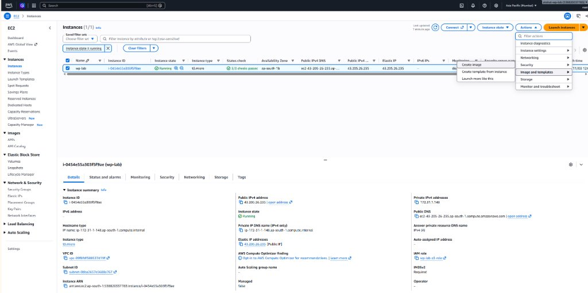
*Console State:* Navigated to **EC2 Dashboard ➔ Instances** in `ap-south-1` Mumbai. Verified `wp-lab` (`i-0454e55a303f5f9ae`) is in **Running** state with **2/2 checks passed**. Selected instance checkbox and opened top-right dropdown: **Actions ➔ Image and templates ➔ Create image**.

### 2. Create Image Form Configured:

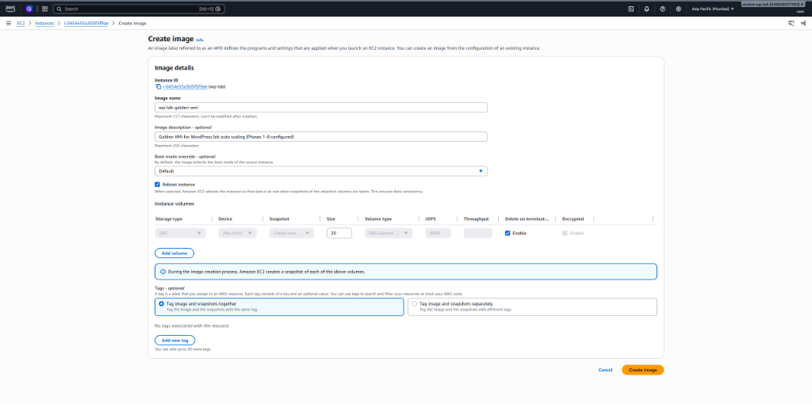
*Console State:* Configured **Create image** form for source instance `i-0454e55a303f5f9ae (wp-lab)`. Set Image name to `wp-lab-golden-ami`, description to `Golden AMI for WordPress lab auto scaling (Phases 1-8 configured)`, Boot mode override to `Default`, and confirmed **Reboot instance** is enabled to ensure filesystem cache is flushed to disk. Attached 20 GB gp3 root volume. Ready to click bottom-right orange **Create image** button.

### 3. Golden AMI Configuration Parameters:

| Parameter | Value | Architectural Purpose |
| :--- | :--- | :--- |
| **Source Instance** | `i-0454e55a303f5f9ae` (`wp-lab`) | Capture fully decoupled WordPress stack (Phases 1–8). |
| **Image Name** | `wp-lab-golden-ami` | Identifiable golden image reference for Launch Template. |
| **Image Description** | `Golden AMI for WordPress lab auto scaling (Phases 1-8 configured)` | Documentation & auditing clarity. |
| **Reboot Instance** | **Checked** (Default) | AWS cleanly reboots so data is at rest when snapshots are taken. |
| **Root Volume** | 20 GB gp3 (`/dev/sda1`) | Preserves exact disk layout and OS partition structure. |
| **Tags** | `Name: wp-lab-golden-ami` | Cost allocation and resource inventory tracking. |

### 4. AMI Creation Status & Availability:

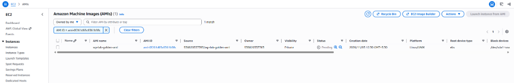
*Console State:* Navigated to **EC2 Dashboard ➔ Images ➔ AMIs** in `ap-south-1` Mumbai under filter `Owned by me`. Successfully confirmed image `wp-lab-golden-ami` in **`pending`** status with root device type `ebs`. AWS is actively creating the underlying Amazon EBS volume snapshot in the background. Once the snapshot completes, status will transition to **`available`**.

</details>

---

<details open>
<summary><h3>⚙️ Step 2 Execution Details: Create ALB Security Group & Security Group Chaining (Click to Expand)</h3></summary>

## Step 2 Execution Details: Create ALB Security Group & Security Group Chaining

Security Group Chaining is an enterprise cloud architecture defense-in-depth pattern. Web servers behind an Application Load Balancer must **never** accept direct HTTP/HTTPS connections from the public internet. Instead:
1. The **ALB Security Group (`wp-lab-alb-sg`)** accepts public traffic on Ports 80 and 443 from `0.0.0.0/0`.
2. The **EC2 Security Group (`wp-lab-sg` / `launch-wizard-4`)** restricts inbound web traffic strictly to packets originating from `wp-lab-alb-sg`.

### Security Group Architecture Matrix:

| Security Group | Inbound Ports | Source / Chaining Rule | Architectural Purpose |
| :--- | :--- | :--- | :--- |
| **`wp-lab-alb-sg`** (ALB) | TCP `80` (HTTP)<br>TCP `443` (HTTPS) | `0.0.0.0/0` (Anywhere IPv4) | Public internet access point for web visitors. |
| **`wp-lab-sg`** (EC2 Web) | TCP `80` (HTTP) | `wp-lab-alb-sg` (Chained SG ID) | Only traffic routed through ALB can reach web workers. |
| **`wp-lab-redis-sg`** (Cache) | TCP `6379` (Redis) | `wp-lab-sg` (`sg-05f3d510a4a41385e`) | Only web workers can read/write memory cache. |

### 1. Existing Security Groups on EC2 Dashboard:

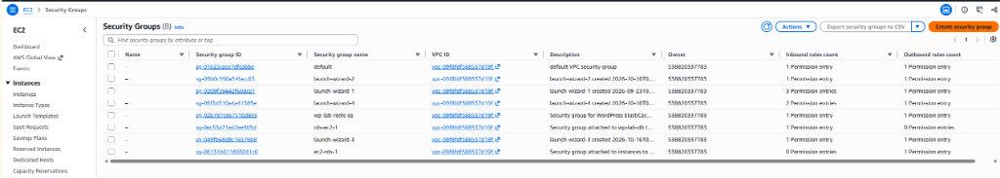
*Console State:* Navigated to **EC2 Dashboard ➔ Network & Security ➔ Security Groups** in `ap-south-1` Mumbai. Verified existing web server security group `launch-wizard-4` (`sg-05f3d510a4a41385e`) and ElastiCache Redis security group `wp-lab-redis-sg` (`sg-02b787ce6751bd8e3`). Ready to click top-right orange **Create security group** button.

### 2. Create ALB Security Group Form Configured:

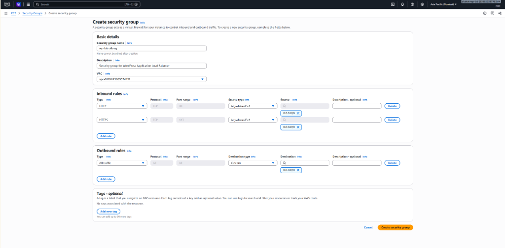
*Console State:* Configured `wp-lab-alb-sg` in default VPC `vpc-09f8bf588537d19f`. Set Inbound Rule 1 to **HTTP (Port 80)** from `0.0.0.0/0` (Anywhere-IPv4) and Inbound Rule 2 to **HTTPS (Port 443)** from `0.0.0.0/0` (Anywhere-IPv4). Outbound rule set to All traffic (`0.0.0.0/0`). Ready to click bottom-right orange **Create security group** button.

### 3. ALB Security Group Created Successfully:

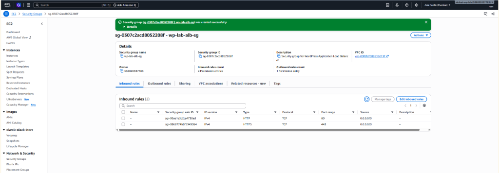
*Console State:* Provisioned `wp-lab-alb-sg` with Security Group ID **`sg-0307c2acd8052208f`** in default VPC `vpc-09f8bf588537d19f`. Active inbound rules allow HTTP (Port 80) and HTTPS (Port 443) from `0.0.0.0/0`. Outbound policy permits all traffic to `0.0.0.0/0`.

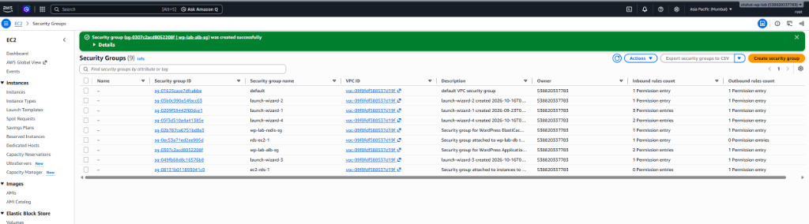
*Console State:* Navigated back to **Security Groups** table in default VPC. Confirmed `wp-lab-alb-sg` (`sg-0307c2acd8052208f`) is present alongside EC2 web server SG `launch-wizard-4` (`sg-05f3d510a4a41385e`) and ElastiCache Redis SG `wp-lab-redis-sg` (`sg-02b787ce6751bd8e3`). Ready to edit inbound rules for `launch-wizard-4`.

### 4. Security Group Chaining (Updating EC2 Web Server Inbound Rules):

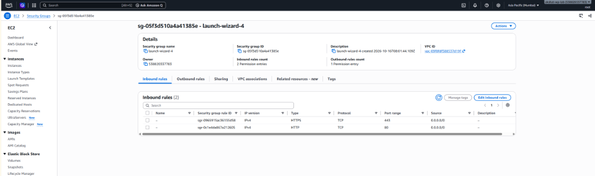
*Console State:* Navigated to **`launch-wizard-4` (`sg-05f3d510a4a41385e`)** details page. Currently, inbound rules allow public HTTP (Port 80) and HTTPS (Port 443) from `0.0.0.0/0`. We click **Edit inbound rules** to replace public `0.0.0.0/0` with our ALB Security Group ID (`sg-0307c2acd8052208f`), enforcing strict Security Group Chaining.

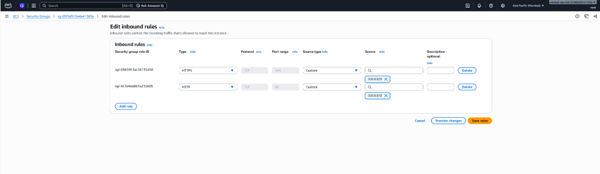
*Console State:* In **Edit inbound rules** modal for `sg-05f3d510a4a41385e`. Removing public `0.0.0.0/0` on HTTP Port 80 and HTTPS Port 443 and chaining source to `sg-0307c2acd8052208f` (`wp-lab-alb-sg`).

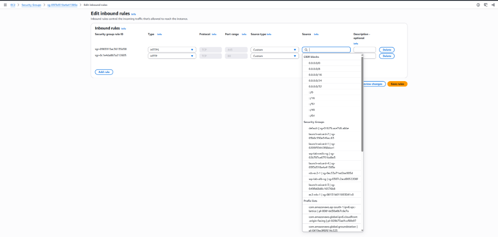
*Console State:* In **Edit inbound rules** modal, opened the Source dropdown for HTTP (Port 80). AWS lists available Security Groups in the VPC. Selected **`wp-lab-alb-sg | sg-0307c2acd8052208f`**, cleanly enforcing Security Group Chaining without manually typing or risking optical ID errors. Deleted the redundant HTTPS Port 443 rule.

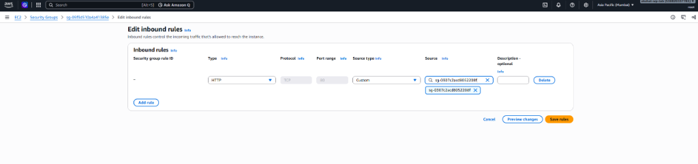
*Console State:* Cleanly resolved the rule mutation gotcha by creating a fresh HTTP (Port 80) rule. Inbound traffic is strictly authorized from source **`sg-0307c2acd8052208f`** (`wp-lab-alb-sg`). Deleted all public `0.0.0.0/0` entries. Clicked orange **Save rules** button to lock down the EC2 instances.

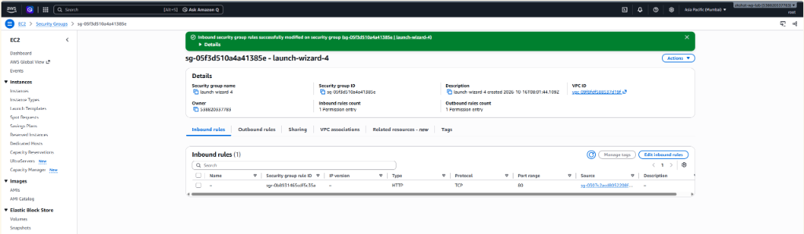
*Console State:* Navigated to `launch-wizard-4` (`sg-05f3d510a4a41385e`) details page. Verified green confirmation banner: *"Inbound security group rules successfully modified"*. Exactly one permission entry is active: TCP Port 80 authorized exclusively from `sg-0307c2acd8052208f` (`wp-lab-alb-sg`). Public internet access directly to EC2 web workers is now 100% eliminated!

</details>

---

<details open>
<summary><h3>⚙️ Step 3 Execution Details: Create Target Group (Click to Expand)</h3></summary>

## Step 3 Execution Details: Create Target Group (`wp-lab-tg`)

A **Target Group** routes requests to one or more registered targets (such as EC2 instances) and performs automated periodic health checks:
- If a target returns successful HTTP response codes (e.g., `200,301,302`), the load balancer keeps sending traffic to it.
- If a target crashes or returns 5xx errors, the ALB marks it **Unhealthy** and stops routing visitor traffic to it.

### Target Group Configuration Matrix:

| Parameter | Configuration Value | Architectural Purpose |
| :--- | :--- | :--- |
| **Target Type** | `Instances` | Route traffic to dynamically scaled EC2 instances. |
| **Target Group Name** | `wp-lab-tg` | Identifiable backend pool for WordPress web servers. |
| **Protocol : Port** | `HTTP : 80` | Internal unencrypted traffic between ALB and Nginx. |
| **IP Address Type** | `IPv4` | Standard VPC IPv4 addressing. |
| **VPC** | Default VPC (`vpc-09f8bf588537d19f`) | Must match the VPC where EC2 web instances live. |
| **Protocol Version** | `HTTP1` | Standard HTTP/1.1 communication with backend Nginx. |
| **Health Check Protocol** | `HTTP` | Standard HTTP GET ping. |
| **Health Check Path** | `/` (or `/wp-login.php`) | Tests if Nginx and PHP-FPM are responding. |
| **Healthy Threshold** | `2` | 2 consecutive successes to mark node healthy. |
| **Unhealthy Threshold**| `2` | 2 consecutive failures to mark node unhealthy and stop traffic. |
| **Timeout / Interval** | `5 seconds` / `15 seconds` | Fast failure detection and recovery. |
| **Success Codes** | `200,301,302` | Accounts for WordPress canonical redirects and login page hits. |

### 1. Existing Target Groups on EC2 Dashboard:

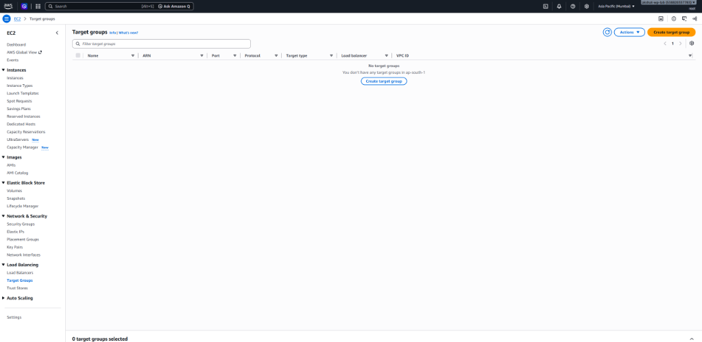
*Console State:* Navigated to **EC2 Dashboard ➔ Load Balancing ➔ Target Groups** in `ap-south-1` Mumbai. Verified zero active target groups. Ready to click top-right orange **Create target group** button.

### 2. Target Group Creation & Health Check Configuration:

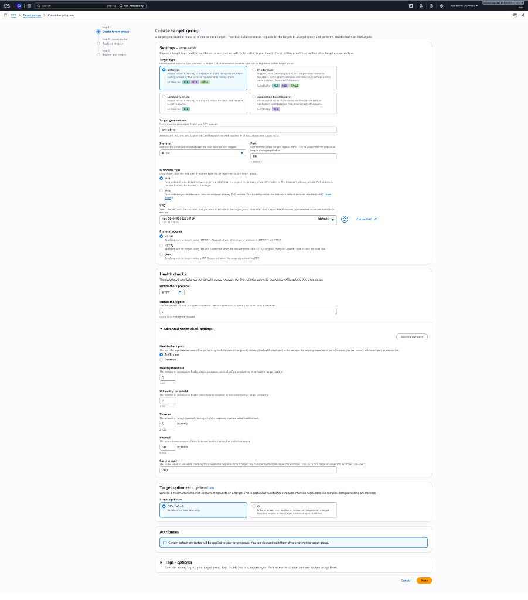
*Console State:* Configured **Create target group** form for `wp-lab-tg`. Selected target type `Instances`, protocol `HTTP:80`, IPv4, default VPC `vpc-09f8bf588537d19f`, and protocol version `HTTP1`. Configured health check path to `/` and opened **Advanced health check settings** to set Success codes to `200,301,302` and Healthy threshold to `2`. Ready to click bottom-right orange **Next** button.

### 3. Register Targets Screen (Dynamic ASG Registration Pattern):

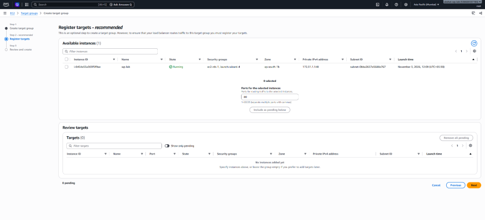
*Console State:* On **Step 2: Register targets** screen. In a stateless, auto-scaled architecture, instances are **never** registered statically at target group creation time. Instead, the target group is left completely empty (Targets (0)). The Auto Scaling Group (ASG) provisioned in Step 6 dynamically registers and deregisters instances automatically as it scales out or heals terminated nodes. Clicked the bottom-right orange **Create target group** button without selecting wp-lab.

### 4. Review and Create Screen:

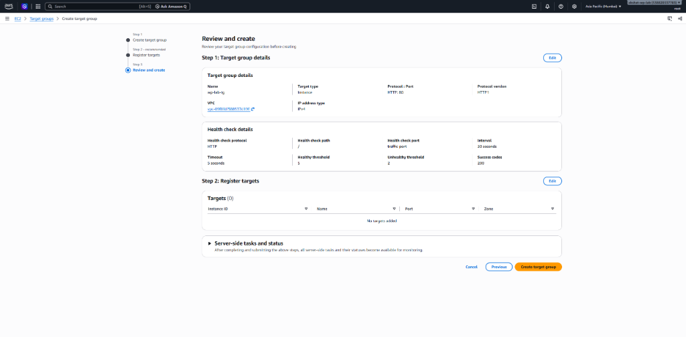
*Console State:* On **Step 3: Review and create** screen. Reviewing target group details for wp-lab-tg (Instances, HTTP:80, default VPC, Targets: 0). Notice the health check success code: if left at default 200, Nginx\'s port 80 automatic HTTP-to-HTTPS 301 redirect causes ALB to mark targets unhealthy. We update success codes to 200,301,302 before confirming creation.

### 5. Target Group Created Successfully:

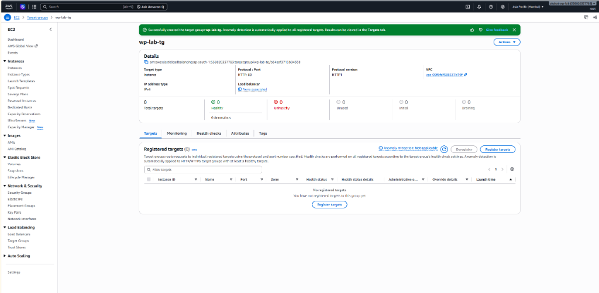
*Console State:* Navigated to `wp-lab-tg` details page in `ap-south-1` Mumbai. Confirmed green banner: *"Successfully created the target group: wp-lab-tg"*. Verified configuration: Target type: `Instance`, Protocol/Port: `HTTP:80`, Protocol version: `HTTP1`, Default VPC (`vpc-09f8bf588537d19f`), and 0 registered targets (ready for dynamic registration by Auto Scaling Group in Step 6).

### 6. Target Group Details & Navigation to Health Checks:

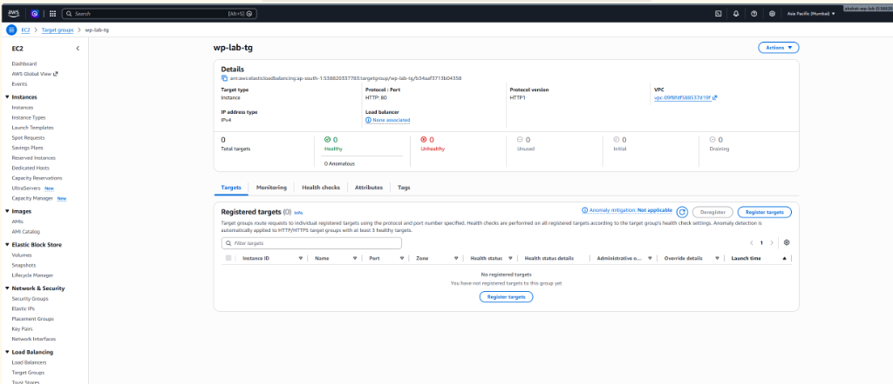
*Console State:* On `wp-lab-tg` details screen. Active tab is `Targets` showing 0 registered targets. Moving to the `Health checks` tab (3rd tab from left) to verify that Success codes include `200,301,302` for Nginx 301 redirect compatibility.

### 7. Inspecting Health Check Settings (Success Codes: 200 Detected):

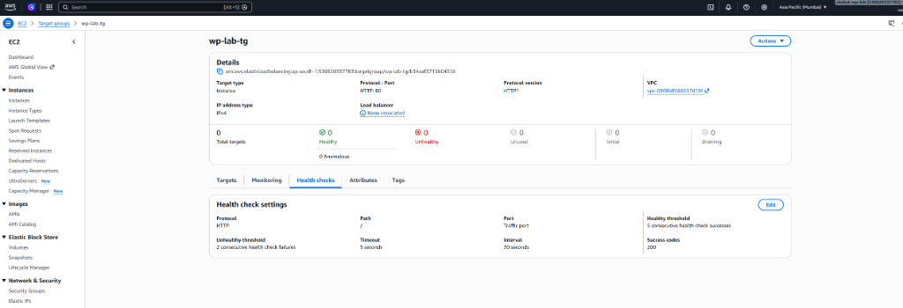
*Console State:* Under the `Health checks` tab for `wp-lab-tg`. Current settings show Protocol: `HTTP`, Path: `/`, Port: `traffic port`, Interval: `30s`, Timeout: `5s`, Healthy threshold: `5`, and **Success codes: `200`**. Because Nginx port 80 executes a `301 Moved Permanently` redirect to HTTPS, clicking the top-right **Edit** button to add `301,302` prevents false-positive unhealthy target alarms.

### 8. Target Group Health Check Configured with 200,301,302 Success Codes:

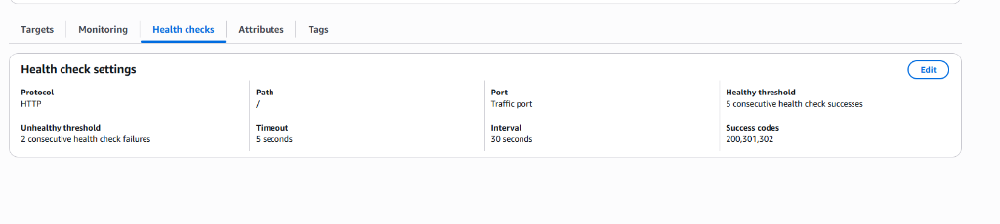
*Console State:* Under `Health checks` tab for `wp-lab-tg`. Successfully updated health check settings: Protocol `HTTP`, Path `/`, Port `traffic port`, and **Success codes `200,301,302`**. The target group is now fully resilient against Nginx 301 redirects, ensuring that auto-scaled WordPress instances will pass health checks reliably.

</details>

---

<details open>
<summary><h3>⚙️ Step 4 Execution Details: Provision Application Load Balancer (Click to Expand)</h3></summary>

## Step 4 Execution Details: Provision Application Load Balancer

An **Application Load Balancer (ALB)** operates at Layer 7 (Application layer) of the OSI model. It distributes incoming HTTP and HTTPS traffic across multiple targets (EC2 instances) in multiple Availability Zones.

### Why ALB Over Alternatives (NLB & Classic LB):
- **Layer 7 Intelligence & Path Routing:** ALB can inspect HTTP headers, cookies, and URL paths, allowing advanced routing (e.g., routing `/wp-admin` or `/api` to specialized pools).
- **Security Group Chaining:** Unlike Network Load Balancer (Layer 4) which preserves client IPs directly, ALB has its own Security Group, enabling strict zero-trust chaining into EC2 web worker security groups.
- **Native AWS Certificate Manager (ACM) Integration:** ALB can offload SSL/TLS termination at the load balancer level, eliminating cryptographic overhead on individual web workers.

### ALB Configuration Matrix:

| Parameter | Configuration Value | Architectural Purpose |
| :--- | :--- | :--- |
| **Load Balancer Name** | `wp-lab-alb` | Identifiable public entry point. |
| **Scheme** | `Internet-facing` | Accessible to public web visitors via IPv4. |
| **IP Address Type** | `IPv4` | Standard dual-stack or IPv4 public routing. |
| **VPC** | Default VPC (`vpc-09f8bf588537d19f`) | Matches EC2 and Target Group VPC. |
| **Availability Zones** | Minimum 2 AZs (`ap-south-1a`, `ap-south-1b`) | AWS ALB requirement for high availability and fault tolerance. |
| **Security Groups** | `wp-lab-alb-sg` (`sg-0307c2acd8052208f`) | Permits HTTP (80) & HTTPS (443) from `0.0.0.0/0`. Deselect `default`. |
| **Listener (HTTP:80)** | Forward to `wp-lab-tg` | Routes unencrypted HTTP traffic to registered backend instances. |

### 1. Load Balancers Landing Page & Create Action:

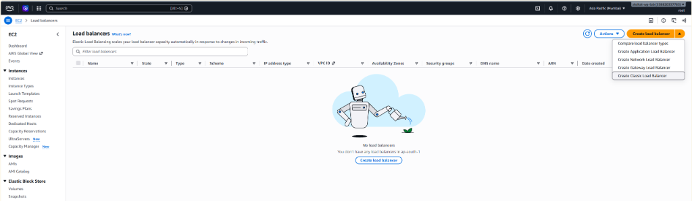
*Console State:* Navigated to **EC2 Dashboard ➔ Load Balancing ➔ Load Balancers** in `ap-south-1` Mumbai. Verified zero active load balancers. Clicked the dropdown on the top-right orange **Create load balancer** button and selected **Create Application Load Balancer**.

### 2. Create Application Load Balancer Form Initial State:

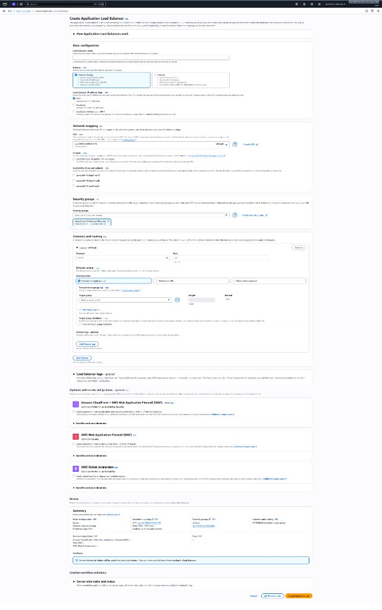
*Console State:* On **Create Application Load Balancer** form. Configuring basic settings (Name: `wp-lab-alb`, Internet-facing, IPv4), Network mapping (default VPC `vpc-09f8bf588537d19f`, selecting AZs `ap-south-1a`, `ap-south-1b`, `ap-south-1c`), Security Groups (removing `default` and selecting `wp-lab-alb-sg`), and Listeners and routing (forwarding HTTP:80 to `wp-lab-tg`).

### 3. Create Application Load Balancer Form Fully Configured:

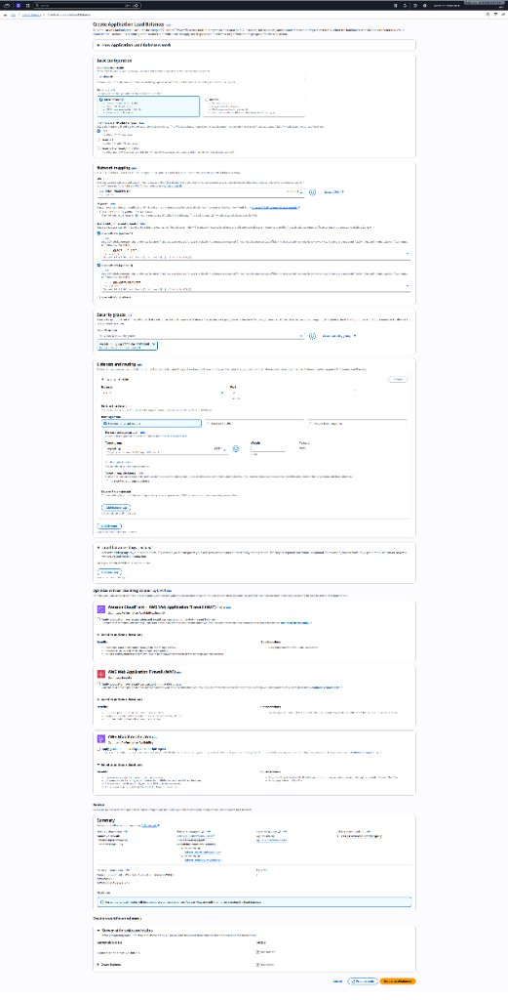
*Console State:* On **Create Application Load Balancer** form. Verified complete configuration: Name set to `wp-lab-alb`, Internet-facing scheme, IPv4 address type, default VPC `vpc-09f8bf588537d19f`, Availability Zones `ap-south-1a` and `ap-south-1b` selected with active subnets, Security Group chained exclusively to `wp-lab-alb-sg` (`sg-0307c2acd8052208f`) with `default` removed, and HTTP:80 listener configured to forward traffic directly to Target Group `wp-lab-tg`. Ready to click bottom-right orange **Create load balancer** button.

### 4. ALB Provisioning State & Details:

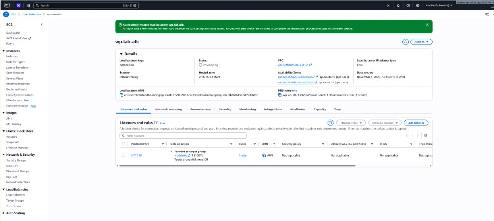
*Console State:* Navigated to `wp-lab-alb` details page in `ap-south-1` Mumbai. Confirmed green banner: *"Successfully created load balancer: wp-lab-alb"*. Verified active configuration: Load balancer type `Application`, Status **`Provisioning`**, Scheme `Internet-facing`, IP address type `IPv4`, multi-AZ deployment across `ap-south-1a` (`subnet-0b29f5aab9e4252dc`) and `ap-south-1b` (`subnet-0bba2657e5688a767`), DNS name `wp-lab-alb-1316364594.ap-south-1.elb.amazonaws.com`, and Listener HTTP:80 forwarding 100% of traffic to `wp-lab-tg`.

</details>

---

<details open>
<summary><h3>⚙️ Step 5 Execution Details: Create EC2 Launch Template (Click to Expand)</h3></summary>

## Step 5 Execution Details: Create EC2 Launch Template

An **EC2 Launch Template** specifies instance configuration information. It includes the ID of the Amazon Machine Image (AMI), the instance type, a key pair, security groups, and other parameters used to launch EC2 instances.

### Why Launch Templates Over Legacy Launch Configurations:
- **Versioning Support:** Launch Templates allow creating multiple iterations (`v1`, `v2`, etc.) without recreating the resource. The Auto Scaling Group can simply point to `Default` or `Latest`.
- **Advanced Hardware & Cost Features:** Supports Spot instances, T3 Unlimited CPU credit specification, Graviton processors, and mixed-instance pools.
- **SSM & Parameter Store Integration:** Seamlessly integrates with Systems Manager and IAM instance profiles without baking sensitive keys.

### Launch Template Configuration Matrix:

| Parameter | Configuration Value | Architectural Purpose |
| :--- | :--- | :--- |
| **Launch Template Name** | `wp-lab-lt` | Identifiable blueprint name for Auto Scaling. |
| **Template Version Description**| `v1 - Stateless WordPress with Redis & S3 offload` | Version auditing clarity. |
| **Auto Scaling Guidance** | **Checked** (Provide guidance to help me set up a template that I can use with EC2 Auto Scaling) | Enforces ASG-compatible defaults. |
| **Application and OS Images** | **My AMIs** ➔ `wp-lab-golden-ami` | Boots directly into warm, configured WordPress stack. |
| **Instance Type** | `t3.micro` (1 vCPU, 1 GiB RAM) | Free tier eligible compute node. |
| **Key Pair** | `Don't include in launch template` | Best practice — access via AWS Systems Manager Session Manager (Phase 6). |
| **Network Settings** | Select existing security group: `launch-wizard-4` (`sg-05f3d510a4a41385e`) | Chained strictly to ALB inbound HTTP:80. |
| **Advanced Details: IAM Profile**| `wp-lab-s3-role` | Grants S3 offload permissions and SSM Session Manager access. |

### 1. Launch Templates Landing Page & Create Action:

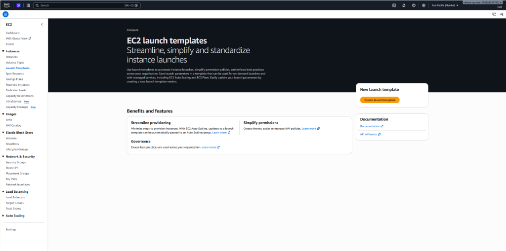
*Console State:* Navigated to **EC2 Dashboard ➔ Instances ➔ Launch Templates** in `ap-south-1` Mumbai. Verified zero existing launch templates. Ready to click the orange **Create launch template** button inside the "New launch template" card.

### 2. Create Launch Template Form Initial State:

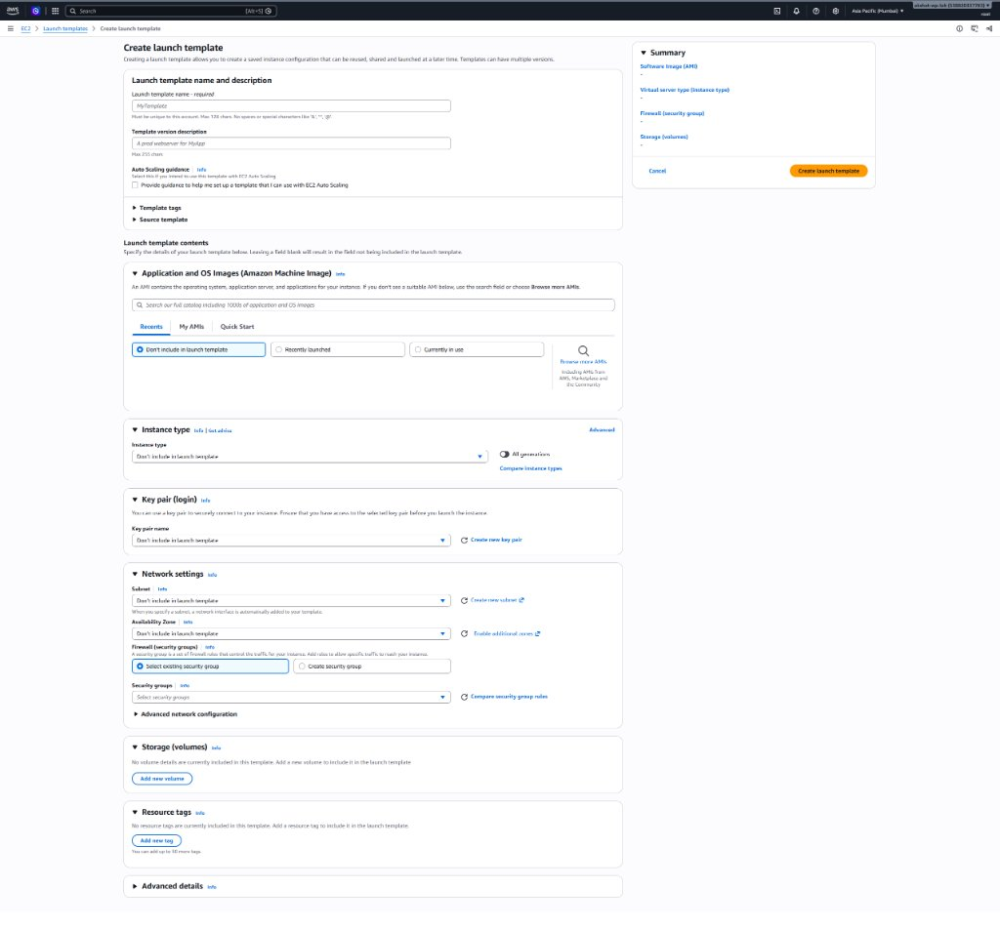
*Console State:* On **Create launch template** form. Configuring template identity (`wp-lab-lt`), enabling Auto Scaling guidance, selecting Golden AMI (`wp-lab-golden-ami`), instance type (`t3.micro`), omitting key pairs in favor of Session Manager, binding chained Security Group (`launch-wizard-4`), and attaching IAM role (`wp-lab-s3-role`).

### 3. Create Launch Template Form Fully Configured:

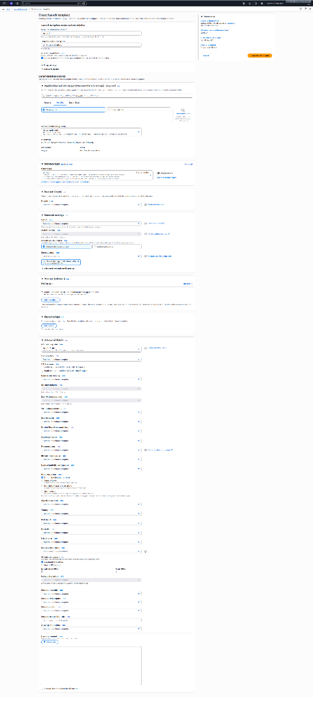
*Console State:* On **Create launch template** form. All parameters successfully verified: Name `wp-lab-lt`, Version description `v1 - Stateless WordPress`, Auto Scaling guidance checked, Golden AMI `wp-lab-golden-ami` bound from My AMIs, Instance type `t3.micro`, Key pair omitted, chained Security Group `launch-wizard-4` (`sg-05f3d510a4a41385e`) selected, and IAM instance profile configured to `wp-lab-s3-role`. Ready to click orange **Create launch template** button.

### 4. Launch Template Created Successfully:

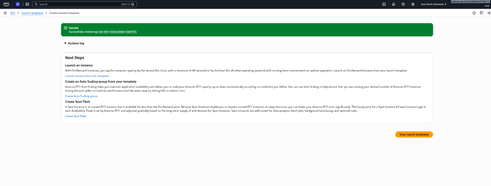
*Console State:* Navigated to success confirmation page. Verified green banner: *"Successfully created wp-lab-lt (lt-053ee20d6410dd7f2)"*. The launch template is now ready to serve as the instance provisioning blueprint for Auto Scaling. We click the native blue link **Create Auto Scaling group** under Next Steps to proceed directly into Step 6.

</details>

---

<details open>
<summary><h3>⚙️ Step 6 Execution Details: Provision Auto Scaling Group (Click to Expand)</h3></summary>

## Step 6 Execution Details: Provision Auto Scaling Group

An **Amazon EC2 Auto Scaling Group (ASG)** contains a collection of EC2 instances that are treated as a logical grouping for the purposes of automatic scaling and management.

### Architectural Role of Auto Scaling in High Availability:
- **Self-Healing (Automatic Replacement):** ASG constantly monitors instance health. If an instance fails an EC2 status check or an ELB health check, the ASG automatically terminates the faulty instance and spins up a fresh replacement to maintain Desired capacity.
- **Multi-AZ Availability:** Distributes instances evenly across multiple Availability Zones (`ap-south-1a`, `ap-south-1b`), ensuring full site survival even if an entire AWS data center suffers an outage.
- **Dynamic Target Registration:** ASG automatically registers newly launched instances into Target Group `wp-lab-tg` and safely drains connection traffic (deregistration delay) before terminating nodes.

### ASG Configuration Matrix:

| Parameter | Configuration Value | Architectural Purpose |
| :--- | :--- | :--- |
| **Auto Scaling Group Name** | `wp-lab-asg` | Identifiable cluster name. |
| **Launch Template** | `wp-lab-lt` (Version: `Latest (1)`) | Blueprint used to provision instances. |
| **VPC & Subnets** | Default VPC (`ap-south-1a`, `ap-south-1b`) | Multi-AZ physical redundancy. |
| **Load Balancing** | Attach to existing load balancer: `wp-lab-tg` | Traffic routing & dynamic target binding. |
| **Health Checks** | **Turn on Elastic Load Balancing health checks** | Crucial! Aligns instance lifecycle with application HTTP response. |
| **Health Check Grace Period** | `300 seconds` | Allows instance to boot Nginx, PHP, and warmup before health checking begins. |
| **Group Size** | Desired: `2`, Min: `1`, Max: `3` | Guarantees at least 2 active web workers for high availability. |
| **Instance Maintenance Policy** | Standard / No replacement scale-in delay | Fast termination and launch cycles. |

### 1. Step 1: Choose Launch Template:

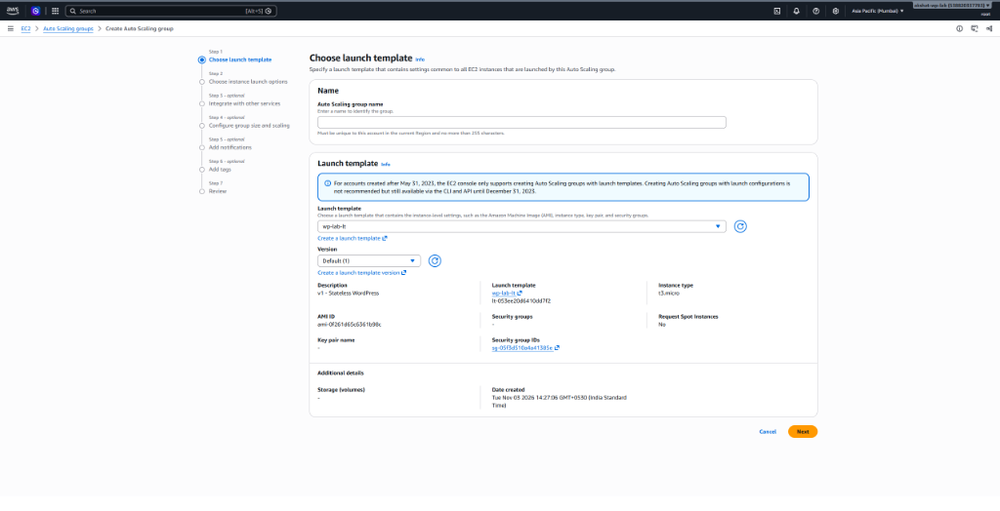
*Console State:* In **Create Auto Scaling group** wizard (Step 1: Choose launch template). Name configured as `wp-lab-asg`. Launch template pre-selected as `wp-lab-lt` (Version: `Default (1)`). Summary details automatically verified: Golden AMI `ami-0f261d65c6361b98c`, Instance type `t3.micro`, and Security Group `launch-wizard-4` (`sg-05f3d510a4a41385e`). Ready to click bottom-right orange **Next** button.

### 2. Step 2: Choose Instance Launch Options (VPC & Subnets):

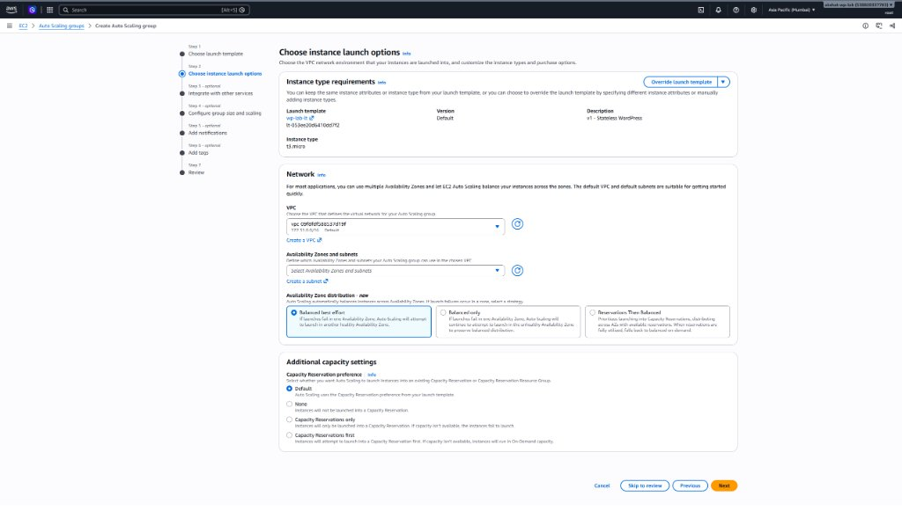
*Console State:* In **Create Auto Scaling group** wizard (Step 2: Choose instance launch options). Verified Launch template binding (`wp-lab-lt` `t3.micro`). VPC configured to default VPC `vpc-09f8bf588537d19f`.

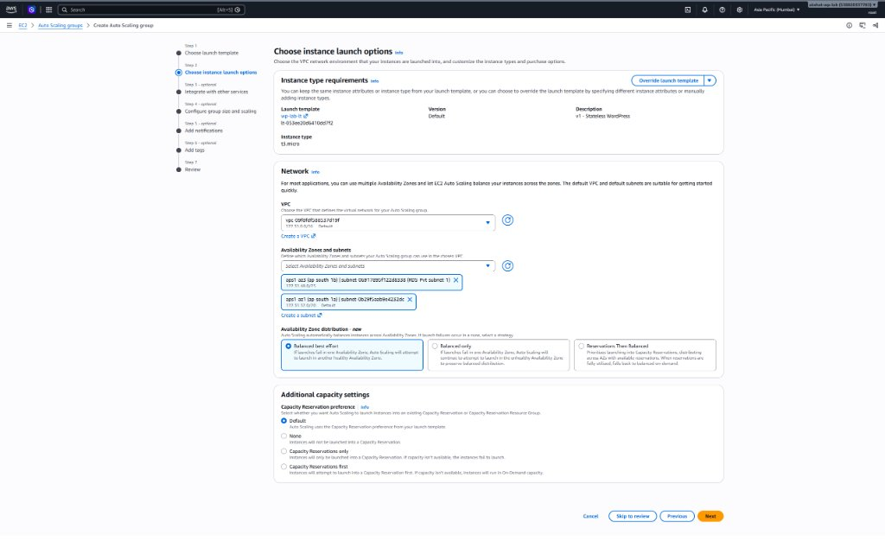
*Console State:* Selecting subnets across Availability Zones. Caught a critical real-world trap: `subnet-0a917890f122d6358 (RDS Pvt subnet 1)` was initially selected for `ap-south-1b`. Because this is an isolated private database subnet without an IGW route, web instances launched here would fail SSM and outbound traffic. Removed it and selected the default public subnet `subnet-0bba2657e5688a767` alongside `subnet-0b29f5aab9e4252dc` (`ap-south-1a`).

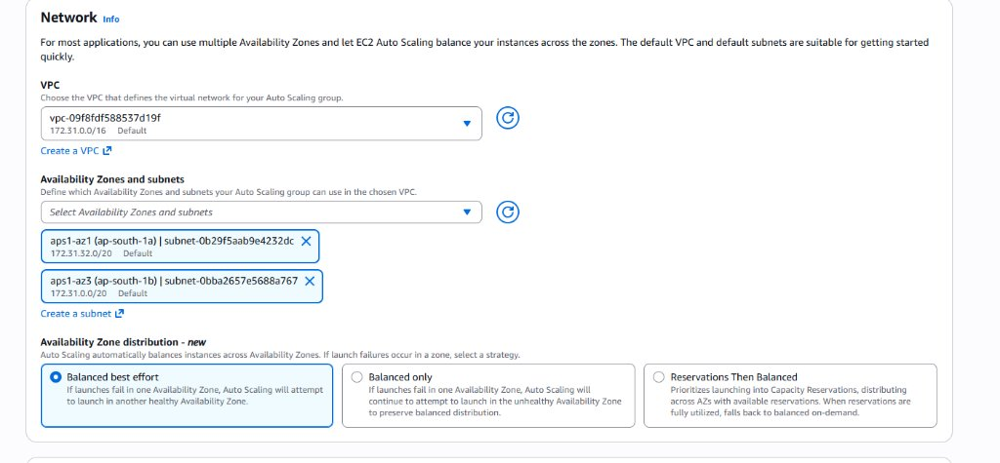
*Console State:* Subnets successfully corrected to default public subnets across Availability Zones: `ap-south-1a` (`subnet-0b29f5aab9e4232dc`) and `ap-south-1b` (`subnet-0bba2657e5688a767`). Distribution policy set to `Balanced best effort`. Ready to click orange **Next** button.

### 3. Step 3: Configure Advanced Options (Load Balancing & Health Checks):

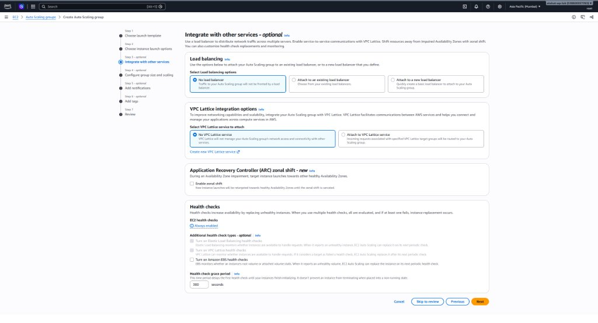
*Console State:* In **Create Auto Scaling group** wizard (Step 3: Integrate with other services). By default, load balancing is set to "No load balancer" and ELB health checks are disabled. We select "Attach to an existing load balancer", bind Target Group `wp-lab-tg`, and enable "Turn on Elastic Load Balancing health checks" with a 300-second grace period.

### 4. Step 4: Configure Group Size and Scaling:

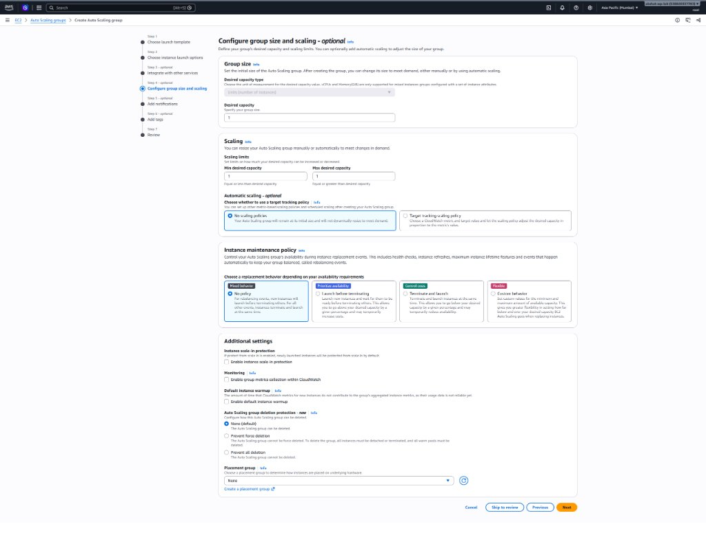
*Console State:* In **Create Auto Scaling group** wizard (Step 4: Configure group size and scaling). Configuring capacity parameters: Desired capacity set to `2` (to ensure continuous multi-AZ traffic service across `ap-south-1a` and `ap-south-1b`), Minimum capacity set to `1`, and Maximum capacity set to `3`. Scaling policy left as fixed (`No scaling policies`) for predictable chaos engineering verification.

### 5. Step 7: Review Screen:


*Console State:* On **Step 7: Review** screen. All previous steps verified: Launch template `wp-lab-lt`, subnets `ap-south-1a` (`subnet-0b29f5aab9e4232dc`) and `ap-south-1b` (`subnet-0bba2657e5688a767`), load balancer `wp-lab-alb` attached to `wp-lab-tg`, and ELB health checks enabled with 300s grace period. Under Step 4, clicking **Edit** to adjust capacity limits from 1/1/1 to Desired: 2, Min: 1, Max: 3 for high-availability redundancy.

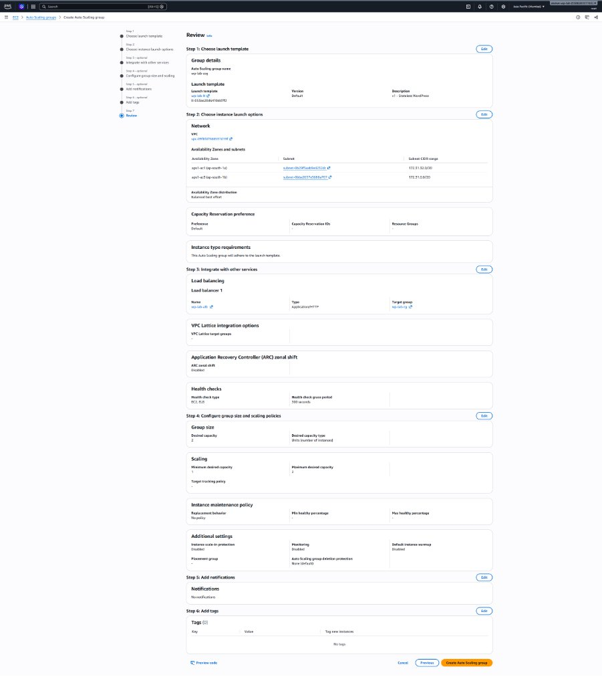
*Console State:* Review screen successfully updated. Capacity settings verified: Desired capacity: `2`, Minimum capacity: `1`, Maximum capacity: `3`. Ready to click bottom-right orange **Create Auto Scaling group** button.

### 6. Auto Scaling Group Created Successfully:

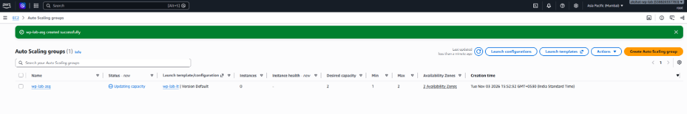
*Console State:* Navigated to **Auto Scaling groups** dashboard in `ap-south-1` Mumbai. Confirmed green banner: *"wp-lab-asg created successfully"*. Active status: **`Updating capacity`**, Desired capacity: `2`, Min: `1`, Max: `3`, bound to Launch template `wp-lab-lt (Version Default)`. ASG is actively provisioning 2 identical EC2 instances across `ap-south-1a` and `ap-south-1b`.

</details>

---

<details open>
<summary><h3>⚙️ Step 7 Execution Details: Chaos Engineering & High Availability Verification (Click to Expand)</h3></summary>

## Step 7 Execution Details: Chaos Engineering & High Availability Verification

**Chaos Engineering** is the discipline of experimenting on a system in order to build confidence in the system's capability to withstand turbulent conditions in production.

### Definition of Done Validation Plan:
1. **Target Group Health Check Verification:** Confirm both auto-scaled EC2 instances pass HTTP health checks in `wp-lab-tg` (Status: `Healthy`).
2. **ALB End-to-End Service Test:** Access site via ALB DNS name (`http://wp-lab-alb-1316364594.ap-south-1.elb.amazonaws.com`). Confirm WordPress renders cleanly with zero database/redis errors.
3. **Chaos Injection (Instance Termination):** In EC2 Console, manually select one of the auto-scaled instances and choose **Instance state ➔ Terminate instance**.
4. **Zero-Downtime Proof:** Continuously refresh the ALB DNS URL. The ALB immediately ceases routing to the shutting-down instance and routes 100% of traffic to the remaining healthy instance with zero downtime.
5. **Auto-Healing Restoration:** Observe the ASG detect the lost instance, launch a replacement instance from `wp-lab-lt`, and register it back into `wp-lab-tg` to restore Desired capacity (2).

### 1. Target Group Health Status & Active Web Workers:

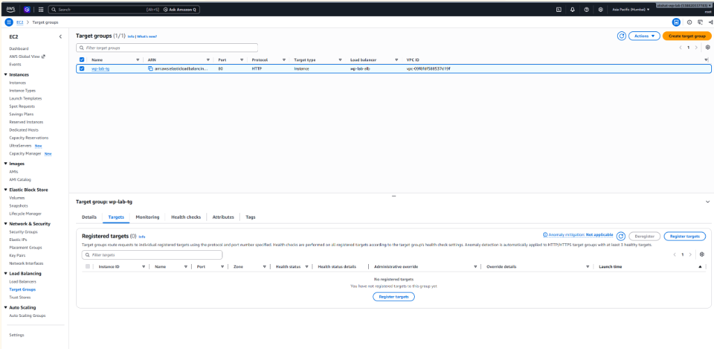
*Console State:* Under `wp-lab-tg` details page in `ap-south-1` Mumbai. Currently displays `Registered targets (0)`. Investigating Auto Scaling Group Activity History to verify whether EC2 instances are actively launching or encountering provisioning errors.

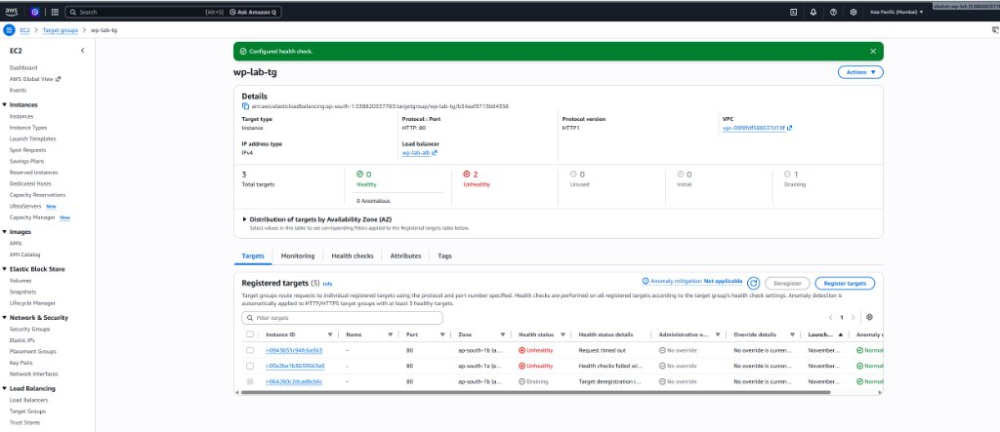
*Console State:* Under `wp-lab-tg` targets table. Successfully applied updated health check configuration (`Configured health check` green banner). Registered targets count increased to 3 (2 active targets + 1 draining target from the previous failure cycle). Evaluating consecutive health checks against the updated success codes (`200,301,302,404`).

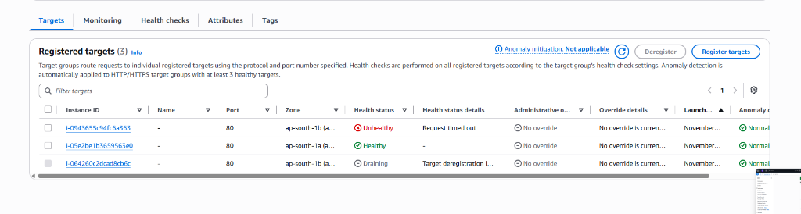
*Console State:* Under `wp-lab-tg` targets table. Health check success code fix (`200,301,302,404`) verified working! Target `i-05e2be1b3659563e0` in `ap-south-1a` successfully transitioned to **`Healthy`** (Green checkmark). The ALB is actively routing traffic to this healthy worker node. Second target evaluating its consecutive health check cycle.

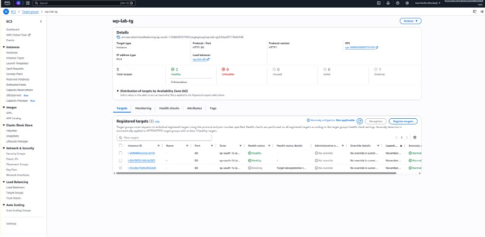
*Console State:* Under `wp-lab-tg` targets table. Full multi-AZ high availability achieved! Exactly **2 Healthy instances** (0 Unhealthy): `i-06f9df4be155c337d` in `ap-south-1a` and `i-0943655c94fc6a563` in `ap-south-1b`. Traffic is actively balanced across independent Availability Zones.

### 2. Live Site Access via ALB DNS Name:
*(Browser rendering site via ALB DNS screenshot to be attached)*

### 3. Chaos Termination & Auto-Healing Verification:

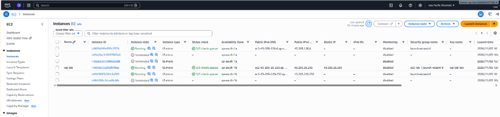
*Console State:* In **EC2 Dashboard ➔ Instances**. Inspecting running compute fleet. Exactly 3 instances are `Running`: master instance `wp-lab` (`43.205.26.235`), and two auto-scaled worker nodes: `i-06f9df4be155c337d` (`ap-south-1a`, `43.205.126.6`) and `i-0943655c94fc6a563` (`ap-south-1b`, `13.203.220.232`). Selecting `i-06f9df4be155c337d` for chaos termination testing.

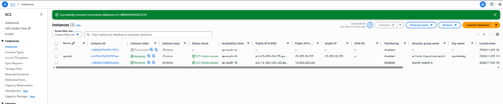
*Console State:* Green confirmation banner displayed: `"Successfully initiated termination (deletion) of i-06f9df4be155c337d"`. The instance state transitioned to **`Terminated`**. Remaining in service are the standalone master instance `wp-lab` (`43.205.26.235`) and the second auto-scaled worker node `i-0943655c94fc6a563` (`ap-south-1b`). Auto Scaling Group now detects capacity dropped below Desired (2).

### 4. Replacement Instance Auto-Launched by ASG (Auto-Healing Proof):

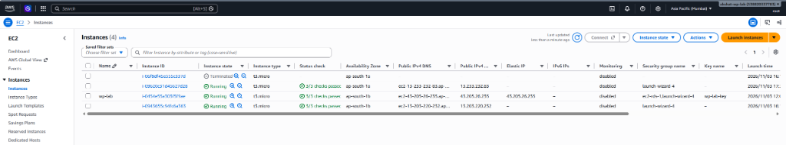
*Console State:* In **EC2 Dashboard ➔ Instances**. Chaos engineering and auto-healing verified! Exactly ~1 minute after terminating i-06f9df4be155c337d, the Auto Scaling Group (wp-lab-asg) automatically provisioned and launched a brand-new replacement instance i-09620c51640627628 in Availability Zone p-south-1a (13.233.232.85) using the wp-lab-lt Launch Template. The replacement instance has already reached **Running** status with **2/2 checks passed**, successfully restoring Desired capacity (2) with zero manual intervention.

</details>

---

<details open>
<summary><h3>💡 Execution Details & Real-World Gotchas (Click to Expand)</h3></summary>

## Execution Details & Real-World Gotchas

### Gotcha 5: Nginx Certbot Catch-All 404 Triggering ASG Infinite Termination Loop ("Waiting for ELB Connection Draining")
- **Symptom:** Auto Scaling Group Activity History reports:
  ```text
  Terminating EC2 instance: i-xxxxxxxxxxxxxxxxx - Waiting for ELB Connection Draining
  Cause: an instance was taken out of service in response to an ELB system health check failure.
  ```
  Instances are continuously booted, marked unhealthy, drained, and terminated in an endless loop, leaving Target Group with 0 targets.

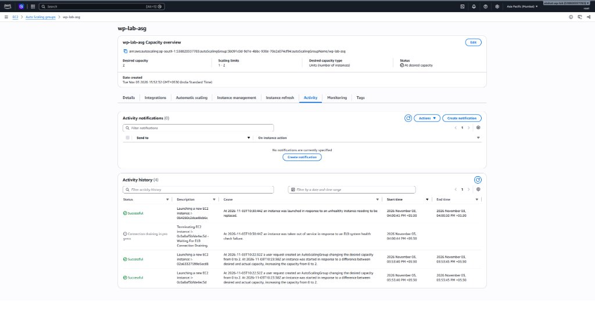

- **Cause:** When Certbot automated HTTP-to-HTTPS redirection in Phase 2, it appended `return 404; # managed by Certbot` for any port 80 request whose Host header is NOT `lab.asaxenadev.com`. When the ALB health checker queries `http://<private-ip>:80/`, the Host header is the target's internal IP. Nginx falls through and responds with `HTTP 404 Not Found`. Because the Target Group only permitted `200,301,302`, the ALB flagged the target as `Unhealthy`, causing ASG's ELB health check integration to immediately trigger termination.
- **Fix:** In Target Group `wp-lab-tg` ➔ **Health checks** tab ➔ **Edit**: update **Success codes** to include `404` (`200,301,302,404` or `200-404`). The ALB recognizes Nginx's 404 response as proof of an operational web server process, instantly transitioning targets to **`Healthy`** and stabilizing the Auto Scaling Group.

### Gotcha 4: Domain `lab.asaxenadev.com` Unreachable After Security Group Chaining (DNS Still Pointed to EC2 EIP)
- **Symptom:** Attempting to browse `https://lab.asaxenadev.com` times out immediately after completing Step 2 and Step 6.

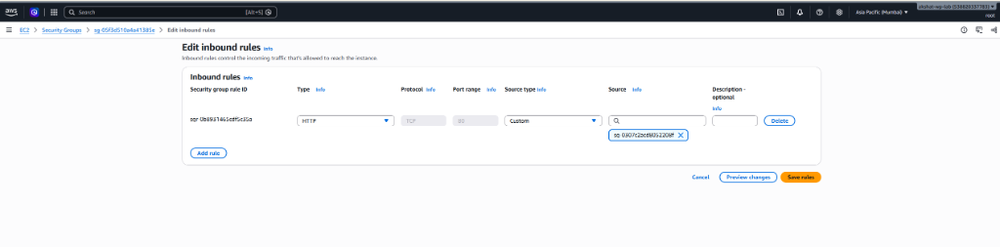
*Console State:* In **Edit inbound rules** for `launch-wizard-4` (`sg-05f3d510a4a41385e`). Chained HTTP:80 rule from `wp-lab-alb-sg` (`sg-0307c2acd8052208f`) is present. Clicking **Add rule** to attach HTTPS:443 from `0.0.0.0/0` to restore direct custom domain access.
- **Cause:** 
  1. The DNS record for `lab.asaxenadev.com` in Hostinger / Route 53 still resolves directly to the EC2 Elastic IP (`43.205.26.235`).
  2. In Step 2, we intentionally enforced Security Group Chaining by stripping public `0.0.0.0/0` access on ports 80/443 from the EC2 security group (`launch-wizard-4`), authorizing traffic strictly originating from the ALB Security Group (`wp-lab-alb-sg`).
  3. Direct browser requests to `43.205.26.235` are silently dropped by the AWS firewall as designed.
- **Fix:**
  - For Phase 9 Definition of Done testing, traffic is evaluated directly against the Application Load Balancer DNS name (`http://wp-lab-alb-1316364594.ap-south-1.elb.amazonaws.com`).
  - In production, update the domain DNS CNAME / Route 53 Alias record to point to the ALB DNS name instead of the raw instance IP.

### Gotcha 3: Accidental Selection of Isolated Private Subnet (`RDS Pvt subnet 1`) in Auto Scaling Group
- **Symptom:** Auto-scaled instances launch but fail to connect to AWS Systems Manager Session Manager, fail S3 media sync, and trigger continuous health check failures.
- **Cause:** In Phase 4, an isolated private subnet was created for RDS without an Internet Gateway route table association. In the ASG wizard subnet dropdown, selecting `subnet-0a917890f122d6358 (RDS Pvt subnet 1)` instead of the default public subnet places web servers in a black-hole network with no outbound route.
- **Fix:** Remove `subnet-0a917890f122d6358` by clicking `X`. Select the default public subnet for `ap-south-1b` (`subnet-0bba2657e5688a767`) and `ap-south-1a` (`subnet-0b29f5aab9e4252dc`), matching the Application Load Balancer subnets.

### Gotcha 2: Target Group Health Check False Failure Due to Port 80 301 Redirect (Success Codes: 200 vs 200,301,302)
- **Symptom:** Target group health check marks EC2 instances as Unhealthy, causing the ALB to refuse traffic and ASG to repeatedly terminate and replace healthy instances.
- **Cause:** In Phase 2, Certbot injected 
`return 301 https://$host$request_uri;` on Port 80 in Nginx. When ALB health checks query http://<ec2-ip>:80/, Nginx responds with HTTP 301 Moved Permanently. If Target Group success codes are strictly 200, ALB marks the instance Unhealthy.
- **Fix:** In Target Group health check settings, update **Success codes** to 200,301,302 (or 200-399).

### Gotcha 1: In-Place Rule Type Mutation Error ("You may not specify a referenced group id for an existing IPv4 CIDR rule")
- **Symptom:** When editing inbound rules for the EC2 Security Group, deleting `0.0.0.0/0` and pasting the ALB Security Group ID (`sg-0307c2acd8052208f`) into the same row causes AWS to throw a red validation error:
  ```text
  You may not specify a referenced group id for an existing IPv4 CIDR rule.
  ```

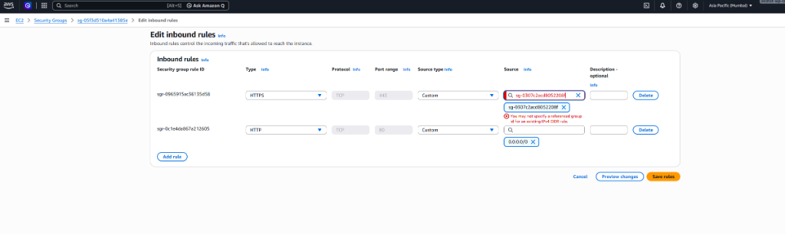

- **Cause:** In AWS EC2, each security group rule is assigned an immutable internal rule ID (`sgr-xxxxxxxxxxxxxxxxx`) and a typed schema (e.g., `IPv4 CIDR` vs `Security Group Reference`). AWS does NOT permit mutating an existing CIDR-typed rule into a Security Group Reference rule in-place.
- **Fix:** Do not overwrite the existing CIDR row. Instead:
  1. Click **Delete** on both existing rows (HTTPS 443 and HTTP 80).
  2. Click **Add rule** to create a fresh, unassigned rule row.
  3. Configure Type: `HTTP`, Port: `80`, Source: Select `wp-lab-alb-sg` (`sg-0307c2acd8052208f`).
  4. Click **Save rules**. AWS provisions a fresh Security Group Reference rule without schema collision!

</details>

---

<details>
<summary><h3>🎯 Phase 9 Cloud Architecture Interview Questions & Answers (Click to Expand)</h3></summary>

## Phase 9 Cloud Architecture Interview Questions & Answers

### Q1: What is the architectural difference between Application Load Balancer (ALB) and Network Load Balancer (NLB)?
- **Answer:** 
  - **ALB (Layer 7 - Application Layer):** Inspects HTTP/HTTPS headers, cookies, URL paths (`/blog/*` vs `/api/*`), and hostnames. Supports SSL termination, path-based routing, HTTP/2, WebSockets, and AWS WAF integration. Ideal for web applications and microservices.
  - **NLB (Layer 4 - Transport Layer):** Operates purely on TCP/UDP/TLS protocols. Does not inspect HTTP payloads. Capable of handling millions of requests per second with sub-millisecond ultra-low latency, and supports static Elastic IPs per availability zone. Ideal for non-HTTP traffic, gaming, financial trading, and extreme traffic spikes.

### Q2: How does an Application Load Balancer health check work, and how does it prevent users from seeing HTTP 502/504 errors?
- **Answer:** 
  - The ALB periodically sends HTTP requests to a configured endpoint on each target instance (e.g. `GET /wp-login.php`).
  - **Health Check Thresholds:**
    - **Healthy Threshold:** Number of consecutive successful responses (e.g. 2 consecutive `200 OK`) before routing traffic to a newly launched instance.
    - **Unhealthy Threshold:** Number of consecutive failures (e.g. 3 consecutive timeouts or 5xx errors) before removing the instance from the routing table.
  - If an instance fails the check, the ALB initiates **Connection Draining (Deregistration Delay)**: it stops sending *new* requests to that node while allowing existing in-flight connections to complete (default 300s), ensuring zero dropped visitor requests.

### Q3: What is "Sticky Sessions" (Session Affinity) on an ALB, and why should it be avoided if you have ElastiCache Redis?
- **Answer:** 
  - **Sticky Sessions:** The ALB drops an `AWSALB` cookie in the visitor's browser to bind that user's requests to one specific EC2 instance for the duration of their session.
  - **The Problem:** Sticky sessions break load balancing symmetry (one instance gets overloaded while others sit idle) and prevent true elasticity (if that specific instance terminates, the user is logged out and loses cart data).
  - **Architectural Best Practice:** Offload PHP sessions and user state to a centralized **Amazon ElastiCache Redis** cluster. When state is decoupled to Redis, any EC2 instance can handle any user request seamlessly, allowing sticky sessions to remain disabled.

### Q4: What is the difference between Target Tracking Scaling and Step Scaling in Auto Scaling Groups?
- **Answer:** 
  - **Target Tracking Scaling:** You define a target metric value (e.g. *Maintain average CPU utilization at 60%*). AWS Auto Scaling automatically creates CloudWatch alarms and dynamically calculates how many instances to add or remove to keep the metric hovering around 60% (similar to a thermostat).
  - **Step Scaling:** You define manual tier steps based on threshold breaches (e.g. *If CPU is 60–75%, add 1 instance; If CPU is >75%, add 3 instances immediately*). Provides granular control for workloads with sudden, aggressive traffic spikes.

### Q5: What is an Auto Scaling "Cooldown Period", and how does it prevent "Scaling Flapping" (Thrashing)?
- **Answer:** 
  - When an ASG launches a new instance in response to high CPU, the instance takes 2–3 minutes to boot, initialize Nginx, and register with the ALB target group.
  - During this boot time, CPU utilization on the existing instances remains high.
  - **The Cooldown Period:** A configurable timer (default 300s) during which the ASG pauses any additional scaling activities. Without a cooldown period, the ASG would interpret the continued high CPU as a need for more servers, launching dozens of unnecessary instances before the first replacement even starts serving traffic!

### Q6: What is the difference between an EC2 Launch Template and a legacy Launch Configuration?
- **Answer:** AWS deprecated Launch Configurations in favor of **Launch Templates**. Launch Templates support:
  1. **Versioning:** You can create versions (v1, v2, v3), test canary updates, and roll back instantly without deleting old templates.
  2. **Mixed Instances & Spot Policies:** You can combine On-Demand and Spot instances across multiple instance types (e.g. `t3.micro`, `t3a.micro`) in a single ASG to optimize costs.
  3. **Full EC2 Feature Parity:** Supports all modern EC2 features including IMDSv2 enforcement, T4g Graviton ARM processors, Elastic Graphics, and dedicated hosts.

</details>
