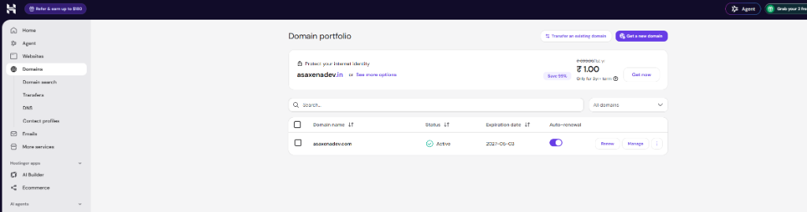
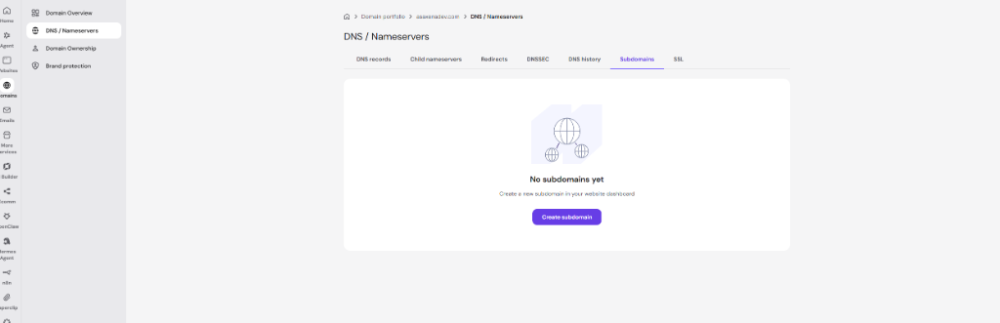
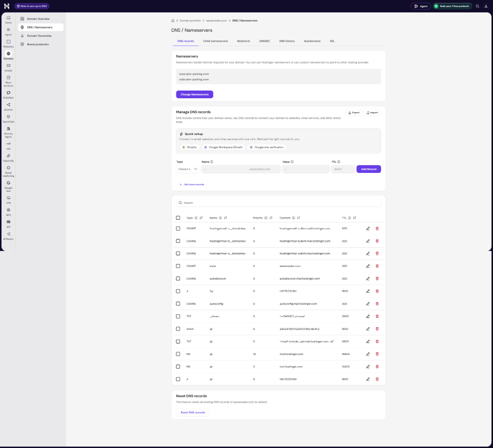

# Subdomain & DNS Complete Architecture Guide
> **Hands-on Reference for Phase 2: Domain, DNS, Elastic IP & HTTPS on AWS**

---

## Table of Contents
1. [What is a Subdomain? (Anatomy & Hierarchy)](#1-what-is-a-subdomain-anatomy--hierarchy)
2. [Why You Don't Need to Buy a New Domain](#2-why-you-dont-need-to-buy-a-new-domain)
3. [How DNS Works Behind the Scenes](#3-how-dns-works-behind-the-scenes)
4. [DNS Record Types Explained (A vs CNAME vs ALIAS)](#4-dns-record-types-explained)
5. [What is TTL (Time-To-Live) and Why Does It Matter?](#5-what-is-ttl-time-to-live-and-why-does-it-matter)
6. [Step-by-Step: Creating `lab.asaxenadev.com` on Hostinger hPanel](#6-step-by-step-creating-labasaxenadevcom-on-hostinger-hpanel)
7. [How to Verify DNS Propagation from Your Laptop](#7-how-to-verify-dns-propagation-from-your-laptop)
8. [How AWS EC2 & WordPress Connect to the Subdomain in Phase 2](#8-how-aws-ec2--wordpress-connect-to-the-subdomain-in-phase-2)
9. [Interview Questions & Answers (DNS & Cloud Routing)](#9-interview-questions--answers-dns--cloud-routing)

---

## 1. What is a Subdomain? (Anatomy & Hierarchy)

A **subdomain** is a prefix added to your main domain name to create a distinct, independent address on the internet. It acts as a separate department under the same parent umbrella.

### The Anatomy of `lab.asaxenadev.com`:

```text
       lab     .     asaxenadev     .     com
    [Subdomain]    [Second-Level]       [TLD]
    (Child Site)   (Root Domain)    (Top-Level Domain)
```

- **Top-Level Domain (TLD):** `.com` (managed globally by ICANN / Verisign).
- **Second-Level Domain (SLD / Root Domain):** `asaxenadev` — this is what you purchased from Hostinger.
- **Subdomain:** `lab` — this is an arbitrary prefix you create for free to host your AWS test lab!

### Real-World Industry Examples:
| Parent Domain | Subdomain | Use Case |
|---|---|---|
| `google.com` | `mail.google.com` | Gmail web app |
| `github.com` | `api.github.com` | GitHub REST/GraphQL API |
| `amazon.com` | `aws.amazon.com` | AWS Cloud Console |
| **`asaxenadev.com`** | **`lab.asaxenadev.com`** | **Our AWS WordPress Lab** |

---

## 2. Why You Don't Need to Buy a New Domain

When you buy a domain like `asaxenadev.com`, **you own the entire namespace underneath it**.

- You can create **unlimited subdomains** (`lab`, `dev`, `staging`, `api`, `app`, `blog`) at **zero additional cost**.
- Creating a subdomain is simply adding an entry into your domain's **DNS Zone file** telling browsers where to go when someone visits that specific prefix.
- The parent website (`asaxenadev.com`) and the subdomain (`lab.asaxenadev.com`) can point to **completely different servers** in completely different parts of the world!
  - `asaxenadev.com` can stay hosted on Hostinger.
  - `lab.asaxenadev.com` will point directly to your AWS EC2 instance in Mumbai (`ap-south-1`).

---

## 3. How DNS Works Behind the Scenes

DNS (**Domain Name System**) is the phonebook of the internet. Computers don't communicate using names like `lab.asaxenadev.com`; they communicate using numerical IP addresses like `13.233.151.154`.

### The 5-Step DNS Resolution Flow:

```text
[User Browser]
      │
      ▼  1. "Where is lab.asaxenadev.com?"
[Local DNS Resolver / ISP]
      │
      ▼  2. Queries Root Server (".") -> Points to ".com" TLD servers
[TLD Server (.com)]
      │
      ▼  3. Points to Hostinger Authoritative Nameservers (ns1.dns-parking.com)
[Hostinger Nameservers]
      │  4. Looks up Zone File -> Finds "lab" A-Record -> Returns Elastic IP (13.xxx.xxx.xxx)
      ▼
[User Browser]
      │
      ▼  5. HTTP/HTTPS Handshake directly to AWS EC2 Instance!
[AWS EC2 (Mumbai: 13.xxx.xxx.xxx)]
```

---

## 4. DNS Record Types Explained

When configuring DNS, you will encounter different record types. Understanding the difference is a frequent interview topic:

### 1. `A` Record (Address Record) — *What we use in Phase 2*
- **What it does:** Maps a hostname directly to an **IPv4 address**.
- **Example:** `lab` ➔ `13.233.151.154`
- **When to use:** When you have a static server IP (like our AWS Elastic IP).

### 2. `AAAA` Record (IPv6 Address Record)
- **What it does:** Maps a hostname to an **IPv6 address** (128-bit hex string).

### 3. `CNAME` Record (Canonical Name / Alias)
- **What it does:** Maps a hostname to **another domain name**, not an IP.
- **Example:** `www` ➔ `asaxenadev.com`
- **Crucial Rule (RFC 1912):** A CNAME cannot coexist with other records for the same name, which is why you **cannot put a CNAME on the root apex domain (`@`)**. However, subdomains (like `lab`) *can* use CNAMEs if pointing to another hostname (like an AWS CloudFront CDN or ALB URL in later phases).

### 4. `ALIAS` / `ANAME` (Route 53 Virtual Record)
- **What it does:** An AWS-specific feature in Route 53 that allows alias mapping at the root apex domain (`asaxenadev.com` ➔ AWS ALB/CloudFront) while behaving like an A record.

---

## 5. What is TTL (Time-To-Live) and Why Does It Matter?

**TTL (Time-To-Live)** defines how many seconds DNS resolvers (ISPs, Google DNS `8.8.8.8`, Cloudflare `1.1.1.1`, and your local computer) are allowed to **cache** your DNS record before checking the authoritative server again.

### TTL Comparison:
| TTL Value | Time | Use Case | Trade-off |
|---|---|---|---|
| **300 seconds** | **5 minutes** | **Testing, Migration, Active Labs (Our Choice)** | Fast propagation. If you make a mistake, it fixes in 5 minutes. Slightly more DNS lookup queries. |
| **3600 seconds** | 1 hour | Staging / Balanced sites | Moderate cache time. |
| **86400 seconds**| 24 hours | Production stable sites | Maximizes speed and reduces server load, but if your server IP changes, users are stuck for up to 24 hours! |

> **Pro-Tip for Phase 2:** Always set TTL to **300 seconds** (or lowest allowed) when setting up a new lab so you don't have to wait hours for changes to take effect!

---

## 6. Step-by-Step: Creating `lab.asaxenadev.com` on Hostinger hPanel

### Step 1: Open Hostinger Domains Dashboard
Log into [hPanel](https://hpanel.hostinger.com) and navigate to **Domains**:


_Hostinger Portfolio: Locate asaxenadev.com and click the Manage button or open the DNS tab on the left._

---

### Step 2: Open DNS / Nameservers
1. Click **Manage** next to `asaxenadev.com`.
2. On the left sidebar, click **DNS / Nameservers**.

---

### ⚠️ Critical Hostinger Gotcha: "Subdomains" Tab vs "DNS records" Tab!

When you open **DNS / Nameservers**, Hostinger shows several horizontal tabs:
- `DNS records` (First tab on the left)
- `Child nameservers`
- `Redirects`
- `DNSSEC`
- `DNS history`
- `Subdomains`
- `SSL`


_Hostinger Subdomains Tab Trap: Do NOT use the 'Create subdomain' button under the Subdomains tab! That button configures hosting on Hostinger's internal servers. Because our WordPress site is hosted on AWS EC2, we must click the first tab: 'DNS records'!_

- **Why NOT use the "Subdomains" tab:** That wizard creates an Apache/LiteSpeed web root on Hostinger's shared hosting. If you use that, your site won't connect to AWS!
- **What we MUST do instead:** Click the very first tab: **`DNS records`**! In the `DNS records` tab, we route incoming traffic across the internet to **AWS EC2** by adding an **A Record**.

---

### Step 3: Add the A Record in the "DNS records" Tab
In the first tab (**DNS records**), under the **"Manage DNS records"** section:


_Hostinger DNS Zone Editor: Fill the Type, Name (lab), Value (AWS Elastic IP), and TTL (300) fields under Manage DNS records and click Add Record._

Fill in the fields exactly as follows:

| Field on Screen | Value to Enter | Explanation |
|---|---|---|
| **Type** | Select `A` from the dropdown | Tells DNS this is an IPv4 address |
| **Name** | Type `lab` | Hostinger auto-appends `.asaxenadev.com` on the right side. Result: `lab.asaxenadev.com` |
| **Value** | `<AWS-Elastic-IP>` | The static IP allocated from AWS EC2 in Phase 2 Step 1 |
| **TTL** | `300` | 5 minutes cache expiration for fast propagation (change 14400 to 300) |

Click **Add Record** (the purple button).

---

## 7. How to Verify DNS Propagation from Your Laptop

Never guess if DNS is working. Always verify with terminal commands:

### On Windows PowerShell:
```powershell
Resolve-DnsName lab.asaxenadev.com
```
*Look for `IP4Address`. It must return your AWS Elastic IP!*

### On Mac / Linux / Git Bash:
```bash
dig lab.asaxenadev.com +short
# OR
nslookup lab.asaxenadev.com
```

### Global Online Verification:
Visit [whatsmydns.net](https://www.whatsmydns.net/#A/lab.asaxenadev.com) or [dnschecker.org](https://dnschecker.org/#A/lab.asaxenadev.com) to see if DNS servers across Mumbai, London, New York, and Tokyo have updated.

---

## 8. How AWS EC2 & WordPress Connect to the Subdomain in Phase 2

Once DNS resolves `lab.asaxenadev.com` to your AWS Elastic IP, three things must happen on the EC2 server:

### 1. Nginx Virtual Host Update (`/etc/nginx/sites-available/wordpress`)
Change `server_name _;` to:
```nginx
server_name lab.asaxenadev.com;
```
*Tells Nginx to specifically listen for requests addressed to `lab.asaxenadev.com`.*

### 2. WordPress Configuration Update (`/var/www/html/wp-config.php`)
Tell WordPress its canonical domain:
```php
define('WP_HOME', 'https://lab.asaxenadev.com');
define('WP_SITEURL', 'https://lab.asaxenadev.com');
```

### 3. Let's Encrypt SSL/TLS Certificate (Certbot)
Certbot connects to Let's Encrypt ACME servers. Let's Encrypt validates that `lab.asaxenadev.com` actually points to your EC2 instance by sending a challenge request to `http://lab.asaxenadev.com/.well-known/acme-challenge/`.
- If DNS is correct: Certificate is issued! ✅
- If DNS is missing: Certbot fails with `NXDOMAIN` or `Connection Refused`. ❌

---

## 9. Interview Questions & Answers (DNS & Cloud Routing)

#### Q1: What is the technical difference between an A Record and a CNAME Record?
* **Question:** When would you use an A record versus a CNAME record, and what is the key limitation of CNAME?
* **Answer:** An **A Record** maps a hostname directly to a physical or virtual IPv4 address (e.g., `lab.example.com` ➔ `13.233.151.154`). A **CNAME (Canonical Name)** maps a hostname to an alias domain name (e.g., `www.example.com` ➔ `example.com` or `cdn.example.com` ➔ `d123.cloudfront.net`).
* **The Limitation:** Under RFC 1912, a CNAME cannot coexist with any other record types (like MX, NS, SOA) for the same node. Therefore, **you cannot place a CNAME at the root zone (`@` / `example.com`)**. Subdomains (`lab.example.com`), however, can safely use CNAMEs.

---

#### Q2: What is DNS TTL, and what are the trade-offs of setting it high vs low?
* **Question:** If you are migrating a production website to AWS next week, what changes would you make to the DNS TTL today?
* **Answer:** **TTL (Time-To-Live)** dictates how long downstream DNS resolvers cache records.
  * **Low TTL (e.g. 300s / 5 min):** Ensures near-instant propagation when you change IPs, ideal for migrations and failovers. The trade-off is higher DNS query volume and slightly increased latency for initial visitors.
  * **High TTL (e.g. 86400s / 24 hours):** Maximizes caching, reduces DNS query costs, and speeds up lookups. The trade-off is rigidity: if your server suffers a catastrophe or changes IP, users will be unable to access the site until the 24-hour cache expires worldwide.
  * **Production Migration Best Practice:** Lower TTL to 300 seconds 48 hours *before* the migration. Perform the migration. Once verified, raise TTL back to 86400 seconds.

---

#### Q3: Why does Certbot / Let's Encrypt require DNS to be fully propagated before issuing an SSL certificate?
* **Question:** Why can't you run `certbot --nginx -d lab.example.com` before adding the A record in Hostinger?
* **Answer:** Let's Encrypt relies on the **ACME HTTP-01 challenge** protocol to verify domain ownership. The Let's Encrypt validation servers make an outbound HTTP request to `http://<domain>/.well-known/acme-challenge/<token>`. If the domain does not resolve to the exact EC2 instance running Certbot, the challenge request never reaches the machine, and Let's Encrypt refuses to sign the certificate to prevent fraudulent SSL issuance.

---

#### Q4: What is the difference between Hostinger DNS and AWS Route 53?
* **Question:** Why might a company migrate their DNS from their domain registrar (like Hostinger or GoDaddy) to AWS Route 53?
* **Answer:** Registrar DNS is basic and static: it only offers standard A, CNAME, and MX lookups. **AWS Route 53** is a highly resilient, globally distributed Anycast DNS service that offers cloud-native capabilities:
  1. **ALIAS Records:** Allows mapping the root apex domain directly to AWS Elastic Load Balancers, CloudFront distributions, and S3 static buckets (which have dynamic IPs).
  2. **Health Checks & Failover Routing:** Automatically reroutes DNS traffic away from an unhealthy EC2 instance or region to a disaster recovery region.
  3. **Latency & Geolocation Routing:** Resolves users to the AWS region physically closest to them for lowest latency.
